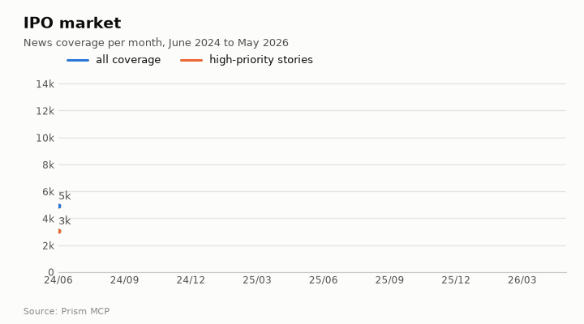
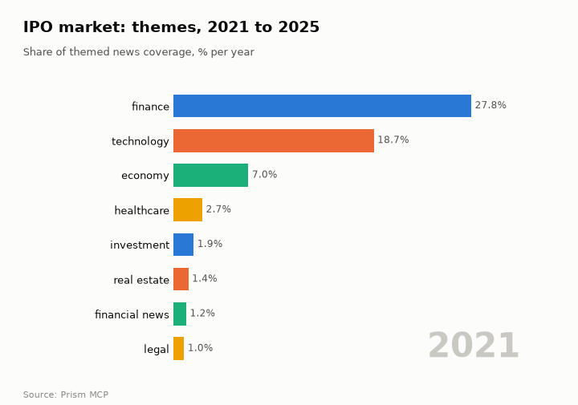
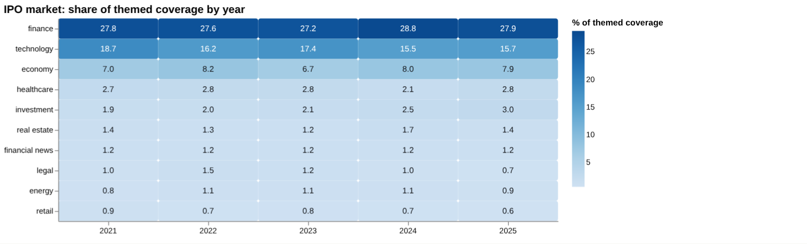
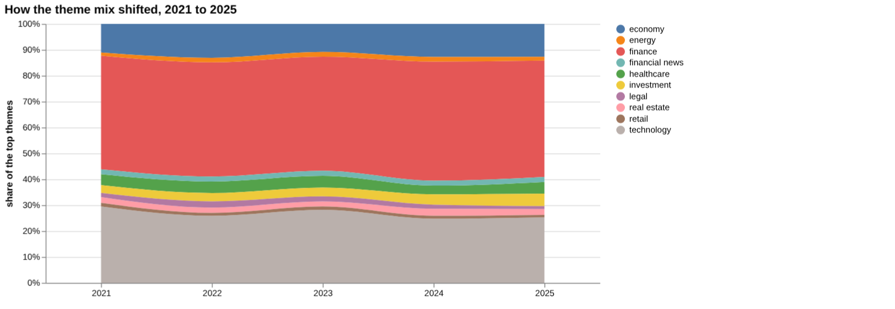
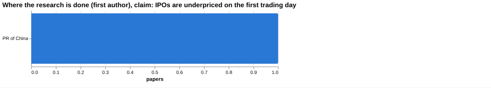
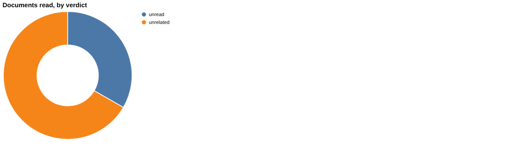
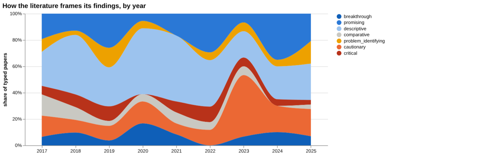
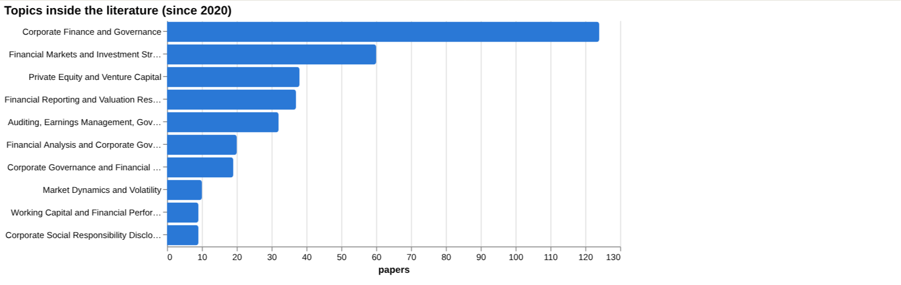
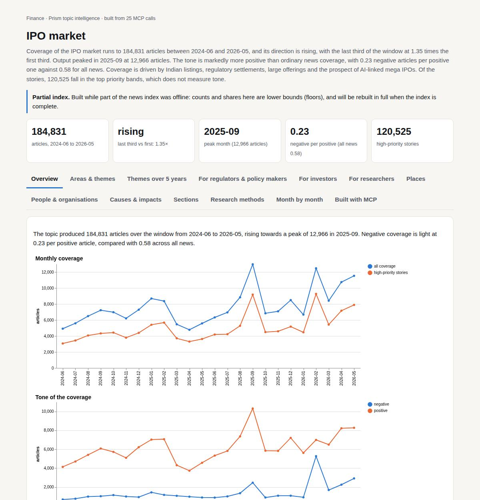

# IPO market

*Finance · Prism topic intelligence* · **[Open the interactive page](https://fliarbi.com/demo/docs/prism-dashboards-3bb43e4c/topics/ipo-market/)** (tabs: Overview · Areas & themes · Themes over 5 years · For regulators & policy makers · For investors · For researchers · Places · People & organisations · Causes & impacts · Sections · Research methods · Month by month · Built with MCP)

> **Partial index.** Built while part of the news index was offline: counts and shares here are lower bounds (floors), and will be rebuilt in full when the index is complete.

Coverage of the IPO market runs to 184,831 articles between 2024-06 and 2026-05, and its direction is rising, with the last third of the window at 1.35 times the first third. Output peaked in 2025-09 at 12,966 articles. The tone is markedly more positive than ordinary news coverage, with 0.23 negative articles per positive one against 0.58 for all news. Coverage is driven by Indian listings, regulatory settlements, large offerings and the prospect of AI-linked mega IPOs. Of the stories, 120,525 fall in the top priority bands, which does not measure tone.

| Articles | Direction (last third vs first) | Peak month | Negative per positive | High-priority stories |
| ---: | --- | --- | ---: | ---: |
| 184,831 (2024-06 to 2026-05) | rising (1.35×) | 2025-09 (12,966) | 0.23 (all news 0.58) | 120,525 |

## Coverage over time

The topic produced 184,831 articles over the window from 2024-06 to 2026-05, rising towards a peak of 12,966 in 2025-09. Negative coverage is light at 0.23 per positive article, compared with 0.58 across all news.

## Areas of activity and themes

The top tags are ipo with 180,018, investment with 84,493, india with 53,093 and market analysis with 26,183, while themes include stock buyback programmes, stock splits and fintech innovation.

| Area of activity | Articles |
| --- | ---: |
| Business & Industrial › Business Finance › Venture Capital | 15,942 |
| Business & Industrial › Pharmaceuticals & Biotech | 10,443 |
| Finance › Banking | 4,803 |
| Business & Industrial › Automotive Industry | 3,972 |
| Business & Industrial › Aerospace & Defense › Space Technology | 2,718 |
| Law & Government › Legal › Business & Corporate Law | 1,817 |

**Top tags (what the themes are built from):** ipo (180,018), investment (84,493), india (53,093), market analysis (26,183), bse (23,608), hong kong (12,032), nse (10,268), sme (7,270)

## Where it is reported

The United States leads the countries with 54,869 articles, followed by India with 45,344, China with 19,574 and the United Kingdom with 16,251.

| Country | Articles | Lift | | Indian state | Articles | Lift |
| --- | ---: | ---: | --- | --- | ---: | ---: |
| United States | 54,869 | 1.0× | | California | 14,727 | 2.1× |
| India | 45,344 | 2.7× | | New York | 11,977 | 2.0× |
| China | 19,574 | 1.5× | | Maharashtra | 11,029 | 7.0× |
| United Kingdom | 16,251 | 1.3× | | England | 9,490 | 2.4× |
| Australia | 8,512 | 0.7× | | Hong Kong | 8,902 | 4.9× |
| Japan | 8,223 | 2.1× | | Pennsylvania | 8,656 | 1.4× |

## People and organisations

Named people and entities include John F. Kennedy Jr., Carolyn Bessette-Kennedy, Aesop, Motilal Oswal Financial Services and JPMorgan Chase. Organisations most often named include OFS, NSE and the Securities and Exchange Board of India.

## Causes and impacts

The causes recorded in coverage include an immigration crackdown, a U.S. and Israel surprise attack, a fire at a girls school, a chemical implosion at a paper mill, a UK heatwave and a building collapse. The impacts include 16 student deaths, eleven deaths, five deaths and one injury, seven trapped and a shooter killed.

**Causes named in the coverage:** immigration crackdown, U.S. and Israel surprise attack, fire at girls school, chemical implosion at paper mill, uk heatwave, building collapse

**Impacts:** five deaths and one injury, 16 student deaths, one death, eleven deaths, seven trapped, shooter killed

## Sections inside the topic

The listing section has 14,206 articles, or 7.69% of the topic, and is rising, with its late period at 1.33 times its early period. The SME section has 8,621 articles, or 4.66% of the topic, and is falling, with its late period at 0.63 times its early period. Both are more positive than the topic as a whole, with 0.17 negative per positive article for listing and 0.11 for SME, against 0.23 for the topic.

| Section | Articles | Share of the topic | Late vs early | Negative per positive |
| --- | ---: | ---: | ---: | ---: |
| ipo → sme | 8,621 | 4.66% | 0.63× | 0.11 (topic 0.23) |
| ipo → listing | 14,206 | 7.69% | 1.33× | 0.17 (topic 0.23) |

## Research and outlook

The balance of research framing is broadly unchanged, with a shift of 3.0 points. The outlook holds at 70.0 for each of 2026, 2027 and 2028, with the range widening from 59.0 to 81.0 in 2026, to 48.0 to 92.0 in 2027 and 37.0 to 103.0 in 2028.

## Month by month

In 2025-06 regulatory settlements involving SEBI observations and NSE cleared hurdles and revived IPO activity in India, and 2025-09 brought record oversubscription of Urban Company and a festival-season surge. In 2025-10 the prospect of OpenAI's trillion-dollar IPO and London dropping out of the top-20 IPO hubs signalled a global re-allocation of listing destinations, and into 2026 mega IPOs persisted amid market volatility and rising political and legal turbulence.

- **2025-06:** Regulatory settlements (SEBI observations, NSE settlement) cleared hurdles and revived IPO activity in India.
- **2025-09:** Record oversubscription of Urban Company and festival‑season surge demonstrated intense investor demand and broadened the IPO pipeline.
- **2025-10:** OpenAI’s trillion‑dollar IPO prospect and London dropping out of the top‑20 IPO hubs signaled a global re‑allocation of listing destinations.

## Themes over five years

Finance was the leading theme throughout, at 27.8 percent of themed coverage in 2021 and 27.9 percent in 2025, with a figure of 28.8 percent in 2024. Technology was second in both years, at 18.7 percent in 2021 and 15.7 percent in 2025. Economy moved from 7.0 percent to 7.9 percent, and investment from 1.9 percent to 3.0 percent. Healthcare was 2.7 percent in 2021 and 2.8 percent in 2025, real estate 1.4 percent in both years, and financial news 1.2 percent in both years. Legal fell from 1.0 percent to 0.7 percent, energy was 0.8 percent and then 0.9 percent, and retail went from 0.9 percent to 0.6 percent.

| Theme | 2021 | 2022 | 2023 | 2024 | 2025 |
| --- | ---: | ---: | ---: | ---: | ---: |
| finance | 27.8% | 27.6% | 27.2% | 28.8% | 27.9% |
| technology | 18.7% | 16.2% | 17.4% | 15.5% | 15.7% |
| economy | 7.0% | 8.2% | 6.7% | 8.0% | 7.9% |
| healthcare | 2.7% | 2.8% | 2.8% | 2.1% | 2.8% |
| investment | 1.9% | 2.0% | 2.1% | 2.5% | 3.0% |
| real estate | 1.4% | 1.3% | 1.2% | 1.7% | 1.4% |
| financial news | 1.2% | 1.2% | 1.2% | 1.2% | 1.2% |
| legal | 1.0% | 1.5% | 1.2% | 1.0% | 0.7% |
| energy | 0.8% | 1.1% | 1.1% | 1.1% | 0.9% |
| retail | 0.9% | 0.7% | 0.8% | 0.7% | 0.6% |

## For regulators & policy makers

Coverage of the IPO market is concentrated in finance and technology themes, and the shares changed little between 2021 and 2025, apart from technology easing and investment rising. The index holds 7,258 news articles for 2019-01-01 to 2026-06-01. Recent stories point to large and fast-growing issuers, including a report of a possible OpenAI IPO at $1.5 trillion and Sebi approval for the quick commerce company Zepto. Geographic evidence in the research is thin: the only place recorded is the PR of China, with 1 paper, and no country breakdown of reporting was found. The scenario baseline is 'no_change', with a central value of 70 in each of 2026, 2027 and 2028; the sensitivity range widens from 59 to 81 in 2026, to 48 to 92 in 2027 and 37 to 103 in 2028. Evidence on the market's structure, such as the short position on shares offered, comes from a narrow set of figures.

- Scenario central value of 70 for 2026 to 2028, with the range widening to 37 to 103 by 2028
- Large listings in the news: the OpenAI IPO report and Zepto's Sebi approval
- Geographic evidence is limited to 1 paper on the PR of China
- Key figures on IPOs: average short position of shares offered 10.75 percent; loss of underwriting fees 3.61 percent
- Legal theme share was 0.7 percent in 2025, against 1.0 percent in 2021

## For investors

On the claim that IPOs are underpriced on the first trading day, the wider corpus of 32,707 papers has 14,089 supporting, 6,126 qualifying, 1,262 contradicting and 11,230 neutral, with 22.6 percent contested. The selected documents read give a weaker picture: 1 supports, 0 contradict, 0 qualify, 9 are unrelated and 0 are unread, and the recommendation is that this sample does not establish scientific consensus. In the head-to-head, the first claim is judged to have more evidence behind it than the claim that IPOs underperform the market in the long run, which has 112 papers touching both poles and 33.0 percent contested. The strongest source for the long-run claim is a 2014 review on the Johannesburg Stock Exchange that qualifies the claim. Among the key figures, the average short position of shares offered is 10.75 percent, covered in 22 transactions over 16.6 days in the aftermarket, and the loss of underwriting fees is 3.61 percent. Screening found no measured values for underpricing, long-run returns, retail investor demand, market sentiment or lock-up expiry.

- Underpricing claim: corpus mix of 14,089 supporting against 1,262 contradicting, with 22.6 percent contested
- Review tier: 'Underpricing of Initial Public Offerings: A Literature Review' (2016), cited by 37
- Long-run underperformance claim: 33.0 percent contested; the review-tier 2014 Johannesburg Stock Exchange source qualifies it
- Selected sample of documents read: 1 supports, 9 unrelated, so consensus is not established
- Screening rows for underpricing, long-run returns and lock-up expiry carry no figure, which means none was found rather than no effect

**Head to head:** IPOs are underpriced on the first trading day vs IPOs underperform the market in the long run: the first claim has more evidence behind it.

**Screen:** *What does research measure about IPO …?* (one row per line below)

| Row | Figure (quoted) | Measures | Source |
| --- | --- | --- | --- |
| underpricing | no figure found |  | The “educational capital” of corporate boards and initial public offering pricing: Evidenc (2024) |
| long-run returns | no figure found |  | The impact of company innovativeness and other internal factors on initial public offering (2023) |
| retail investor demand | no figure found |  |  |
| anchor investors | no figure found |  | Response of anchor investors to pre-IPO earnings management: evidence from an emerging mar (2023) |
| market sentiment | no figure found |  |  |
| lock-up expiry | no figure found |  |  |

## For researchers

The literature of 344 research papers is framed mostly positively, with 79 supporting, 76 qualifying, 18 contradicting and 171 neutral, and 27.3 percent contested. By orientation, descriptive work leads at 43.6 percent, followed by promising at 19.4 percent and cautionary at 17.1 percent. Empirical contributions number 179, against 17 reviews, 8 methodological, 6 theoretical and 1 position paper. The framing shift is described as broadly unchanged, with cautionary papers at 35.0 percent in the recent window of 80 papers and 29.4 percent in the earlier window of 102 papers. Newer work includes Initial Public Offerings Chinese Style (2022, cited by 99) and a 2024 study of crowding out in the local economy. The thinly covered areas are clear: the health literature index holds 10 records, arXiv has 0 preprints and patents number 7, and several screening rows have no papers.

- Why do screening rows for underpricing, long-run returns, retail investor demand, market sentiment and lock-up expiry show 0 papers, while anchor investors show 2?
- Gap analysis finds evidence for systematic underpricing but not for pricing below market value or a first-day price above the offer price; how are these components tested?
- Contested share by year rose to 29.0 percent in 2023 and was 24.5 percent in 2025; what drives the swings?
- Only 1 paper records a place of study (PR of China), while recent titles cover India, Bangladesh and Russia; how comparable are the markets?
- The 2025 papers have 0 citations so far, including a survey of the last decade; which will shape the field?

## Research exploration methods

Nine ways to explore the research, each run on this topic; the interactive report shows each call and its result.

**Chaining them.** Begin with triangulation to gauge the overall volume and stance of the literature on IPO underpricing, then use head‑to‑head to compare this claim with the underperformance claim. Apply screening to identify which risk factors have measurable effect sizes, focusing on anchor investors where papers exist. Examine framing trends to understand how the tone of the literature has shifted over time, and consult the frontier scan for newly influential works and any subtle framing changes. Finally, use gap mapping to pinpoint missing components of the underpricing claim, and supplement with facets to select empirical and descriptive papers for deeper analysis.

### Evidence triangulation

*Is a claim supported, and by how strong a design?* `find_evidence` + `find_counter_evidence` + `rank_sources`

The corpus contains 32,707 papers, of which 14,089 support the claim that IPOs are underpriced on the first trading day, 6,126 qualify it, 1,262 contradict it and 11,230 are neutral. The contested percentage is 22.6, and the reading is described as mostly positive framing with a substantial cautionary minority. Only a small sample of documents was read: six were unrelated and three were unread, and the tier breakdown of the claim documents is three reviews, five articles and one preprint. Counter‑evidence tally shows one supporting document and nine unrelated, with no contradicting or qualifying documents, leading to the recommendation that the selected sample does not establish scientific consensus. This result does not reveal the methodological quality of the supporting papers nor the temporal distribution of the evidence. A careful researcher would seek additional, directly relevant sources and assess their design strength before drawing firm conclusions.

### Head-to-head claims

*Which of two interventions has more and stronger evidence?* `compare_claims`

The comparison pits the underpricing claim against the long‑run underperformance claim. The underpricing claim has a corpus mix identical to the triangulation result and a contested percentage of 22.6, but no documents were read as supporting, contradicting or qualifying, only eight unrelated and one unread; its strongest source is unrelated. The underperformance claim shows 112 papers on both poles, a corpus mix of 28 supporting, 28 qualifying, 9 contradicting and 47 neutral, and a contested percentage of 33.0; one qualifying document was read and the strongest source qualifies the claim. The verdict states that the first claim has more evidence behind it. This analysis does not disclose the full set of papers examined nor the criteria for classifying sources as strongest. A careful researcher would retrieve and evaluate the underlying papers, especially those qualifying the underperformance claim, to verify the comparative assessment.

### Cross-row screening

*Which rows carry a measured, quoted figure, and how large is it?* `research_table`

The screening exercise returned null values for measured effect sizes for underpricing, long‑run returns, retail investor demand, market sentiment and lock‑up expiry, indicating no quantitative findings were located for these rows. Only the anchor investors row lists two papers, but provides no value, measure or population details. The source for the anchor investors row is "Response of anchor investors to pre‑IPO earnings management: evidence from an emerging market" (2023). This result does not indicate the direction or magnitude of any effect, nor does it confirm whether the lack of values reflects a true gap in the literature or a limitation of the search. A careful researcher would examine the two identified papers directly to extract any reported effect sizes and explore additional databases for the missing rows.

### Framing drift

*Is the literature becoming more hopeful or more cautious?* `stance_trends`

Year‑by‑year percentages show that positive framing ranged from a high of 25.0 in 2024 to a low of 6.5 in 2023, while contested percentages varied between 7.4 in 2021 and 29.0 in 2023. The data suggest fluctuations in the tone of the literature over the period 2017‑2025, without a clear monotonic trend. The figures do not reveal the absolute number of papers contributing to each yearly percentage, nor the reasons behind the shifts. A careful researcher would investigate the underlying papers for each year to understand the drivers of the observed framing changes.

### Frontier scan

*What is new, and what is the research not reaching?* `research_radar`

The frontier scan highlights six recent works, the most cited being "Initial Public Offerings Chinese Style" (2022) with 99 citations and a cautionary orientation. Other notable papers include a comparative study from 2023 (64 citations) and a critical piece on board independence (25 citations). The framing shift analysis reports a recent window of 80 papers with a cautionary proportion of 35.0, compared with an earlier window of 102 papers at 29.4, yielding a delta of 5.6 percentage points and a reading that framing is broadly unchanged. The caveat notes that orientation labels reflect the paper's own framing rather than an objective truth. This result does not quantify the impact of the new works on the broader field, nor does it identify which topics remain under‑explored. A careful researcher would read the highlighted papers to assess their contributions and monitor whether the modest increase in cautionary orientation influences future research directions.

### Gap mapping

*Which parts of a claim does the literature actually cover?* `research_gaps`

The gap mapping breaks the underpricing claim into three components and finds evidence only for the systematic underpricing of IPOs, while the other two components – offering price set below market value and first trading day price exceeding offering price – have no evidence. This indicates that the literature addresses the overall phenomenon but not the specific mechanisms. The result does not assess the depth or quality of the evidence for the systematic underpricing component. A careful researcher would seek studies that explicitly test the missing components to determine whether the gaps are due to a true absence of research or to search limitations.

### Count history and backtested scenarios

*Is research on this growing, and where could it be in three years?* `historical_analysis` + `scenarios`

No yearly counts of papers are provided, but scenario modelling projects a central estimate of 70 papers per year for 2026, 2027 and 2028, with lower sensitivity bounds of 59, 48 and 37 respectively, and upper bounds of 81, 92 and 103 respectively. The baseline scenario is described as "no_change". The absence of historical counts means the trend driving the scenarios cannot be verified. This result does not reveal whether the projected stability reflects past growth patterns or merely the modelling assumption. A careful researcher would obtain the actual publication counts for previous years to validate the scenario assumptions.

### Geographic triangulation

*Where is it studied, published, reported and patented?* `global_comparison` + `newsgeo`

Geographic triangulation shows that the claim is studied in the "PR of China" with a count of 1, and no other countries are listed for study locations or reporting. No news geography entries are present. This limited information does not indicate whether research exists elsewhere but was not captured, nor does it show the distribution of publications across regions. A careful researcher would broaden the geographic search to confirm whether the claim has been examined in other jurisdictions.

### Faceted browsing

*What kind of literature is it: empirical, review, position? Problem-identifying or promising?* `browse_research`

The faceted browsing reveals that descriptive orientation dominates with 92 papers (43.6% share), followed by promising (41 papers, 19.4%) and cautionary (36 papers, 17.1%). Contribution types are mainly empirical (179 papers) with fewer reviews (17), methodological (8) and theoretical (6) works. Topic distribution shows Corporate Finance and Governance as the largest area with 124 papers, and several other finance‑related topics ranging from 10 to 124 papers. The most cited works since 2020 all have zero citations, indicating they are very recent or have not yet attracted attention. This overview does not assess the quality or impact of the papers within each facet, nor does it show how the orientations relate to the claim under investigation. A careful researcher would prioritise reading the most cited and highly oriented papers to gauge the state of evidence.

## Built with MCP

Every number and chart on this page comes from these 25 Prism MCP tool calls, made over MCP (streamable HTTP). Arguments and timings: [mcp_calls.json](mcp_calls.json); responses: [data.json](data.json).

| MCP tool | Calls |
| --- | ---: |
| `news_activities` | 1 |
| `news_geography` | 1 |
| `prism_overview` | 1 |
| `news_drill` | 2 |
| `news_themes` | 5 |
| `news_factors` | 1 |
| `historical_analysis` | 1 |
| `critical_news` | 1 |
| `stance_trends` | 1 |
| `browse_research` | 1 |
| `research_radar` | 1 |
| `global_comparison` | 1 |
| `research_brief` | 1 |
| `research_gaps` | 1 |
| `find_evidence` | 1 |
| `find_counter_evidence` | 1 |
| `rank_sources` | 1 |
| `deep_timeline` | 1 |
| `compare_claims` | 1 |
| `research_table` | 1 |

Try it: `prism entity "ipo"` · `prism call news.drill term='ipo' scope='sme'` · `prism call analysis.timeline term='ipo'`

