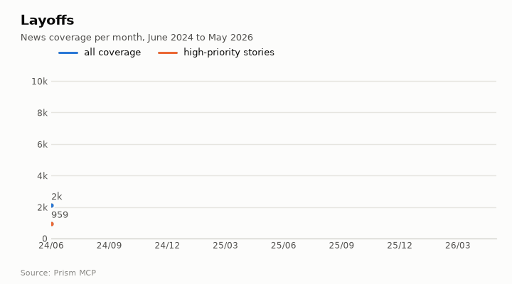
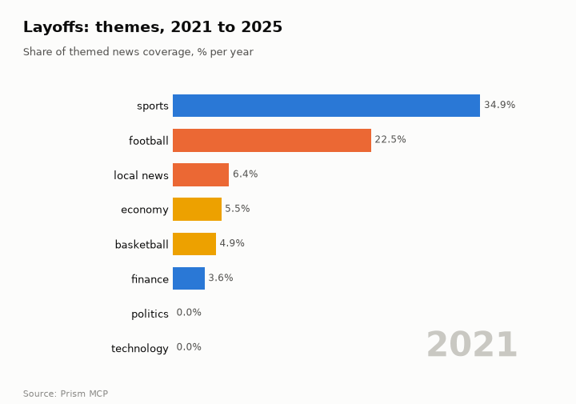
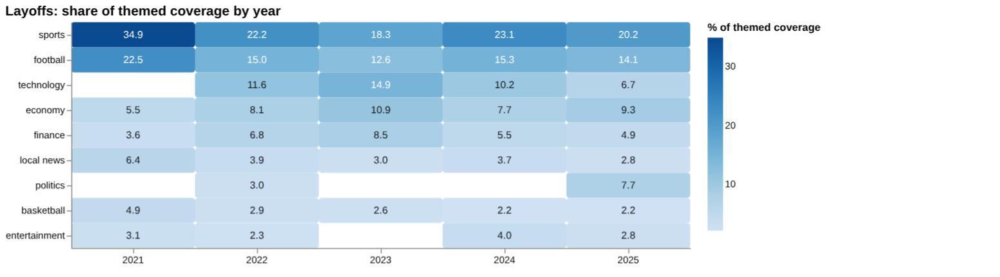
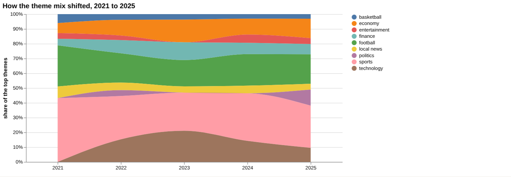
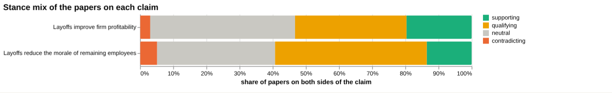
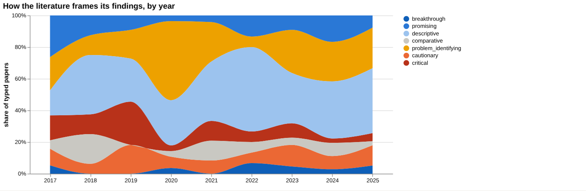
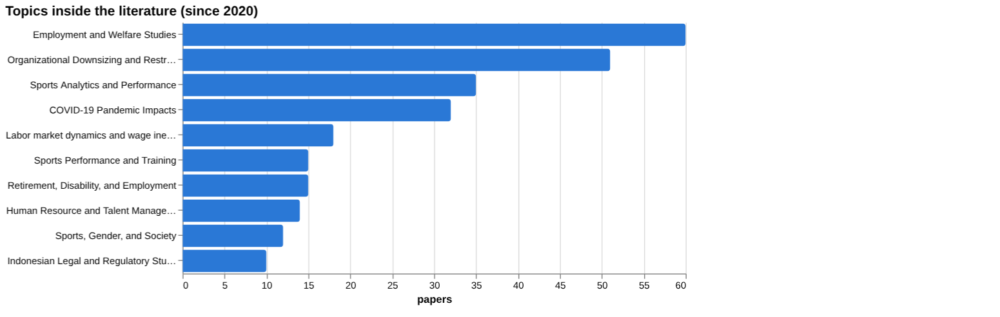
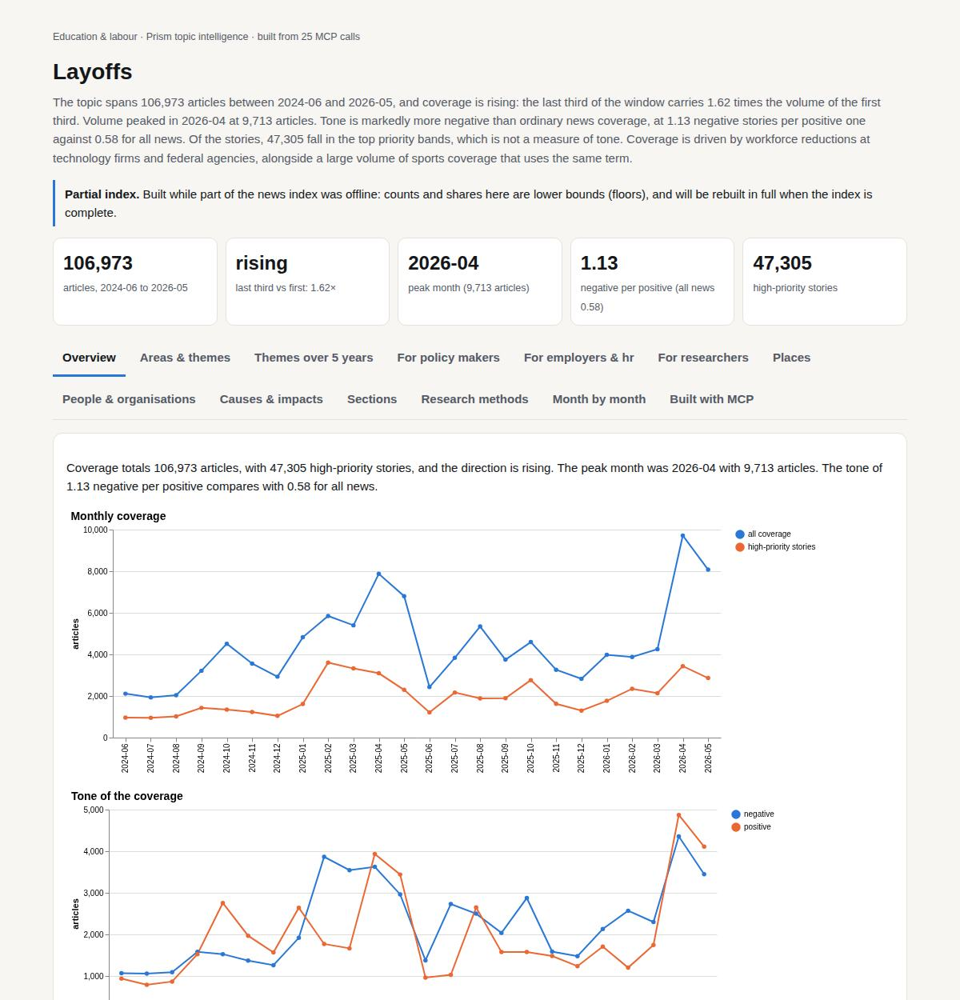

# Layoffs

*Education & labour · Prism topic intelligence* · **[Open the interactive page](https://fliarbi.com/demo/docs/prism-dashboards-3bb43e4c/topics/layoffs/)** (tabs: Overview · Areas & themes · Themes over 5 years · For policy makers · For employers & hr · For researchers · Places · People & organisations · Causes & impacts · Sections · Research methods · Month by month · Built with MCP)

> **Partial index.** Built while part of the news index was offline: counts and shares here are lower bounds (floors), and will be rebuilt in full when the index is complete.

The topic spans 106,973 articles between 2024-06 and 2026-05, and coverage is rising: the last third of the window carries 1.62 times the volume of the first third. Volume peaked in 2026-04 at 9,713 articles. Tone is markedly more negative than ordinary news coverage, at 1.13 negative stories per positive one against 0.58 for all news. Of the stories, 47,305 fall in the top priority bands, which is not a measure of tone. Coverage is driven by workforce reductions at technology firms and federal agencies, alongside a large volume of sports coverage that uses the same term.

| Articles | Direction (last third vs first) | Peak month | Negative per positive | High-priority stories |
| ---: | --- | --- | ---: | ---: |
| 106,973 (2024-06 to 2026-05) | rising (1.62×) | 2026-04 (9,713) | 1.13 (all news 0.58) | 47,305 |

## Coverage over time

Coverage totals 106,973 articles, with 47,305 high-priority stories, and the direction is rising. The peak month was 2026-04 with 9,713 articles. The tone of 1.13 negative per positive compares with 0.58 for all news.

## Areas of activity and themes

The largest areas of activity are sports: Basketball with 16,456 articles, American Football with 16,429 and Hockey with 9,346. The top tags are layoffs (35,024), nba (12,121) and nfl (10,592), followed by nhl (6,528), super bowl (3,868), employee engagement (3,774), restructuring (3,236) and employee benefits (3,190).

| Area of activity | Articles |
| --- | ---: |
| Sports › Team Sports › Basketball | 16,456 |
| Sports › Team Sports › American Football | 16,429 |
| Sports › Team Sports › Hockey | 9,346 |
| Sports › College Sports | 5,846 |
| Sports › Sport Scores & Statistics | 3,670 |
| People & Society › Social Issues & Advocacy › Work & Labor Issues | 3,394 |

**Top tags (what the themes are built from):** layoffs (35,024), nba (12,121), nfl (10,592), nhl (6,528), super bowl (3,868), employee engagement (3,774), restructuring (3,236), employee benefits (3,190)

## Where it is reported

| Country | Articles | Lift | | Indian state | Articles | Lift |
| --- | ---: | ---: | --- | --- | ---: | ---: |
| United States | 56,222 | 2.1× | | California | 14,503 | 2.1× |
| Canada | 7,689 | 1.9× | | Texas | 12,979 | 2.1× |
| United Kingdom | 6,093 | 1.0× | | Pennsylvania | 11,441 | 1.8× |
| India | 4,224 | 0.5× | | New York | 11,338 | 1.9× |
| Australia | 3,293 | 0.6× | | Washington | 9,325 | 1.9× |
| Spain | 2,858 | 2.1× | | Florida | 7,176 | 1.4× |

## People and organisations

The people named most often are mainly American sports figures: Sam Darnold, Joey Logano, Patrick Mahomes, Derrick Henry and Tyrese Haliburton, alongside fubotv. This reflects the sports share of coverage rather than the labour-market stories.

## Causes and impacts

The causes cited include layoffs of government sanitation workers, mass layoffs at federal agencies, cuts to medical research and the April 1 firing of 2,400 employees. The impacts named are unsafe, unsanitary conditions and traffic disruption, a reduction of services for people, the dismantling of public-health infrastructure and fear over jobs and funding.

**Causes named in the coverage:** layoffs of government sanitation workers, mass layoffs looming, massive layoffs in many departments, mass layoffs and cuts to medical research, mass layoffs at federal agencies, April 1 firing of 2,400 employees

**Impacts:** unsafe, unsanitary conditions and traffic disruption, concerns among travelers about plans, reduction of services for people, dismantling of public‑health infrastructure, fear over jobs and funding, collateral damage

## Sections inside the topic

The artificial intelligence section has 7,017 articles (6.56 per cent of the topic) and the tech section has 3,799 (3.55 per cent). Both are growing faster than the topic as a whole, with late-versus-early ratios of 5.44 for artificial intelligence and 2.62 for tech, against 1.62 overall. Both are also more negative than the topic average of 1.13 negative per positive, at 3.23 for artificial intelligence and 3.59 for tech.

| Section | Articles | Share of the topic | Late vs early | Negative per positive |
| --- | ---: | ---: | ---: | ---: |
| layoffs → tech | 3,799 | 3.55% | 2.62× | 3.59 (topic 1.13) |
| layoffs → artificial intelligence | 7,017 | 6.56% | 5.44× | 3.23 (topic 1.13) |

## Research and outlook

The balance of research framing is broadly unchanged, with a shift of -3.4 points. The outlook values rise from 139.5 in 2026 (range 106.929 to 172.071) to 151.0 in 2027 (85.857 to 216.143) and 162.5 in 2028 (64.786 to 260.214), with the range widening each year.

## Month by month

Coverage began with an initial wave of tech and government layoffs in 2025-06, followed by a brief cooling in 2025-09 when job openings fell to 7.2 million. In 2025-10 mass layoffs at Amazon, Google and federal agencies marked an escalation, and cuts continued through to May 2026, including AI-focused reductions at Starbucks and Cisco.

- **2025-06:** Initial wave of layoffs across tech and government signaled the most turbulent labor market phase since the pandemic.
- **2025-09:** Job openings fell to 7.2 million and layoffs cooled, indicating a brief market respite despite ongoing AI staffing shifts.
- **2025-10:** Mass layoffs at Amazon, Google, and federal workers marked a politicized escalation of employment cuts.

## Themes over five years

Coverage of layoffs was dominated by sport at the start of the period: sports held 34.9% of themed coverage in 2021 and football 22.5%, falling to 20.2% and 14.1% in 2025. Technology did not appear as a theme in 2021, reached 11.6% in 2022 and 14.9% in 2023, then fell to 6.7% in 2025. Economy rose from 5.5% in 2021 to 9.3% in 2025, while finance moved from 3.6% to 4.9% and local news from 6.4% to 2.8%. Politics (7.7%) and government (6.2%) appear in 2025, and basketball fell from 4.9% to 2.2%; entertainment stood at 3.1% in 2021 and 2.8% in 2025.

| Theme | 2021 | 2022 | 2023 | 2024 | 2025 |
| --- | ---: | ---: | ---: | ---: | ---: |
| sports | 34.9% | 22.2% | 18.3% | 23.1% | 20.2% |
| football | 22.5% | 15.0% | 12.6% | 15.3% | 14.1% |
| technology | – | 11.6% | 14.9% | 10.2% | 6.7% |
| economy | 5.5% | 8.1% | 10.9% | 7.7% | 9.3% |
| finance | 3.6% | 6.8% | 8.5% | 5.5% | 4.9% |
| local news | 6.4% | 3.9% | 3.0% | 3.7% | 2.8% |
| politics | – | 3.0% | – | – | 7.7% |
| basketball | 4.9% | 2.9% | 2.6% | 2.2% | 2.2% |
| entertainment | 3.1% | 2.3% | – | 4.0% | 2.8% |

## For policy makers

News coverage of layoffs numbers 285 articles in the index from 2019-01-01 to 2026-06-01, and its mix has shifted from sport towards economic and political subjects. In 2025 politics held 7.7% of themed coverage and government 6.2%, neither of which was listed as a theme in 2021, which suggests a growing policy dimension. The central scenario under linear drift is 140 in 2026, 151 in 2027 and 162 in 2028, with a sensitivity range of 107 to 172 in 2026 widening to 65 to 260 in 2028. The facts give no country breakdown, so geography cannot be assessed. The recent papers that touch on policy are on advance notice of layoffs, non-discrimination in terminations in Indonesia and equality before the law in Finland. Patents and preprints are both at 0, so the activity is in news and in the journal literature.

- Politics (7.7%) and government (6.2%) themes in 2025 coverage
- Scenario range for 2028 of 65 to 260, central 162
- Advance-notice research on layoffs and labour market outcomes (2025)
- Legal and non-discrimination studies from Indonesia and Finland
- No country-level reporting data available

## For employers & hr

On the claim that layoffs reduce the morale of remaining employees, the evidence in the index is thin. Of the documents read, 8 were judged unrelated, and none supports, contradicts or qualifies the claim. The wider corpus of 59 papers has 8 supporting, 27 qualifying, 3 contradicting and 21 neutral, with 50.8% contested, so the literature is actively contested. The analysis finds no evidence for either component: that layoffs decrease morale, or that remaining employees experience lower morale. The most-cited source, a UK study of layoffs, shareholder wealth and firm performance (2007, article tier, cited by 101), concerns share prices rather than morale. The rival claim that layoffs improve firm profitability has a larger corpus (702 supporting, 1,199 qualifying, 108 contradicting, 1,559 neutral; 36.6% contested), though its documents read were also unrelated or unread.

- Morale claim: 8 documents read, all unrelated (article tier)
- Corpus stance on morale: 27 qualifying and 8 supporting among 59 papers; 50.8% contested
- Top source, UK shareholder wealth study (2007, article, cited by 101), is about firm performance and was judged unrelated
- Profitability claim has 36.6% contested, but no read document supports it
- Screening found no effect figure for productivity, mental health, firm profitability, stock price or innovation

**Head to head:** Layoffs reduce the morale of remaining employees vs Layoffs improve firm profitability: the second claim has more evidence behind it.

**Screen:** *What is the effect of layoffs on …?* (one row per line below)

| Row | Figure (quoted) | Measures | Source |
| --- | --- | --- | --- |
| productivity | no figure found |  | Employee Layoffs, Shareholder Wealth and Firm Performance: Evidence from the UK (2007) |
| morale | twelve percent | salary increase percentage |  |
| mental health | no figure found |  | Job seeking, reemployment, and mental health: a randomized field experiment in coping with (1989) |
| firm profitability | no figure found |  | Workforce Reductions at Women-Owned Businesses in the United States (2014) |
| stock price | no figure found |  |  |
| innovation | no figure found |  | Female Top Managers and Employee Layoffs during the Covid-19 Pandemic (2023) |

## For researchers

The literature is mostly descriptive (114 papers, 36.5%) or problem-identifying (91 papers, 29.2%), with promising at 33 papers (10.6%) and cautionary at 31 (9.9%). Empirical work accounts for 244 papers, against 10 theoretical and 9 reviews. The leading topics are Employment and Welfare Studies (60 papers) and Organizational Downsizing and Restructuring (51), and sports topics also appear, which suggests the term overlaps with unrelated usage. The index holds 8 research papers, 15 readable papers and 1 the health literature index record, so study-design information is scarce. Positive framing ranged from 2.6% in 2021 to 11.3% in 2024, and contested framing from 8.6% in 2022 to 33.3% in 2017. A comparison of framing between periods could not be made because one window held too few papers.

- Why no read document addresses the morale claim directly
- Whether the sports-related topics distort the layoffs literature
- Whether the 2025 theoretical Dual Destruction Hypothesis (breakthrough, cited by 0) can be tested empirically
- Why only 9 reviews exist against 244 empirical papers
- Whether framing has shifted, which the data could not show

## Research exploration methods

Nine ways to explore the research, each run on this topic; the interactive report shows each call and its result.

**Chaining them.** Start with the facets to see what kind of literature this is, noting that sports topics suggest off-topic papers need removing before any share is trusted. Then use the gap map and triangulation together on the morale claim: both show that no document directly addresses it, so the next search should use alternative terms such as survivor syndrome or job insecurity. Use the head-to-head comparison to decide whether profitability is the better-documented question, then read the unread 2024 cost-benefit article and the qualifying papers. Run the screening again with a narrower outcome list, since it returned no sourced effect sizes. Finish with the history and geography methods, rerunning them with an explicit window, because both currently return nothing usable, and use the frontier scan to track the few new, uncited papers.

### Evidence triangulation

*Is a claim supported, and by how strong a design?* `find_evidence` + `find_counter_evidence` + `rank_sources`

For the claim that layoffs reduce the morale of remaining employees, the seven documents read were all tiered as articles and all returned a verdict of unrelated, so no document directly supports or contradicts the claim. The wider corpus of 59 papers splits into 8 supporting, 27 qualifying, 3 contradicting and 21 neutral, with contested share at 50.8, so the literature is actively contested and mostly hedges rather than confirms. The counter-evidence search read 9 documents and all were unrelated, which means the absence of contradiction here reflects a lack of relevant material, not a finding that the claim holds. The top sources (for example the UK study from 2007 with 101 citations) concern shareholder wealth and stock prices, not morale. A careful researcher would treat the claim as untested by this evidence and look for survivor-morale studies specifically, since the tool itself says no verified verdict supports a wording recommendation.

### Head-to-head claims

*Which of two interventions has more and stronger evidence?* `compare_claims`

The two claims are measured the same way, but the comparison is thin on direct evidence. For the morale claim, 1 paper sits on both poles and the corpus mix is 8 supporting, 27 qualifying, 3 contradicting and 21 neutral, with contested share at 50.8. For the profitability claim, 2 papers sit on both poles and the mix is 702 supporting, 1,199 qualifying, 108 contradicting and 1,559 neutral, with contested share at 36.6. The tool's verdict is that the second claim has more evidence behind it, which is a statement about volume of literature, not about whether profitability actually improves. Documents read were 8 unrelated for the morale claim, and 4 unrelated plus 1 unread for profitability, so neither claim has a verified supporting or contradicting source. The strongest source for profitability is a 2024 article that was unread, so its stance is unknown. The next step would be to read that article and the qualifying papers, which are the largest group in both corpora.

### Cross-row screening

*Which rows carry a measured, quoted figure, and how large is it?* `research_table`

The screening asked what the effect of layoffs is on six outcomes, and it produced no usable effect size. Only morale returned a value, 'twelve percent', but it is measured as a salary increase percentage, has 0 papers and no source, so it does not describe the effect of layoffs on morale and should be disregarded. Productivity and innovation each have 1 paper attached (the 2007 UK study and a 2023 paper on female top managers) but no quoted figure. Mental health, firm profitability and stock price have 0 papers, though mental health and profitability name sources from 1989 and 2014. The overall reading is that no outcome has a measured, sourced effect in this set, which suggests the extraction did not find quantified results rather than that effects are absent. A researcher would go to the named papers directly to check whether they report figures the extraction missed.

### Framing drift

*Is the literature becoming more hopeful or more cautious?* `stance_trends`

The yearly framing figures run from 2017 to 2025 and show no steady move toward hope or caution. Positive_pct was 22.2 in 2017, fell to 7.4 in 2018 and 3.6 in 2019, was 2.6 in 2021, and rose to 11.3 in 2024 before 6.6 in 2025. Contested_pct ranged from 33.3 in 2017 to a low of 8.6 in 2022, then 23.4 in 2023, 21.0 in 2024 and 22.4 in 2025. Contested shares are consistently higher than positive shares except in 2022, where the two are equal at 8.6. The 2017 figures sit well apart from later years and may rest on few papers, though the facts give no yearly counts. These percentages show tone only, not whether any claim is true, and a researcher would check the yearly paper counts before reading any change as a trend.

### Frontier scan

*What is new, and what is the research not reaching?* `research_radar`

The newest work is a small set of six items from 2023 to 2025, and most have 0 citations, so their influence is unproven. The most cited is 'Employee layoffs in times of crisis: do family firms differ?' (2024) with 5 citations, and it is described as descriptive. Orientations are mixed: two are promising, two problem_identifying and one descriptive in the list, plus a 2024 cost-benefit analysis marked promising. Topics include regional characteristics, machine-learning prediction of layoffs and corporate social responsibility during COVID-19. The framing shift between windows is unavailable because there were not enough papers in one of the windows, so no statement about changing tone can be made from this scan. None of the items is about remaining-employee morale, which is consistent with the gap map. A careful researcher would read the family-firm paper first, as the only one with any citations.

### Gap mapping

*Which parts of a claim does the literature actually cover?* `research_gaps`

The claim was split into two components, 'layoffs decrease morale' and 'remaining employees experience lower morale', and both are marked evidence 'no'. This means the scan found no literature covering either component, which fits the triangulation result where every document read was unrelated. It does not prove that no such research exists anywhere, only that none was found in the material searched, and the corpus stance mix of 8 supporting papers suggests some adjacent work may exist under different wording. The practical meaning is that the claim cannot currently be graded from this evidence, in either direction. A researcher would try alternative terms such as survivor syndrome, job insecurity or engagement after downsizing, and would check whether the framing as 'morale' is excluding relevant studies.

### Count history and backtested scenarios

*Is research on this growing, and where could it be in three years?* `historical_analysis` + `scenarios`

The count of papers per year came back empty, so there is no observed history of research volume to judge growth from. The scenarios were built on a linear_drift baseline and give central values of 140 for 2026, 151 for 2027 and 162 for 2028. The sensitivity band widens over time, from 107 to 172 in 2026, 86 to 216 in 2027 and 65 to 260 in 2028. Because the underlying yearly counts are missing, these figures cannot be checked against past data and should be treated with caution. The widening band shows that uncertainty grows with each step ahead. A researcher would rerun the count with an explicit window to get the actual yearly series before relying on any scenario.

### Geographic triangulation

*Where is it studied, published, reported and patented?* `global_comparison` + `newsgeo`

Both lanes, where the topic is studied and where it is reported by country, returned empty lists. This means no country-level picture is available, so nothing can be said about which countries produce or cover research on layoffs. It should not be read as evidence that the topic is studied nowhere or that coverage is evenly spread. The sources named elsewhere hint at UK, Finnish and Indonesian material, but those are individual titles and not a geographic measure. A researcher would need to rerun the comparison, perhaps with a broader query, before drawing any conclusion about location.

### Faceted browsing

*What kind of literature is it: empirical, review, position? Problem-identifying or promising?* `browse_research`

By contribution, empirical papers number 244, then position 37, methodological 12, theoretical 10 and review 9, so the literature is mainly empirical with few reviews. Topics are led by Employment and Welfare Studies (60) and Organizational Downsizing and Restructuring (51), but Sports Analytics and Performance (35) and Sports Performance and Training (15) also appear, which suggests the search picked up sports 'layoffs' or unrelated senses of the word and the corpus is not fully clean. The most cited since 2020 items all have 0 or 1 citations, and include a theoretical 'dual destruction' paper and several legal case studies. A careful researcher would filter out off-topic clusters before using these shares and would treat the small number of reviews as a gap in synthesis.

## Built with MCP

Every number and chart on this page comes from these 25 Prism MCP tool calls, made over MCP (streamable HTTP). Arguments and timings: [mcp_calls.json](mcp_calls.json); responses: [data.json](data.json).

| MCP tool | Calls |
| --- | ---: |
| `news_activities` | 1 |
| `news_geography` | 1 |
| `prism_overview` | 1 |
| `news_drill` | 2 |
| `news_themes` | 5 |
| `critical_news` | 1 |
| `historical_analysis` | 1 |
| `stance_trends` | 1 |
| `news_factors` | 1 |
| `browse_research` | 1 |
| `research_radar` | 1 |
| `research_brief` | 1 |
| `research_gaps` | 1 |
| `global_comparison` | 1 |
| `rank_sources` | 1 |
| `find_counter_evidence` | 1 |
| `find_evidence` | 1 |
| `deep_timeline` | 1 |
| `compare_claims` | 1 |
| `research_table` | 1 |

Try it: `prism entity "layoffs"` · `prism call news.drill term='layoffs' scope='tech'` · `prism call analysis.timeline term='layoffs'`

