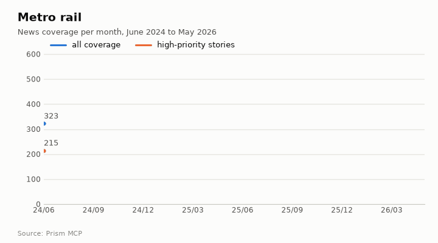
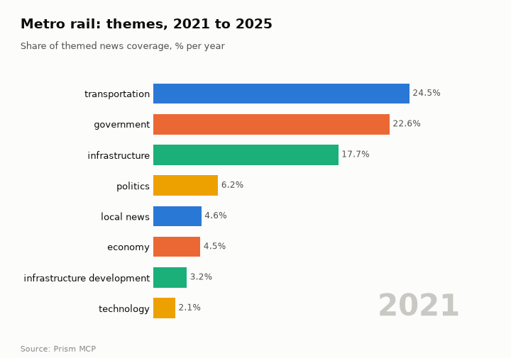
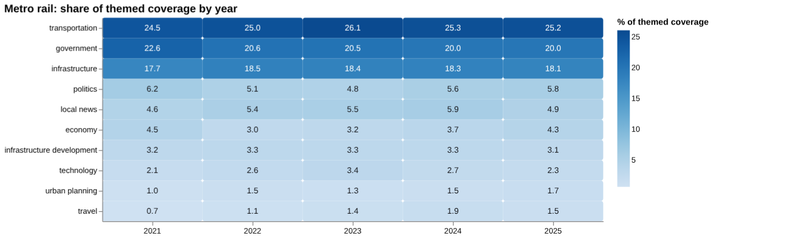
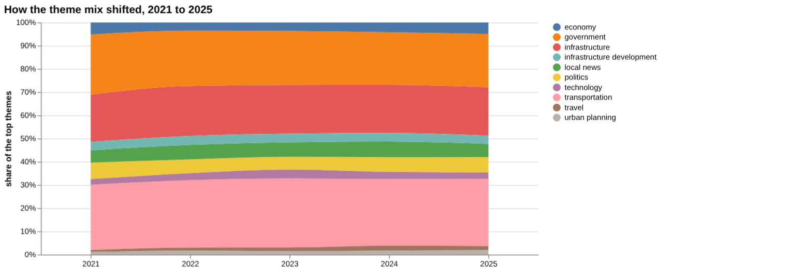
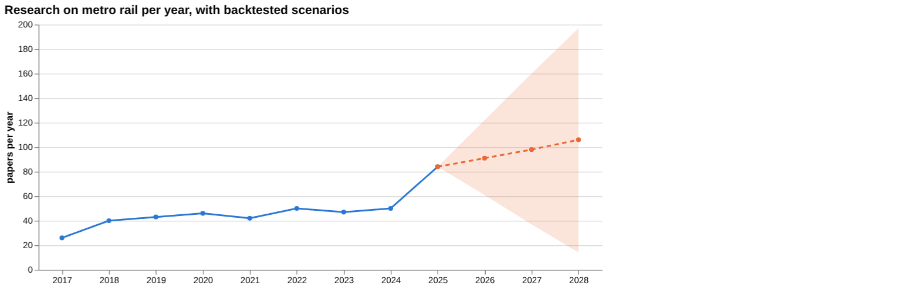
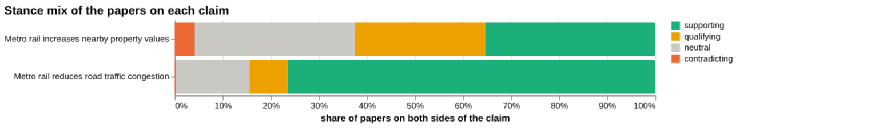
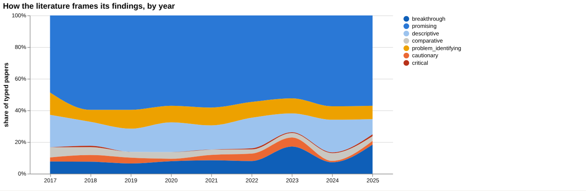
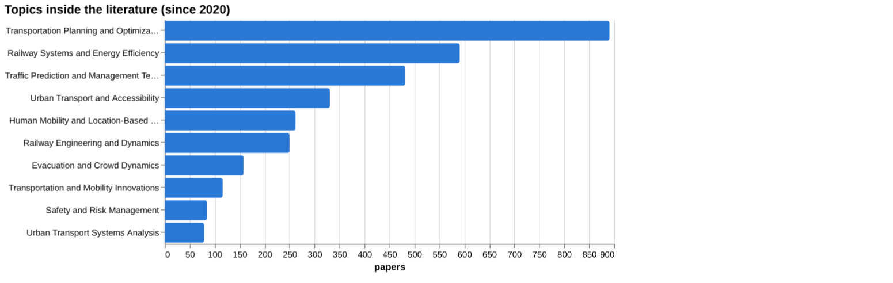
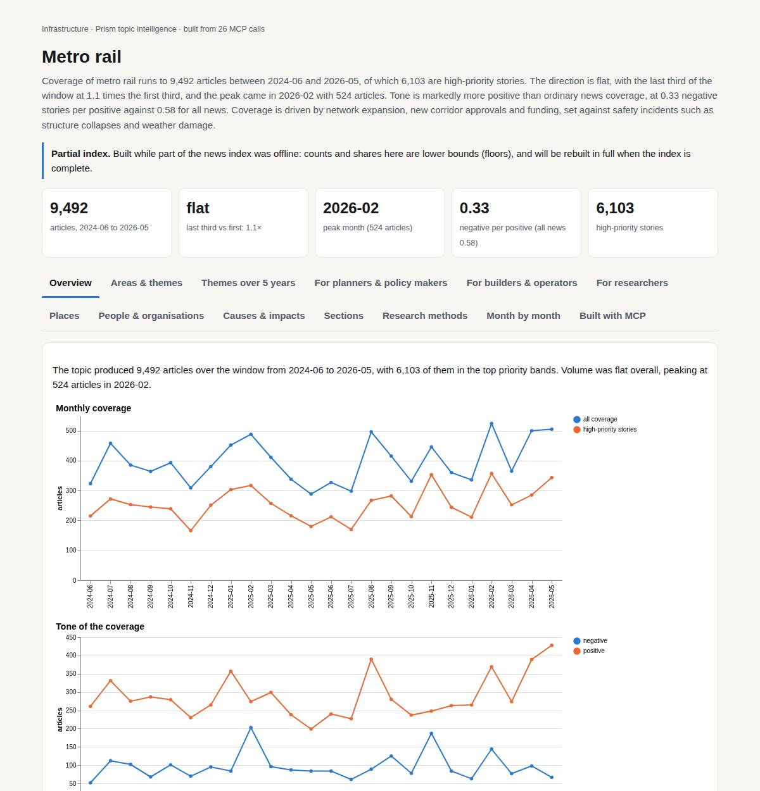

# Metro rail

*Infrastructure · Prism topic intelligence* · **[Open the interactive page](https://fliarbi.com/demo/docs/prism-dashboards-3bb43e4c/topics/metro-rail/)** (tabs: Overview · Areas & themes · Themes over 5 years · For planners & policy makers · For builders & operators · For researchers · Places · People & organisations · Causes & impacts · Sections · Research methods · Month by month · Built with MCP)

> **Partial index.** Built while part of the news index was offline: counts and shares here are lower bounds (floors), and will be rebuilt in full when the index is complete.

Coverage of metro rail runs to 9,492 articles between 2024-06 and 2026-05, of which 6,103 are high-priority stories. The direction is flat, with the last third of the window at 1.1 times the first third, and the peak came in 2026-02 with 524 articles. Tone is markedly more positive than ordinary news coverage, at 0.33 negative stories per positive against 0.58 for all news. Coverage is driven by network expansion, new corridor approvals and funding, set against safety incidents such as structure collapses and weather damage.

| Articles | Direction (last third vs first) | Peak month | Negative per positive | High-priority stories |
| ---: | --- | --- | ---: | ---: |
| 9,492 (2024-06 to 2026-05) | flat (1.1×) | 2026-02 (524) | 0.33 (all news 0.58) | 6,103 |

## Coverage over time

The topic produced 9,492 articles over the window from 2024-06 to 2026-05, with 6,103 of them in the top priority bands. Volume was flat overall, peaking at 524 articles in 2026-02.

## Areas of activity and themes

Activity centres on Long Distance Bus & Rail (7,535) and Urban Transit (6,638), followed by Rail Freight (5,690) and Construction & Maintenance (3,119). The leading tags are metro (6,171), transportation (1,822), delhi (1,462) and bengaluru (1,092), with hyderabad at 705.

| Area of activity | Articles |
| --- | ---: |
| Travel & Transportation › Transportation › Long Distance Bus & Rail | 7,535 |
| Travel & Transportation › Transportation › Urban Transit | 6,638 |
| Business & Industrial › Shipping & Logistics › Freight Transport › Rail Freight | 5,690 |
| Business & Industrial › Construction & Maintenance | 3,119 |
| Travel & Transportation › Transportation › Traffic & Route Planners | 1,934 |
| Law & Government › Government | 1,683 |

**Top tags (what the themes are built from):** metro (6,171), transportation (1,822), delhi (1,462), bengaluru (1,092), hyderabad (705), pti (661), centre (660), urban development (393)

## Where it is reported

India accounts for 4,323 articles, well ahead of the united states (867), cameroon (468), japan (169), the united kingdom (162) and bangladesh (161). Among Indian states, delhi (961), karnataka (883), maharashtra (851), tamil nadu (697) and telangana (604) lead, with the centre at 464.

| Country | Articles | Lift | | Indian state | Articles | Lift |
| --- | ---: | ---: | --- | --- | ---: | ---: |
| India | 4,323 | 8.8× | | Delhi | 961 | 25.7× |
| United States | 867 | 0.5× | | Karnataka | 883 | 32.1× |
| Cameroon | 468 | 23.9× | | Maharashtra | 851 | 12.9× |
| Japan | 169 | 1.5× | | Tamil Nadu | 697 | 21.6× |
| United Kingdom | 162 | 0.4× | | Telangana | 604 | 28.5× |
| Bangladesh | 161 | 10.6× | | Centre | 464 | 45.5× |

## People and organisations

The people most named are tejasvi surya, g. kishan reddy, revanth reddy, siddaramaiah, sivakumar and ashwini vaishnaw, a mix of union and state political figures.

## Causes and impacts

Incidents are attributed to parapet wall collapses on elevated and under-construction metro bridges, a steel pillar collapse, heavy rains, slippery tracks prompting emergency braking, and an earthmover engaged in the Patna metro rail project. Reported impacts include one person killed and several injured, a family of three who died, and commuters exposed to unhealthy indoor air.

**Causes named in the coverage:** parapet wall collapse of elevated metro bridge, parapet of under-construction metro bridge fell, heavy rains, steel pillar collapse at under-construction metro line, slippery tracks prompted emergency braking, earthmover engaged in Patna metro rail project

**Impacts:** one person killed and several injured, one person lost life and at least four injured, family of three died, commuters exposed to unhealthy indoor air

## Sections inside the topic

The fare section has 368 articles, or 3.88 per cent of the topic, and the delay section has 92 articles, or 0.97 per cent. Both are far more negative than the topic as a whole, at 1.35 and 1.36 negative stories per positive against 0.33 overall. Fare coverage grew over the window (late versus early 1.49), while delay coverage fell (0.6).

| Section | Articles | Share of the topic | Late vs early | Negative per positive |
| --- | ---: | ---: | ---: | ---: |
| metro rail → delay | 92 | 0.97% | 0.6× | 1.36 (topic 0.33) |
| metro rail → fare | 368 | 3.88% | 1.49× | 1.35 (topic 0.33) |

## Research and outlook

The balance of framing is broadly unchanged, with a shift of -0.7 points. The outlook runs from 91.25 in 2026 to 98.5 in 2027 and 105.75 in 2028, with wide ranges, such as 14.036 to 197.464 in 2028.

## Month by month

From mid-2025 the Indian network entered a rapid expansion phase, with approvals in Pune and Chennai in 2025-06 and the network crossing 1,000 km in 2025-07. In 2025-09 safety-related disruptions, including a Kolkata stabbing, heavy rains and Bengaluru delays, underscored operational vulnerabilities amid that growth.

- **2025-06:** Major expansion approvals (Pune Phase‑II, Chennai Phase‑II) combined with the first high‑profile safety fatality, exposing the tension between growth and risk.
- **2025-07:** India’s metro network crossed the 1,000 km threshold, cementing its status as a global leader and accelerating further expansion plans.
- **2025-09:** A series of safety‑related disruptions (Kolkata stabbing, heavy rains, Bengaluru delays) underscored operational vulnerabilities amid rapid growth.

## Themes over five years

Theme shares were broadly stable from 2021 to 2025. Transportation moved from 24.5% in 2021 to 25.2% in 2025, government from 22.6% to 20.0%, and infrastructure from 17.7% to 18.1%. Among smaller themes, politics went from 6.2% to 5.8%, local news from 4.6% to 4.9%, economy from 4.5% to 4.3%, infrastructure development from 3.2% to 3.1%, technology from 2.1% to 2.3%, urban planning from 1.0% to 1.7% and travel from 0.7% to 1.5%.

| Theme | 2021 | 2022 | 2023 | 2024 | 2025 |
| --- | ---: | ---: | ---: | ---: | ---: |
| transportation | 24.5% | 25.0% | 26.1% | 25.3% | 25.2% |
| government | 22.6% | 20.6% | 20.5% | 20.0% | 20.0% |
| infrastructure | 17.7% | 18.5% | 18.4% | 18.3% | 18.1% |
| politics | 6.2% | 5.1% | 4.8% | 5.6% | 5.8% |
| local news | 4.6% | 5.4% | 5.5% | 5.9% | 4.9% |
| economy | 4.5% | 3.0% | 3.2% | 3.7% | 4.3% |
| infrastructure development | 3.2% | 3.3% | 3.3% | 3.3% | 3.1% |
| technology | 2.1% | 2.6% | 3.4% | 2.7% | 2.3% |
| urban planning | 1.0% | 1.5% | 1.3% | 1.5% | 1.7% |
| travel | 0.7% | 1.1% | 1.4% | 1.9% | 1.5% |

## For planners & policy makers

Research output on metro rail was 26 papers in 2017 and 84 in 2025, with 25,170 research papers indexed for 2017-2025. The central scenario, on a linear-drift baseline, is 91 for 2026, 98 for 2027 and 106 for 2028, with a wide sensitivity band (lower 14, upper 197 by 2028). Recent news centres on South Asia and the Gulf region: the Kamalapur section reported as 70.92% complete, Hyderabad Metro expansion to the airport, and Delhi Metro train upgrades. In Odisha, the cabinet decision to scrap the Bhubaneswar Metro project drew opposition criticism, and an MP has urged the chief minister to revive it. Coverage themes are led by transportation at 25.2% and government at 20.0% in 2025, so delivery and political decisions feature heavily. The country-level reporting breakdown and the studied-location breakdown are empty, so geography beyond named news stories cannot be stated.

- Whether the Bhubaneswar Metro decision is revisited after the April 2026 calls to revive it
- Hyderabad Metro airport and Bharat Future City expansion progress
- Kamalapur section completion beyond the reported 70.92%
- Research volume against the 2026 central scenario of 91 papers, with a range of 61 to 122
- Gaps in measured outcomes: no papers found on road accidents, air pollution or traffic congestion in screening

## For builders & operators

The claim that metro rail reduces road traffic congestion has 913 papers in the literature, of which 698 are supporting, 73 qualifying, 2 contradicting and 140 neutral, with contested at 8.2%. The framing is described as overwhelmingly positive, which may reflect consensus or publication bias. However, the document-level check does not confirm it: the 10 documents examined were all judged unrelated, and no verified verdict supports a wording recommendation. The strongest source, a 2023 review on greenhouse gas emissions, was judged unrelated to the congestion claim. The property-value claim has 718 papers and is more contested at 31.3%, and the first claim is judged to have more evidence behind it. Reported figures such as a 7.31% reduction in energy consumption and a 3.26% reduction in travel time are given without a stated population.

- Congestion claim: 698 of 913 papers supporting, contested 8.2%, but all 10 documents read were unrelated (review tier: 1, article tier: 9)
- Strongest source is a 2023 review on greenhouse gas emissions, judged unrelated to congestion
- Property values: contested 31.3% across 718 papers; the one qualifying document is from the article tier
- Key numbers of 7.31% reduction in energy consumption and 3.26% reduction in travel time carry no stated population
- Screening found no figure for congestion, air pollution or road accidents (0 papers each), which means no figure was found, not no effect

**Head to head:** Metro rail reduces road traffic congestion vs Metro rail increases nearby property values: the first claim has more evidence behind it.

**Screen:** *What is the effect of metro rail on …?* (one row per line below)

| Row | Figure (quoted) | Measures | Source |
| --- | --- | --- | --- |
| traffic congestion | no figure found |  |  |
| air pollution | no figure found |  |  |
| property values | no figure found |  | The Synergistic Influence of Light Rail Stations and Zoning on Home Prices (2011) |
| commute time | no figure found |  | Effects of Urban Rail Transit Expansions: Evidence from Sixteen Cities, 1970-2000 (2005) |
| carbon emissions | no figure found |  | Greenhouse gas emission analysis and measurement for urban rail transit: A review of resea (2023) |
| road accidents | no figure found |  |  |

## For researchers

The literature mix across 25,170 papers is 14,745 supporting, 3,165 qualifying, 100 contradicting and 7,160 neutral, with contested at 13.0% and no dominant lean. By orientation, promising papers number 1,307 (55.8%), against 62 cautionary (2.6%) and 6 critical (0.3%). Contributions are mostly methodological (1,436) rather than empirical (774), and the leading topics are Transportation Planning and Optimization (891) and Railway Systems and Energy Efficiency (591). Framing shows little shift, with cautionary papers at 12.1% in the recent window against 14.4% in the earlier one. Newer work includes a solar-powered metro system, train-induced airflow for wind energy in Dhaka, and passenger satisfaction in Doha. Thin areas include only 2 the health literature index records, 0 patents and 0 preprints, and an empty list of studied locations.

- Why methodological papers (1,436) outnumber empirical ones (774) and whether outcome evidence is keeping pace
- Whether the positive framing (55.8% promising) reflects consensus or publication bias
- Why the most-cited sources on the congestion claim concern passenger forecasting and emissions rather than congestion itself
- Where the studies were conducted, given that the location data is empty
- Whether the 2025 rise to 84 papers continues and whether newer energy-recovery work is validated

## Research exploration methods

Nine ways to explore the research, each run on this topic; the interactive report shows each call and its result.

**Chaining them.** Begin with triangulation to establish the overall support and framing for the congestion claim, then use head‑to‑head to compare it with the property‑value claim. Apply screening to locate quantitative effect sizes for outcomes of interest, followed by framing to assess any shifts in literature tone over time. Use frontier scanning to identify recent novel studies, gap mapping to verify coverage of claim components, and history to track publication trends, while geography highlights missing regional data. Finally, employ faceted browsing to understand the distribution of study types and topics, guiding the selection of papers for detailed analysis.

### Evidence triangulation

*Is a claim supported, and by how strong a design?* `find_evidence` + `find_counter_evidence` + `rank_sources`

The claim that metro rail reduces road traffic congestion is linked to 913 papers, with 698 supporting, 73 qualifying, 2 contradicting and 140 neutral, giving a contested share of 8.2%. The evidence corpus is dominated by a positive framing, which the reading notes may reflect consensus or publication bias. The tier breakdown shows one review and nine articles, while the claim sources by tier list a review and fifteen articles, indicating a concentration of secondary literature. No counter‑evidence documents were identified beyond ten unrelated items, and the recommendation states no verified document supports a wording recommendation. A careful researcher would examine the individual supporting papers for methodological rigour and seek quantitative effect estimates rather than rely on the overall positive framing.

### Head-to-head claims

*Which of two interventions has more and stronger evidence?* `compare_claims`

The head‑to‑head comparison shows the congestion claim associated with 913 papers and a contested share of 8.2%, whereas the property‑value claim involves 718 papers and a contested share of 31.3%. The strongest source for the congestion claim is a 2023 review classified as unrelated, while the strongest source for the property‑value claim is a 2002 article marked unread. The verdict notes that the first claim has more evidence behind it, reflecting a larger corpus and lower contested proportion. However, the comparison does not provide information on the quality or effect size of the evidence for either claim. A careful researcher would follow up by reviewing the strongest sources and assessing the empirical support for the property‑value claim in more depth.

### Cross-row screening

*Which rows carry a measured, quoted figure, and how large is it?* `research_table`

The cross‑row screening returns null values for traffic congestion, air pollution and road accidents, indicating no measured effect sizes were found for these outcomes. For property values, three papers are cited from a 2011 source, and for commute time two papers are cited from a 2005 source; carbon emissions are linked to five papers from a 2023 review. No quantitative figures or population details are provided for any row. This absence shows that the screening has not identified concrete effect estimates for the most central outcomes. A careful researcher would retrieve the cited papers to extract any reported effect sizes and consider conducting a meta‑analysis where data are available.

### Framing drift

*Is the literature becoming more hopeful or more cautious?* `stance_trends`

The framing analysis reports positive share ranging from 28.9 to 39.4 per cent and contested share ranging from 4.7 to 8.7 per cent between 2017 and 2025. The reading concludes that framing is broadly unchanged, and the year‑by‑year percentages do not indicate a clear shift toward more hopeful or more cautious literature. The data do not reveal why the positive share fluctuates across years or which topics drive the changes. Consequently, a careful researcher would investigate the underlying studies contributing to the yearly percentages to understand the drivers of any observed variation.

### Frontier scan

*What is new, and what is the research not reaching?* `research_radar`

The frontier scan lists six new works, including a 2023 service quality model with ten citations and several 2025 papers on sustainability and user satisfaction with two citations each. The framing shift comparison shows a recent window of 6,566 papers with a cautionary_pct of 12.1 versus an earlier window of 6,044 papers with a cautionary_pct of 14.4, a delta of -2.3 points, and a reading that framing is broadly unchanged. The caveat notes that orientation labels reflect the paper's own framing rather than an objective truth. This output does not indicate how influential the new works are beyond their citation counts. A careful researcher would examine the new papers for novel methodologies or findings that could address identified gaps.

### Gap mapping

*Which parts of a claim does the literature actually cover?* `research_gaps`

The gap mapping confirms that literature exists for the overall claim that metro rail reduces road traffic congestion, as well as for the sub‑components of decreasing vehicle counts and alleviating urban traffic delays, each marked as evidence "yes". The result shows coverage of all three components but does not assess the depth, quality or consistency of that evidence. It also does not indicate whether any aspects of congestion, such as peak‑hour effects, remain uncovered. A careful researcher would drill down into the cited studies to evaluate the robustness of evidence for each component and identify any finer‑grained gaps.

### Count history and backtested scenarios

*Is research on this growing, and where could it be in three years?* `historical_analysis` + `trend_scenarios`

The count history shows research outputs rising from 26 papers in 2017 to 84 papers in 2025, indicating a growing literature base. Scenario projections forecast central values of 91 papers for 2026, 98 for 2027 and 106 for 2028, with lower and upper sensitivity bounds provided for each year. The baseline used for projection is described as linear_drift. The data do not reveal the reasons behind the recent increase to 84 papers in 2025 or the uncertainty beyond the given sensitivity bands. A careful researcher would monitor upcoming publications to verify whether the projected growth materialises and explore factors driving the recent surge.

### Geographic triangulation

*Where is it studied, published, reported and patented?* `global_comparison` + `newsgeo`

Both the "where_studied" and "where_reported_by_country" lists are empty, indicating that no geographic information was captured for the claim. This absence means the analysis does not reveal which countries or regions have produced research on metro rail's impact. It also provides no insight into regional variations in findings or policy relevance. A careful researcher would conduct a targeted search for location‑specific studies to fill this geographic gap.

### Faceted browsing

*What kind of literature is it: empirical, review, position? Problem-identifying or promising?* `browse_research`

The faceted browsing shows a dominant orientation of "promising" with 1,307 papers (55.8 per cent) and smaller shares for descriptive, breakthrough, problem_identifying and other orientations. Contributions are led by methodological papers (1,436) and empirical papers (774), while review, position and theoretical contributions are less common. Topic counts highlight that "Transportation Planning and Optimization" (891 papers) and "Railway Systems and Energy Efficiency" (591 papers) are the most represented areas. The most‑cited‑since‑2020 list contains six titles, all from 2025, each with zero citations, suggesting recent publications have not yet accrued impact. This output does not indicate which individual papers are most influential within each orientation or topic. A careful researcher would prioritise high‑citation works and methodological studies for deeper review.

## Built with MCP

Every number and chart on this page comes from these 26 Prism MCP tool calls, made over MCP (streamable HTTP). Arguments and timings: [mcp_calls.json](mcp_calls.json); responses: [data.json](data.json).

| MCP tool | Calls |
| --- | ---: |
| `news_activities` | 1 |
| `news_geography` | 1 |
| `news_drill` | 2 |
| `prism_overview` | 1 |
| `news_themes` | 5 |
| `critical_news` | 1 |
| `historical_analysis` | 1 |
| `stance_trends` | 1 |
| `news_factors` | 1 |
| `browse_research` | 1 |
| `research_radar` | 1 |
| `research_brief` | 1 |
| `research_gaps` | 1 |
| `global_comparison` | 1 |
| `find_evidence` | 1 |
| `find_counter_evidence` | 1 |
| `rank_sources` | 1 |
| `deep_timeline` | 1 |
| `compare_claims` | 1 |
| `research_table` | 1 |
| `trend_scenarios` | 1 |

Try it: `prism entity "metro rail"` · `prism call news.drill term='metro rail' scope='delay'` · `prism call analysis.timeline term='metro rail'`

