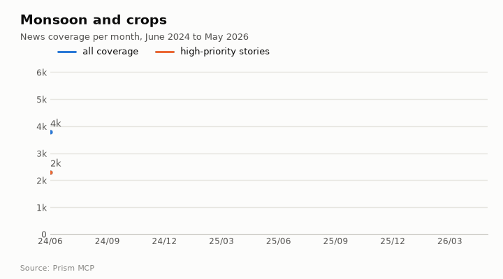
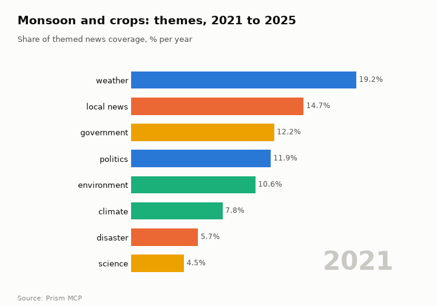
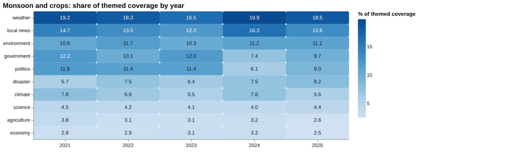
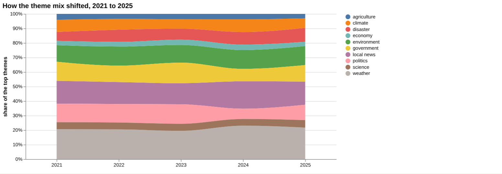
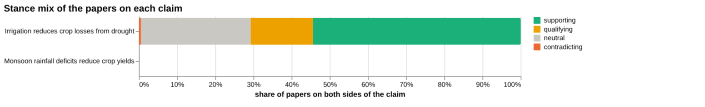
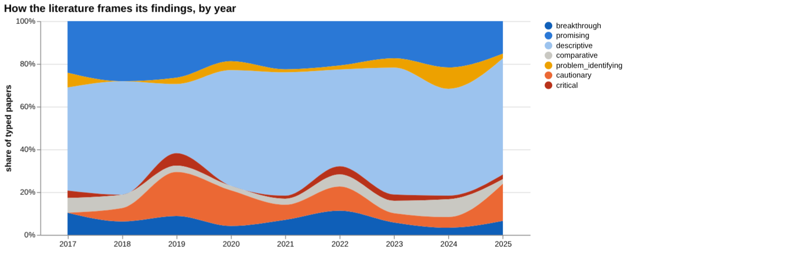
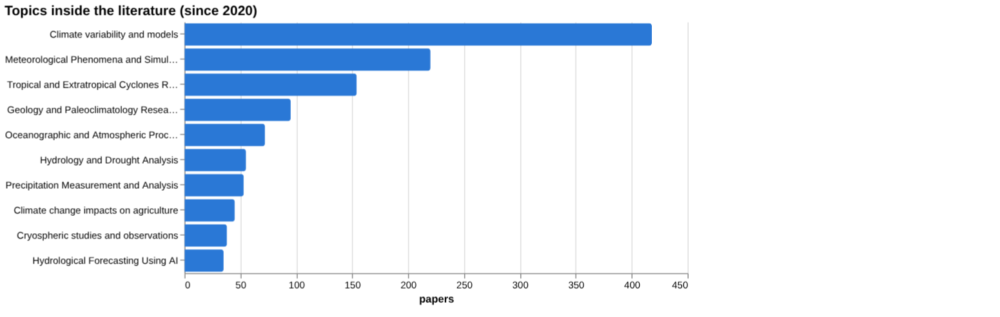
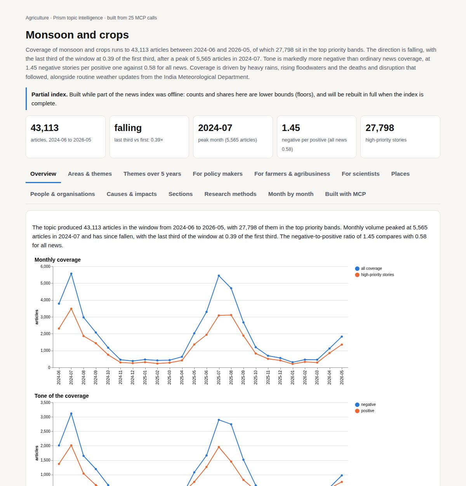

# Monsoon and crops

*Agriculture · Prism topic intelligence* · **[Open the interactive page](https://fliarbi.com/demo/docs/prism-dashboards-3bb43e4c/topics/monsoon-agriculture/)** (tabs: Overview · Areas & themes · Themes over 5 years · For policy makers · For farmers & agribusiness · For scientists · Places · People & organisations · Causes & impacts · Sections · Research methods · Month by month · Built with MCP)

> **Partial index.** Built while part of the news index was offline: counts and shares here are lower bounds (floors), and will be rebuilt in full when the index is complete.

Coverage of monsoon and crops runs to 43,113 articles between 2024-06 and 2026-05, of which 27,798 sit in the top priority bands. The direction is falling, with the last third of the window at 0.39 of the first third, after a peak of 5,565 articles in 2024-07. Tone is markedly more negative than ordinary news coverage, at 1.45 negative stories per positive one against 0.58 for all news. Coverage is driven by heavy rains, rising floodwaters and the deaths and disruption that followed, alongside routine weather updates from the India Meteorological Department.

| Articles | Direction (last third vs first) | Peak month | Negative per positive | High-priority stories |
| ---: | --- | --- | ---: | ---: |
| 43,113 (2024-06 to 2026-05) | falling (0.39×) | 2024-07 (5,565) | 1.45 (all news 0.58) | 27,798 |

## Coverage over time

The topic produced 43,113 articles in the window from 2024-06 to 2026-05, with 27,798 of them in the top priority bands. Monthly volume peaked at 5,565 articles in 2024-07 and has since fallen, with the last third of the window at 0.39 of the first third. The negative-to-positive ratio of 1.45 compares with 0.58 for all news.

## Areas of activity and themes

The main themes are monsoon season updates, rainfall statistics, flood risk assessments and flood mitigation, and the top tags are imd (6,109), weather (5,123) and the india meteorological department (3,880).

| Area of activity | Articles |
| --- | ---: |
| People & Society › Social Issues & Advocacy › Green Living & Environmental Issues | 2,826 |
| Business & Industrial › Agriculture & Forestry | 2,054 |
| Travel & Transportation › Tourist Destinations | 2,035 |
| Science › Earth Sciences › Atmospheric Science | 1,422 |
| Business & Industrial › Agriculture & Forestry › Crops & Seed | 1,198 |
| Business & Industrial › Construction & Maintenance › Civil Engineering | 1,075 |

**Top tags (what the themes are built from):** imd (6,109), weather (5,123), the india meteorological department (3,880), bihar (3,102), india meteorological department (3,071), himachal pradesh (2,446), madhya pradesh (2,238), uttarakhand (2,186)

## Where it is reported

| Country | Articles | Lift | | Indian state | Articles | Lift |
| --- | ---: | ---: | --- | --- | ---: | ---: |
| India | 21,563 | 7.1× | | Maharashtra | 4,398 | 8.4× |
| United States | 7,937 | 0.8× | | Delhi | 3,602 | 12.1× |
| Pakistan | 1,469 | 3.1× | | Uttar Pradesh | 3,339 | 9.7× |
| Cameroon | 1,052 | 8.6× | | Kerala | 2,835 | 21.9× |
| United Kingdom | 964 | 0.4× | | Bihar | 2,749 | 19.7× |
| China | 852 | 0.4× | | Rajasthan | 2,500 | 16.2× |

## People and organisations

The people most often named are Safdar Jang, Kiren Rijiju, Sukhvinder Singh Sukhu, J. P. Nadda, Om Birla and Nirmala Sitharaman. The organisations most prominent are the IMD and the India Meteorological Department, followed by ThePrint, LPA, RMC and BMC.

## Causes and impacts

Coverage attributes events to heavy rains, rising floodwaters, heavy pre-monsoon showers and a large monsoon trough. The impacts reported include over 1,000 deaths, flooded low-lying neighbourhoods, power cuts, slowed traffic, and a separate incident with 45 deaths and 74 injuries.

**Causes named in the coverage:** heavy rains, rising floodwaters, heavy pre-monsoon showers, large monsoon trough

**Impacts:** over 1,000 deaths, low-lying neighbourhoods flooded, people struggling with flood water, power cuts, traffic movement slowed, 45 deaths and 74 injuries

## Sections inside the topic

The kharif section has 898 articles, 2.08% of the topic, and a negative-to-positive ratio of 0.86, which is less negative than the topic's 1.45. The rainfall deficit section is much smaller at 57 articles, 0.13% of the topic, and is more negative at 2.5. Both sections are falling, with late-versus-early ratios of 0.36 for kharif and 0.35 for rainfall deficit.

| Section | Articles | Share of the topic | Late vs early | Negative per positive |
| --- | ---: | ---: | ---: | ---: |
| monsoon → kharif | 898 | 2.08% | 0.36× | 0.86 (topic 1.45) |
| monsoon → rainfall deficit | 57 | 0.13% | 0.35× | 2.5 (topic 1.45) |

## Research and outlook

The balance of research framing is broadly unchanged, with a framing shift of 0.3 points. The outlook shows a central value of 122.0 for each of 2026, 2027 and 2028, with the range widening from 103.0 to 141.0 in 2026 to 65.0 to 179.0 in 2028.

## Month by month

The arc began with a June 2025 surge that caused deadly floods across South Asia and China, reached record floods and landslides in India in 2025-09, and became a regional humanitarian crisis by 2025-12 as monsoon rains combined with tropical cyclones. In early 2026 the focus moved to mitigation, pre-monsoon flood plans and a forecast of a weaker-than-normal Indian monsoon.

- **2025-06:** Initial monsoon surge caused deadly floods and widespread disruptions across South Asia and China, setting the stage for an extreme season.
- **2025-09:** Record floods and landslides in India produced hundreds of deaths and massive displacement, marking the peak of the disaster.
- **2025-12:** Combined monsoon rains and tropical cyclones created a regional humanitarian crisis, with food, shelter and medical shortages across South and Southeast Asia.

## Themes over five years

Weather stayed the leading theme in the topic's themed coverage, at 19.2% in 2021 and 18.5% in 2025, with local news second in both years at 14.7% and 13.6%. Government fell from 12.2% to 9.7% and politics from 11.9% to 9.0%, with a sharper dip in 2024 (7.4% and 6.1%). Disaster rose from 5.7% to 8.2%, while climate fell from 7.8% to 5.6%. Environment was close to level (10.6% to 11.1%), science moved from 4.5% to 4.4%, agriculture slipped from 3.8% to 2.6% and economy from 2.8% to 2.5%.

| Theme | 2021 | 2022 | 2023 | 2024 | 2025 |
| --- | ---: | ---: | ---: | ---: | ---: |
| weather | 19.2% | 18.3% | 16.5% | 19.9% | 18.5% |
| local news | 14.7% | 13.5% | 12.3% | 16.3% | 13.6% |
| environment | 10.6% | 11.7% | 10.3% | 11.2% | 11.1% |
| government | 12.2% | 10.1% | 12.0% | 7.4% | 9.7% |
| politics | 11.9% | 11.4% | 11.4% | 6.1% | 9.0% |
| disaster | 5.7% | 7.5% | 6.4% | 7.5% | 8.2% |
| climate | 7.8% | 6.6% | 5.5% | 7.6% | 5.6% |
| science | 4.5% | 4.2% | 4.1% | 4.0% | 4.4% |
| agriculture | 3.8% | 3.1% | 3.1% | 3.2% | 2.6% |
| economy | 2.8% | 2.9% | 3.1% | 3.2% | 2.5% |

## For policy makers

Coverage of the monsoon is dominated by weather and local news, and agriculture and economy together remain small shares of themed coverage (2.6% and 2.5% in 2025). Disaster coverage rose from 5.7% in 2021 to 8.2% in 2025, in line with recent stories such as one on over 1.9 million people likely to be affected by monsoon disasters. The scenario series holds a central value of 122 for 2026 to 2028, with the sensitivity range widening from 103 to 141 in 2026 to 65 to 179 in 2028. The key numbers show a country average seasonal rainfall of 89 cm with a variance coefficient of about 10%, and projections of rainfall intensity increasing by up to 50%. No country breakdown of reporting or research geography is available, so geographic targeting cannot be drawn from this data. The screening shows little direct evidence on farm income and rural employment, where no papers were found; that is a gap in the index, not evidence of no effect.

- Disaster share of coverage: 8.2% in 2025 against 5.7% in 2021
- Scenario range for 2028: 65 to 179 around a central 122
- Local flood and drainage preparedness stories, such as Delhi Gate drain cleaning and the Rangirkhal guard wall
- Farm income and rural employment: no papers found in screening
- No geographic breakdown available, so regional priorities need other sources

## For farmers & agribusiness

The claim that monsoon rainfall deficits reduce crop yields has only three sources in the article tier, and no verdict breakdown or corpus stance is available for it. The most cited of these has 16 citations and concerns East Asian summer monsoon rainfall anomalies in 2020. The gap check finds evidence for one link, that reduced soil moisture decreases crop yields, but none for monsoon deficits lowering soil moisture or for deficits directly reducing yields. For the related claim that irrigation reduces crop losses from drought, the broader corpus of 2029 papers has 1,104 supporting, 332 qualifying and 11 contradicting, with 16.9% contested. Of the documents read for that claim, one contradicted it and eight were unrelated; the strongest source is a 2013 review on soil type and irrigation systems for wheat yield losses. The two claims are not comparable, so the irrigation figures should not be read across to monsoon deficits.

- Claim on rainfall deficits and yields: three sources, all article tier, no verdict breakdown
- Gap check: soil moisture to yield link has evidence; the other two links do not
- Irrigation claim: 1,104 supporting and 11 contradicting papers, 16.9% contested
- Irrigation claim strongest source: a 2013 review-tier paper, stance contradicts
- Screening found 2 papers on rice yields and 3 on wheat yields, with no values

**Head to head:** Monsoon rainfall deficits reduce crop yields vs Irrigation reduces crop losses from drought: not comparable.

**Screen:** *What is the effect of monsoon rainfall variability on …?* (one row per line below)

| Row | Figure (quoted) | Measures | Source |
| --- | --- | --- | --- |
| rice yields | no figure found |  | Climate–crop yield relationships at provincial scales in China and the impacts of recent c (2008) |
| wheat yields | no figure found |  | Meteorological Drought Variability and Its Impact on Wheat Yields across South Africa (2022) |
| farm income | no figure found |  |  |
| food prices | 13% | cereal harvest increase |  |
| groundwater levels | no figure found |  | South-to-North Water Diversion stabilizing Beijing’s groundwater levels (2020) |
| rural employment | no figure found |  |  |

## For scientists

The literature is large, with 39,330 research papers for 2017-2025, and its framing is mixed with no dominant lean: 16,099 supporting, 3,985 qualifying, 262 contradicting and 18,984 neutral, with 10.8% contested. Among the papers with orientation labels, descriptive work is 51.8% and promising 21.0%, while cautionary is 10.0% and critical 2.0%. Contributions are mostly empirical (599 papers), with 71 methodological, 14 review and 3 position papers. The topic mix centres on climate variability and models (418 papers) and meteorological phenomena (220), while climate change impacts on agriculture has 45 papers. Cautionary framing in the recent window is 8.9% against 13.6% earlier, which the data reads as broadly unchanged; the orientation labels describe a paper's own framing, not the truth. Crop-specific evidence is thin: the health literature index holds 84 records, and screening found few papers on yields and none on farm income.

- Why is direct evidence missing for rainfall deficits lowering soil moisture and reducing yields?
- Why does agriculture-impact work (45 papers) trail climate variability and models (418)?
- How far do descriptive papers (51.8%) support causal claims about crop outcomes?
- Is the contested share, 10.3% in 2025, a lasting rise or noise?
- What is missing on farm income, rural employment and food prices, where screening found no papers?

## Research exploration methods

Nine ways to explore the research, each run on this topic; the interactive report shows each call and its result.

**Chaining them.** Begin with triangulation to identify the limited set of article‑level sources that currently support the claim. Use gap mapping to pinpoint missing links between rainfall deficits, soil moisture and yields, then apply screening to seek quantitative effect sizes for those missing components. Examine framing trends to understand the overall tone of the literature, and consult the frontier scan to incorporate the most recent highly cited works. Finally, employ facets to locate empirical studies within the dominant climate‑agriculture topics, while recognising the lack of geographic data and the need for additional evidence on the monsoon claim.

### Evidence triangulation

*Is a claim supported, and by how strong a design?* `find_evidence` + `find_counter_evidence` + `rank_sources`

The claim "Monsoon rainfall deficits reduce crop yields" is linked to three article‑level sources. The top sources are titled "East Asian Summer Monsoon Rainfall Anomalies in 2020 and the Role of Northwest Pacific Anticyclone on the Intraseasonal‑to‑Interannual Timescales" (cited_by "16"), "Relationship Between the Aerosol Loadings Over the Bay of Bengal and the Arabian Sea in the Early Summer and Asian Monsoon Rainfall Anomalies, and the Role of SST Anomalies in the Indian Ocean" (cited_by "1"), and "The joint effects of monsoon rainfall anomalies and natural disasters on food insecurity in Nepal: Implications for a changing climate" (cited_by "0"). No counter‑evidence tally is provided and the corpus stance fields are null, indicating no assessment of disagreement. This result shows that only a small set of article‑tier evidence currently supports the claim, without any identified contradictory literature. It does not reveal the methodological strength of the supporting studies or any broader consensus. A careful researcher would seek additional, higher‑tier evidence and explicitly search for studies that might challenge the claim.

### Head-to-head claims

*Which of two interventions has more and stronger evidence?* `compare_claims`

The comparison between the claim "Monsoon rainfall deficits reduce crop yields" and the claim "Irrigation reduces crop losses from drought" cannot be made because the first claim has no data in the fields "papers_both_poles", "corpus_mix", "contested share", "documents_read" or "strongest_source". The second claim shows a corpus of "2029" papers on both poles, a mix of "supporting" "1,104", "qualifying" "332", "contradicting" "11", and "neutral" "582", a contested proportion of "16.9", and a strongest source that "contradicts" the claim. The overall verdict is "not comparable". This result demonstrates that there is substantial literature on irrigation effects but a lack of comparable evidence for monsoon deficits. It does not provide any support or refutation for the monsoon claim. A careful researcher would need to locate and analyse evidence for the monsoon claim before any head‑to‑head assessment is possible.

### Cross-row screening

*Which rows carry a measured, quoted figure, and how large is it?* `research_table`

The cross‑row screening returned a quantified effect only for "food prices", with a value of "13%" measured as a "cereal harvest increase". All other rows – "rice yields", "wheat yields", "farm income", "groundwater levels", and "rural employment" – have null values and no measures identified. The result therefore shows a single reported impact of monsoon variability on food prices, while providing no effect‑size data for the principal agricultural outcomes. It does not indicate the magnitude of yield or income changes associated with monsoon variability. A careful researcher would retrieve the primary studies behind the "food prices" figure and search for primary evidence on the missing rows.

### Framing drift

*Is the literature becoming more hopeful or more cautious?* `stance_trends`

The framing analysis records yearly percentages of positive and contested papers from 2017 to 2025. Positive percentages move from "19.2" in 2017 to "10.3" in 2025, while contested percentages fluctuate between "3.1" and "13.0" across the same period. This suggests a gradual reduction in overtly positive framing and variable levels of contested viewpoints. The data do not explain why the framing shifts occur or which topics drive the changes. A careful researcher would examine the underlying papers to understand the drivers of the observed framing trend.

### Frontier scan

*What is new, and what is the research not reaching?* `research_radar`

The frontier scan lists six highly cited works from 2022 to 2023, with citation counts ranging from "55" to "45" and orientations described as "promising", "descriptive", "problem_identifying" and "descriptive". The framing shift component reports a delta of "-4.7" points and a reading that "framing is broadly unchanged", with a cautionary share falling from "13.6" in the earlier window to "8.9" in the recent window. This indicates that recent literature maintains a similar overall stance while introducing new descriptive and promising studies. The result does not indicate whether these new works directly address the claim about monsoon deficits and crop yields. A careful researcher would review the most‑cited new papers to assess their relevance to the claim and to fill identified gaps.

### Gap mapping

*Which parts of a claim does the literature actually cover?* `research_gaps`

The gap mapping breaks the claim into three components. Evidence is recorded as "no" for "monsoon rainfall deficits lower soil moisture" and for "rainfall deficits directly reduce crop yields", but "yes" for "reduced soil moisture decreases crop yields". This shows that the literature currently supports the link between soil moisture and yields, but lacks studies on the antecedent links from rainfall deficits. It does not provide any quantitative assessment of the supported component. A careful researcher would prioritise locating studies that examine how monsoon deficits affect soil moisture and direct yield outcomes.

### Count history and backtested scenarios

*Is research on this growing, and where could it be in three years?* `historical_analysis` + `scenarios`

The count history provides no yearly paper totals, leaving the past trajectory of research undocumented. Scenario modelling projects a central count of "122" papers for each year 2026, 2027 and 2028, with sensitivity bounds from "103" to "141" in 2026, "84" to "160" in 2027, and "65" to "179" in 2028. The baseline used for projection is "no_change". This result suggests an expectation of a stable volume of literature in the near future, but offers no insight into past growth patterns. It does not confirm whether the projected stability aligns with historical trends. A careful researcher would retrieve the missing historical counts to validate the scenario assumptions.

### Geographic triangulation

*Where is it studied, published, reported and patented?* `global_comparison` + `newsgeo`

Both the "where_studied" and "where_reported_by_country" lists are empty, indicating that no geographic information was captured for the claim. This absence means that the locations of research, reporting or patent activity are unknown from the current output. It does not reveal any regional focus or gaps in geographic coverage. A careful researcher would need to conduct a separate geographic mapping of the relevant literature.

### Faceted browsing

*What kind of literature is it: empirical, review, position? Problem-identifying or promising?* `browse_research`

The faceted browsing shows that "descriptive" orientation accounts for "356" papers (share_pct "51.8"), followed by "promising" with "144" papers (share_pct "21.0"), and smaller shares for "cautionary", "breakthrough", "comparative", "problem_identifying", and "critical". Contributions are dominated by "empirical" work with "599" papers, with fewer methodological, review and position papers. The top topics include "Climate variability and models" ("418" papers) and "Meteorological Phenomena and Simulations" ("220" papers). The most‑cited papers since 2020 all have a cited_by count of "0", indicating they have not yet accrued citations. This result outlines the dominant research orientations, contributions and thematic areas, but does not indicate which of these directly address the claim about monsoon deficits and yields. A careful researcher would focus on the descriptive and promising papers within the climate‑agriculture topics to locate relevant evidence.

## Built with MCP

Every number and chart on this page comes from these 25 Prism MCP tool calls, made over MCP (streamable HTTP). Arguments and timings: [mcp_calls.json](mcp_calls.json); responses: [data.json](data.json).

| MCP tool | Calls |
| --- | ---: |
| `news_activities` | 1 |
| `news_geography` | 1 |
| `news_drill` | 2 |
| `news_themes` | 5 |
| `prism_overview` | 1 |
| `critical_news` | 1 |
| `stance_trends` | 1 |
| `historical_analysis` | 1 |
| `news_factors` | 1 |
| `browse_research` | 1 |
| `global_comparison` | 1 |
| `research_gaps` | 1 |
| `research_radar` | 1 |
| `research_brief` | 1 |
| `find_counter_evidence` | 1 |
| `find_evidence` | 1 |
| `rank_sources` | 1 |
| `deep_timeline` | 1 |
| `compare_claims` | 1 |
| `research_table` | 1 |

Try it: `prism entity "monsoon"` · `prism call news.drill term='monsoon' scope='kharif'` · `prism call analysis.timeline term='monsoon'`

