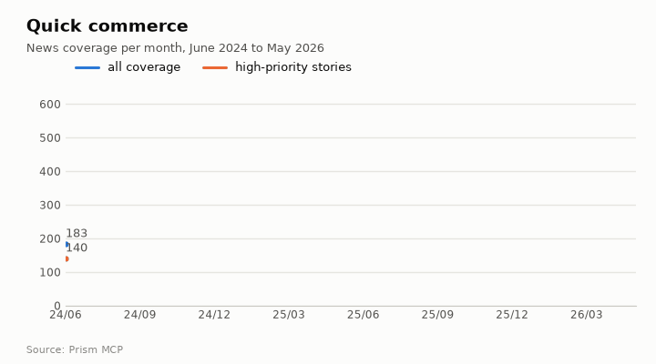
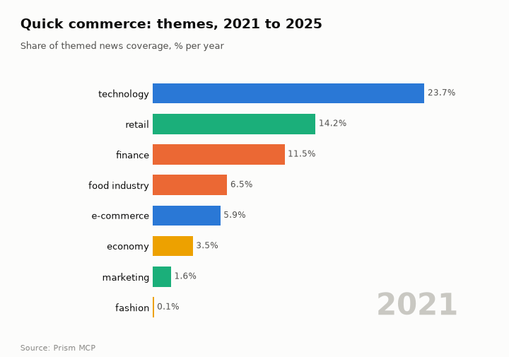
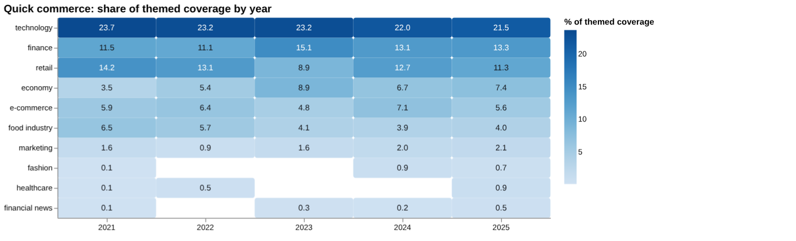
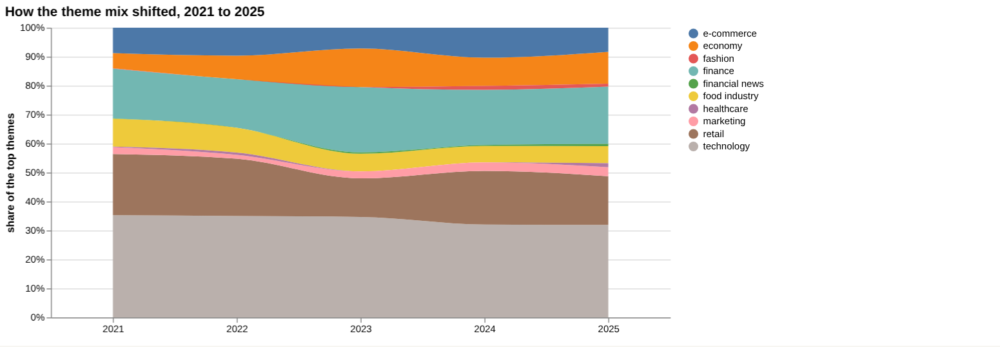
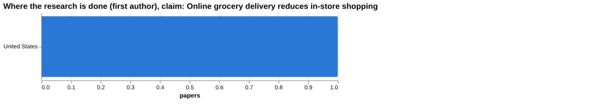
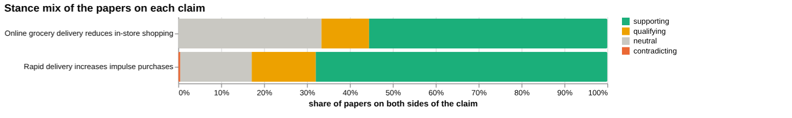
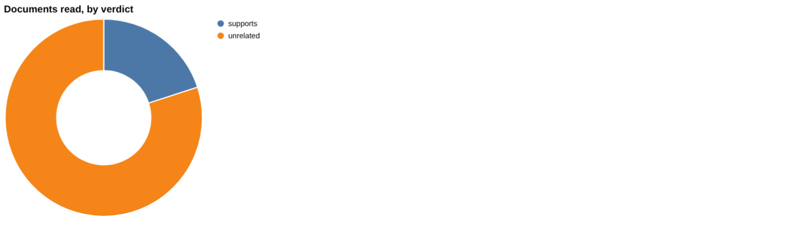
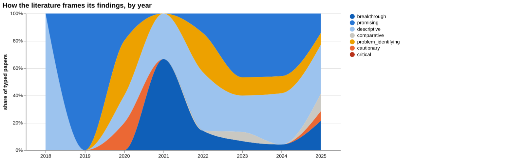
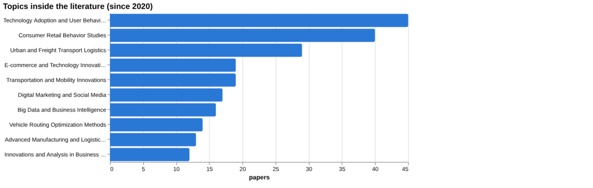
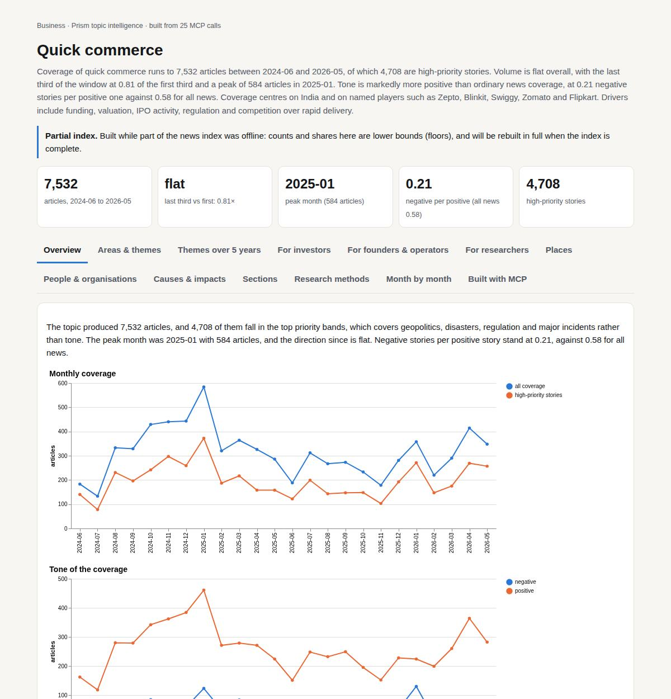

# Quick commerce

*Business · Prism topic intelligence* · **[Open the interactive page](https://fliarbi.com/demo/docs/prism-dashboards-3bb43e4c/topics/quick-commerce/)** (tabs: Overview · Areas & themes · Themes over 5 years · For investors · For founders & operators · For researchers · Places · People & organisations · Causes & impacts · Sections · Research methods · Month by month · Built with MCP)

> **Partial index.** Built while part of the news index was offline: counts and shares here are lower bounds (floors), and will be rebuilt in full when the index is complete.

Coverage of quick commerce runs to 7,532 articles between 2024-06 and 2026-05, of which 4,708 are high-priority stories. Volume is flat overall, with the last third of the window at 0.81 of the first third and a peak of 584 articles in 2025-01. Tone is markedly more positive than ordinary news coverage, at 0.21 negative stories per positive one against 0.58 for all news. Coverage centres on India and on named players such as Zepto, Blinkit, Swiggy, Zomato and Flipkart. Drivers include funding, valuation, IPO activity, regulation and competition over rapid delivery.

| Articles | Direction (last third vs first) | Peak month | Negative per positive | High-priority stories |
| ---: | --- | --- | ---: | ---: |
| 7,532 (2024-06 to 2026-05) | flat (0.81×) | 2025-01 (584) | 0.21 (all news 0.58) | 4,708 |

## Coverage over time

The topic produced 7,532 articles, and 4,708 of them fall in the top priority bands, which covers geopolitics, disasters, regulation and major incidents rather than tone. The peak month was 2025-01 with 584 articles, and the direction since is flat. Negative stories per positive story stand at 0.21, against 0.58 for all news.

## Areas of activity and themes

The leading area of activity is E-Commerce Services with 1911 articles, followed by Shopping Portals with 774 and Grocery Delivery Services with 557. The top tags are india (4,424), e-commerce (1,790), retail (1,516), bengaluru (1,499), mumbai (1,400), flipkart (1,273) and ipo (1,085), and themes centre on inventory, order fulfilment, third-party logistics and customer acquisition.

| Area of activity | Articles |
| --- | ---: |
| Business & Industrial › Business Services › E-Commerce Services | 1,911 |
| Shopping › Shopping Portals | 774 |
| Food & Drink › Food & Grocery Delivery › Grocery Delivery Services | 557 |
| Business & Industrial › Retail Trade | 456 |
| Food & Drink › Food & Grocery Delivery › Restaurant Delivery Services | 331 |
| Business & Industrial › Shipping & Logistics › Mail & Package Delivery | 176 |

**Top tags (what the themes are built from):** india (4,424), e-commerce (1,790), retail (1,516), bengaluru (1,499), mumbai (1,400), flipkart (1,273), ipo (1,085), yoy (496)

## Where it is reported

India dominates with 3,731 articles, followed by the United States (814), Singapore (172), China (171) and the United Kingdom (165). Among Indian states, Karnataka leads with 1,144 articles, then Maharashtra (1,075), Delhi (498), Telangana (381) and Tamil Nadu (332).

| Country | Articles | Lift | | Indian state | Articles | Lift |
| --- | ---: | ---: | --- | --- | ---: | ---: |
| India | 3,731 | 9.0× | | Karnataka | 1,144 | 60.9× |
| United States | 814 | 0.6× | | Maharashtra | 1,075 | 24.0× |
| Singapore | 172 | 4.8× | | Delhi | 498 | 19.5× |
| China | 171 | 0.5× | | Telangana | 381 | 26.4× |
| United Kingdom | 165 | 0.5× | | Tamil Nadu | 332 | 15.1× |
| Japan | 86 | 0.9× | | Uttar Pradesh | 237 | 8.0× |

## People and organisations

Named people include Piyush Goyal and Mansukh Mandaviya, alongside Bonita Ely, Aesop, P. V. Sindhu and Motilal Oswal Financial Services. Organisations most associated with the topic are Zepto, Blinkit, Swiggy, Zomato, Flipkart and D2C.

## Causes and impacts

Stated causes include digital infrastructure and AI, a surge in smartphone penetration, strong private funding support, valuation concerns, a shareholder vote that fell short and Amazon's 10-minute delivery push. Reported impacts include Blinkit widening its lead over Swiggy Instamart, Instamart gross order value slipping, shares falling nearly 30% and net profit plummeting 99.7%.

**Causes named in the coverage:** digital infrastructure and AI, surge in smartphone penetration, valuation concerns, strong private funding support, shareholder vote falls short, amazon 10-minute delivery push

**Impacts:** empowering the financially marginalised, emergence of e-commerce and quick commerce, shares fell nearly 30%, blinkit widened lead over swiggy instamart, instamart gross order value slipped, net profit plummeted 99.7%

## Sections inside the topic

The zepto section holds 3,049 articles, a 40.48 per cent share of the topic, while dark store holds 318 articles, a 4.22 per cent share. Both have declined in the later part of the window, with late-versus-early ratios of 0.52 for zepto and 0.77 for dark store, so zepto has fallen further. Their tone is close to the topic's 0.21 negative per positive, at 0.25 for zepto and 0.23 for dark store.

| Section | Articles | Share of the topic | Late vs early | Negative per positive |
| --- | ---: | ---: | ---: | ---: |
| quick commerce → dark store | 318 | 4.22% | 0.77× | 0.23 (topic 0.21) |
| quick commerce → zepto | 3,049 | 40.48% | 0.52× | 0.25 (topic 0.21) |

## Research and outlook

Research framing has shifted by 8.6 points, and recent work is markedly more cautious than earlier work. No typed paper count is available.

## Month by month

In June 2025 a cyberattack on Kiranapro Datalabs and the suspension of Zepto's Dharavi warehouse raised security and compliance concerns, even as Morgan Stanley lifted its market estimate to $57 billion. July brought a valuation of Rs 64,000 crore alongside widening losses at Swiggy, and August saw tighter scrutiny of anti-competitive conduct while Zepto raised fresh funding. Early 2026 brought leadership changes, new ultra-fast-delivery regulations and a stalled Zepto IPO.

- **2025-06:** Cyberattack on Kiranapro Datalabs and regulatory suspension of Zepto’s warehouse highlighted security and compliance risks.
- **2025-07:** Market valuation surged to Rs 64,000 crore and rapid dark‑store expansion, but Swiggy reported widening losses, exposing profit pressure.
- **2025-08:** Regulatory bodies intensified scrutiny of anti‑competitive conduct while Zepto secured fresh funding and launched a manufacturing‑startup initiative.

## Themes over five years

Technology stayed the leading theme throughout, moving from 23.7% of themed coverage in 2021 to 21.5% in 2025. Finance went from 11.5% in 2021 to 13.3% in 2025, having stood at 15.1% in 2023. Retail moved from 14.2% in 2021 to 11.3% in 2025, with a low of 8.9% in 2023. Economy rose from 3.5% to 7.4%, while food industry fell from 6.5% to 4.0%; e-commerce went from 5.9% to 5.6% and marketing from 1.6% to 2.1%. Healthcare and financial news stayed marginal, at 0.1% each in 2021 and 0.9% and 0.5% respectively in 2025.

| Theme | 2021 | 2022 | 2023 | 2024 | 2025 |
| --- | ---: | ---: | ---: | ---: | ---: |
| technology | 23.7% | 23.2% | 23.2% | 22.0% | 21.5% |
| finance | 11.5% | 11.1% | 15.1% | 13.1% | 13.3% |
| retail | 14.2% | 13.1% | 8.9% | 12.7% | 11.3% |
| economy | 3.5% | 5.4% | 8.9% | 6.7% | 7.4% |
| e-commerce | 5.9% | 6.4% | 4.8% | 7.1% | 5.6% |
| food industry | 6.5% | 5.7% | 4.1% | 3.9% | 4.0% |
| marketing | 1.6% | 0.9% | 1.6% | 2.0% | 2.1% |
| fashion | 0.1% | – | – | 0.9% | 0.7% |
| healthcare | 0.1% | 0.5% | – | – | 0.9% |
| financial news | 0.1% | – | 0.3% | 0.2% | 0.5% |

## For investors

The news index holds 8,189 articles for 2019-01-01..2026-06-01, so attention is substantial, while the research base is small: 169 research papers, 154 with readable abstracts, 2 arXiv preprints and 1 patent. Headline figures in circulation include a 45% compound annual growth rate, an industry valuation of $1.5 billion and a projected industry valuation of $5 billion, though no population or source is attached to them. Recent stories point to India as a focus, including a 2026-04-14 piece asking whether Blinkit can sustain growth as 50% TAM penetration nears maturity. The only country listed for where the work was studied is the United States, with 1 paper, so geographic coverage in the research is very thin. Research output scenarios under a linear-drift baseline give a central 174 for 2026, 194 for 2027 and 213 for 2028, with wide sensitivity ranges (for 2027, 0 to 421). Finance coverage and economy coverage have both held a larger share of themed news in 2025 than in 2021.

- Whether the 50% TAM penetration question for Blinkit becomes a wider market-maturity theme
- The unsourced 45% CAGR and $5 billion projected valuation figures, which carry no stated population
- Geographic gaps: only the United States appears in studied locations, despite the India-heavy news
- Research volume scenarios for 2026 to 2028, noting the sensitivity range reaches 0 for 2027 and 2028
- Economy theme share (3.5% in 2021, 7.4% in 2025) as a sign of macro framing

## For founders & operators

On the claim that online grocery delivery reduces in-store shopping, the evidence is limited. Of the documents read, 1 supports the claim, 4 are unrelated and none contradict; the tool's own note says this selected sample does not establish scientific consensus. All 5 documents are at the article tier. The wider corpus on this claim has 9 papers: 5 supporting, 1 qualifying, 0 contradicting and 3 neutral, with 11.1% contested and mixed framing with no dominant lean. The strongest source is a 2023 article on UK purchase data before and during the COVID-19 pandemic, which supports the claim. For the claim that rapid delivery increases impulse purchases, none of the 13 documents read supports it (10 unrelated, 3 unread), so the first claim has more evidence behind it. Screening found no figures for impulse buying, delivery worker safety, packaging waste, small retailer sales, urban traffic or household spending, which means none was found, not that there is no effect.

- Article tier: 1 document supports the in-store shopping claim, 4 are unrelated, 0 contradict
- Article tier: the UK longitudinal purchase data abstract (2023) is the strongest source and supports the claim
- Impulse purchase claim: 0 documents supported it; the strongest source, a 2023 article on same-day delivery time guarantees, was unrelated
- Corpus on in-store claim: 9 papers, 11.1% contested, no dominant lean
- No figures found for packaging waste, worker safety, traffic, small retailer sales or household spending

**Head to head:** Online grocery delivery reduces in-store shopping vs Rapid delivery increases impulse purchases: the first claim has more evidence behind it.

**Screen:** *What is the effect of rapid grocery delivery on …?* (one row per line below)

| Row | Figure (quoted) | Measures | Source |
| --- | --- | --- | --- |
| impulse buying | no figure found |  |  |
| delivery worker safety | no figure found |  |  |
| packaging waste | no figure found |  |  |
| small retailer sales | no figure found |  |  |
| urban traffic | no figure found |  |  |
| household spending | no figure found |  |  |

## For researchers

The literature is mostly positive in framing, with 59 supporting, 39 qualifying, 0 contradicting and 71 neutral papers out of 169, and 23.1% contested. By orientation, descriptive work leads at 69 papers (33.0%), then promising at 62 (29.7%), problem-identifying at 30 (14.4%), breakthrough at 25 (12.0%), cautionary at 12 (5.7%) and comparative at 11 (5.3%). Contributions are mainly empirical (131), then methodological (54), with 12 reviews, 10 position papers and 2 theoretical papers. The leading topics are Technology Adoption and User Behaviour (45 papers), Consumer Retail Behavior Studies (40) and Urban and Freight Transport Logistics (29). Newer work includes a 2024 Journal of Service Research paper on delivery time and repurchase behaviour (cited by 42) and a 2023 study of dark stores in Paris (cited by 41). Positive framing by year ranged from 15.4% in 2022 to 19.7% in 2025, and a framing-shift comparison could not be made because one window had too few papers.

- Theory is thin: only 2 theoretical papers against 131 empirical ones
- No the health literature index records exist, so health and behavioural outcomes lack clinical-style study designs
- Which causal links on impulse buying, worker safety and packaging waste have any direct study, given 0 papers in each screening row
- Why the most-cited recent items are 2025 papers with cited_by of 0, and how quickly India-focused work will be tested
- Whether the framing shift can be measured once more papers accumulate in each window

## Research exploration methods

Nine ways to explore the research, each run on this topic; the interactive report shows each call and its result.

**Chaining them.** Start with faceted browsing to see the shape of the literature, which is mostly empirical and consumer-focused, and use the frontier scan to pick out the cited recent work. Then run gap mapping and evidence triangulation on a specific claim, noting that coverage exists but that only 1 document was read as supporting. Use head-to-head comparison to check whether a rival claim, such as impulse purchasing, has any direct evidence, and rerun screening with broader terms because all six rows came back empty. Treat the framing, history and geography outputs as incomplete until yearly counts and country data are recovered. Finish by reading the few direct sources in full before drawing any conclusion.

### Evidence triangulation

*Is a claim supported, and by how strong a design?* `find_evidence` + `find_counter_evidence` + `rank_sources`

For the claim that online grocery delivery reduces in-store shopping, only 1 document was read as supporting, while 4 were unrelated, and all 5 sit in the article tier. The wider corpus of 9 papers splits into 5 supporting, 1 qualifying, 0 contradicting and 3 neutral, with a contested share of 11.1%, which the tool reads as mixed framing with no dominant lean. The counter-evidence search found no contradicting or qualifying documents, but with 4 of 5 documents unrelated this is thin assurance rather than a test that the claim survived. The top sources are all articles; the most cited, on congestion and environmental burden, has 27 citations and concerns a different question from store substitution. The tool itself says the sample does not establish scientific consensus. A careful researcher would read the one supporting document closely, check its design and population, and search for longitudinal or panel studies of purchase data.

### Head-to-head claims

*Which of two interventions has more and stronger evidence?* `compare_claims`

The comparison gives the first claim, that online grocery delivery reduces in-store shopping, more evidence than the second, that rapid delivery increases impulse purchases. Claim A has 5 papers on both poles and a corpus mix of 5 supporting, 1 qualifying, 0 contradicting and 3 neutral; its strongest source is a UK longitudinal purchase-data abstract from 2023, rated as supporting. Claim B has 0 papers on both poles, yet its corpus mix is larger at 155 supporting, 34 qualifying, 1 contradicting and 38 neutral. That mix shows how much loosely related literature exists, not that the claim is tested. Of its documents, 10 were unrelated and 3 unread, and its strongest source, on same-day delivery time guarantees, is itself marked unrelated. The verdict therefore rests on read documents, not corpus size, and both claims remain weakly evidenced. The next step is to find direct measurements of basket composition in rapid-delivery orders.

### Cross-row screening

*Which rows carry a measured, quoted figure, and how large is it?* `research_table`

All six rows returned no value, no measure, no population and 0 papers: impulse buying, delivery worker safety, packaging waste, small retailer sales, urban traffic and household spending. This means the screening found no quotable effect size for rapid grocery delivery on any of them, and it does not mean the effects are zero or absent. The question wording, which asks for the effect of rapid grocery delivery, may be narrower than how the literature phrases these outcomes. Quick commerce research may also describe such impacts qualitatively, as the dark-store and Paris transport work in the frontier list suggests. Decision-makers should not read this as evidence of no harm or no benefit. A careful researcher would rerun with broader terms, such as dark stores or instant delivery, and check whether any measured figures sit in grey literature or industry reports.

### Framing drift

*Is the literature becoming more hopeful or more cautious?* `stance_trends`

The yearly framing figures are volatile and, with no paper counts given, should be read cautiously. Positive share was 0.0 in 2018, 50.0 in 2019, 20.0 in 2020, 50.0 in 2021, 15.4 in 2022, 32.0 in 2023, 34.3 in 2024 and 19.7 in 2025. Contested share peaked at 60.0 in 2020 and was 8.6 in 2024 and 8.7 in 2025. The early years likely rest on very few papers, so 50.0 in 2019 and 2021 and 60.0 in 2020 may reflect small numbers rather than a real swing. From 2023 to 2025 contested share stays between 8.0 and 8.7, which is steady, while positive share falls to 19.7 in 2025 from 34.3 in 2024. This does not show whether the field is turning cautious, since the shares do not sum to the whole and many papers are likely neutral. The next step is to obtain the yearly paper counts behind each percentage.

### Frontier scan

*What is new, and what is the research not reaching?* `research_radar`

The most-cited new work is led by a 2024 Journal of Service Research paper on delivery time and repurchase behaviour in quick commerce, with 42 citations and a promising orientation. Close behind is a 2023 study of dark stores in Paris, with 41 citations, framed as problem-identifying and concerned with geographical and transportation impacts. The remaining items cover service quality and loyalty (32), service experience (23), micro-fulfilment network planning (19) and the food retail supply chain (13). The mix shows a split between consumer-loyalty work, mostly promising or descriptive, and urban-impact work, which is more critical. The framing shift could not be computed because there were not enough papers in one of the windows, so no claim about changing tone can be made. The list shows what is cited, not what is correct, and it says nothing about coverage gaps because no under-covered topics were returned. A careful researcher would read the Paris study and the repurchase paper side by side.

### Gap mapping

*Which parts of a claim does the literature actually cover?* `research_gaps`

All three components of the claim were marked as having evidence: the original wording, digital grocery ordering decreasing physical store visits, and e-commerce grocery services shifting purchases away from brick-and-mortar stores. This suggests the claim can be found under several phrasings, so the topic is not an empty field. It does not show how strong the evidence is, and the triangulation result shows only 1 document read as supporting. The check is binary, so it cannot distinguish a single abstract from a body of robust studies. It also does not test related components such as net effects on total spending or on particular store formats. A careful researcher would use this as permission to look further and then judge design quality, population and time period in the underlying studies.

### Count history and backtested scenarios

*Is research on this growing, and where could it be in three years?* `historical_analysis` + `scenarios`

The count of papers per year came back empty, so there is no observed history to read and no growth trend can be stated from the counts. The scenarios therefore rest on a linear drift baseline, with central values of 174 for 2026, 194 for 2027 and 213 for 2028. The sensitivity bands are wide: 61 to 288 in 2026, 0 to 421 in 2027 and 0 to 555 in 2028. The lower bound of 0 in the later years shows that the method cannot rule out a collapse as well as growth. Without the underlying counts, it is unclear what window or title-matching was used, so these figures should be treated as indicative only. A careful researcher would first recover the yearly counts, confirm the search terms such as quick commerce, q-commerce and instant delivery, and then re-run the backtest.

### Geographic triangulation

*Where is it studied, published, reported and patented?* `global_comparison` + `newsgeo`

The geographic evidence is nearly empty. Only one country appears for where the claim is studied, the United States with 1, and the reported-by-country lane is empty. This means that the claim's evidence base, as retrieved, is effectively not geographically characterised. It does not show that the topic is studied mainly in the United States, since a single count is too small to say so, and other sources in the facts include UK, Paris and India-related work. The lanes answer different questions and should not be combined. The absence of news geography means nothing can be said about where coverage is concentrated. A careful researcher would check the country affiliations of the papers directly, especially for India, the UK and France, where the other results point.

### Faceted browsing

*What kind of literature is it: empirical, review, position? Problem-identifying or promising?* `browse_research`

The literature is mostly empirical, with 131 papers, followed by 54 methodological, 12 review, 10 position and 2 theoretical. By orientation, descriptive leads with 69 papers (33.0%), then promising with 62 (29.7%), problem_identifying with 30 (14.4%), breakthrough with 25 (12.0%), cautionary with 12 (5.7%) and comparative with 11 (5.3%). So cautionary and problem-identifying work together is smaller than descriptive and promising work. The top topics are Technology Adoption and User Behaviour (45) and Consumer Retail Behavior Studies (40), with Urban and Freight Transport Logistics at 29, which suggests the field leans toward consumer and operational questions. The most-cited-since-2020 list shows 0 citations for every item, all from 2025, so it reflects recency and not influence. Its labels, for example one India paper marked cautionary, are tool classifications and not verified findings. A careful researcher would use the facets to select empirical, problem-identifying papers and read those directly.

## Built with MCP

Every number and chart on this page comes from these 25 Prism MCP tool calls, made over MCP (streamable HTTP). Arguments and timings: [mcp_calls.json](mcp_calls.json); responses: [data.json](data.json).

| MCP tool | Calls |
| --- | ---: |
| `news_activities` | 1 |
| `news_geography` | 1 |
| `news_drill` | 2 |
| `news_themes` | 5 |
| `prism_overview` | 1 |
| `news_factors` | 1 |
| `historical_analysis` | 1 |
| `critical_news` | 1 |
| `stance_trends` | 1 |
| `browse_research` | 1 |
| `research_radar` | 1 |
| `research_brief` | 1 |
| `research_gaps` | 1 |
| `global_comparison` | 1 |
| `find_counter_evidence` | 1 |
| `find_evidence` | 1 |
| `rank_sources` | 1 |
| `deep_timeline` | 1 |
| `compare_claims` | 1 |
| `research_table` | 1 |

Try it: `prism entity "quick commerce"` · `prism call news.drill term='quick commerce' scope='dark store'` · `prism call analysis.timeline term='quick commerce'`

