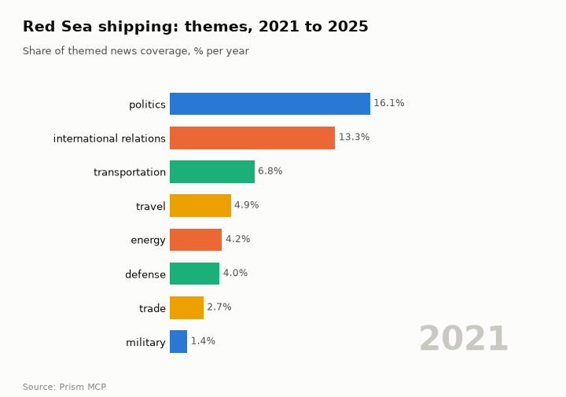
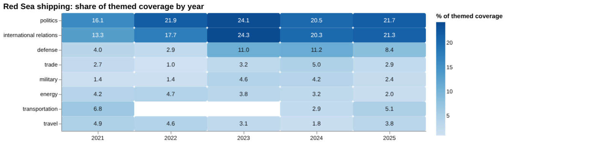
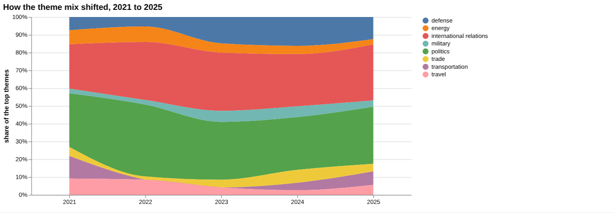
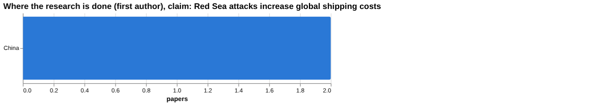
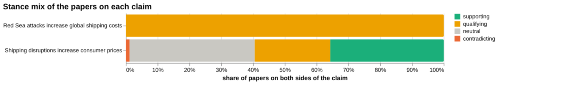
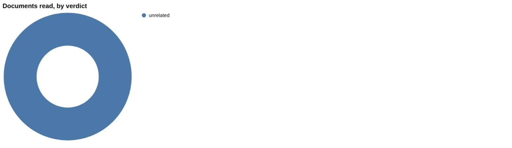
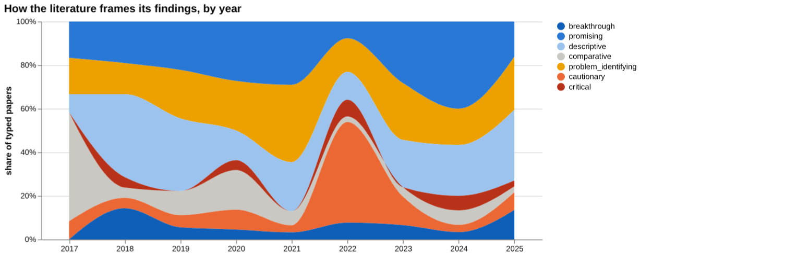
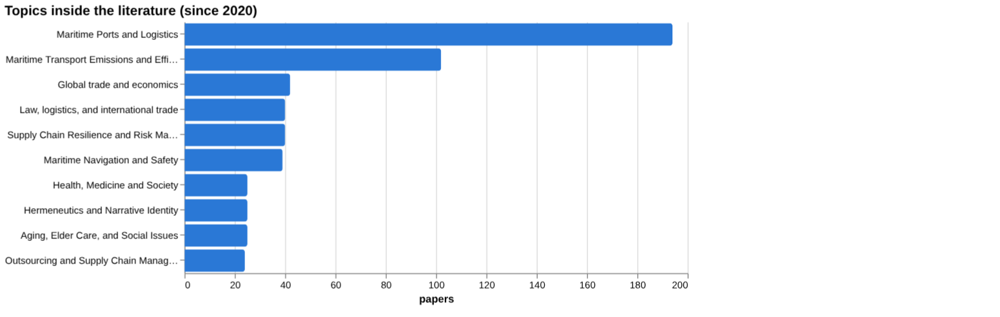
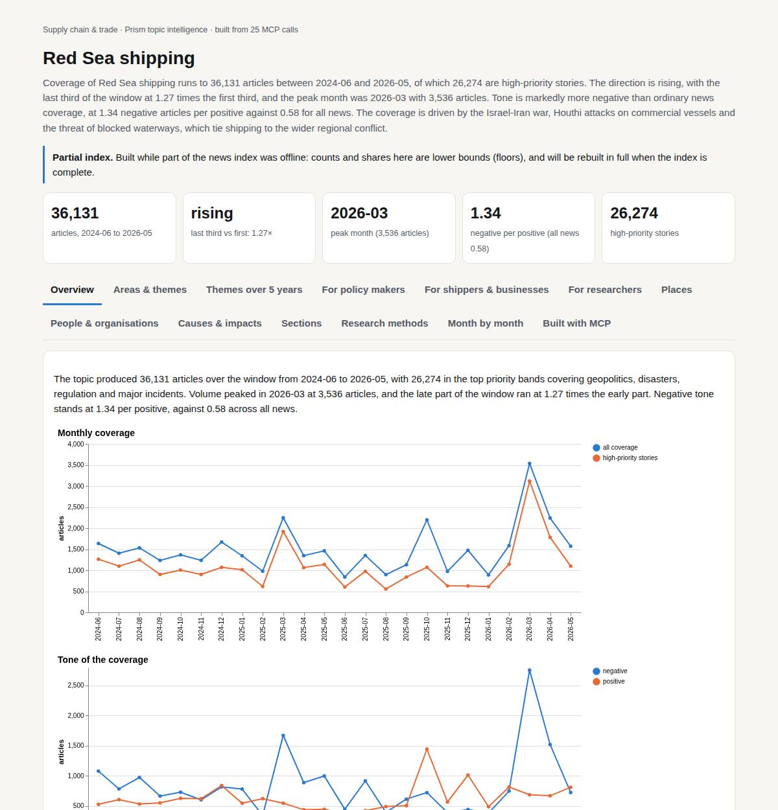

# Red Sea shipping

*Supply chain & trade · Prism topic intelligence* · **[Open the interactive page](https://fliarbi.com/demo/docs/prism-dashboards-3bb43e4c/topics/red-sea-shipping/)** (tabs: Overview · Areas & themes · Themes over 5 years · For policy makers · For shippers & businesses · For researchers · Places · People & organisations · Causes & impacts · Sections · Research methods · Month by month · Built with MCP)

> **Partial index.** Built while part of the news index was offline: counts and shares here are lower bounds (floors), and will be rebuilt in full when the index is complete.

Coverage of Red Sea shipping runs to 36,131 articles between 2024-06 and 2026-05, of which 26,274 are high-priority stories. The direction is rising, with the last third of the window at 1.27 times the first third, and the peak month was 2026-03 with 3,536 articles. Tone is markedly more negative than ordinary news coverage, at 1.34 negative articles per positive against 0.58 for all news. The coverage is driven by the Israel-Iran war, Houthi attacks on commercial vessels and the threat of blocked waterways, which tie shipping to the wider regional conflict.

| Articles | Direction (last third vs first) | Peak month | Negative per positive | High-priority stories |
| ---: | --- | --- | ---: | ---: |
| 36,131 (2024-06 to 2026-05) | rising (1.27×) | 2026-03 (3,536) | 1.34 (all news 0.58) | 26,274 |

## Coverage over time

The topic produced 36,131 articles over the window from 2024-06 to 2026-05, with 26,274 in the top priority bands covering geopolitics, disasters, regulation and major incidents. Volume peaked in 2026-03 at 3,536 articles, and the late part of the window ran at 1.27 times the early part. Negative tone stands at 1.34 per positive, against 0.58 across all news.

## Areas of activity and themes

The largest area of activity is People & Society › Social Sciences › Political Science with 8,147 articles, followed by Maritime Transport within Shipping & Logistics with 6,345. Law & Government › Military › Navy has 1,121 and Freight Transport has 1,096. The leading tags are 'red sea' with 27,043, 'the red sea' with 17,309, 'israel' with 11,056 and 'yemen' with 10,214, and the themes range from trade routes and freight rates to piracy prevention and naval and aerial combat operations.

| Area of activity | Articles |
| --- | ---: |
| People & Society › Social Sciences › Political Science | 8,147 |
| Business & Industrial › Shipping & Logistics › Freight Transport › Maritime Transport | 6,345 |
| Law & Government › Military › Navy | 1,121 |
| Business & Industrial › Shipping & Logistics › Freight Transport | 1,096 |
| Internet & Telecom › Search Engines | 772 |
| Travel & Transportation › Specialty Travel › Luxury Travel | 578 |

**Top tags (what the themes are built from):** red sea (27,043), the red sea (17,309), israel (11,056), yemen (10,214), saudi arabia (7,675), gaza (6,110), egypt (5,624), hamas (4,605)

## Where it is reported

By country, the United States leads with 15,647 articles, followed by Israel with 8,099, Yemen with 7,658, Iran with 7,623, Palestine with 5,562 and Saudi Arabia with 5,543. Among states and regions, the Gaza Strip has 5,685 articles, Washington 3,340, Tennessee 2,493, Tehran 2,487, Capital Municipality 2,116 and Dubai 1,953.

| Country | Articles | Lift | | Indian state | Articles | Lift |
| --- | ---: | ---: | --- | --- | ---: | ---: |
| United States | 15,647 | 0.6× | | Gaza Strip | 5,685 | 62.1× |
| Israel | 8,099 | 5.3× | | Washington | 3,340 | 2.2× |
| Yemen | 7,658 | 38.2× | | Tennessee | 2,493 | 1.8× |
| Iran | 7,623 | 2.0× | | Tehran | 2,487 | 6.8× |
| Palestine | 5,562 | 19.1× | | Capital Municipality | 2,116 | 1678.6× |
| Saudi Arabia | 5,543 | 9.8× | | Dubai | 1,953 | 11.4× |

## People and organisations

The people most often named are Abdel Fattah el-Sisi, Michael Waltz, Mohammed bin Salman, Bashar al-Assad, Lloyd Austin and Benjamin Netanyahu. Organisations include NEOM, the Rapid Support Forces, Maersk, Hapag-Lloyd, CMA CGM and the United States Fifth Fleet.

## Causes and impacts

Coverage attributes disruption to the closure of the Strait of Hormuz, Iran's closing of it, a fuel cost shock and both Middle East critical waterways being closed. The impacts described are higher shipping costs, an acute crisis for the shipping industry, a severe global food price crisis, pressure on the international economy and millions being pushed back into poverty.

**Causes named in the coverage:** keeping the strait of hormuz blocked, closure of the strait of hormuz, fuel cost shock, both middle east critical waterways closed, iran closed the strait of hormuz

**Impacts:** severe global food price crisis, pushing millions back into poverty, higher shipping costs, international economy into a spin, shipping industry acute crisis

## Sections inside the topic

The houthi section has 9,236 articles, 25.56 per cent of the topic, and its late-versus-early ratio is 0.63. Its tone is far more negative, at 10.72 negative per positive against 1.34 for the topic as a whole. The freight section is much smaller at 1,042 articles, 2.88 per cent of the topic, with a late-versus-early ratio of 0.98 and 1.91 negative per positive.

| Section | Articles | Share of the topic | Late vs early | Negative per positive |
| --- | ---: | ---: | ---: | ---: |
| red sea → houthi | 9,236 | 25.56% | 0.63× | 10.72 (topic 1.34) |
| red sea → freight | 1,042 | 2.88% | 0.98× | 1.91 (topic 1.34) |

## Research and outlook

The balance of framing is broadly unchanged, with a shift of 7.2 points. The outlook holds the central figure at 37.0 for each of 2026, 2027 and 2028, while the range widens from 25.0 to 49.0 in 2026, to 13.0 to 61.0 in 2027 and to 1.0 to 73.0 in 2028.

## Month by month

Coverage moved from the Israel-Iran strikes of 2025-06, which spilled into the Red Sea, to renewed Houthi attacks on commercial vessels in 2025-07. In 2025-09 a Houthi-launched drone struck southern Israel, linking the Red Sea conflict to the Israel-Hamas war, and by March and April 2026 the conflict had broadened into a multi-front war with reciprocal threats to block shipping.

- **2025-06:** Israel and Iran launched direct strikes that spilled into the Red Sea, marking the first major military escalation in the region.
- **2025-07:** Houthi rebels resumed aggressive attacks on commercial vessels, demonstrating a new wave of maritime insecurity.
- **2025-09:** A Houthi‑launched drone breached Israel’s air defenses and struck southern Israel, linking the Red Sea conflict to the Israel‑Hamas war.

## Themes over five years

Politics moved from 16.1% of themed coverage in 2021 to 21.7% in 2025, and international relations from 13.3% to 21.3%. Defense rose from 4.0% to 8.4%, having stood at 11.0% in 2023 and 11.2% in 2024. Trade went from 2.7% to 2.9%, military from 1.4% to 2.4%, and energy fell from 4.2% to 2.0%. Transportation was 6.8% in 2021 and 5.1% in 2025, with no figure given for 2022 or 2023; travel fell from 4.9% to 3.8%. Economy (5.3%) and finance (4.0%) appear only in 2024.

| Theme | 2021 | 2022 | 2023 | 2024 | 2025 |
| --- | ---: | ---: | ---: | ---: | ---: |
| politics | 16.1% | 21.9% | 24.1% | 20.5% | 21.7% |
| international relations | 13.3% | 17.7% | 24.3% | 20.3% | 21.3% |
| defense | 4.0% | 2.9% | 11.0% | 11.2% | 8.4% |
| trade | 2.7% | 1.0% | 3.2% | 5.0% | 2.9% |
| military | 1.4% | 1.4% | 4.6% | 4.2% | 2.4% |
| energy | 4.2% | 4.7% | 3.8% | 3.2% | 2.0% |
| transportation | 6.8% | – | – | 2.9% | 5.1% |
| travel | 4.9% | 4.6% | 3.1% | 1.8% | 3.8% |

## For policy makers

Coverage of Red Sea shipping has become more political and diplomatic: politics stood at 21.7% and international relations at 21.3% of themed coverage in 2025. Defense held at 8.4% in 2025 after 11.2% in 2024. Recent news points to a wider regional picture, including a story on Houthi involvement possibly widening the war, one on insurers keeping ships away from the Strait of Hormuz and one on South Korea diversifying crude oil sources. The index holds 166 news articles from 2019-01-01 to 2026-06-01. The scenario figures give a central value of 37 for each of 2026, 2027 and 2028, with sensitivity ranges of 25 to 49, 13 to 61 and 1 to 73 respectively, under a no-change baseline. The ranges widen each year, so the later figures carry much less certainty. Geographic evidence is thin: the only country listed for where the research is studied is China, with 2 papers.

- Watch the share of politics and international relations in coverage, at 21.7% and 21.3% in 2025.
- Track Hormuz-related insurer and supply diversification stories alongside Red Sea ones.
- Treat the 2028 scenario range of 1 to 73 around a central 37 as very wide.
- Note that no country-level reporting data was found, so regional exposure is not mapped.
- Follow whether defense coverage, 8.4% in 2025, returns towards its 2024 level of 11.2%.

## For shippers & businesses

For the claim that Red Sea attacks increase global shipping costs, the evidence found is very thin. Only 2 papers were matched, both qualifying in stance, and both documents read were judged unrelated, so no verified verdict supports a wording recommendation. The sources are both at article tier: a 2020 study on state control of maritime transport in Sudan and a 2024 paper on Port Sudan. The related claim that shipping disruptions increase consumer prices has 2,160 papers on both poles, with 771 supporting, 514 qualifying, 25 contradicting and 850 neutral, though the 6 documents read for it were also judged unrelated. For screening, freight rates have 1 paper, on the food import bill and global shipping costs (2025), while transit time, insurance premiums, inflation and carbon emissions have 0 papers. Trade volumes show a figure of 14.1% for exports rose, but with no source paper attached.

- Article tier: 2 papers on the Red Sea shipping cost claim, both qualifying, and both read documents judged unrelated.
- Review tier: the strongest source for the consumer prices claim is a 2019 review on last-mile delivery, judged unrelated.
- Gaps with no evidence found: attacks raising freight rates, attacks causing vessel rerouting, and rerouting increasing global shipping costs.
- Insurance premiums, inflation and transit time have 0 papers in the screening, which means none were found, not that there is no effect.
- The 14.1% trade volumes figure (exports rose) has no source or population attached.

**Head to head:** Red Sea attacks increase global shipping costs vs Shipping disruptions increase consumer prices: the second claim has more evidence behind it.

**Screen:** *What is the effect of Red Sea shipping disruption on …?* (one row per line below)

| Row | Figure (quoted) | Measures | Source |
| --- | --- | --- | --- |
| freight rates | no figure found |  | The dynamic response of the food import bill to global shipping costs (2025) |
| transit time | no figure found |  | Port Sudan as a Strategic Hub in Maritime Shipping Markets and Transit Trade (2024) |
| insurance premiums | no figure found |  |  |
| inflation | no figure found |  |  |
| trade volumes | 14.1% | exports rose |  |
| carbon emissions | no figure found |  |  |

## For researchers

The index holds 43,272 research papers from 2017 to 2025, but only 35 readable papers with real abstracts, and no the health literature index records, patents or preprints. Across the wider literature, 14,948 papers are supporting, 12,139 qualifying, 408 contradicting and 15,777 neutral, with 29.0% contested. Framing looks stable: the recent window has 27.5% cautionary across 9,818 papers against 29.8% across 11,713 earlier, a change of -2.3 percentage points, which is read as broadly unchanged. Contested share by year ran from 9.4% in 2017 to 34.6% in 2022 and 22.0% in 2025. Orientation is led by problem-identifying work (100 papers, 26.0%), and contributions are mostly empirical (207 papers). The most visible topics are ports and logistics (194) and emissions and efficiency (102), and the newest work includes a 2024 Environmental Research Letters paper on carbon emissions from the Red Sea crisis. Several listed topics, such as hermeneutics and elder care, appear unrelated to the subject.

- Why do the three core links (freight rates, rerouting, global costs) show no evidence in the gap check?
- How much of the 43,272 papers are on Red Sea shipping itself, given the off-topic themes among the leading topics?
- What explains the contested share of 34.6% in 2022 compared with 12.5% in 2024?
- Can the 2024 Environmental Research Letters paper on emissions and carbon pricing be matched by empirical work on costs?
- Why are recent high-profile papers from 2025 showing cited-by counts of 0 or 1, and how will they be assessed?

## Research exploration methods

Nine ways to explore the research, each run on this topic; the interactive report shows each call and its result.

**Chaining them.** Begin with triangulation to confirm the paucity of directly supportive evidence for the cost claim, then use gap mapping to pinpoint missing sub‑components. Apply screening to seek quantitative effect sizes for any identified factors, and consult framing and frontier analyses to understand broader narrative trends and emerging studies. Use head‑to‑head comparison to benchmark against related claims with richer evidence, and employ geography and facets to locate relevant regional and thematic literature. Finally, integrate historical scenario insights to gauge future research trajectories.

### Evidence triangulation

*Is a claim supported, and by how strong a design?* `find_evidence` + `find_counter_evidence` + `rank_sources`

The evidence base for the claim "Red Sea attacks increase global shipping costs" consists of two documents, both classified as articles. Both documents are recorded as unrelated to the claim, and the corpus stance shows zero supporting papers, two qualifying, and zero contradicting, giving a contested share of 100.0%, indicating active contestation. The counter‑evidence tally also records zero supports, contradictions or qualifications, and two unrelated items, and the recommendation states that no verified document verdict supports a wording recommendation. What is not shown is any direct empirical measurement linking attacks to cost increases, nor any peer‑reviewed evidence that directly supports the claim. A careful researcher should seek primary data or studies that explicitly quantify cost impacts, and verify the relevance of the two articles identified.

### Head-to-head claims

*Which of two interventions has more and stronger evidence?* `compare_claims`

Comparing the two claims, the first claim ("Red Sea attacks increase global shipping costs") has zero papers on both poles and a corpus mix of zero supporting, two qualifying, zero contradicting, giving a contested share of 100.0%, with two unrelated documents read. The second claim ("Shipping disruptions increase consumer prices") is associated with 2,160 papers on both poles, a corpus mix of 771 supporting, 514 qualifying, 25 contradicting, 850 neutral, and a contested share of 25.0%, with six unrelated documents read. The verdict notes that the second claim has more evidence behind it. What is not shown is any assessment of the quality or relevance of the supporting papers for either claim, nor any direct linkage between Red Sea disruptions and consumer prices. A careful researcher would need to examine the substantive content of the supporting papers for the second claim and locate any comparable evidence for the first claim.

### Cross-row screening

*Which rows carry a measured, quoted figure, and how large is it?* `research_table`

The screening of specific risk‑factor rows returned a quantitative figure only for trade volumes, reporting a value of "14.1%" with the measure described as "exports rose". All other rows – freight rates, transit time, insurance premiums, inflation, carbon emissions – returned null values and no identified measures, though freight rates cites one paper from 2025. What is not shown is any effect size or confidence interval for freight rates or other factors, nor the population context for the trade‑volume figure. A careful researcher should locate studies that provide explicit effect estimates for the missing rows and verify the source of the 14.1% trade‑volume change.

### Framing drift

*Is the literature becoming more hopeful or more cautious?* `stance_trends`

The framing analysis shows yearly percentages of positive orientation ranging from 6.2% in 2017 to 20.3% in 2024, with contested percentages fluctuating between 9.4% and 34.6%. What is not shown is the absolute number of papers underlying these percentages, nor the specific topics driving the positive or contested frames. A careful researcher would track the evolution of framing in conjunction with emerging themes to understand whether optimism or caution is gaining traction.

### Frontier scan

*What is new, and what is the research not reaching?* `research_radar`

The frontier scan identifies six recent works, including a 2023 article on digital servitisation cited 26 times and a 2024 environmental study cited 22 times, with orientations labelled as problem_identifying or cautionary. The framing shift comparison shows recent papers (9,818) with a cautionary_pct of 27.5 versus earlier papers (11,713) with a cautionary_pct of 29.8, a delta of -2.3 points, and a reading that framing is broadly unchanged. The caveat notes that orientation labels reflect the paper's own framing rather than an objective truth. What is not shown is any quantitative impact of these new works on the specific claim about shipping costs. A careful researcher should assess the relevance of the newly cited studies to the cost‑impact claim and monitor subsequent citations for emerging evidence.

### Gap mapping

*Which parts of a claim does the literature actually cover?* `research_gaps`

The gap mapping breaks the claim into three components – freight‑rate increase, vessel rerouting, and cost increase via rerouting – and records evidence as "no" for each. This indicates that the current literature does not directly address any of these sub‑claims. What is not shown is whether related but indirect evidence exists, such as broader supply‑chain cost analyses. A careful researcher should broaden the search to adjacent domains and consider primary data collection to fill these evidentiary gaps.

### Count history and backtested scenarios

*Is research on this growing, and where could it be in three years?* `historical_analysis` + `scenarios`

The count history provides no yearly paper counts, but scenario modelling projects a central estimate of "37" papers for each of the years 2026, 2027 and 2028, with sensitivity bounds ranging from "25" to "49", "13" to "61", and "1" to "73" respectively. The baseline scenario is described as "no_change". What is not shown is the actual historical trend that would inform the plausibility of these projections. A careful researcher should verify past publication counts before relying on the scenario forecasts.

### Geographic triangulation

*Where is it studied, published, reported and patented?* `global_comparison` + `newsgeo`

Geographic triangulation shows that the claim has been studied in China, with two associated items. No countries are listed for where the claim is reported by news outlets. What is not shown is the distribution of research across other regions or the presence of patents. A careful researcher should explore literature from additional jurisdictions to assess geographic breadth.

### Faceted browsing

*What kind of literature is it: empirical, review, position? Problem-identifying or promising?* `browse_research`

Faceted browsing reveals that problem_identifying papers number "100" (26.0% share), promising "95" (24.7%), descriptive "86" (22.3%), cautionary "55" (14.3%), breakthrough "29" (7.5%), comparative "13" (3.4%) and critical "7" (1.8%). Contributions are dominated by empirical papers ("207"), followed by methodological ("87"), position ("55"), review ("25") and theoretical ("11"). The top topics include Maritime Ports and Logistics ("194" papers) and Maritime Transport Emissions and Efficiency ("102" papers). What is not shown is how many of these papers directly address the cost‑impact claim. A careful researcher should filter the orientation and contribution facets to locate studies that empirically test cost effects.

## Built with MCP

Every number and chart on this page comes from these 25 Prism MCP tool calls, made over MCP (streamable HTTP). Arguments and timings: [mcp_calls.json](mcp_calls.json); responses: [data.json](data.json).

| MCP tool | Calls |
| --- | ---: |
| `news_activities` | 1 |
| `news_geography` | 1 |
| `prism_overview` | 1 |
| `news_drill` | 2 |
| `news_themes` | 5 |
| `news_factors` | 1 |
| `historical_analysis` | 1 |
| `critical_news` | 1 |
| `stance_trends` | 1 |
| `browse_research` | 1 |
| `research_radar` | 1 |
| `global_comparison` | 1 |
| `research_brief` | 1 |
| `research_gaps` | 1 |
| `find_counter_evidence` | 1 |
| `find_evidence` | 1 |
| `rank_sources` | 1 |
| `deep_timeline` | 1 |
| `compare_claims` | 1 |
| `research_table` | 1 |

Try it: `prism entity "red sea"` · `prism call news.drill term='red sea' scope='houthi'` · `prism call analysis.timeline term='red sea'`

