# Road accidents

*Crime & public safety · Prism topic intelligence* · **[Open the interactive page](https://fliarbi.com/demo/docs/prism-dashboards-3bb43e4c/topics/road-accidents/)** (tabs: Overview · Areas & themes · Themes over 5 years · For policy makers · For police & enforcement · For researchers · Places · People & organisations · Causes & impacts · Sections · Research methods · Month by month · Built with MCP)

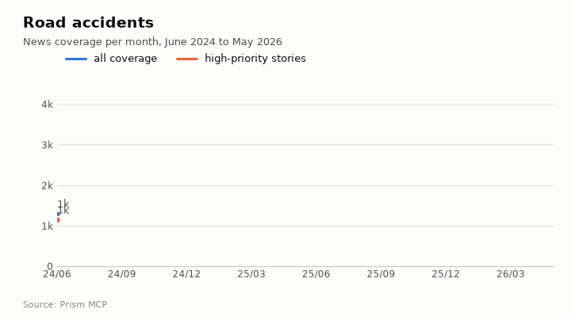

> **Partial index.** Built while part of the news index was offline: counts and shares here are lower bounds (floors), and will be rebuilt in full when the index is complete.

Coverage of road accidents totals 47,635 articles between 2024-06 and 2026-05, and the direction is rising, with the last third of the window running at 1.28 times the first third. The peak month was 2026-04, with 4,211 articles. The tone is markedly more negative than ordinary news coverage, at 10.05 negative articles per positive one against 0.58 for all news. Coverage is driven by individual fatal crashes such as head-on collisions, speeding trucks and drunken drivers, and by the public and political calls for safety reform that follow them. Of the stories, 42,263 fall in the highest priority bands.

| Articles | Direction (last third vs first) | Peak month | Negative per positive | High-priority stories |
| ---: | --- | --- | ---: | ---: |
| 47,635 (2024-06 to 2026-05) | rising (1.28×) | 2026-04 (4,211) | 10.05 (all news 0.58) | 42,263 |

## Coverage over time

The topic holds 47,635 articles, of which 42,263 sit in the top priority bands; this is a measure of story category and not of tone. Volume is rising, peaking at 4,211 articles in 2026-04. The negative-to-positive ratio of 10.05 compares with 0.58 across all news.

## Areas of activity and themes

The leading area of activity is Autos & Vehicles › Vehicle Codes & Driving Laws with 8,004 articles, followed by long distance bus and rail transport with 1,198 and cycling with 877. The top tags are road accident (33,116), injury (6,714), road safety (3,559) and collision (2,246), and the themes cover traffic safety, crashes and derailments, fatalities, inspection protocols and traffic penalties.

| Area of activity | Articles |
| --- | ---: |
| Autos & Vehicles › Vehicle Codes & Driving Laws | 8,004 |
| Travel & Transportation › Transportation › Long Distance Bus & Rail | 1,198 |
| Sports › Individual Sports › Cycling | 877 |
| Law & Government › Legal › Accident & Personal Injury Law | 875 |
| Autos & Vehicles › Motor Vehicles (By Type) › Motorcycles | 508 |
| Autos & Vehicles › Vehicle Codes & Driving Laws › Drunk Driving Law | 327 |

**Top tags (what the themes are built from):** road accident (33,116), injury (6,714), road safety (3,559), collision (2,246), thana (1,925), accident (1,482), motorcycle (1,196), vehicle safety (1,174)

## Where it is reported

India leads the country ranking with 11,428 articles, ahead of the United States with 3,029, the United Kingdom with 708, Japan with 529, Nigeria with 470 and Australia with 393. Among Indian states, Uttar Pradesh has 2,908 articles, followed by Maharashtra with 1,201, Madhya Pradesh with 947, Bihar with 935, Rajasthan with 903 and Delhi with 878.

| Country | Articles | Lift | | Indian state | Articles | Lift |
| --- | ---: | ---: | --- | --- | ---: | ---: |
| India | 11,428 | 7.8× | | Uttar Pradesh | 2,908 | 25.2× |
| United States | 3,029 | 0.6× | | Maharashtra | 1,201 | 6.9× |
| United Kingdom | 708 | 0.6× | | Madhya Pradesh | 947 | 24.5× |
| Japan | 529 | 1.5× | | Bihar | 935 | 20.0× |
| Nigeria | 470 | 2.9× | | Rajasthan | 903 | 17.4× |
| Australia | 393 | 0.4× | | Delhi | 878 | 8.8× |

## People and organisations

The people most often named are Nitin Gadkari, Anil Kumar, Yogi Adityanath, Ponnam Prabhakar, Droupadi Murmu and Amit Kumar. Organisations named include the transport department and Fortis Healthcare.

## Causes and impacts

Reported causes include head-on collisions, a bus and fuel tanker collision, an overcrowded passenger bus that skidded, a speeding truck, a drunken driver and a victim pushed out of a moving e-rickshaw. Reported impacts are people killed and injured, including a child, a pregnant woman and an elderly couple, as well as multiple injuries.

**Causes named in the coverage:** head-on collision, bus and fuel tanker collision, overcrowded passenger bus skidded, speeding truck, drunken driver, pushed victim out of moving e-rickshaw

**Impacts:** people killed, people injured, child killed, pregnant woman killed, elderly couple died, multiple injuries

## Sections inside the topic

The highway section has 5,097 articles, which is 10.7% of the topic, and its late-versus-early ratio is 1.54. Its negative-to-positive ratio of 14.72 is above the topic figure of 10.05. The drunk driving section is much smaller at 63 articles, or 0.13% of the topic, with a late-versus-early ratio of 1.24 and a lower negative-to-positive ratio of 6.75.

| Section | Articles | Share of the topic | Late vs early | Negative per positive |
| --- | ---: | ---: | ---: | ---: |
| road accident → drunk driving | 63 | 0.13% | 1.24× | 6.75 (topic 10.05) |
| road accident → highway | 5,097 | 10.7% | 1.54× | 14.72 (topic 10.05) |

## Research and outlook

The shift in research framing is 2.3 points, and the balance of framing is broadly unchanged. The outlook gives 235.5 for 2026 (range 214.5 to 256.5), 243.0 for 2027 (range 201.0 to 285.0) and 250.5 for 2028 (range 187.5 to 313.5).

## Month by month

Coverage begins in 2025-06 with a seasonal rise in incidents and fatalities, and in 2025-09 repeated crashes prompt public calls for safety reforms and an appeal from India's transport minister for industry cooperation. In 2025-12 national leaders offer condolences and the Indian Supreme Court begins debating pan-India safety guidelines, which marks a shift towards systemic legal action.

- **2025-06:** Data showed a measurable rise in road‑accident incidents and fatalities, marking the start of a seasonal spike.
- **2025-09:** Repeated crashes triggered public calls for safety reforms and direct appeals from India’s transport minister for industry cooperation.
- **2025-12:** National leaders responded with condolences and the Indian Supreme Court began debating pan‑India safety guidelines, indicating a shift toward systemic legal action.

## Themes over five years

Local news, accident and transportation were the three leading themes in every year from 2021 to 2025. Local news moved from 26.0% in 2021 to 27.6% in 2025, and accident from 22.2% to 23.8%. Transportation was 22.4% in 2021 and 22.0% in 2025, having been 20.5% in 2024. Tragedy rose from 3.1% to 4.9%, while crime went from 8.6% to 8.7%, law enforcement from 3.7% to 3.2%, health from 2.6% to 2.1%, and safety from 1.8% to 1.4%.

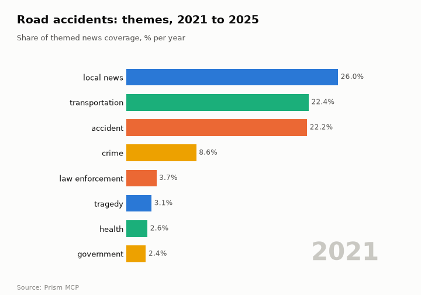

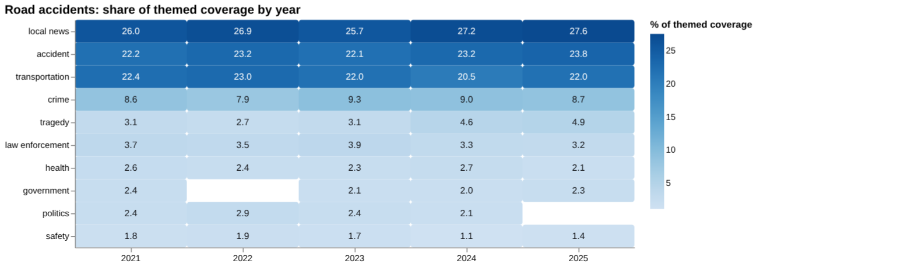

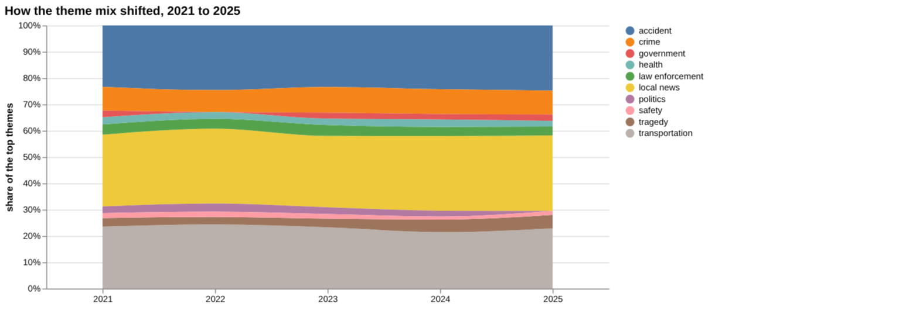

| Theme | 2021 | 2022 | 2023 | 2024 | 2025 |
| --- | ---: | ---: | ---: | ---: | ---: |
| local news | 26.0% | 26.9% | 25.7% | 27.2% | 27.6% |
| accident | 22.2% | 23.2% | 22.1% | 23.2% | 23.8% |
| transportation | 22.4% | 23.0% | 22.0% | 20.5% | 22.0% |
| crime | 8.6% | 7.9% | 9.3% | 9.0% | 8.7% |
| tragedy | 3.1% | 2.7% | 3.1% | 4.6% | 4.9% |
| law enforcement | 3.7% | 3.5% | 3.9% | 3.3% | 3.2% |
| health | 2.6% | 2.4% | 2.3% | 2.7% | 2.1% |
| government | 2.4% | – | 2.1% | 2.0% | 2.3% |
| politics | 2.4% | 2.9% | 2.4% | 2.1% | – |
| safety | 1.8% | 1.9% | 1.7% | 1.1% | 1.4% |

## For policy makers

Research output on road accidents was 168 papers in 2017 and 228 in 2025, with 238 in 2024. The central scenario for research volume is 236 in 2026, 243 in 2027 and 250 in 2028, with the sensitivity range widening to 188 to 314 by 2028. The scale of harm cited is large: 20,640 people lost their lives in traffic accidents in the European Union, and road traffic accidents involve 1,317 accidents and 474 fatalities daily. Annual GDP loss due to RTAs is given as 3%–5%, and Poland is cited with almost 60% reduction in traffic fatalities. Study geography is concentrated in the United States with 320 papers, followed by Brazil with 50, Canada with 48 and Australia with 46. News coverage is dominated by local reporting, with recent stories of fatal crashes in Ghana and Argentina.

- Research volume scenarios: central 236 in 2026, 243 in 2027, 250 in 2028
- Evidence base is concentrated in the United States (320 papers), with far fewer from other regions
- Poland's almost 60% reduction in traffic fatalities as a case worth examining
- Tragedy theme share rising from 3.1% in 2021 to 4.9% in 2025
- Safety theme share falling from 1.8% in 2021 to 1.4% in 2025

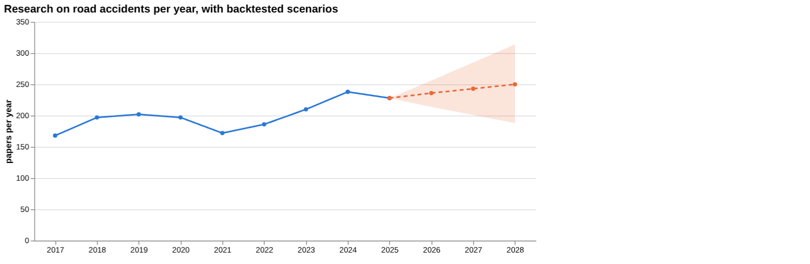

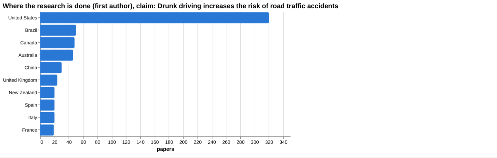

## For police & enforcement

For the claim that drunk driving increases the risk of road traffic accidents, the claim-specific literature covers 1,622 papers: 342 supporting, 480 qualifying, 27 contradicting and 773 neutral, with 31.3% contested. The framing is described as mostly positive with a substantial cautionary minority. Of the sources identified, 4 are meta-analyses, 5 trials, 8 reviews and 7 articles. However, among the documents actually read, 1 supports, 6 are unrelated and 3 are unread, and the counter-evidence check found no verified verdict supporting a wording recommendation. Among the comparison claims, speed cameras show 44.1% contested and helmet laws 67.6% contested; the speed camera claim's strongest source is an article from 2025 on New York City. The screening table gives a figure only for driver fatigue, at fewer than one percent of crashes with fatigue noted in a national database; missing values mean no figure was found, not no effect.

- Drunk driving claim: 1,622 papers, 31.3% contested, with 342 supporting and 27 contradicting
- Source tiers for the claim: 4 meta-analysis, 5 trial, 8 review, 7 article
- Document verdicts: 1 supports, 6 unrelated, 3 unread; no verified verdict supports a wording recommendation
- Speed cameras: strongest source is an article (2025, New York City), 44.1% contested
- Helmet laws: 67.6% contested; strongest source is a 2006 article; driver fatigue figure is fewer than one percent of crashes with fatigue noted

**Head to head:** Speed cameras reduce road traffic crashes vs Helmet laws reduce motorcycle crash deaths: the second claim has more evidence behind it.

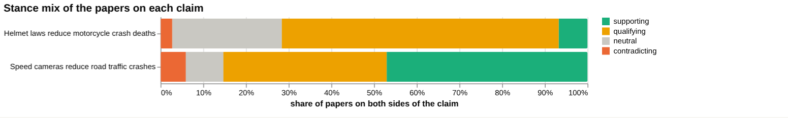

**Screen:** *Does … increase the risk of road traffic crashes?* (one row per line below)

| Row | Figure (quoted) | Measures | Source |
| --- | --- | --- | --- |
| drunk driving | no figure found |  | Do Brief Motivational Interventions Reduce Alcohol-impaired Driving Among College Students (2022) |
| speeding | no figure found |  | The Effects of External Motivation and Real-Time Automated Feedback on Speeding Behavior i (2012) |
| mobile phone use while driving | no figure found |  | Student motorcyclists’ mobile phone use while driving in Vientiane, Laos (2016) |
| not wearing seat belts | no figure found |  |  |
| driver fatigue | fewer than one percent | proportion of crashes with driver fatigue noted | Driver fatigue: crashes, the law, and traffic police officers’ experiences and views (2025) |
| poor road design | no figure found |  |  |

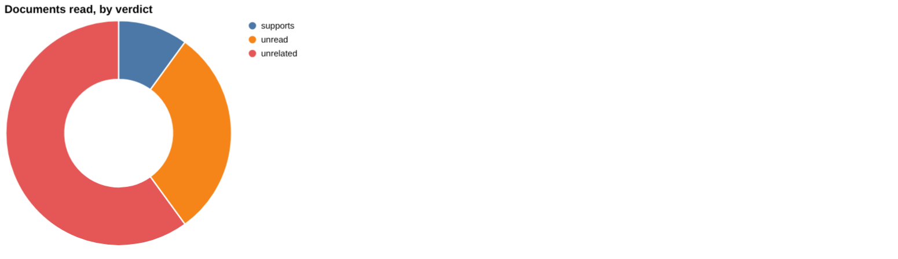

## For researchers

The literature mix across 94,144 papers is 51,661 supporting, 16,164 qualifying, 655 contradicting and 25,664 neutral, with 17.9% contested and no dominant lean. By orientation, descriptive papers number 519 (47.0%) and problem-identifying 315 (28.5%), while cautionary are 53 (4.8%) and critical 6 (0.5%). Contributions are mostly empirical, at 863 papers, with 115 methodological, 74 review, 48 position and 4 theoretical. Framing is described as broadly unchanged, with cautionary papers at 16.2% in the recent window against 19.6% in the earlier one, though contested share in 2025 was 22.7%. Newer work includes machine learning classifiers, sleep apnoea and sleepiness, and public perception of autonomous vehicles. The most cited recent items listed have 0 citations, so influence cannot yet be judged, and the screening rows for drunk driving, seat belts and poor road design found 0 papers.

- Why screening found 0 papers for seat belts and poor road design
- Whether the 2025 contested share of 22.7% marks a real shift given broadly unchanged framing overall
- Only 4 theoretical contributions against 863 empirical ones
- Critical orientation is just 6 papers; is critical appraisal thin?
- Evidence on emerging topics such as autonomous vehicles and sleep apnoea rests on few, recently published studies

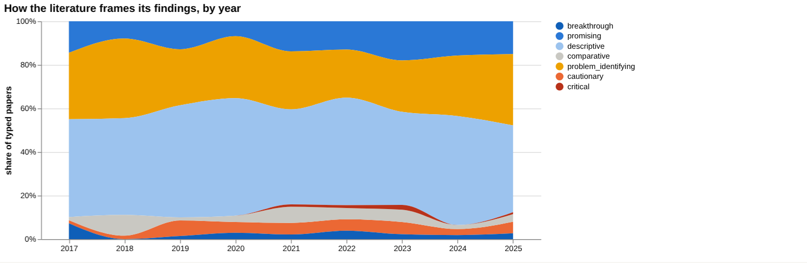

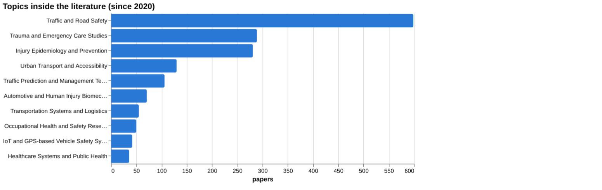

## Research exploration methods

Nine ways to explore the research, each run on this topic; the interactive report shows each call and its result.

### Evidence triangulation

*Is a claim supported, and by how strong a design?* `find_evidence` + `find_counter_evidence` + `rank_sources`

Of ten documents examined for the claim that drunk driving increases the risk of road traffic accidents, only 1 supports it, 6 are unrelated and 3 were unread, so the document-level check is thin. The wider corpus of 1,622 papers is more informative: 342 are supporting, 480 qualifying, 27 contradicting and 773 neutral, with contested share at 31.3, described as mostly positive framing with a substantial cautionary minority. The counter-evidence search returned 10 unrelated documents and nothing that contradicts, so the absence of disagreement here reflects a poor match rather than a settled question. The tool states that no verified document verdict supports a wording recommendation. The top-ranked sources (four meta-analyses, from 2022 to 2025, each with 0 citations) concern prevalence, brief interventions, cannabis legislation and fatal injuries, so none directly measures crash risk from drink-driving. A careful researcher would look for case-control or cohort studies that estimate crash risk by blood alcohol level, and read the 480 qualifying papers to see what they qualify.

### Head-to-head claims

*Which of two interventions has more and stronger evidence?* `compare_claims`

The two claims are measured the same way but are not evenly matched in what was captured. For speed cameras, 34 papers sit on both poles, the corpus mix is 16 supporting, 13 qualifying, 2 contradicting and 3 neutral, and a contested share of 44.1%. For helmet laws, papers on both poles is missing, the mix is 5 supporting, 48 qualifying, 2 contradicting and 19 neutral, and a contested share of 67.6%. The verdict says the second claim has more evidence behind it, but that sits awkwardly with the helmet mix, where only 5 papers are supporting and 48 are qualifying. Each strongest source is an article rather than a higher-tier design: a 2025 New York City longitudinal study of fixed speed cameras, and a 2006 paper on helmet laws and libertarian values. Documents read are small (1 supporting for cameras, 2 for helmets, the rest unrelated), so neither verdict rests on much reading. The comparison shows how much literature exists and how it leans, not which intervention saves more lives. A researcher would want the underlying quantitative effect estimates for each before drawing a contrast.

### Cross-row screening

*Which rows carry a measured, quoted figure, and how large is it?* `research_table`

Of six risk factors screened for a measured effect on crash risk, only driver fatigue returned a figure: fewer than one percent, the proportion of crashes with driver fatigue noted in a national database, from a 2025 paper based on 4 papers. That figure is a recording rate, not a risk increase, and it says nothing about how much fatigue raises crash likelihood; low recording may reflect under-detection. Drunk driving, speeding and mobile phone use returned no value, with 0, 2 and 1 papers respectively and sources that are only loosely relevant (for example, a motivational-intervention meta-analysis for drunk driving). Seat belts and poor road design found 0 papers and no source. The absence of values should be read as a failure of extraction for this question, not as evidence that these factors carry no effect. A careful researcher would rerun the screen with odds-ratio or relative-risk wording and targeted searches for each factor, and would not treat the single fatigue figure as comparable with the others.

### Framing drift

*Is the literature becoming more hopeful or more cautious?* `stance_trends`

From 2017 to 2025, positive share runs between 3.1 (2018) and 12.2 (2017), ending at 10.3 in 2025, so there is no steady move toward optimism. Contested_pct sits between 13.6 (2022) and 18.3 (2020) for most years, then rises to 22.7 in 2025, the highest value in the series. That 2025 jump is the only notable movement and could reflect a single year's mix of papers or incomplete counting for the latest year rather than a real shift. The 2017 positive figure of 12.2 followed by 3.1 in 2018 also suggests that the share is sensitive to the sample in a given year. The series describes how papers frame themselves, not whether road safety is improving or the findings are true. A researcher would check the number of typed papers behind each year and look at the 2025 contested papers directly before reading it as a trend.

### Frontier scan

*What is new, and what is the research not reaching?* `research_radar`

The most-cited new work since 2022 is led by a machine-learning classifier comparison (84 citations, orientation promising), followed by a decision-making model of driver behaviour factors and a Danish nationwide cohort on obstructive sleep apnoea (each 45), a sleepiness systematic review (37), and two papers at 34 each. The topics are modelling, sleepiness and sleep disorders, work-related factors and public perception of autonomous vehicles; none addresses drink-driving, speed or helmets directly. The framing shift compares 24,276 recent papers (cautionary_pct 16.2) with 22,834 earlier ones (19.6), a delta_pct_points of -3.4, read by the tool as broadly unchanged. The caveat that orientation labels a paper's own framing, not the truth, applies throughout. No under-covered topics list is given, so the scan cannot say what the research is missing. A researcher would read the sleep apnoea cohort as a design that measures crash outcomes and examine whether the modelling work has been validated outside its original data.

### Gap mapping

*Which parts of a claim does the literature actually cover?* `research_gaps`

The claim was split into two components, drunk driving increases accident risk and alcohol impairment raises crash likelihood, and both are marked as having evidence. This tells us a literature exists for each; it does not say how strong, how large the effect is, or what designs were used. The two components are close paraphrases of one another, so the check is little more than confirming that the topic has been studied. It does not break out the questions that would matter in practice, such as dose-response by alcohol level, differences by driver group, or effect on severity of injury. A researcher would split the claim more finely and test each part separately, since the earlier triangulation found only 1 supporting document among those read.

### Count history and backtested scenarios

*Is research on this growing, and where could it be in three years?* `historical_analysis` + `trend_scenarios`

Title-matched papers per year ran from 168 in 2017 to 228 in 2025, with a peak of 238 in 2024 and a dip to 172 in 2021. Growth is modest and uneven rather than steep: 197, 202, 197 across 2018 to 2020, then 186 in 2022 and 210 in 2023. The scenarios use a linear drift baseline and give central values of 236 for 2026, 243 for 2027 and 250 for 2028. The sensitivity bands widen with distance, from 214 to 256 in 2026, 201 to 285 in 2027 and 188 to 314 in 2028. These are extrapolations of publication counts that rely on title matching, so they indicate volume, not quality or progress in reducing crashes. The wide 2028 band shows that the projection is weak beyond the near term. A researcher would check whether the 2021 dip and the 2024 peak reflect real changes or changes in indexing.

### Geographic triangulation

*Where is it studied, published, reported and patented?* `global_comparison` + `newsgeo`

The United States dominates where the topic is studied with 320 papers, well ahead of Brazil (50), Canada (48), Australia (46), China (30), the United Kingdom (24), and New Zealand and Spain (20 each). The list is ranked, so the United States is the largest by a clear margin, but it covers only eight countries and the lane measures where studies are located, not where crashes occur or where harm is greatest. The where-reported-by-country lane is empty, so nothing can be said about news coverage and no comparison between research attention and public attention is possible. The absence of low- and middle-income countries in the top eight may reflect indexing or search wording rather than a lack of research, since other results mention Nepal, Laos and Kathmandu. A researcher would check country counts against crash burden data from outside this set before drawing a conclusion about neglect.

### Faceted browsing

*What kind of literature is it: empirical, review, position? Problem-identifying or promising?* `browse_research`

By contribution, 863 are empirical, 115 methodological, 74 review, 48 position and 4 theoretical. Taken together, this is a field that mainly documents and describes the problem rather than testing interventions. The leading topic is Traffic and Road Safety (599), followed by Trauma and Emergency Care Studies (289) and Injury Epidemiology and Prevention (281). The most-cited-since-2020 list is of 2025 papers, all at 0 citations, so it reflects recency rather than influence and should not be used to identify important work. A researcher would filter to empirical comparative and review papers when looking for effect evidence, and sort by design rather than by that list.

## Built with MCP

Every number and chart on this page comes from these 26 Prism MCP tool calls, made over MCP (streamable HTTP). Arguments and timings: [mcp_calls.json](mcp_calls.json); responses: [data.json](data.json).

| MCP tool | Calls |
| --- | ---: |
| `news_activities` | 1 |
| `news_geography` | 1 |
| `news_drill` | 2 |
| `prism_overview` | 1 |
| `news_themes` | 5 |
| `critical_news` | 1 |
| `historical_analysis` | 1 |
| `news_factors` | 1 |
| `stance_trends` | 1 |
| `browse_research` | 1 |
| `global_comparison` | 1 |
| `research_radar` | 1 |
| `research_gaps` | 1 |
| `research_brief` | 1 |
| `rank_sources` | 1 |
| `find_evidence` | 1 |
| `find_counter_evidence` | 1 |
| `deep_timeline` | 1 |
| `compare_claims` | 1 |
| `research_table` | 1 |
| `trend_scenarios` | 1 |

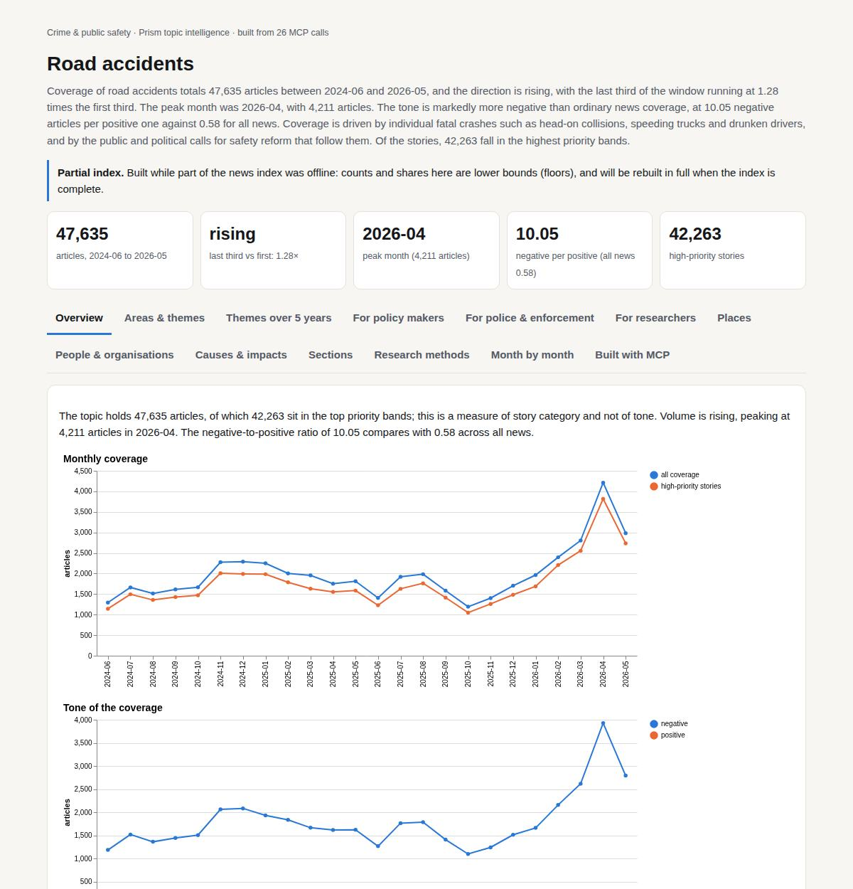

Try it: `prism entity "road accident"` · `prism call news.drill term='road accident' scope='drunk driving'` · `prism call analysis.timeline term='road accident'`

