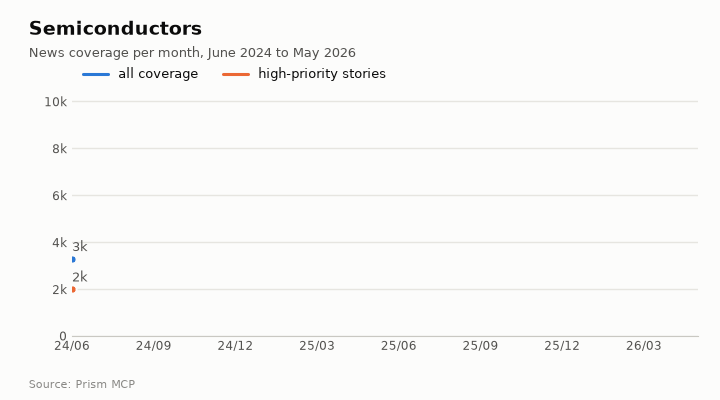
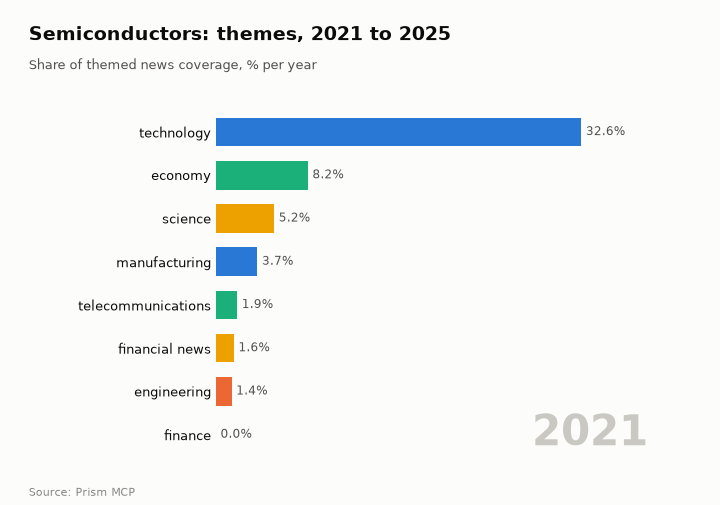
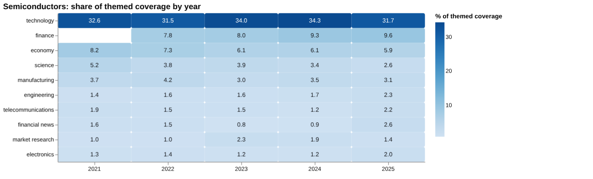
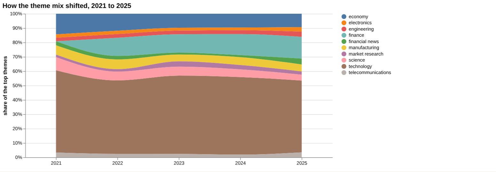
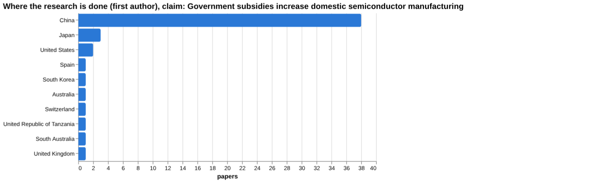
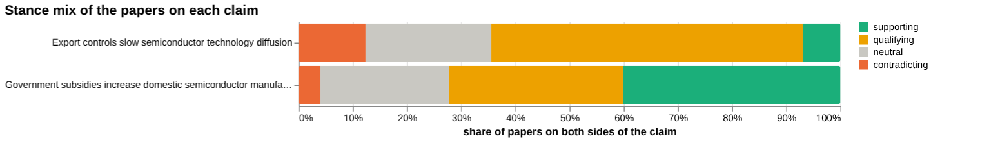
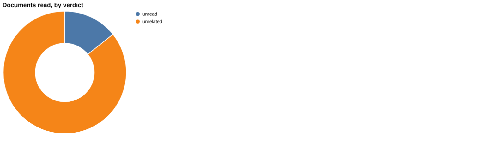
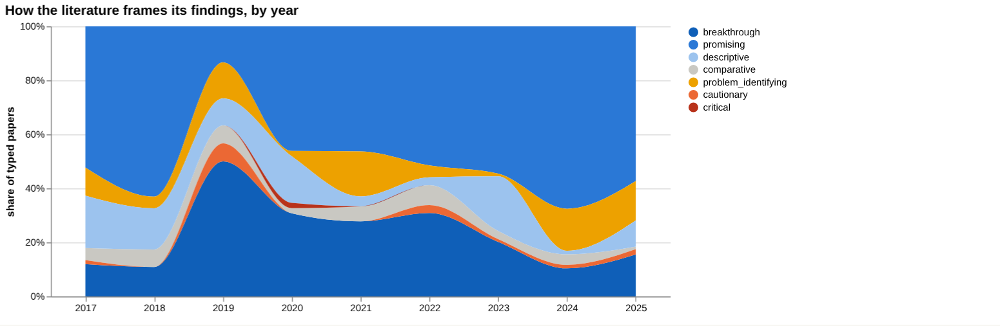
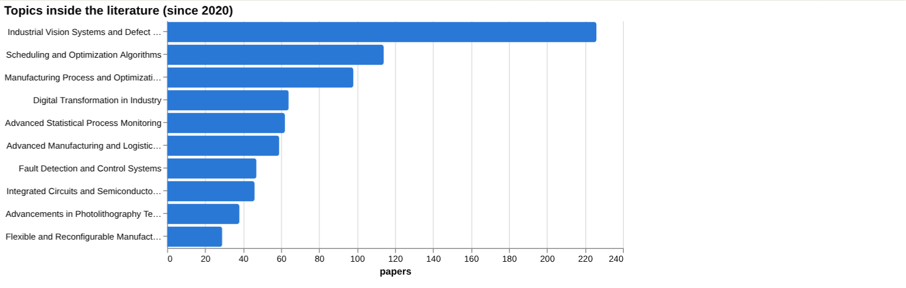
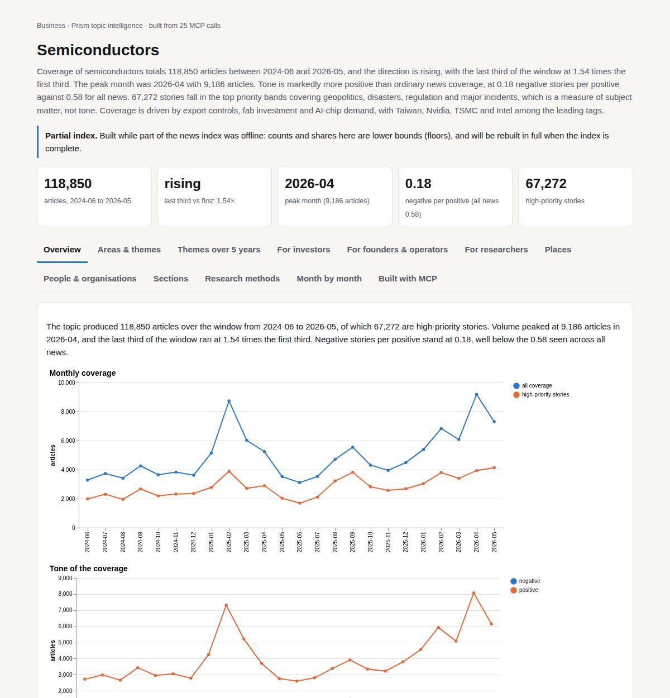

# Semiconductors

*Business · Prism topic intelligence* · **[Open the interactive page](https://fliarbi.com/demo/docs/prism-dashboards-3bb43e4c/topics/semiconductors/)** (tabs: Overview · Areas & themes · Themes over 5 years · For investors · For founders & operators · For researchers · Places · People & organisations · Sections · Research methods · Month by month · Built with MCP)

> **Partial index.** Built while part of the news index was offline: counts and shares here are lower bounds (floors), and will be rebuilt in full when the index is complete.

Coverage of semiconductors totals 118,850 articles between 2024-06 and 2026-05, and the direction is rising, with the last third of the window at 1.54 times the first third. The peak month was 2026-04 with 9,186 articles. Tone is markedly more positive than ordinary news coverage, at 0.18 negative stories per positive against 0.58 for all news. 67,272 stories fall in the top priority bands covering geopolitics, disasters, regulation and major incidents, which is a measure of subject matter, not tone. Coverage is driven by export controls, fab investment and AI-chip demand, with Taiwan, Nvidia, TSMC and Intel among the leading tags.

| Articles | Direction (last third vs first) | Peak month | Negative per positive | High-priority stories |
| ---: | --- | --- | ---: | ---: |
| 118,850 (2024-06 to 2026-05) | rising (1.54×) | 2026-04 (9,186) | 0.18 (all news 0.58) | 67,272 |

## Coverage over time

The topic produced 118,850 articles over the window from 2024-06 to 2026-05, of which 67,272 are high-priority stories. Volume peaked at 9,186 articles in 2026-04, and the last third of the window ran at 1.54 times the first third. Negative stories per positive stand at 0.18, well below the 0.58 seen across all news.

## Areas of activity and themes

Activity is concentrated in Electronic Components (26,558 articles) and Computer Components (23,546), followed by Manufacturing (9,275) and Engineering & Technology (7,172). The leading tags are semiconductors (45,298) and semiconductor (39,560), then taiwan (10,657), nvidia (10,487), tsmc (8,649), intel (7,373), iot (6,039) and amd (4,919).

| Area of activity | Articles |
| --- | ---: |
| Computers & Electronics › Electronics & Electrical › Electronic Components | 26,558 |
| Computers & Electronics › Computer Hardware › Computer Components | 23,546 |
| Business & Industrial › Manufacturing | 9,275 |
| Science › Engineering & Technology | 7,172 |
| Science › Physics | 2,578 |
| Computers & Electronics › Electronics & Electrical › Optoelectronics & Fiber | 1,351 |

**Top tags (what the themes are built from):** semiconductors (45,298), semiconductor (39,560), taiwan (10,657), nvidia (10,487), tsmc (8,649), intel (7,373), iot (6,039), amd (4,919)

## Where it is reported

The United States has the most country coverage with 35,739 articles, followed by China (13,881), India (13,490), Japan (7,795), Taiwan (7,211) and South Korea (7,113). In the state-level list, California leads with 6,566 articles, then Pennsylvania (5,908), Chungcheongbuk-do (3,638), Texas (3,527), Washington (2,936) and New York (2,515).

| Country | Articles | Lift | | Indian state | Articles | Lift |
| --- | ---: | ---: | --- | --- | ---: | ---: |
| United States | 35,739 | 1.1× | | California | 6,566 | 2.3× |
| China | 13,881 | 1.9× | | Pennsylvania | 5,908 | 2.3× |
| India | 13,490 | 1.4× | | Chungcheongbuk-Do | 3,638 | 30.2× |
| Japan | 7,795 | 3.5× | | Texas | 3,527 | 1.4× |
| Taiwan | 7,211 | 5.4× | | Washington | 2,936 | 1.4× |
| South Korea | 7,113 | 6.5× | | New York | 2,515 | 1.0× |

## People and organisations

The people most associated with the coverage are Morris Chang, Lip-Bu Tan, Ashwini Vaishnaw, Jensen Huang, Howard Lutnick and David K. Lam. The organisations most prominent are TSMC, NXP Semiconductors, Infineon Technologies, STMicroelectronics, Synopsys and Lam Research.

## Causes and impacts

No causes or impacts were recorded in the measured data for this topic. The timeline points to export controls, domestic fab investment and rising demand across AI, 5G, EVs and medical diagnostics as the forces shaping coverage.

## Sections inside the topic

The India section has 17,190 articles, a 14.46 per cent share of the topic, and is growing, with its late period at 1.34 times its early period. Its tone is slightly more positive than the topic overall, at 0.15 negative per positive against 0.18. The tariff section is much smaller at 2,717 articles, a 2.29 per cent share, but is growing faster, at 2.74 times between early and late periods. Its tone is far more negative, at 2.51 negative per positive.

| Section | Articles | Share of the topic | Late vs early | Negative per positive |
| --- | ---: | ---: | ---: | ---: |
| semiconductor → india | 17,190 | 14.46% | 1.34× | 0.15 (topic 0.18) |
| semiconductor → tariff | 2,717 | 2.29% | 2.74× | 2.51 (topic 0.18) |

## Research and outlook

The balance of research framing is broadly unchanged, with a shift of -0.3 points. The outlook gives a central projection of 399.125 for 2026, within a range of 294.125 to 504.125, rising to 463.375 for 2028 with a wider range of 148.375 to 778.375.

## Month by month

In 2025-06, Taiwan's export controls on Chinese chipmakers and Texas Instruments' $60 billion U.S. investment marked a geopolitical and funding shift. In 2025-10, a surge in demand and breakthroughs such as Samsung's HBM4 chip moved the market from steady growth to an exponential trajectory, and in 2026-01 a U.S. crackdown on AI chip exports and faster fab builds in Arizona signalled a protectionist phase.

- **2025-06:** Taiwan’s export controls on Chinese chipmakers and Texas Instruments’ $60 billion U.S. investment marked a geopolitical and funding shift that constrained China’s ambitions and boosted domestic production.
- **2025-10:** A surge in demand and breakthroughs like Samsung’s HBM4 chip moved the market from steady growth to an exponential trajectory, drawing strong investor attention to power‑semiconductor solutions.
- **2026-01:** U.S. political crackdown on AI chip exports and accelerated fab builds in Arizona signaled a new protectionist phase and a race to secure supply chains.

## Themes over five years

Technology stayed the leading theme throughout, at 32.6% of themed coverage in 2021 and 31.7% in 2025, with a peak of 34.3% in 2024. Economy fell from 8.2% in 2021 to 5.9% in 2025, while a separate finance theme appears from 2022 and reached 9.6% in 2025. Science declined from 5.2% in 2021 to 2.6% in 2025, and manufacturing moved from 3.7% to 3.1%. Smaller themes rose by 2025: engineering from 1.4% to 2.3%, telecommunications from 1.9% to 2.2%, financial news from 1.6% to 2.6%, and electronics from 1.3% to 2.0%, while market research went from 1.0% to 1.4%.

| Theme | 2021 | 2022 | 2023 | 2024 | 2025 |
| --- | ---: | ---: | ---: | ---: | ---: |
| technology | 32.6% | 31.5% | 34.0% | 34.3% | 31.7% |
| finance | – | 7.8% | 8.0% | 9.3% | 9.6% |
| economy | 8.2% | 7.3% | 6.1% | 6.1% | 5.9% |
| science | 5.2% | 3.8% | 3.9% | 3.4% | 2.6% |
| manufacturing | 3.7% | 4.2% | 3.0% | 3.5% | 3.1% |
| engineering | 1.4% | 1.6% | 1.6% | 1.7% | 2.3% |
| telecommunications | 1.9% | 1.5% | 1.5% | 1.2% | 2.2% |
| financial news | 1.6% | 1.5% | 0.8% | 0.9% | 2.6% |
| market research | 1.0% | 1.0% | 2.3% | 1.9% | 1.4% |
| electronics | 1.3% | 1.4% | 1.2% | 1.2% | 2.0% |

## For investors

The index holds 16,303 news articles from 2019-01-01..2026-06-01 and 9,424 patents with matching titles from 2005-2024, so the topic is heavily covered. Finance coverage reached 9.6% of themed coverage in 2025, while technology stayed near a third at 31.7%. Where research is located, China accounts for 38 of the geographically attributed studies, followed by Japan with 3 and the United States with 2. The subsidy claim, that government subsidies increase domestic semiconductor manufacturing, has 626 papers in its corpus, of which 251 are supporting and 25 contradicting, but no verified document verdict supports it. The scenario baseline is linear drift, with a central figure of 399 for 2026, 431 for 2027 and 463 for 2028, and the sensitivity range widens from 294 to 504 in 2026 to 148 to 778 in 2028. Environmental figures such as 1.15 kWh/cm2 of energy and 8.22 L/cm2 of water per cm2 point to resource intensity as a factor in fab operations.

- Finance theme at 9.6% of themed coverage in 2025
- Geographic concentration: China 38 studies, Japan 3, United States 2
- Scenario range for 2028 spans 148 to 778 around a central 463
- Subsidy claim lacks verified document support despite 626 papers
- Resource intensity: 1.15 kWh/cm2 energy and 8.22 L/cm2 water

## For founders & operators

On the claim that government subsidies increase domestic semiconductor manufacturing, the surrounding corpus of 626 papers splits into 251 supporting, 201 qualifying, 25 contradicting and 149 neutral, with 36.1% contested. Of the documents read, none supports, contradicts or qualifies the claim: 6 were unrelated and 1 was unread. The strongest source listed, a 2016 article on BYD and government subsidies in China, was judged unrelated, so the recommendation is that no verified verdict supports a wording choice. By comparison, the claim that export controls slow semiconductor technology diffusion has 23 supporting, 191 qualifying and 41 contradicting papers, with 69.9% contested, and its 12 documents read were unrelated. The head-to-head reading is that the subsidy claim has more evidence behind it, though this rests on the corpus mix rather than on read documents. Screening found no figure for subsidies, export controls, talent shortages, water use or supply chain disruption, which means none was found, not that there is no effect.

- Subsidy claim corpus: 626 papers, 36.1% contested; documents read gave no supporting verdict (article tier: 6 documents, preprint tier: 1)
- Export controls claim: 69.9% contested across its corpus; 12 documents read were unrelated
- Top subsidy sources are articles, the leading one from 2016 cited by 90 and judged unrelated
- Gap check: subsidies and fab investment, and public funding and capacity, show evidence; subsidies and domestic chip output shows none
- Environmental figures (83.7% electricity share of energy, 47.0% surface water share of water) come without a stated population

**Head to head:** Government subsidies increase domestic semiconductor manufacturing vs Export controls slow semiconductor technology diffusion: the first claim has more evidence behind it.

**Screen:** *What is the effect of … on semiconductor manufacturing?* (one row per line below)

| Row | Figure (quoted) | Measures | Source |
| --- | --- | --- | --- |
| subsidies | no figure found |  | Advancements in hydrogen energy systems: A review of levelized costs, financial incentives (2024) |
| export controls | no figure found |  | The Limits of Export Controls under Economic Interdependence : A Comparative Analysis of R (2025) |
| talent shortages | no figure found |  |  |
| water use | no figure found |  | The WULCA consensus characterization model for water scarcity footprints: assessing impact (2017) |
| supply chain disruption | no figure found |  |  |
| energy use | no figure found |  | Optimization of energy consumption in industrial robots, a review (2023) |

## For researchers

The literature holds 163,600 research papers for 2017-2025, of which 108,000 are supporting, 16,075 qualifying, 859 contradicting and 38,666 neutral, with 10.4% contested. That framing is overwhelmingly positive, which on a citation-weighted corpus can mean consensus or publication bias. In the themed set, promising work makes up 39.1% and breakthrough 30.9%, while cautionary is 1.4% and critical 0.1%. Contributions are mostly methodological, with 474 papers, against 149 empirical and 80 review papers. Leading topics are industrial vision and defect detection with 226 papers and scheduling and optimisation algorithms with 114. Framing is broadly unchanged between windows, with cautionary share at 9.9% in the recent window of 38,781 papers and 10.9% in the earlier window of 42,925, and orientation labels reflect a paper's own framing, not truth.

- Is the positive framing consensus or publication bias, given only 859 contradicting papers?
- Why do empirical studies of subsidy effects on domestic chip output show no evidence in the gap check?
- Why do the screening rows for talent shortages and supply chain disruption return no sources?
- Only 55 the health literature index records and 27 preprints exist; what do studies outside engineering show?
- Environmental figures lack stated populations, so how comparable are they across fabs?

## Research exploration methods

Nine ways to explore the research, each run on this topic; the interactive report shows each call and its result.

**Chaining them.** Start with the faceted browse and the frontier scan to see that the literature is mainly about process engineering and inspection, not policy. Then run gap mapping on the subsidy claim, which shows that chip output has no literature, and use that to direct the triangulation and head-to-head comparison towards semiconductor-specific policy studies. Because the screening returned no effect sizes and the document verdicts were mostly unrelated, narrow the queries before trusting any comparison between subsidies and export controls. Use the framing trend and geography lane to see whether the apparent tone and the China concentration come from semiconductor papers or from adjacent subsidy literature. Retrieve the annual counts before using the scenario projections.

### Evidence triangulation

*Is a claim supported, and by how strong a design?* `find_evidence` + `find_counter_evidence` + `rank_sources`

The claim that government subsidies increase domestic semiconductor manufacturing has no verified support in the documents read. Of the claim documents, 6 were judged unrelated and 1 was unread; by tier, 6 were articles and 1 was a preprint. The wider corpus of 626 papers splits into 251 supporting, 201 qualifying, 25 contradicting and 149 neutral, with a contested share of 36.1%, which the tool reads as mostly positive framing with a substantial cautionary minority. The counter-evidence search returned 0 supports, 0 contradicts and 0 qualifies, with 5 unrelated and 1 unread, so nothing was found against the claim either. The top-cited sources (for example the BYD electric vehicle paper, cited by 90) concern subsidies in other industries, not chips. A careful researcher would treat the corpus stance mix as a mood measure, not evidence of effect, and would look for semiconductor-specific policy evaluations before relying on the claim.

### Head-to-head claims

*Which of two interventions has more and stronger evidence?* `compare_claims`

The two claims were measured the same way, and the tool's verdict is that the first claim, on subsidies, has more evidence behind it. That rests on the corpus mix: subsidies show 251 supporting, 201 qualifying, 25 contradicting and 149 neutral (a contested share of 36.1%), against 23 supporting, 191 qualifying, 41 contradicting and 77 neutral for export controls (a contested share of 69.9%). Papers on both poles were 0 for each claim. In documents read, neither claim has any supporting, contradicting or qualifying verdict: subsidies have 6 unrelated and 1 unread, export controls 12 unrelated and 2 unread. Each strongest source was itself judged unrelated, so the verdict reflects framing in the wider literature and not verified findings. Export controls look more contested and more qualified, which suggests a less settled picture, but the comparison does not show which policy works better.

### Cross-row screening

*Which rows carry a measured, quoted figure, and how large is it?* `research_table`

The screening found no quoted effect size for any of the six rows: subsidies, export controls, talent shortages, water use, supply chain disruption and energy use all returned a null value, with no measure or population. Papers counted were 0 for five rows and 7 for energy use, yet even that row produced no figure. The sources named are mostly off-topic, such as a hydrogen energy review for subsidies and an industrial robots review for energy use, and talent shortages and supply chain disruption returned no source at all. This absence means the literature, as indexed here, does not state quantified effects of these factors on semiconductor manufacturing in a form the tool could extract. It should not be read as showing the effects are small or absent. A careful researcher would use narrower queries or specialist sources, such as industry or government data, to find measured effects.

### Framing drift

*Is the literature becoming more hopeful or more cautious?* `stance_trends`

The positive share of framing moves without a steady direction across 2017 to 2025. It was 54.4 in 2017, dipped to 23.8 in 2019, returned to 54.8 in 2020, peaked at 58.3 in 2023, then fell to 41.1 in 2024 and 34.7 in 2025. The contested share stayed low throughout, from 1.6 in 2023 to 11.8 in 2021, with 7.9 in 2025. The recent fall in positive framing was not matched by a large rise in contested framing, so the shift may reflect more neutral or descriptive papers and not growing doubt. The labels describe how papers frame themselves, not whether their claims are true. Year-level percentages can be volatile if the typed paper count per year is small, and the counts are not given, so single-year swings such as 2019 should be read cautiously.

### Frontier scan

*What is new, and what is the research not reaching?* `research_radar`

The most-cited recent work is dominated by process engineering, not policy. The top item is an environmental study on high water and energy consumption (2023, cited by 90, descriptive), followed by deep-learning fault inspection (2022, cited by 59, breakthrough) and smart manufacturing for supply chain management (2022, cited by 55, promising). Several others concern anomaly or fault detection using autoencoders. The framing shift between windows is small: recent papers number 38,781 with cautionary_pct 9.9, earlier papers 42,925 with 10.9, a delta of -1.0 percentage points, read as broadly unchanged. The tool's caveat applies: orientation labels the paper's own framing, not the truth. No under-covered topics are listed in the output, so the scan does not say what the research is missing. A careful researcher would note that the environmental-footprint paper is the most-cited new work and sits apart from the yield and inspection cluster.

### Gap mapping

*Which parts of a claim does the literature actually cover?* `research_gaps`

The claim was split into three components, and the literature check found coverage for two. Evidence exists for 'government subsidies boost semiconductor fab investment' and for 'public funding raises semiconductor manufacturing capacity'. No evidence was found for 'subsidies increase domestic chip output'. This matters because the full claim is about manufacturing, and output is the most direct measure of it, while investment and capacity are inputs. A 'yes' means a literature exists on that component, not that it supports the claim or is of good quality, and the earlier triangulation found no verified supporting document. A careful researcher would target the output component directly, looking for production or shipment data linked to subsidy programmes.

### Count history and backtested scenarios

*Is research on this growing, and where could it be in three years?* `historical_analysis` + `scenarios`

The count of papers per year came back empty, so there is no observed history to read and growth cannot be judged from this output. The scenarios therefore rest on a linear_drift baseline whose underlying counts are not shown. They project 399 in 2026 (sensitivity band 294 to 504), 431 in 2027 (221 to 641) and 463 in 2028 (148 to 778). The band widens each year, so the 2028 central figure is far less certain than the 2026 one. Because the input series is not visible, these numbers cannot be checked against actual counts or the backtest result. A careful researcher would rerun the yearly counts with an explicit window and confirm the series before using the projections.

### Geographic triangulation

*Where is it studied, published, reported and patented?* `global_comparison` + `newsgeo`

Studies are concentrated in one country: China has 38, followed by Japan with 3, the United States with 2, and one each for Spain, South Korea, Australia, Switzerland and the United Republic of Tanzania. This lane shows where the research is studied, not where it is published, reported or patented. The reported-by-country lane is empty, so there is no news geography to compare, and the lanes are not to be added together. The pattern suggests the evidence base is geographically narrow, which limits how far findings could transfer to other policy settings. It does not show where semiconductor manufacturing itself is located. A careful researcher would check whether the China-heavy count reflects the subsidy claim wording or the indexed literature more broadly.

### Faceted browsing

*What kind of literature is it: empirical, review, position? Problem-identifying or promising?* `browse_research`

The literature on semiconductor manufacturing is mostly technical and favourable in framing. By orientation, promising has 288 papers (39.1%), breakthrough 228 (30.9%), descriptive 115 (15.6%), problem_identifying 73 (9.9%), comparative 22 (3.0%), cautionary 10 (1.4%) and critical 1 (0.1%). By contribution, methodological papers number 474, empirical 149, review 80, position 33 and theoretical 1. The leading topics are Industrial Vision Systems and Defect Detection (226), Scheduling and Optimization Algorithms (114) and Manufacturing Process and Optimization (98); policy topics do not appear in the top ten. The most-cited-since-2020 list shows 0 citations for every entry, which reflects their 2025 dates and means citations cannot rank recent work here. A careful researcher would conclude that this body of work speaks to engineering methods, not to the policy claims tested elsewhere.

## Built with MCP

Every number and chart on this page comes from these 25 Prism MCP tool calls, made over MCP (streamable HTTP). Arguments and timings: [mcp_calls.json](mcp_calls.json); responses: [data.json](data.json).

| MCP tool | Calls |
| --- | ---: |
| `news_activities` | 1 |
| `news_geography` | 1 |
| `prism_overview` | 1 |
| `news_drill` | 2 |
| `news_themes` | 5 |
| `news_factors` | 1 |
| `historical_analysis` | 1 |
| `stance_trends` | 1 |
| `critical_news` | 1 |
| `browse_research` | 1 |
| `research_radar` | 1 |
| `research_brief` | 1 |
| `research_gaps` | 1 |
| `global_comparison` | 1 |
| `find_evidence` | 1 |
| `rank_sources` | 1 |
| `find_counter_evidence` | 1 |
| `deep_timeline` | 1 |
| `compare_claims` | 1 |
| `research_table` | 1 |

Try it: `prism entity "semiconductor"` · `prism call news.drill term='semiconductor' scope='india'` · `prism call analysis.timeline term='semiconductor'`

