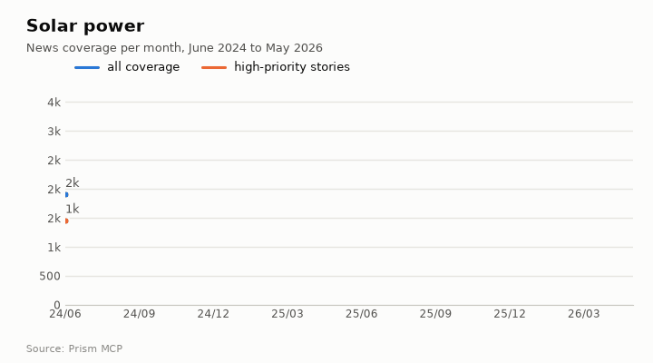
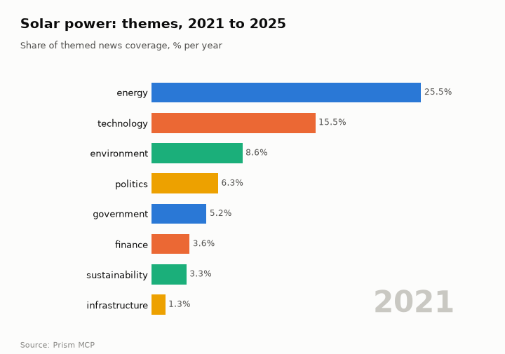
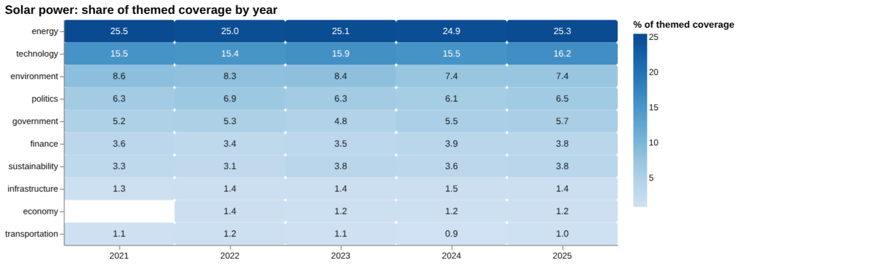
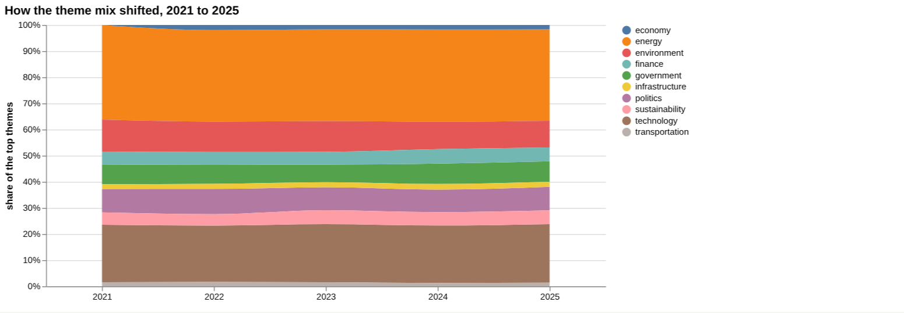
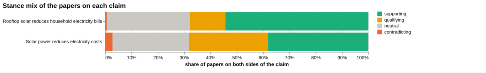
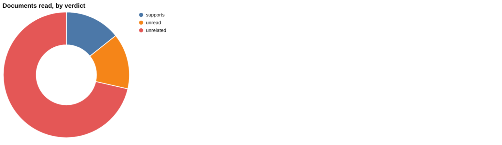
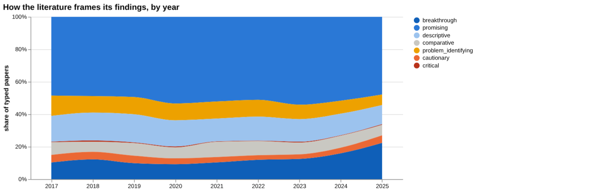
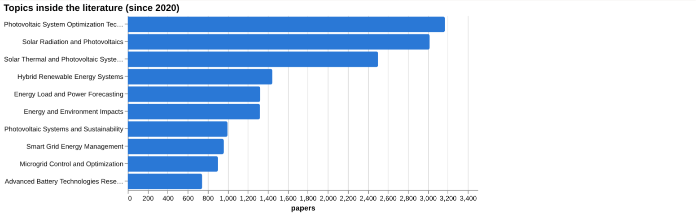
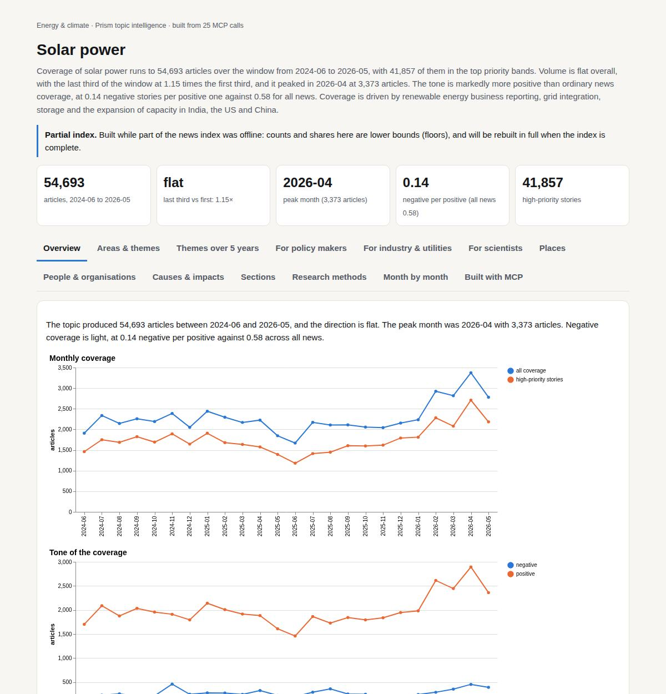

# Solar power

*Energy & climate · Prism topic intelligence* · **[Open the interactive page](https://fliarbi.com/demo/docs/prism-dashboards-3bb43e4c/topics/solar-power/)** (tabs: Overview · Areas & themes · Themes over 5 years · For policy makers · For industry & utilities · For scientists · Places · People & organisations · Causes & impacts · Sections · Research methods · Month by month · Built with MCP)

> **Partial index.** Built while part of the news index was offline: counts and shares here are lower bounds (floors), and will be rebuilt in full when the index is complete.

Coverage of solar power runs to 54,693 articles over the window from 2024-06 to 2026-05, with 41,857 of them in the top priority bands. Volume is flat overall, with the last third of the window at 1.15 times the first third, and it peaked in 2026-04 at 3,373 articles. The tone is markedly more positive than ordinary news coverage, at 0.14 negative stories per positive one against 0.58 for all news. Coverage is driven by renewable energy business reporting, grid integration, storage and the expansion of capacity in India, the US and China.

| Articles | Direction (last third vs first) | Peak month | Negative per positive | High-priority stories |
| ---: | --- | --- | ---: | ---: |
| 54,693 (2024-06 to 2026-05) | flat (1.15×) | 2026-04 (3,373) | 0.14 (all news 0.58) | 41,857 |

## Coverage over time

The topic produced 54,693 articles between 2024-06 and 2026-05, and the direction is flat. The peak month was 2026-04 with 3,373 articles. Negative coverage is light, at 0.14 negative per positive against 0.58 across all news.

## Areas of activity and themes

The main areas of activity are Renewable & Alternative Energy, with 43,114 articles, and Electricity, with 14,908, followed by Green Living & Environmental Issues with 8,181. The leading tags are solar power (47,901), renewable energy (26,903) and sustainability (20,243), and themes include solar photovoltaic systems, community solar, hybrid systems, feed-in tariffs, grid integration and energy storage.

| Area of activity | Articles |
| --- | ---: |
| Business & Industrial › Energy & Utilities › Renewable & Alternative Energy | 43,114 |
| Business & Industrial › Energy & Utilities › Electricity | 14,908 |
| People & Society › Social Issues & Advocacy › Green Living & Environmental Issues | 8,181 |
| Business & Industrial › Energy & Utilities | 2,789 |
| Computers & Electronics › Electronics & Electrical › Power Supplies | 2,439 |
| Autos & Vehicles › Motor Vehicles (By Type) › Hybrid & Alternative Vehicles | 1,718 |

**Top tags (what the themes are built from):** solar power (47,901), renewable energy (26,903), sustainability (20,243), mw (11,865), energy efficiency (11,250), energy policy (7,143), solar (5,375), clean energy (4,539)

## Where it is reported

Among states, California (2,998), Texas (2,830) and Pennsylvania (2,641) lead, while the Indian states of Gujarat (1,548) and Rajasthan (1,485) also feature strongly.

| Country | Articles | Lift | | Indian state | Articles | Lift |
| --- | ---: | ---: | --- | --- | ---: | ---: |
| United States | 14,088 | 1.0× | | California | 2,998 | 1.8× |
| India | 9,776 | 2.3× | | Texas | 2,830 | 1.9× |
| China | 3,842 | 1.2× | | Pennsylvania | 2,641 | 1.8× |
| United Kingdom | 3,307 | 1.0× | | Gujarat | 1,548 | 16.0× |
| Australia | 2,623 | 0.9× | | Rajasthan | 1,485 | 13.4× |
| Germany | 2,038 | 2.5× | | New York | 1,479 | 1.0× |

## People and organisations

Named figures include Pralhad Joshi, Gautam Adani, Ed Miliband and Anil Ambani, alongside Lorde and Charles Kennedy. Organisations most often mentioned include Enphase Energy and Adani Green Energy.

## Causes and impacts

One cause cited is solar power installed after cyclone Gabrielle, along with the construction of solar-powered homes. Reported impacts include about 200 people using civil defence centres and 100 displaced families finding a new lease on life.

**Causes named in the coverage:** solar power installed after cyclone Gabrielle, constructed solar-powered homes

**Impacts:** about 200 people used civil defence centres, 100 displaced families found a new lease on life

## Sections inside the topic

Rooftop accounts for 2,157 articles, or 3.94% of the topic, and manufacturing for 1,866, or 3.41%. Rooftop coverage grew more strongly, with a late-versus-early ratio of 1.33 against 1.06 for manufacturing. Both sections are more positive than the topic as a whole, at 0.07 and 0.08 negative per positive against 0.14 for the topic.

| Section | Articles | Share of the topic | Late vs early | Negative per positive |
| --- | ---: | ---: | ---: | ---: |
| solar power → rooftop | 2,157 | 3.94% | 1.33× | 0.07 (topic 0.14) |
| solar power → manufacturing | 1,866 | 3.41% | 1.06× | 0.08 (topic 0.14) |

## Research and outlook

The balance of framing is broadly unchanged, with a shift of -2.1 points. The outlook holds at 2053 articles in each of 2026, 2027 and 2028, with the range widening from 1,663 to 2,443 in 2026 to 883 to 3,223 in 2028.

## Month by month

Coverage opened in 2025-06 with mixed signals, as strong expansion in India and the US contrasted with European security and supply-chain setbacks. In 2025-08 US political headwinds and Australia's move toward storage shifted attention to pairing solar with batteries, and in 2025-10 solar surged globally, reaching 1.5 TW of installed capacity.

- **2025-06:** Mixed signals emerged: strong solar expansion in India and the US contrasted with European security and supply‑chain setbacks, indicating divergent regional trajectories.
- **2025-08:** US political headwinds intensified and Australia’s market pivoted toward storage, marking a shift from pure capacity growth to integrating solar with battery solutions.
- **2025-10:** Solar surged globally, becoming the cheapest large‑scale energy source and reaching 1.5 TW installed capacity, cementing its role in the energy mix.

## Themes over five years

Coverage themes were largely stable from 2021 to 2025. Energy moved from 25.5% in 2021 to 25.3% in 2025, and technology from 15.5% to 16.2%. Environment fell from 8.6% to 7.4%, while politics went from 6.3% to 6.5% and government from 5.2% to 5.7%. Finance was 3.6% in 2021 and 3.8% in 2025, sustainability 3.3% and 3.8%, infrastructure 1.3% and 1.4%, and transportation 1.1% and 1.0%. Economy first appears in 2022 at 1.4% and stands at 1.2% in 2025.

| Theme | 2021 | 2022 | 2023 | 2024 | 2025 |
| --- | ---: | ---: | ---: | ---: | ---: |
| energy | 25.5% | 25.0% | 25.1% | 24.9% | 25.3% |
| technology | 15.5% | 15.4% | 15.9% | 15.5% | 16.2% |
| environment | 8.6% | 8.3% | 8.4% | 7.4% | 7.4% |
| politics | 6.3% | 6.9% | 6.3% | 6.1% | 6.5% |
| government | 5.2% | 5.3% | 4.8% | 5.5% | 5.7% |
| finance | 3.6% | 3.4% | 3.5% | 3.9% | 3.8% |
| sustainability | 3.3% | 3.1% | 3.8% | 3.6% | 3.8% |
| infrastructure | 1.3% | 1.4% | 1.4% | 1.5% | 1.4% |
| economy | – | 1.4% | 1.2% | 1.2% | 1.2% |
| transportation | 1.1% | 1.2% | 1.1% | 0.9% | 1.0% |

## For policy makers

Solar power is a large field in the index: 134,055 research papers for 2017-2025 and 45,668 news articles for 2019-01-01..2026-06-01, plus 18,385 patents for 2005-2024. Themed news coverage has been steady, with energy at 25.3% and technology at 16.2% in 2025. The scenario figures hold a central value of 2053 for each of 2026, 2027 and 2028, with sensitivity ranges widening from 1,663 to 2,443 in 2026, to 1,273 to 2,833 in 2027 and 883 to 3,223 in 2028. The baseline is labelled no_change. One regional figure is given: 427 projects (32%) in the Jeollanam region. No country-level reporting data is available, so geographic comparison is not possible from these facts. Land use, employment and panel prices returned no papers in the screening, which marks areas where the index offers little to draw on.

- Scenario range widens from 1,663 to 2,443 (2026) to 883 to 3,223 (2028) around a central 2053
- Jeollanam region holds 427 projects (32%)
- No papers found for employment or panel prices in screening
- Grid stability has 6 screened papers, the most of any screening row
- Government theme at 5.7% of themed coverage in 2025

## For industry & utilities

On the claim that solar power reduces electricity costs, 533 papers sit at both poles: 203 supporting, 160 qualifying, 15 contradicting and 155 neutral, with 32.8% contested. The framing is described as mostly positive with a substantial cautionary minority. Of seven documents read, one supports, none contradict or qualify, six are unrelated and one is unread. All seven are at the article tier, and the tally states this sample does not establish scientific consensus. The strongest source is a 2025 article on optimising solar farm locations for revenue and reduced electricity costs in deregulated markets. For the rooftop claim on household bills, the read documents show no support: ten unrelated and two unread, so that claim has weaker direct backing here. Model accuracy figures exist for forecasting: mean absolute percentage error of 4.58 on sunny day predictions and 7.06 on cloudy day predictions.

- Electricity cost claim: 1 document supports, 0 contradict, 6 unrelated (article tier only)
- Corpus stance on cost claim: 203 supporting, 160 qualifying, 15 contradicting, 32.8% contested
- Rooftop bills claim: no documents read support it (10 unrelated, 2 unread; article tier)
- Forecast error of 4.58 (sunny) versus 7.06 (cloudy), mean absolute percentage error
- Molten chloride salt mixtures: thermal stability > 800 °C at < 0.35 USD∙kg−1

**Head to head:** Solar power reduces electricity costs vs Rooftop solar reduces household electricity bills: the first claim has more evidence behind it.

**Screen:** *What is the effect of solar power on …?* (one row per line below)

| Row | Figure (quoted) | Measures | Source |
| --- | --- | --- | --- |
| electricity costs | no figure found |  | A Comprehensive Review of Renewable and Sustainable Energy Sources with Solar Photovoltaic (2024) |
| carbon emissions | no figure found |  | Optimizing the Utilization of 1,35 MW Grid-Connected Solar Power Plants to Reduce Carbon E (2025) |
| grid stability | no figure found |  | A Comprehensive Review of Load Frequency Control and Solar Energy Integration: Challenges  (2025) |
| land use | no figure found |  | ASSESSMENT OF CROPLAND TRANSITION TO SOLAR FARMS AND OTHER LAND USE/COVER USING RS, GIS AN (2023) |
| employment | no figure found |  |  |
| panel prices | no figure found |  |  |

## For scientists

The literature mix across 134,055 papers is 79,465 supporting, 16,470 qualifying, 1,000 contradicting and 37,120 neutral, read as mixed framing with no dominant lean and 13.0% contested. Among oriented papers, promising accounts for 7,023 (51.3%) and breakthrough 1950 (14.2%), against cautionary at 525 (3.8%) and critical at 58 (0.4%). Contribution types lean towards methodological (6,890) and empirical (5,456), with theoretical work at 45. The leading topic is Photovoltaic System Optimization Techniques with 3,170 papers, followed by Solar Radiation and Photovoltaics with 3,018. Thin areas include land use and carbon emissions (2 papers each in screening), and employment and panel prices (none found); the health literature index holds 206 records and arXiv 97 preprints.

- Why is critical work only 58 papers (0.4%) against 7,023 promising?
- What empirical evidence links solar to electricity costs beyond the article tier?
- Can land use, employment and panel prices be studied given none or few screened papers?
- Does the small theoretical output (45 papers) limit explanation of results?
- Do forecasting gains under cloudy conditions (7.06 error) hold across regions?

## Research exploration methods

Nine ways to explore the research, each run on this topic; the interactive report shows each call and its result.

**Chaining them.** Begin with triangulation to confirm the overall stance and identify the limited sample of supporting documents. Use head‑to‑head to compare the claim with related assertions such as rooftop solar, noting the disparity in document counts and strongest sources. Apply screening to seek quantitative effect sizes for key outcomes, recognising the current lack of reported measures. Examine framing drift and frontier scans to understand temporal shifts in optimism and to locate recent, highly cited studies that may update the evidence base. Finally, employ gap mapping, geographic triangulation and facet browsing to pinpoint which sub‑claims are covered, where research is conducted, and which orientations dominate, guiding targeted retrieval of robust studies.

### Evidence triangulation

*Is a claim supported, and by how strong a design?* `find_evidence` + `find_counter_evidence` + `rank_sources`

The evidence triangulation sample contains one document that supports the claim that solar power reduces electricity costs, five documents classified as unrelated, and one document not read. Across the broader corpus of 533 papers, the stance distribution is 203 supporting, 160 qualifying, 15 contradicting and 155 neutral, giving a contested percentage of 32.8. The reading notes a mostly positive framing with a substantial cautionary minority. The sample does not provide a measure of overall scientific consensus because the selection is limited and many documents are unrelated or unread. A careful researcher would need to expand the sample, assess the quality of the supporting and qualifying papers, and seek additional counter‑evidence to gauge consensus.

### Head-to-head claims

*Which of two interventions has more and stronger evidence?* `compare_claims`

In the head‑to‑head comparison, claim A (solar power reduces electricity costs) is linked to 533 papers with a stance mix identical to the triangulation result (203 supporting, 160 qualifying, 15 contradicting, 155 neutral) and a contested percentage of 32.8. The documents read for claim A include one supporting source and six unrelated, with the strongest source being the 2025 article “Optimizing solar farm locations for revenue and reduced electricity costs in deregulated electricity markets” which supports the claim. Claim B (rooftop solar reduces household electricity bills) is associated with only three papers in the pole‑to‑pole count but a much larger corpus mix (37,038 supporting, 9,115 qualifying, 412 contradicting, 21,567 neutral) and a contested percentage of 14.0. No supporting documents were read for claim B and the strongest source is classified as unrelated. The verdict states that the first claim has more evidence behind it, but the analysis does not establish the relative quality or relevance of the large supporting numbers for claim B. A careful researcher would need to verify the relevance of the large supporting count for claim B, examine the methodological rigour of the strongest sources, and might consider additional comparative metrics beyond document counts.

### Cross-row screening

*Which rows carry a measured, quoted figure, and how large is it?* `research_table`

The cross‑row screening returned null values for effect size, measure, and population for all six examined rows, including electricity costs, carbon emissions, grid stability, land use, employment and panel prices. The number of papers identified for each row ranges from two papers for electricity costs and carbon emissions, six papers for grid stability, to zero papers for land use, employment and panel prices. The source titles are provided for the rows with papers, but no quantitative effect is reported. The absence of reported effect sizes means the screening does not reveal any measured impact of solar power on the listed outcomes. A careful researcher would need to locate primary studies that quantify these effects, extract the relevant statistics, and assess their applicability.

### Framing drift

*Is the literature becoming more hopeful or more cautious?* `stance_trends`

The framing drift analysis shows a gradual increase in the proportion of positive papers from 28.8 % in 2017 to 34.2 % in 2025. Concurrently, the contested proportion declines from 8.6 % in 2017 to 5.6 % in 2025. These figures suggest a slow shift towards more hopeful literature and fewer contested positions over the examined period. The data do not indicate the underlying reasons for the shift nor the absolute volume of papers each year. A careful researcher would need to investigate the drivers of the increasing positive share and examine whether the trend reflects changes in technology, policy or publication bias.

### Frontier scan

*What is new, and what is the research not reaching?* `research_radar`

The frontier scan highlights six recent works, such as the 2023 article “Concentrating solar power (CSP) technologies: Status and analysis” cited 220 times and oriented as comparative. Other highly cited papers include two 2022 articles on solar power forecasting cited 197 times each and labelled as promising. The framing shift comparison shows that recent papers (36,058) have a cautionary percentage of 13.4 % versus 13.0 % for earlier papers (31,346), a delta of 0.4 percentage points, leading to the reading that framing is broadly unchanged. The caveat notes that orientation labels reflect the authors’ own framing rather than an objective truth. The frontier information does not quantify how these new works influence the overall claim about cost reduction. A careful researcher would need to review the cited frontier papers for methodological advances and assess whether their findings modify the evidence base for cost impacts.

### Gap mapping

*Which parts of a claim does the literature actually cover?* `research_gaps`

The gap mapping for the claim “Solar power reduces electricity costs” identifies three component statements. Each component – solar power generation reduces electricity costs, photovoltaic systems lower electricity bills, and solar energy installations decrease energy expenses – is marked as having evidence “yes”. This indicates that the literature does cover each sub‑claim of the overall statement. The result does not assess the strength, quality or consistency of the evidence for each component. A careful researcher would need to evaluate the robustness of the evidence behind each component and note any contradictory findings that may not have been captured.

### Count history and backtested scenarios

*Is research on this growing, and where could it be in three years?* `historical_analysis` + `scenarios`

The count history provides no yearly publication totals, leaving the past growth pattern of solar‑power research unspecified. Scenario modelling projects a central estimate of 2,053 papers for each of the years 2026, 2027 and 2028, with sensitivity bounds ranging from 883 to 3,223 in 2028. The baseline for the projection is described as “no_change”. Without historical counts, the scenarios cannot be validated against past trends. A careful researcher would need to retrieve the actual yearly publication counts to confirm whether the “no_change” baseline is realistic and to refine future forecasts.

### Geographic triangulation

*Where is it studied, published, reported and patented?* `global_comparison` + `newsgeo`

The geographic triangulation returns empty lists for both “where studied” and “where reported by country”. This absence indicates that the method did not locate any country‑level data on the study locations or reporting sources for the claim. Consequently, no geographic distribution of research activity can be inferred. A careful researcher would need to query geographic databases or conduct a targeted search for location metadata to map where solar‑power cost research is being performed and reported.

### Faceted browsing

*What kind of literature is it: empirical, review, position? Problem-identifying or promising?* `browse_research`

Faceted browsing shows that 51.3 % of the 7,023 papers classified as “promising” dominate the orientation distribution, followed by 14.2 % “breakthrough” and smaller shares for other orientations. In terms of contribution type, methodological papers number 6,890, empirical papers 5,456, and review papers 962. The top research topics include “Photovoltaic System Optimization Techniques” with 3,170 papers and “Solar Radiation and Photovoltaics” with 3,018 papers. The most‑cited papers since 2020 all have a cited‑by count of 0, covering a range of orientations such as problem_identifying, breakthrough and promising, and contributions from empirical to methodological. The facet data do not reveal how the orientation or contribution types relate to the specific claim about electricity cost reduction. A careful researcher would need to cross‑reference the orientation and contribution facets with the claim‑specific literature to identify which highly cited works directly address cost impacts.

## Built with MCP

Every number and chart on this page comes from these 25 Prism MCP tool calls, made over MCP (streamable HTTP). Arguments and timings: [mcp_calls.json](mcp_calls.json); responses: [data.json](data.json).

| MCP tool | Calls |
| --- | ---: |
| `news_activities` | 1 |
| `news_geography` | 1 |
| `prism_overview` | 1 |
| `news_drill` | 2 |
| `news_themes` | 5 |
| `critical_news` | 1 |
| `historical_analysis` | 1 |
| `news_factors` | 1 |
| `stance_trends` | 1 |
| `browse_research` | 1 |
| `global_comparison` | 1 |
| `research_gaps` | 1 |
| `research_radar` | 1 |
| `research_brief` | 1 |
| `rank_sources` | 1 |
| `find_evidence` | 1 |
| `find_counter_evidence` | 1 |
| `deep_timeline` | 1 |
| `compare_claims` | 1 |
| `research_table` | 1 |

Try it: `prism entity "solar power"` · `prism call news.drill term='solar power' scope='rooftop'` · `prism call analysis.timeline term='solar power'`

