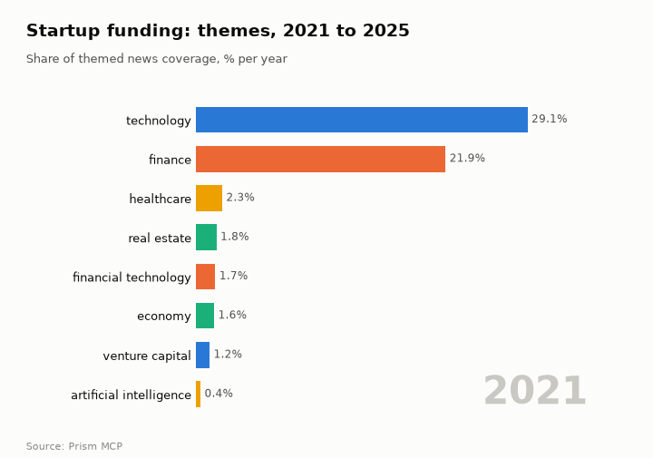
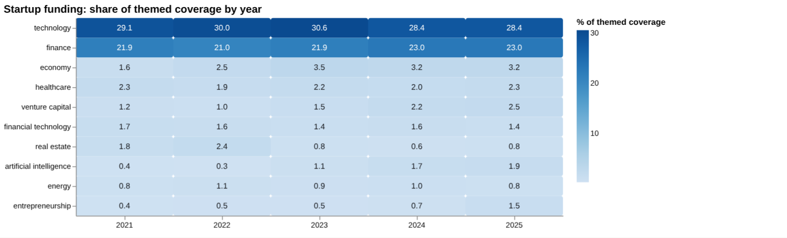
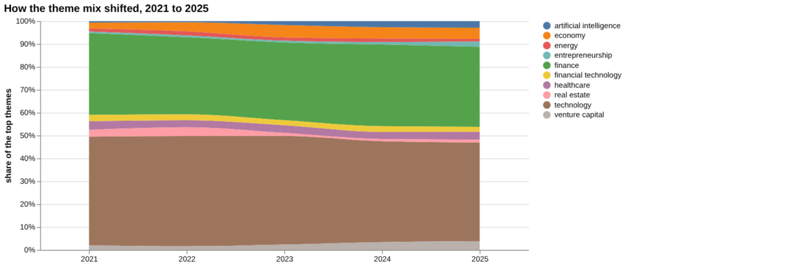
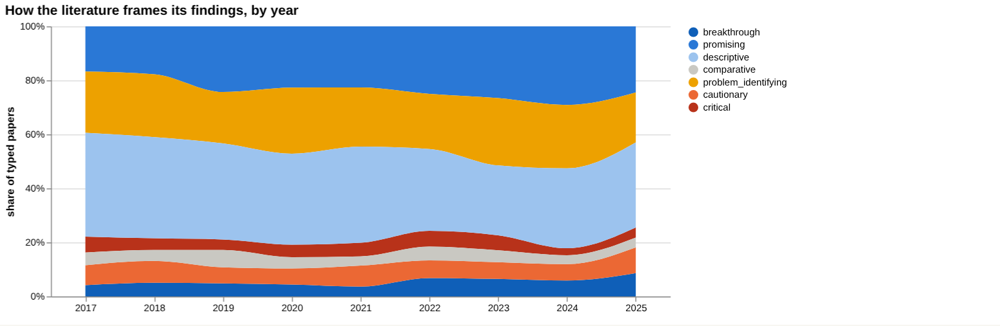
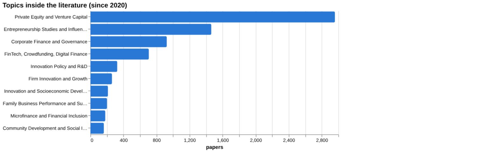
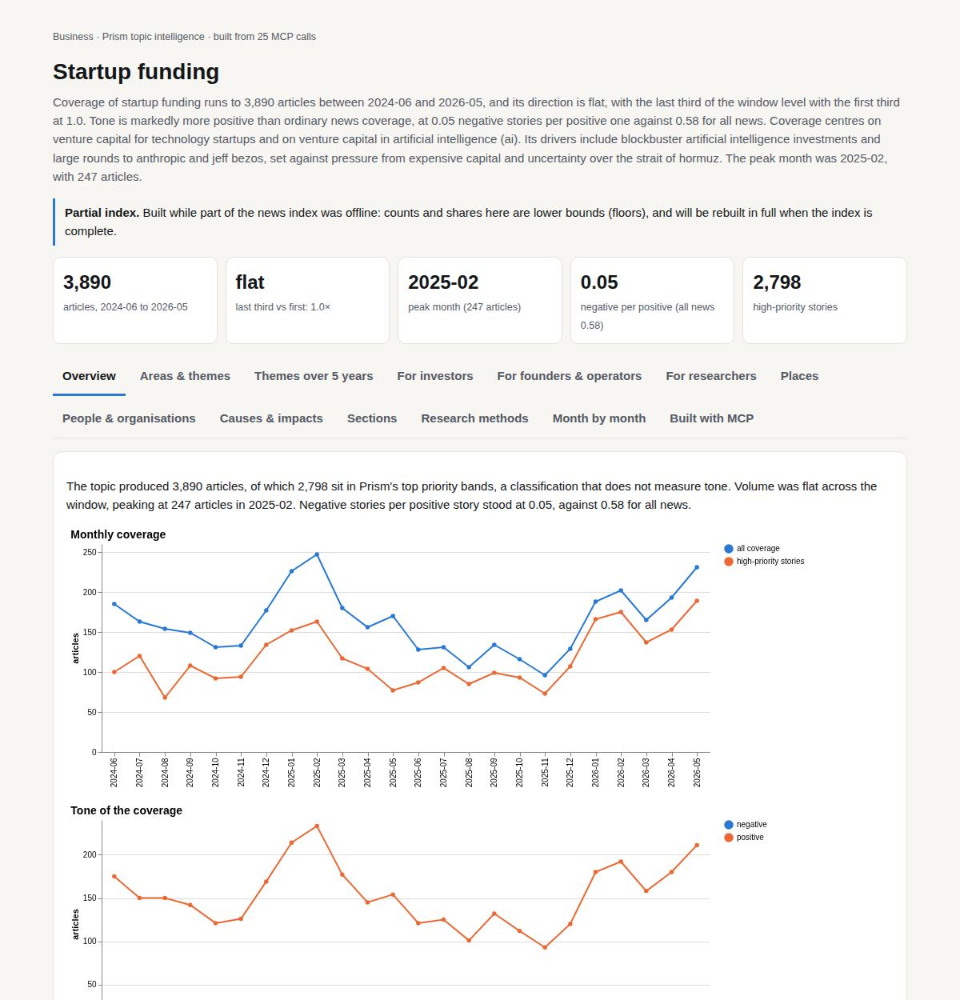

# Startup funding

*Business · Prism topic intelligence* · **[Open the interactive page](https://fliarbi.com/demo/docs/prism-dashboards-3bb43e4c/topics/startup-funding/)** (tabs: Overview · Areas & themes · Themes over 5 years · For investors · For founders & operators · For researchers · Places · People & organisations · Causes & impacts · Sections · Research methods · Month by month · Built with MCP)

> **Partial index.** Built while part of the news index was offline: counts and shares here are lower bounds (floors), and will be rebuilt in full when the index is complete.

Coverage of startup funding runs to 3,890 articles between 2024-06 and 2026-05, and its direction is flat, with the last third of the window level with the first third at 1.0. Tone is markedly more positive than ordinary news coverage, at 0.05 negative stories per positive one against 0.58 for all news. Coverage centres on venture capital for technology startups and on venture capital in artificial intelligence (ai). Its drivers include blockbuster artificial intelligence investments and large rounds to anthropic and jeff bezos, set against pressure from expensive capital and uncertainty over the strait of hormuz. The peak month was 2025-02, with 247 articles.

| Articles | Direction (last third vs first) | Peak month | Negative per positive | High-priority stories |
| ---: | --- | --- | ---: | ---: |
| 3,890 (2024-06 to 2026-05) | flat (1.0×) | 2025-02 (247) | 0.05 (all news 0.58) | 2,798 |

## Coverage over time

The topic produced 3,890 articles, of which 2,798 sit in Prism's top priority bands, a classification that does not measure tone. Volume was flat across the window, peaking at 247 articles in 2025-02. Negative stories per positive story stood at 0.05, against 0.58 for all news.

## Areas of activity and themes

The main area of activity is Business & Industrial › Business Finance › Venture Capital with 2,826 articles, followed by Business & Industrial › Small Business with 610 and Machine Learning & Artificial Intelligence with 481. The leading tags are investment (1,732), ai (1,676), funding (1,365) and technology (1,339), with startups at 991 and venture capital at 801.

| Area of activity | Articles |
| --- | ---: |
| Business & Industrial › Business Finance › Venture Capital | 2,826 |
| Business & Industrial › Small Business | 610 |
| Science › Computer Science › Machine Learning & Artificial Intelligence | 481 |
| Business & Industrial › Small Business › Business Formation | 132 |
| Finance › Crowdfunding | 89 |
| Finance | 75 |

**Top tags (what the themes are built from):** investment (1,732), ai (1,676), funding (1,365), technology (1,339), startups (991), innovation (962), venture capital (801), fintech (610)

## Where it is reported

The united states leads country placement with 1,151 articles, followed by india with 779, the united kingdom with 320, nigeria with 146, and kenya and china with 115 each. Among states and regions, california has 289 articles, new york 236, karnataka 222, texas 166, maharashtra 155 and england 148.

| Country | Articles | Lift | | Indian state | Articles | Lift |
| --- | ---: | ---: | --- | --- | ---: | ---: |
| United States | 1,151 | 1.1× | | California | 289 | 2.4× |
| India | 779 | 2.5× | | New York | 236 | 2.3× |
| United Kingdom | 320 | 1.3× | | Karnataka | 222 | 19.9× |
| Nigeria | 146 | 4.3× | | Texas | 166 | 1.6× |
| Kenya | 115 | 8.8× | | Maharashtra | 155 | 5.8× |
| China | 115 | 0.5× | | England | 148 | 2.2× |

## People and organisations

People named in coverage include eric schmidt, aesop, yann lecun, tim draper, jared leto and mark cuban. Organisations that appear include y combinator, sequoia capital, cooley, andreessen horowitz and khosla ventures.

## Causes and impacts

Causes cited include the us-israeli conflict with iran, prolonged uncertainty over reopening of strait of hormuz, nomura expecting no Fed rate cuts, and private startups remaining unlisted for longer periods. Impacts include global venture funding reaching $56 billion, startup funding being put under pressure of expensive capital, rapid growth in secondary marketplaces, and a reported decline in startup funding.

**Causes named in the coverage:** us-israeli conflict with iran, prolonged uncertainty over reopening of strait of hormuz, nomura expects no Fed rate cuts, private startups remain unlisted for longer periods, blockbuster artificial intelligence investments, large rounds to anthropic and jeff bezos

**Impacts:** global venture funding reached $56 billion, operational reality for startups in the gcc, forcing founders and investors, puts startup funding under pressure of expensive capital, secondary marketplaces have grown rapidly, startup funding declined

## Sections inside the topic

The artificial intelligence section holds 791 articles, 20.33 per cent of the topic, and its late-versus-early ratio of 1.37 shows it growing over the window. Its negative-to-positive ratio of 0.03 is more positive than the topic's 0.05. The layoffs section is small at 6 articles, 0.15 per cent of the topic, with a flat ratio of 1.0 and a higher negative-to-positive ratio of 0.2.

| Section | Articles | Share of the topic | Late vs early | Negative per positive |
| --- | ---: | ---: | ---: | ---: |
| startup funding → layoffs | 6 | 0.15% | 1.0× | 0.2 (topic 0.05) |
| startup funding → artificial intelligence | 791 | 20.33% | 1.37× | 0.03 (topic 0.05) |

## Research and outlook

The balance of framing is broadly unchanged, with a framing shift of 0.0 points. The outlook projects 983.625 for 2026, within a range of 758.054 to 1209.196, rising to 1028.25 for 2027 and 1072.875 for 2028, with the range widening to 396.161 to 1749.589 by 2028.

## Month by month

In 2025-07 AI mega-funding surged, with a $2 billion raise at a $12 billion valuation and expanding MENA investment. In 2025-08 global funding fell 25 % YoY and seed-stage capital plunged 44 %, and by 2025-10 regional swings emerged as Asia surged, Africa slipped and Wayve pursued a $2 billion round amid warnings of AI-washing.

- **2025-07:** AI mega‑funding surged with a $2 billion raise at a $12 billion valuation and MENA investment expanded, indicating heightened investor appetite.
- **2025-08:** Global funding fell 25 % YoY and seed‑stage capital plunged 44 %, marking a shift toward selectivity and heightened governance scrutiny.
- **2025-10:** Regional funding swings emerged as Asia surged, Africa slipped, and Wayve pursued a $2 billion round amid warnings of AI‑washing, highlighting market polarization.

## Themes over five years

Technology stayed the leading theme, at 29.1% of themed coverage in 2021 and 28.4% in 2025, and finance stayed second, at 21.9% in 2021 and 23.0% in 2025. Artificial intelligence rose from 0.4% to 1.9% and venture capital from 1.2% to 2.5%, while entrepreneurship went from 0.4% to 1.5%. Economy coverage grew from 1.6% to 3.2%, whereas real estate fell from 1.8% to 0.8%. Healthcare (2.3% to 2.3%), financial technology (1.7% to 1.4%) and energy (0.8% to 0.8%) were essentially flat at the endpoints.

| Theme | 2021 | 2022 | 2023 | 2024 | 2025 |
| --- | ---: | ---: | ---: | ---: | ---: |
| technology | 29.1% | 30.0% | 30.6% | 28.4% | 28.4% |
| finance | 21.9% | 21.0% | 21.9% | 23.0% | 23.0% |
| economy | 1.6% | 2.5% | 3.5% | 3.2% | 3.2% |
| healthcare | 2.3% | 1.9% | 2.2% | 2.0% | 2.3% |
| venture capital | 1.2% | 1.0% | 1.5% | 2.2% | 2.5% |
| financial technology | 1.7% | 1.6% | 1.4% | 1.6% | 1.4% |
| real estate | 1.8% | 2.4% | 0.8% | 0.6% | 0.8% |
| artificial intelligence | 0.4% | 0.3% | 1.1% | 1.7% | 1.9% |
| energy | 0.8% | 1.1% | 0.9% | 1.0% | 0.8% |
| entrepreneurship | 0.4% | 0.5% | 0.5% | 0.7% | 1.5% |

## For investors

Coverage of startup funding is anchored in technology and finance, which held 28.4% and 23.0% of themed coverage in 2025. The smaller themes that grew are artificial intelligence (1.9% in 2025) and venture capital (2.5%). The index holds 8,137 news articles from 2019-01-01..2026-06-01. One recent headline reports a "Record $56 Billion AI Funding Surge in April 2026" involving Anthropic and Bezos deals, which fits the rising AI theme. A baseline linear-drift scenario puts the central figure at 984 for 2026, 1,028 for 2027 and 1,073 for 2028, with sensitivity ranges of 758 to 1,209, 577 to 1,479 and 396 to 1,750. No country-level breakdown was available, so geography cannot be read from this data.

- AI share of themed coverage: 0.4% in 2021 to 1.9% in 2025
- Venture capital theme: 1.2% in 2021 to 2.5% in 2025
- Scenario central figures: 984 (2026), 1,028 (2027), 1,073 (2028), with widening ranges
- April 2026 headline on a record $56 Billion AI funding surge
- No geographic data was found, so location-based decisions lack support here

## For founders & operators

On the claim that venture capital funding increases startup survival, the verified evidence is thin. Of the documents read, none supports, contradicts or qualifies it; all were judged unrelated (10 in one tally, 11 in another). The wider literature on the claim covers 2,584 papers: 797 supporting, 736 qualifying, 157 contradicting and 894 neutral, with 34.6% contested. That reads as mostly positive framing with a substantial cautionary minority. The screening rows for survival, patenting, revenue growth and exits returned no figures, which means none was found rather than no effect. The data does not support a wording recommendation for this claim, and a comparison claim on government grants and innovation had less evidence behind it.

- Verified document verdicts for the survival claim: none supporting or contradicting; all unrelated (article tier)
- Corpus stance on the claim: 797 supporting, 736 qualifying, 157 contradicting, 894 neutral across 2,584 papers
- Top cited source, article tier: Venture Capital Investments in Europe and Portfolio Firms' Economic Performance (2016), cited by 89, but judged unrelated
- Screening of survival, patenting, revenue growth and exits found no values
- Government grants and innovation claim: contested share 44.8%, but fewer papers behind it

**Head to head:** Venture capital funding increases startup survival vs Government grants increase startup innovation: the first claim has more evidence behind it.

**Screen:** *What is the effect of venture capital on startup …?* (one row per line below)

| Row | Figure (quoted) | Measures | Source |
| --- | --- | --- | --- |
| survival | no figure found |  |  |
| innovation | no figure found |  | A Study on the Impact of Venture Capital Investment on Startup Performance in Daegu: Focus (2025) |
| employment growth | no figure found |  | Does venture capital investment spur employment growth? CEPS Working Document No. 197, Dec (2003) |
| patenting | no figure found |  |  |
| revenue growth | no figure found |  |  |
| exits | no figure found |  |  |

## For researchers

The literature is large: 28,667 research papers from 2017-2025, though only 694 carry a readable abstract and just 29 are the health literature index records. Its overall mix is 8,191 supporting, 8,495 qualifying, 1,405 contradicting and 10,576 neutral, with 34.5% contested. Framing looks broadly unchanged: cautionary share was 36.4% across 7,568 earlier papers and 32.8% across 6,755 recent ones. By orientation, descriptive work leads at 32.1%, then promising at 25.1% and problem-identifying at 21.5%, while critical work is 4.3%. Empirical contributions number 3,763, well ahead of theoretical work at 226. Private Equity and Venture Capital is the main topic cluster at 2,959 papers, and the most recent work is mostly uncited so far.

- Why do survival, failure-rate and longevity components show evidence as "yes" while verified documents were all unrelated?
- Why do screening rows for survival, patenting, revenue growth and exits have no extractable values?
- Critical work is only 4.3% of papers; is causal evidence underrepresented?
- Theoretical contributions number 226 against 3,763 empirical; what explains the gap?
- Recent 2025 papers from India, Turkey, Korea and Russia are uncited so far; how will they shape the field?

## Research exploration methods

Nine ways to explore the research, each run on this topic; the interactive report shows each call and its result.

**Chaining them.** Start with faceted browsing and the frontier scan to learn the shape of the literature: mostly empirical and descriptive, with a modest cautionary share. Use gap mapping to confirm the claim's components have a literature, then run triangulation to see whether any documents actually bear on survival; here none did. Follow with cross-row screening to look for quantified effects on survival and related outcomes, which returned none. Treat framing drift and count history as context only, since orientation is not truth and the yearly counts were empty. Use the head-to-head comparison last, once searches for each claim have been checked, because a volume contrast is only as good as the queries behind it.

### Evidence triangulation

*Is a claim supported, and by how strong a design?* `find_evidence` + `find_counter_evidence` + `rank_sources`

The claim that venture capital funding increases startup survival was checked against 10 documents, and all 10 were judged "unrelated" to it, all at the "article" tier. The counter-evidence search found the same: 9 unrelated, and 0 supporting, contradicting or qualifying. The tool therefore gives no wording recommendation. The wider corpus of "2,584" papers is more informative: 797 supporting, 736 qualifying, 157 contradicting and 894 neutral, with "contested share" of 34.6 and a reading of mostly positive framing with a substantial cautionary minority. That stance mix describes how papers frame their findings, not whether venture capital causes survival. The top sources, such as the 2016 European study cited by 89, are about venture capital and firm performance, not survival specifically. A careful researcher would read those papers directly and look for survival or failure outcomes with a credible comparison group.

### Head-to-head claims

*Which of two interventions has more and stronger evidence?* `compare_claims`

The comparison says the first claim, venture capital and survival, has more evidence behind it. It rests on "2,584" papers on both poles against "0" for government grants and startup innovation, plus a corpus mix of 797 supporting, 736 qualifying, 157 contradicting and 894 neutral against 27, 49, 15 and 52. The grants claim has a higher contested share, 44.8 against 34.6, but from a far smaller base. Neither claim had a single document read as supporting, contradicting or qualifying: 11 were unrelated for venture capital, and 5 were unrelated with 1 unread for grants. The strongest source for grants, a 2003 paper on grants to private charities, is about charitable giving, so it does not bear on startups. The verdict therefore reflects volume of literature, not demonstrated strength of effect. The next step is to check whether the grants search captured the right literature at all.

### Cross-row screening

*Which rows carry a measured, quoted figure, and how large is it?* `research_table`

The screening asked what the effect of venture capital is on six startup outcomes: survival, innovation, employment growth, patenting, revenue growth and exits. Every row returned a null value, with no measure or population, so no effect size was extracted for any outcome. Only two rows pointed to any paper: innovation, with 1 paper (a 2025 study of Daegu), and employment growth, with a 2003 CEPS working document, though its paper count is "0". Survival, patenting, revenue growth and exits had no source at all. This absence means the method could not locate a quotable figure, not that no effect exists; the effect sizes may sit in full texts or in differently worded studies. Any quantified claim on these outcomes would need to be built from reading the primary studies directly.

### Framing drift

*Is the literature becoming more hopeful or more cautious?* `stance_trends`

Positive framing rose from 10.5 per cent in 2017 to 18.2 in 2024, then eased to 16.2 in 2025. Contested framing moved within a narrow band, from 14.7 in 2019 to 18.6 in 2020, ending at 15.6 in 2025. The two shares came close in 2019 and 2022 and positive framing was higher from 2024 onwards (18.2 against 16.7 in 2024, 16.2 against 15.6 in 2025). Read this as a modest drift in how authors present their work, not as evidence that venture capital works better or worse. A careful researcher would check whether the shift comes from particular subtopics or regions before drawing conclusions.

### Frontier scan

*What is new, and what is the research not reaching?* `research_radar`

The most-cited new work since the start year is "The Syndication of Venture Capital Investments" (2022, cited by 674), labelled critical, well ahead of the next entry, cited by 132. The list covers syndication, cross-border investment, cleantech policy, COVID-19 reallocation, Big Tech acquisitions and corporate venture capital, and none addresses survival directly. The framing shift compares 6,755 recent papers (32.8 per cent cautionary) with 7,568 earlier ones (36.4 per cent), a change of -3.6 percentage points, which the tool reads as broadly unchanged. The caveat applies: orientation labels a paper's own framing, not the truth. No under-covered topics were returned, so the scan says little about what research is missing. The next step is to read the syndication paper to see whether its critical stance bears on survival claims.

### Gap mapping

*Which parts of a claim does the literature actually cover?* `research_gaps`

The claim was split into three components: that venture capital funding improves startup survival, that it reduces startup failure rates, and that venture capital investment increases firm longevity. All three were marked "yes" for evidence, meaning a literature exists for each. This shows topical coverage only. It does not say the literature is strong, consistent or causal, and it sits oddly beside the earlier results where documents read were judged unrelated and no survival effect size was found. The check is coarse because the components are near-paraphrases of one another, so it cannot reveal sub-questions such as different stages, sectors or selection effects. A careful researcher would split the claim by those dimensions and test each one.

### Count history and backtested scenarios

*Is research on this growing, and where could it be in three years?* `historical_analysis` + `scenarios`

The yearly paper counts came back empty, so there is no observed history to read. Scenarios were still produced using a linear drift baseline: a central 984 in 2026, 1,028 in 2027 and 1,073 in 2028. The sensitivity band widens over time, from 758 to 1,209 in 2026 and from 396 to 1,750 in 2028. Without displayed historical counts, it is not possible to judge whether growth is real or how well the baseline fitted. These figures are extrapolations, not forecasts, and the widening band signals rising uncertainty. A careful researcher would obtain the underlying yearly counts and the backtest results before relying on any of them.

### Geographic triangulation

*Where is it studied, published, reported and patented?* `global_comparison` + `newsgeo`

Both geographic lanes came back empty: nothing for where the topic is studied and nothing for where it is reported by country. The absence means the tool returned no country data for this claim, not that the research has no geographic pattern. No statement about concentration in the United States, Europe or Asia can be made from this result. The facts elsewhere hint at regional interest, such as European and Indian titles, but that is not a measurement. A careful researcher would rerun with a clearer query or use affiliation data directly, and keep the lanes separate as intended.

### Faceted browsing

*What kind of literature is it: empirical, review, position? Problem-identifying or promising?* `browse_research`

By orientation, the corpus is led by descriptive papers (1,720, 32.1 per cent), then promising (1,346, 25.1) and problem-identifying (1,153, 21.5). Cautionary (377), breakthrough (310), critical (231) and comparative (229) are much smaller. By contribution, empirical work stands at 3,763 papers, with methodological (503), position (448), review (426) and theoretical (226) well behind. The leading topic is "Private Equity and Venture Capital" with 2,959 papers, followed by Entrepreneurship Studies and Influences with 1,463. This shows a largely empirical and descriptive literature, but 'empirical' does not imply causal design. The most-cited-since-2020 list is all 2025 papers with 0 citations, so it reflects recency, not influence, and includes titles in Russian, Turkish and Korean. A careful researcher would filter empirical papers further by design before treating the volume as strength.

## Built with MCP

Every number and chart on this page comes from these 25 Prism MCP tool calls, made over MCP (streamable HTTP). Arguments and timings: [mcp_calls.json](mcp_calls.json); responses: [data.json](data.json).

| MCP tool | Calls |
| --- | ---: |
| `news_activities` | 1 |
| `news_geography` | 1 |
| `news_drill` | 2 |
| `news_themes` | 5 |
| `prism_overview` | 1 |
| `stance_trends` | 1 |
| `historical_analysis` | 1 |
| `critical_news` | 1 |
| `news_factors` | 1 |
| `browse_research` | 1 |
| `research_radar` | 1 |
| `research_brief` | 1 |
| `research_gaps` | 1 |
| `global_comparison` | 1 |
| `find_evidence` | 1 |
| `find_counter_evidence` | 1 |
| `rank_sources` | 1 |
| `deep_timeline` | 1 |
| `compare_claims` | 1 |
| `research_table` | 1 |

Try it: `prism entity "startup funding"` · `prism call news.drill term='startup funding' scope='layoffs'` · `prism call analysis.timeline term='startup funding'`

