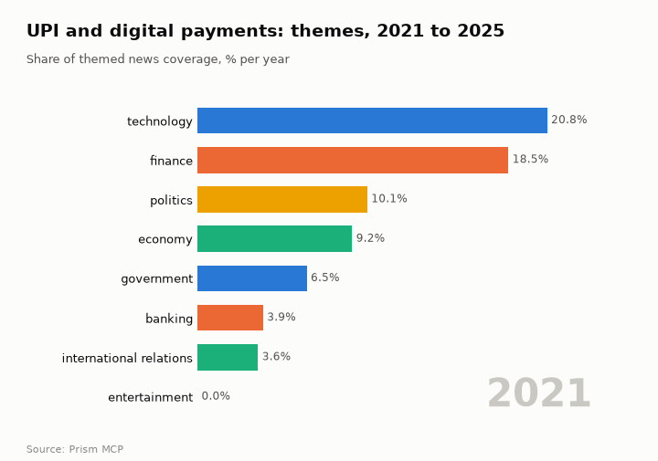
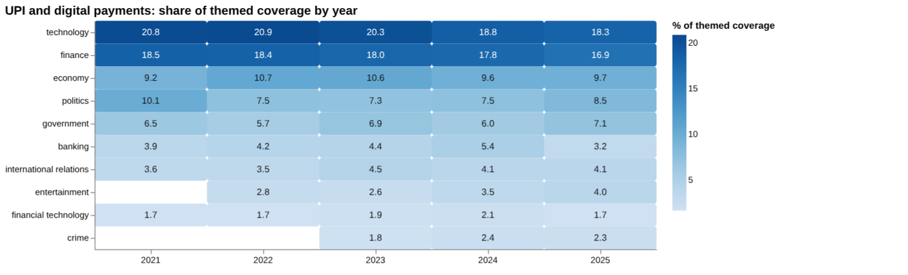
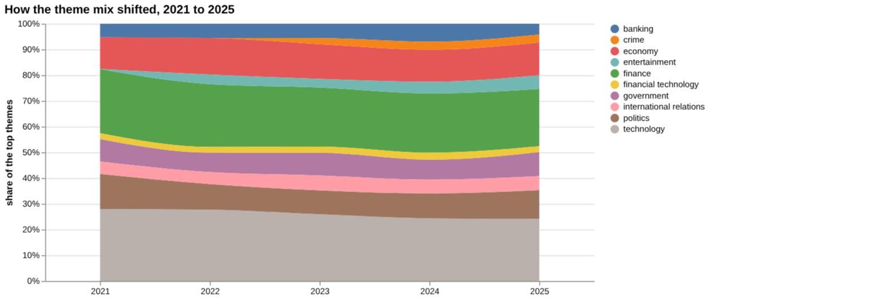
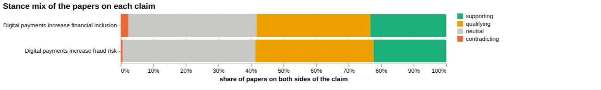
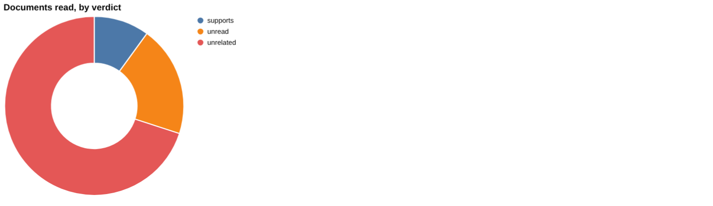
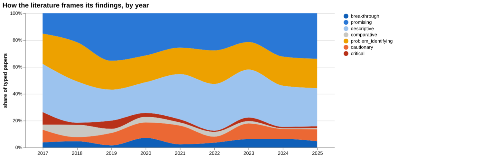
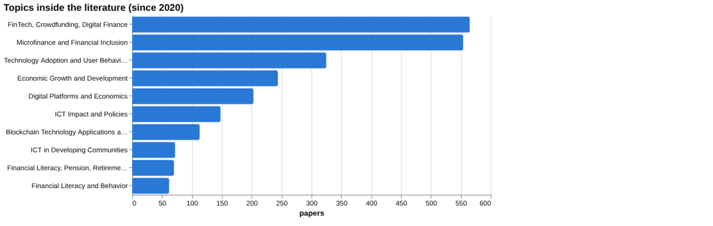
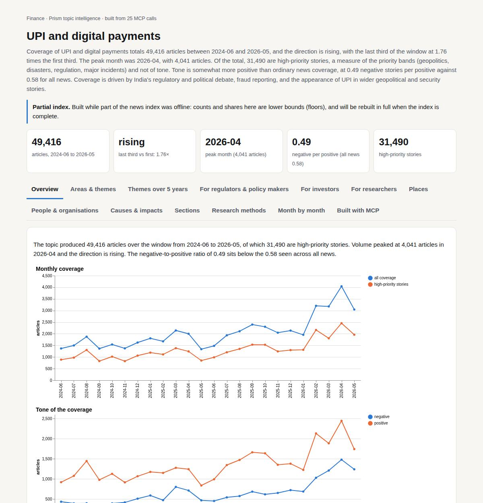

# UPI and digital payments

*Finance · Prism topic intelligence* · **[Open the interactive page](https://fliarbi.com/demo/docs/prism-dashboards-3bb43e4c/topics/upi-payments/)** (tabs: Overview · Areas & themes · Themes over 5 years · For regulators & policy makers · For investors · For researchers · Places · People & organisations · Causes & impacts · Sections · Research methods · Month by month · Built with MCP)

> **Partial index.** Built while part of the news index was offline: counts and shares here are lower bounds (floors), and will be rebuilt in full when the index is complete.

Coverage of UPI and digital payments totals 49,416 articles between 2024-06 and 2026-05, and the direction is rising, with the last third of the window at 1.76 times the first third. The peak month was 2026-04, with 4,041 articles. Of the total, 31,490 are high-priority stories, a measure of the priority bands (geopolitics, disasters, regulation, major incidents) and not of tone. Tone is somewhat more positive than ordinary news coverage, at 0.49 negative stories per positive against 0.58 for all news. Coverage is driven by India's regulatory and political debate, fraud reporting, and the appearance of UPI in wider geopolitical and security stories.

| Articles | Direction (last third vs first) | Peak month | Negative per positive | High-priority stories |
| ---: | --- | --- | ---: | ---: |
| 49,416 (2024-06 to 2026-05) | rising (1.76×) | 2026-04 (4,041) | 0.49 (all news 0.58) | 31,490 |

## Coverage over time

The topic produced 49,416 articles over the window from 2024-06 to 2026-05, of which 31,490 are high-priority stories. Volume peaked at 4,041 articles in 2026-04 and the direction is rising. The negative-to-positive ratio of 0.49 sits below the 0.58 seen across all news.

## Areas of activity and themes

The top tags are upi (32,552), india (19,720), digital payments (7,210), rbi (5,733) and fintech (4,211), while themes centre on payment gateway integration services and real-time transaction technologies.

| Area of activity | Articles |
| --- | ---: |
| Business & Industrial › Business Services › E-Commerce Services | 8,601 |
| Finance › Banking | 7,463 |
| Finance › Banking › Mobile Payments & Digital Wallets | 7,070 |
| Finance › Credit & Lending › Credit Cards | 1,269 |
| Finance › Banking › Money Transfer & Wire Services | 515 |
| Finance | 488 |

**Top tags (what the themes are built from):** upi (32,552), india (19,720), digital payments (7,210), rbi (5,733), fintech (4,211), banking (3,590), the reserve bank of india (3,472), aadhaar (3,059)

## Where it is reported

Among states, Maharashtra has 2,603 articles and Karnataka 1,721, with California (2,160), New York (1,879), Texas (1,658) and Washington (1,589) also listed.

| Country | Articles | Lift | | Indian state | Articles | Lift |
| --- | ---: | ---: | --- | --- | ---: | ---: |
| India | 15,419 | 3.7× | | Maharashtra | 2,603 | 7.3× |
| United States | 12,543 | 0.9× | | California | 2,160 | 1.3× |
| China | 2,320 | 0.7× | | New York | 1,879 | 1.4× |
| United Kingdom | 2,155 | 0.7× | | Karnataka | 1,721 | 11.5× |
| France | 1,639 | 1.5× | | Texas | 1,658 | 1.2× |
| Singapore | 1,491 | 4.1× | | Washington | 1,589 | 1.4× |

## People and organisations

The people named most often include Nirmala Sitharaman and Narendra Modi, alongside Aesop, Gordon Ramsay, Barbie Hsu and Lee Jae-myung. Organisations include the National Payments Corporation of India, Paytm and PhonePe.

## Causes and impacts

The causes named are largely conflict and incident events, among them more than 100 Israeli air strikes, an airstrike in Gaza City that hit a residential building, drone and missile attacks on Ukraine, and a fire in a New York train tunnel. The impacts recorded include 31 people killed, 40 injured, at least three Palestinians killed, and commutes being shut down.

**Causes named in the coverage:** more than 100 israeli air strikes, airstrike in gaza city hit a residential building, drone and missile attacks on ukraine, suicide bombing near train tracks, fire in a new york train tunnel, gas explosion in a coal mine

**Impacts:** 31 people killed, 40 injured, killed at least three palestinians, injuring dozens more, injured five, shut down commutes

## Sections inside the topic

The fraud section has 1,645 articles, 3.33 per cent of the topic, with a late-versus-early ratio of 1.71 and a negative-to-positive ratio of 1.54, well above the topic's 0.49. The international section has 1,995 articles, 4.04 per cent of the topic, a late-versus-early ratio of 1.22 and a ratio of 0.29, more positive than the topic overall. Fraud is therefore the more negative and faster-growing of the two.

| Section | Articles | Share of the topic | Late vs early | Negative per positive |
| --- | ---: | ---: | ---: | ---: |
| upi → fraud | 1,645 | 3.33% | 1.71× | 1.54 (topic 0.49) |
| upi → international | 1,995 | 4.04% | 1.22× | 0.29 (topic 0.49) |

## Research and outlook

The balance of research framing is broadly unchanged, with a shift of -4.4 points. The outlook figures are 506.875 for 2026 (range 327.304 to 686.446), 561.75 for 2027 (202.607 to 920.893) and 616.625 for 2028 (77.911 to 1155.339), with the range widening each year.

## Month by month

In 2025-06 the Indian government rejected MDR plans, highlighting regulatory uncertainty while scammers used UPI on WhatsApp. Narendra Modi's praise of UPI as a global case study in 2025-08 and a surge in payments across India in 2025-09 followed, after which coverage broadened to security and geopolitical events through to May 2026.

- **2025-06:** The Indian government rejected MDR plans, limiting monetisation for firms and highlighting regulatory uncertainty while scammers leveraged UPI on WhatsApp.
- **2025-08:** Prime Minister Narendra Modi praised UPI as a global case study, providing strong political endorsement and boosting the platform’s international profile.
- **2025-09:** UPI payments surged across India, narrowing the digital divide and marking a rapid adoption phase for everyday retail transactions.

## Themes over five years

Technology stayed the leading theme but eased from 20.8% of themed coverage in 2021 to 18.3% in 2025, and finance moved from 18.5% to 16.9%. Economy was 9.2% in 2021 and 9.7% in 2025, after a rise to 10.7% in 2022. Politics fell from 10.1% to 8.5% and government rose from 6.5% to 7.1%. Banking went from 3.9% to 3.2% after peaking at 5.4% in 2024, international relations from 3.6% to 4.1%, and financial technology was 1.7% in both years. Entertainment (2.8% in 2022, 4.0% in 2025) and crime (1.8% in 2023, 2.3% in 2025) appear only in later years.

| Theme | 2021 | 2022 | 2023 | 2024 | 2025 |
| --- | ---: | ---: | ---: | ---: | ---: |
| technology | 20.8% | 20.9% | 20.3% | 18.8% | 18.3% |
| finance | 18.5% | 18.4% | 18.0% | 17.8% | 16.9% |
| economy | 9.2% | 10.7% | 10.6% | 9.6% | 9.7% |
| politics | 10.1% | 7.5% | 7.3% | 7.5% | 8.5% |
| government | 6.5% | 5.7% | 6.9% | 6.0% | 7.1% |
| banking | 3.9% | 4.2% | 4.4% | 5.4% | 3.2% |
| international relations | 3.6% | 3.5% | 4.5% | 4.1% | 4.1% |
| entertainment | – | 2.8% | 2.6% | 3.5% | 4.0% |
| financial technology | 1.7% | 1.7% | 1.9% | 2.1% | 1.7% |
| crime | – | – | 1.8% | 2.4% | 2.3% |

## For regulators & policy makers

News coverage of the topic stands at 29,835 articles between 2019-01-01 and 2026-06-01, while the research index holds 35,760 papers for 2017-2025. The linear-drift baseline gives a central figure of 507 for 2026, 562 for 2027 and 617 for 2028, with a widening sensitivity range of 327 to 686 in 2026 and 78 to 1,155 in 2028. The facts do not say what this series counts, so it should be read as indicative only. No country-level reporting or study-location data is available, so geography cannot be assessed. The highest-ranked research topics are FinTech, Crowdfunding, Digital Finance (565 papers) and Microfinance and Financial Inclusion (554 papers). On fraud, the most recent source found is a 2025 paper on authorised push payment fraud and the draft Payment Services Regulation, which has not been read in full. The top news stories listed concern conflicts and a boat strike rather than payments, so they say little about the topic itself.

- Treat the 2026-2028 baseline (507, 562, 617) as indicative, given the range of 78 to 1,155 in 2028
- Fraud and authorised push payment rules: 179 papers address the fraud claim, with the 2025 paper unread
- Crime coverage share was 2.3% in 2025, against 1.8% in 2023
- Geographic data is missing, so country priorities cannot be set from this evidence
- Banking coverage share was 3.2% in 2025, down from 5.4% in 2024

## For investors

On the claim that digital payments increase financial inclusion, 429 papers were assessed: 100 supporting, 150 qualifying, 10 contradicting and 169 neutral, with 37.3% contested. The framing is mostly positive with a substantial cautionary minority. Of the documents actually read, one supports the claim, none contradict or qualify it, seven are unrelated and two are unread. The assessment states that this sample does not establish scientific consensus. The fraud-risk claim has 179 papers (40 supporting, 65 qualifying, 1 contradicting, 73 neutral; 36.9% contested), and none of the documents read bears on it. The first claim is judged to have more evidence behind it. Quantified effects are thin: tax compliance shows β = 0.185 for the effect of digital payments on VAT compliance, and consumer spending shows 4.8 percent revenue growth, with no population stated for either.

- Financial inclusion claim: 429 papers, 37.3% contested; one review and fifteen articles among the sources (review and article tiers)
- Documents read: 1 supports, 0 contradict, 7 unrelated, 2 unread; no consensus established
- Tax compliance: β = 0.185 on VAT compliance, from a 2025 article on manufacturing firms in Athi River, Machakos County, Kenya
- Fraud risk claim: 179 papers, 36.9% contested, and no read document supports or contradicts it
- Scam classification accuracy of 93.33% is from curated transaction data, not live conditions

**Head to head:** Digital payments increase financial inclusion vs Digital payments increase fraud risk: the first claim has more evidence behind it.

**Screen:** *What is the effect of digital payments on …?* (one row per line below)

| Row | Figure (quoted) | Measures | Source |
| --- | --- | --- | --- |
| financial inclusion | no figure found |  | Making the case for real-time payments in CARICOM: Evidence from Jamaica’s economic impact (2025) |
| fraud | no figure found |  | Electronic Payment Systems and Tele-banking Services in Nigeria (2006) |
| cash use | no figure found |  | Electronic Payment Systems and Tele-banking Services in Nigeria (2006) |
| small business sales | no figure found |  |  |
| tax compliance | β = 0.185 | effect of digital payments on VAT compliance | Effect of Digital Payments on Value Added Tax Compliance among Manufacturing Firms in Athi (2025) |
| consumer spending | 4.8 percent | revenue growth |  |

## For researchers

The literature is dominated by descriptive (503 papers, 31.5%) and promising (466 papers, 29.2%) framings, followed by problem-identifying (339 papers, 21.2%). Cautionary work accounts for 156 papers (9.8%) and critical work for 31 (1.9%). By contribution type, 1,175 papers are empirical, 151 reviews, 147 methodological, 103 position and 22 theoretical. The cautionary share was 40.5% in the earlier window and 34.2% in the recent one, which the analysis reads as broadly unchanged, with the caveat that orientation labels a paper's own framing and not the truth. Recent frontier work includes a 2022 systematic review in Future Internet (109 citations) and a 2023 quantum-digital payments demonstration in Nature Communications (35 citations). Thin areas are evident: the health literature index holds 8 records, arXiv 3 preprints and patents 65, and no papers were found on small business sales.

- Why is the core inclusion evidence drawn from older African and Islamic-country bank-performance studies, such as a 2011 Ghana paper?
- What outcomes sit behind the gaps listed as 'yes' for access, mobile money and inclusion, given the unread documents?
- Can cash use (2 papers) and fraud (4 papers) be studied beyond a 2006 Nigerian source?
- Why is there no paper on small business sales, and none with a consumer spending population?
- Do the 2025 papers, all showing 0 citations so far, change the framing once cited?

## Research exploration methods

Nine ways to explore the research, each run on this topic; the interactive report shows each call and its result.

### Evidence triangulation

*Is a claim supported, and by how strong a design?* `find_evidence` + `find_counter_evidence` + `rank_sources`

For the claim that digital payments increase financial inclusion, the documents actually read give a thin picture: 1 supports, 7 are unrelated, 2 are unread, and none contradict or qualify. The reading set is 9 articles and 1 review, so it contains no stronger design than a review. The wider corpus of 429 papers splits into 100 supporting, 150 qualifying, 10 contradicting and 169 neutral, with a contested share of 37.3%, described as mostly positive framing with a substantial cautionary minority. The counter-evidence search found nothing that disagrees, but with 7 of 8 read documents unrelated this is closer to an absence of relevant reading than a clean test. The tool itself says the sample does not establish scientific consensus. A careful researcher would read the two unread documents, replace the unrelated ones with sources on inclusion outcomes, and examine the 150 qualifying papers to see which conditions limit the claim.

### Head-to-head claims

*Which of two interventions has more and stronger evidence?* `compare_claims`

The inclusion claim has 429 papers on both poles against 179 for the fraud-risk claim, and the verdict is that the first has more evidence behind it. Their contested shares are close, at 37.3 for inclusion and 36.9 for fraud. The corpus mix for fraud is 40 supporting, 65 qualifying, 1 contradicting and 73 neutral. Among documents read, inclusion has 1 supporting, while fraud has 0 supporting, 5 unrelated and 1 unread, so fraud has not been tested by reading at all. The strongest source for each claim is marked unread, so neither ranking reflects a verified stance. This comparison measures volume and framing, not whether one effect is larger than the other. A careful researcher would read both strongest sources and check whether the fraud papers concern the same payment systems as the inclusion papers.

### Cross-row screening

*Which rows carry a measured, quoted figure, and how large is it?* `research_table`

Only two of six rows returned a figure: tax compliance with β = 0.185 (effect of digital payments on VAT compliance, from a 2025 study of manufacturing firms in Athi River, Machakos County, Kenya), and consumer spending with 4.8 percent, measured as revenue growth. The tax figure has a named source and a stated measure but no population. The 4.8 percent figure has no source, no year and 0 papers behind it, and its measure is revenue growth rather than consumer spending, so it should not be relied on. Financial inclusion, fraud and cash use returned no value despite 1, 4 and 2 papers respectively, and small business sales had 0 papers. The absence means those papers did not state a quotable effect for this question, not that there is no effect. A careful researcher would treat β = 0.185 as one Kenyan firm-level result and look for quantified effects on inclusion and fraud in the papers already identified.

### Framing drift

*Is the literature becoming more hopeful or more cautious?* `stance_trends`

Positive framing ranges from 9.3 percent in 2017 to 21.7 in 2024, ending at 16.5 in 2025, so there is no steady rise. Contested framing starts at 20.4 in 2017 and ends at 13.7 in 2025, with a low of 13.7 in the final year. The lines cross in several years: they are equal at 19.7 in 2019, and positive framing is higher in 2020, 2022, 2024 and 2025. The movement is modest and uneven, and the table gives no paper counts per year, so small yearly samples may explain some swings. These are labels of how papers frame themselves, not evidence that payments work or fail. A careful researcher would check the yearly counts and read a sample from 2024 and 2025 to see whether the shift in contested share reflects changed topics or changed conclusions.

### Frontier scan

*What is new, and what is the research not reaching?* `research_radar`

The most-cited new work is led by a 2022 systematic review in Future Internet with 109 citations, followed by a 2023 paper on adoption in emerging economies with 71. Both are labelled problem-identifying, and the list also includes a critical paper on platformisation in the EU and a cautionary one on Zakat, Infaq and Sodaqoh payments among Generation Z. The one breakthrough item is a 2023 Nature Communications demonstration of quantum-digital payments with 35 citations. Between windows, cautionary share moved from 40.5 percent across 8,476 earlier papers to 34.2 percent across 9,215 recent ones, a delta of -6.3 percentage points, which the tool reads as broadly unchanged. The orientation labels describe each paper's own framing, not its truth. A careful researcher would read the two top-cited problem-identifying papers for the challenges they name, and treat the quantum item as a different technical strand rather than evidence about UPI-style systems.

### Gap mapping

*Which parts of a claim does the literature actually cover?* `research_gaps`

All three components of the inclusion claim are marked as having a literature: digital payments expand access to banking services, mobile money reduces unbanked population, and electronic payment systems improve financial inclusion. That means each part can be searched, but the method records only presence, not depth, quality or direction. It does not show whether the studies are causal or whether they cover UPI specifically. The three components also overlap heavily, so they may not split the claim in a way that reveals a real hole. A careful researcher would test the components against design strength, for example by checking whether any rest on more than descriptive or adoption studies, and add components such as who gains and whether usage continues.

### Count history and backtested scenarios

*Is research on this growing, and where could it be in three years?* `historical_analysis` + `scenarios`

The yearly count of title-matched papers came back empty, so the history itself cannot be read and there is no observed trend to compare against. The scenarios use a linear drift baseline and give central values of 507 for 2026, 562 for 2027 and 617 for 2028. The sensitivity band widens each year: 327 to 686 in 2026, 203 to 921 in 2027, and 78 to 1,155 in 2028. By 2028 the band is wide enough to cover very different futures, so the central path should be read as a loose guide only. Because the counts are missing here, the basis for the backtest cannot be checked. A careful researcher would rerun the yearly counts with an explicit window before using any of these figures.

### Geographic triangulation

*Where is it studied, published, reported and patented?* `global_comparison` + `newsgeo`

Both geographic lanes came back empty, so this output says nothing about where digital payments research is studied, published or reported. The absence reflects a lack of returned country data, not evidence that the topic is unstudied anywhere. Some location clues exist elsewhere, such as Ghana, Nigeria, Kenya, Jamaica and Malaysia among the sources, but those are individual papers and do not amount to a geographic profile. A careful researcher would rerun the country comparison and news geography before drawing any conclusions about regional coverage, particularly for India, where UPI operates.

### Faceted browsing

*What kind of literature is it: empirical, review, position? Problem-identifying or promising?* `browse_research`

Of the papers classified by orientation, descriptive is 503 (31.5 percent), promising 466 (29.2), problem-identifying 339 (21.2), cautionary 156 (9.8), breakthrough 75 (4.7), critical 31 (1.9) and comparative 28 (1.8). By contribution, empirical papers number 1,175, against 151 reviews, 147 methodological, 103 position and 22 theoretical. The leading topics are FinTech, Crowdfunding, Digital Finance with 565 papers and Microfinance and Financial Inclusion with 554. The most-cited papers since 2020 all show 0 citations and are from 2025, so they are too recent to judge by citation and the list does not show which recent work matters. Empirical does not mean causal, since the facets record paper type, not design strength. A careful researcher would sample the empirical papers for design and read the recent 2025 items directly.

## Built with MCP

Every number and chart on this page comes from these 25 Prism MCP tool calls, made over MCP (streamable HTTP). Arguments and timings: [mcp_calls.json](mcp_calls.json); responses: [data.json](data.json).

| MCP tool | Calls |
| --- | ---: |
| `news_activities` | 1 |
| `news_geography` | 1 |
| `news_drill` | 2 |
| `prism_overview` | 1 |
| `news_themes` | 5 |
| `critical_news` | 1 |
| `news_factors` | 1 |
| `historical_analysis` | 1 |
| `stance_trends` | 1 |
| `browse_research` | 1 |
| `research_radar` | 1 |
| `research_gaps` | 1 |
| `global_comparison` | 1 |
| `research_brief` | 1 |
| `rank_sources` | 1 |
| `find_counter_evidence` | 1 |
| `find_evidence` | 1 |
| `deep_timeline` | 1 |
| `compare_claims` | 1 |
| `research_table` | 1 |

Try it: `prism entity "upi"` · `prism call news.drill term='upi' scope='fraud'` · `prism call analysis.timeline term='upi'`

