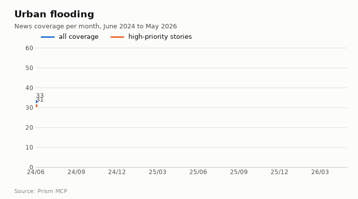
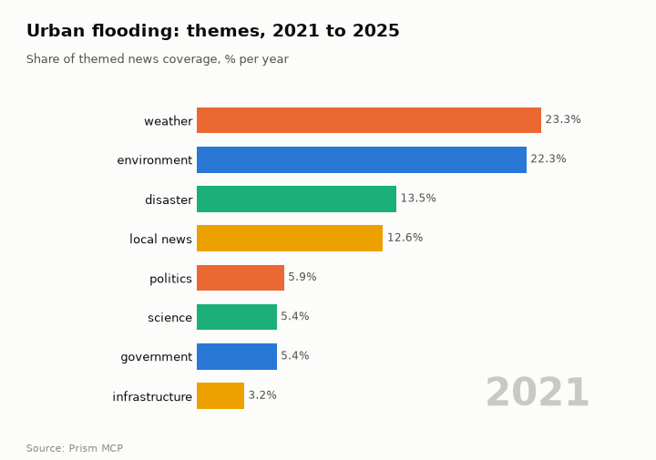
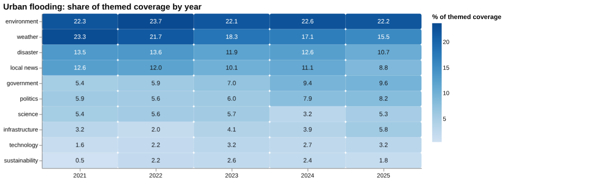
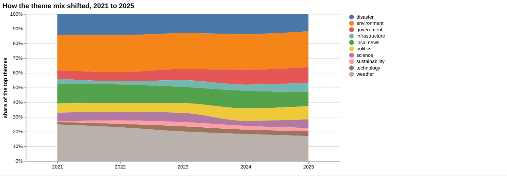
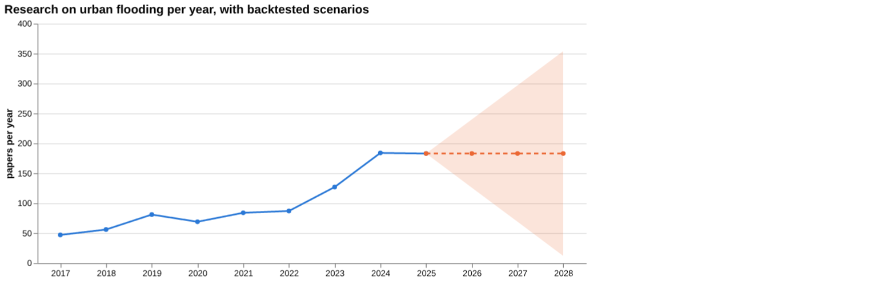
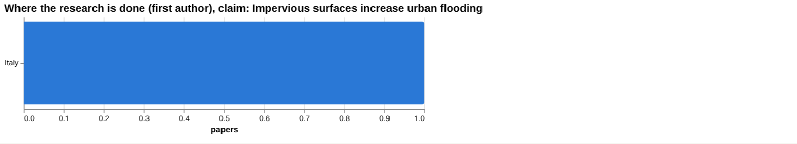
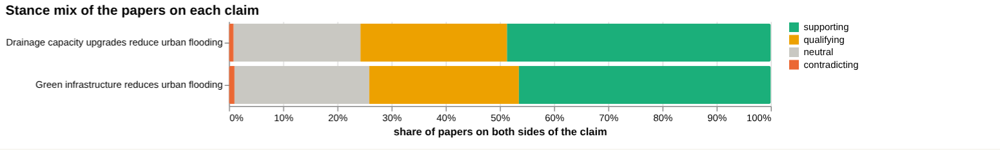
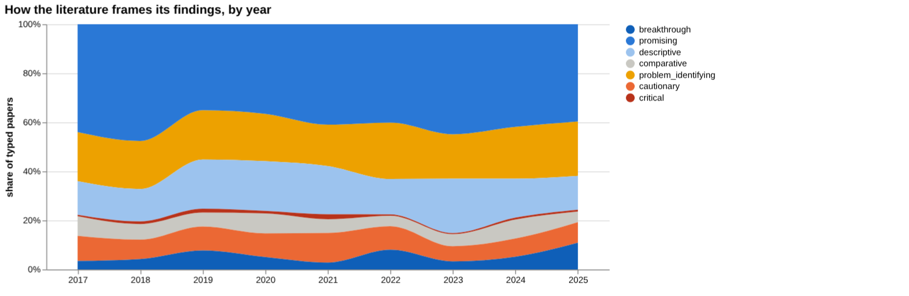
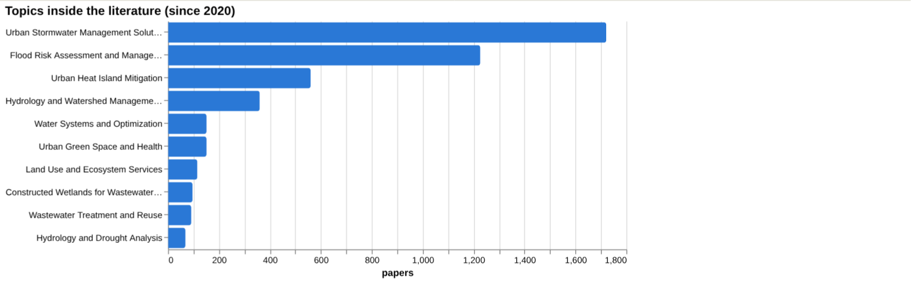
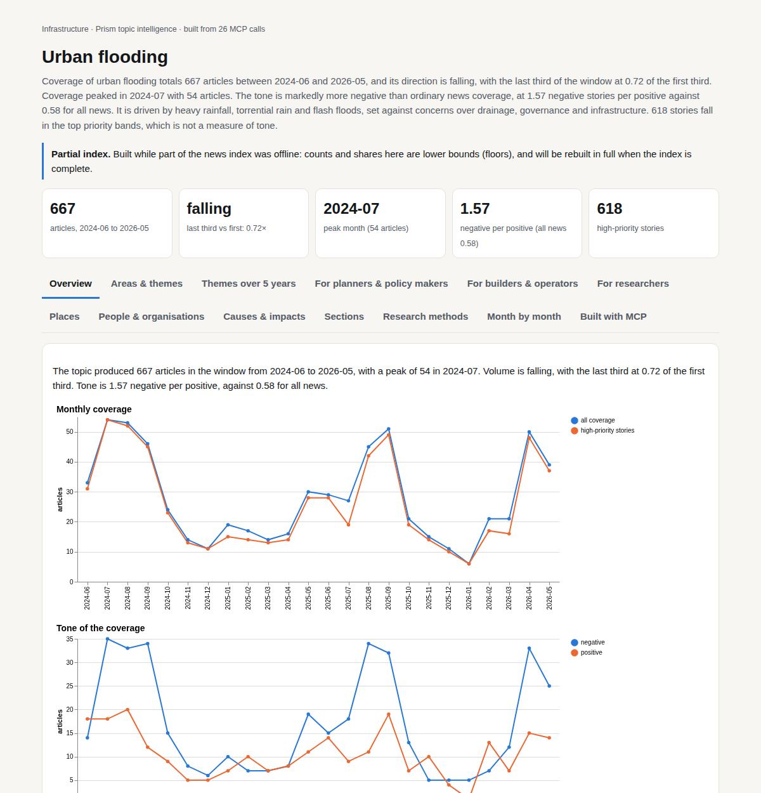

# Urban flooding

*Infrastructure · Prism topic intelligence* · **[Open the interactive page](https://fliarbi.com/demo/docs/prism-dashboards-3bb43e4c/topics/urban-flooding/)** (tabs: Overview · Areas & themes · Themes over 5 years · For planners & policy makers · For builders & operators · For researchers · Places · People & organisations · Causes & impacts · Sections · Research methods · Month by month · Built with MCP)

> **Partial index.** Built while part of the news index was offline: counts and shares here are lower bounds (floors), and will be rebuilt in full when the index is complete.

Coverage of urban flooding totals 667 articles between 2024-06 and 2026-05, and its direction is falling, with the last third of the window at 0.72 of the first third. Coverage peaked in 2024-07 with 54 articles. The tone is markedly more negative than ordinary news coverage, at 1.57 negative stories per positive against 0.58 for all news. It is driven by heavy rainfall, torrential rain and flash floods, set against concerns over drainage, governance and infrastructure. 618 stories fall in the top priority bands, which is not a measure of tone.

| Articles | Direction (last third vs first) | Peak month | Negative per positive | High-priority stories |
| ---: | --- | --- | ---: | ---: |
| 667 (2024-06 to 2026-05) | falling (0.72×) | 2024-07 (54) | 1.57 (all news 0.58) | 618 |

## Coverage over time

The topic produced 667 articles in the window from 2024-06 to 2026-05, with a peak of 54 in 2024-07. Volume is falling, with the last third at 0.72 of the first third. Tone is 1.57 negative per positive, against 0.58 for all news.

## Areas of activity and themes

Activity is led by Business & Industrial › Construction & Maintenance with 192 articles, followed by Green Living & Environmental Issues with 188 and Civil Engineering with 132. The top tags are infrastructure (133), urban planning (67), the national weather service (49), water management (45) and guwahati (43).

| Area of activity | Articles |
| --- | ---: |
| Business & Industrial › Construction & Maintenance | 192 |
| People & Society › Social Issues & Advocacy › Green Living & Environmental Issues | 188 |
| Business & Industrial › Construction & Maintenance › Civil Engineering | 132 |
| Business & Industrial › Energy & Utilities | 93 |
| Science › Ecology & Environment › Climate Change & Global Warming | 49 |
| Science › Ecology & Environment | 42 |

**Top tags (what the themes are built from):** infrastructure (133), urban planning (67), the national weather service (49), water management (45), guwahati (43), water quality (38), imd (33), national weather service (28)

## Where it is reported

India leads country coverage with 196 articles, followed by the United States with 155 and Pakistan with 47. Among states, Texas has 46 articles, Assam 45 and Florida 41, with Assam at 27.9 on the concentration figure given.

| Country | Articles | Lift | | Indian state | Articles | Lift |
| --- | ---: | ---: | --- | --- | ---: | ---: |
| India | 196 | 3.7× | | Texas | 46 | 1.4× |
| United States | 155 | 0.8× | | Assam | 45 | 27.9× |
| Pakistan | 47 | 5.6× | | Florida | 41 | 1.5× |
| Georgia | 36 | 2.7× | | Georgia | 38 | 1.9× |
| Mexico | 23 | 4.7× | | Maharashtra | 33 | 3.8× |
| The Bahamas | 20 | 16.6× | | Delhi | 31 | 6.3× |

## People and organisations

Named figures include Maryam Nawaz, Himanta Biswa Sarma, Greg Abbott, Mohan Charan Majhi and Ron DeSantis, alongside the organisations National Hurricane Center and Greater Hyderabad Municipal Corporation.

## Causes and impacts

Causes cited include heavy rainfall, torrential rain, flash floods, a delayed guard wall project, failed governance and unchecked urban chaos, and population growth. Impacts include 23,000 people affected, 12 deaths, evacuations, transport disruption and essential services breaking down.

**Causes named in the coverage:** heavy rainfall, torrential rain, flash floods, delayed guard wall project, failed governance and unchecked urban chaos, population growth

**Impacts:** 23,000 people affected, 12 deaths, evacuations, misery of displaced families, essential services broke down, transport disruption

## Sections inside the topic

Monsoon has 75 articles (11.24% of the topic) and drainage has 66 (9.9%). Monsoon coverage is rising faster, with a late-versus-early ratio of 2.18 against 1.11 for drainage. Monsoon tone, at 1.59 negative per positive, sits close to the topic figure of 1.57, while drainage is less negative at 0.73.

| Section | Articles | Share of the topic | Late vs early | Negative per positive |
| --- | ---: | ---: | ---: | ---: |
| urban flooding → drainage | 66 | 9.9% | 1.11× | 0.73 (topic 1.57) |
| urban flooding → monsoon | 75 | 11.24% | 2.18× | 1.59 (topic 1.57) |

## Research and outlook

The balance of research framing is broadly unchanged, with a shift of -0.2 points. The outlook figures show 183.0 for each of 2026, 2027 and 2028, with the range widening from 126.0 to 240.0 in 2026 to 12.0 to 354.0 in 2028.

## Month by month

In 2025-06 proactive local measures and early forecasts set a baseline for preparedness, and in 2025-07 deadly monsoon floods exposed crumbling drainage and prompted calls for trillion-dollar upgrades. In 2025-09 Delhi unveiled a 30-year Drainage Master Plan, and later coverage turned to nature-based mitigation, lidar-based detection and AI-driven flood intelligence.

- **2025-06:** Proactive local measures, early forecasts, and research on low‑impact development set a baseline for flood preparedness.
- **2025-07:** Deadly monsoon floods exposed crumbling drainage, prompting calls for trillion‑dollar upgrades to resilient, low‑carbon infrastructure.
- **2025-09:** Delhi unveiled a 30‑year Drainage Master Plan, representing a major governmental commitment to systematic flood mitigation.

## Themes over five years

Between 2021 and 2025 the themed coverage of urban flooding shifted from weather and disaster stories towards government, politics and infrastructure. Environment stayed close to level, at 22.3% in 2021 and 22.2% in 2025. Weather fell from 23.3% to 15.5%, disaster from 13.5% to 10.7% and local news from 12.6% to 8.8%. Government rose from 5.4% to 9.6%, politics from 5.9% to 8.2% and infrastructure from 3.2% to 5.8%, while technology went from 1.6% to 3.2%, sustainability from 0.5% to 1.8%, and science from 5.4% to 5.3%.

| Theme | 2021 | 2022 | 2023 | 2024 | 2025 |
| --- | ---: | ---: | ---: | ---: | ---: |
| environment | 22.3% | 23.7% | 22.1% | 22.6% | 22.2% |
| weather | 23.3% | 21.7% | 18.3% | 17.1% | 15.5% |
| disaster | 13.5% | 13.6% | 11.9% | 12.6% | 10.7% |
| local news | 12.6% | 12.0% | 10.1% | 11.1% | 8.8% |
| government | 5.4% | 5.9% | 7.0% | 9.4% | 9.6% |
| politics | 5.9% | 5.6% | 6.0% | 7.9% | 8.2% |
| science | 5.4% | 5.6% | 5.7% | 3.2% | 5.3% |
| infrastructure | 3.2% | 2.0% | 4.1% | 3.9% | 5.8% |
| technology | 1.6% | 2.2% | 3.2% | 2.7% | 3.2% |
| sustainability | 0.5% | 2.2% | 2.6% | 2.4% | 1.8% |

## For planners & policy makers

Research output on the topic has grown, from 47 papers in 2017 to 183 in 2025, with 184 in 2024, within an index of 105,414 research papers. The no-change scenario holds the central figure at 183 for 2026 to 2028, with a sensitivity range that widens from 126 to 240 in 2026 and 12 to 354 in 2028. Exposure is large and concentrated: 1.81 billion people are directly exposed to 1-in-100-year floods, 1.24 billion of them in South and East Asia, and 89% of the world's flood-exposed people live in low- and middle-income countries. Recent news items point to Assam, Uttarakhand-area flood works (Rangirkhal) and municipalities in Edomex, though only 8 news articles are indexed, so this is thin. Policy and government themes have grown in share of coverage, which fits a shift towards institutional questions. At city scale, one study found 83.72% of documented waterlogging points in predicted high-hazard zones, and 6.41% of the central urban area was extreme-hazard.

- Exposure: 1.81 billion people in 1-in-100-year floods, 1.24 billion in South and East Asia
- 89% of flood-exposed people are in low- and middle-income countries
- Government share of coverage 9.6% in 2025, infrastructure 5.8%
- Research volume of 183 papers in 2025 under the no-change scenario, range 126 to 240 for 2026
- Local stories from Assam and Edomex show where pressure is reported

## For builders & operators

For the claim that impervious surfaces increase urban flooding, the paper corpus is strongly positive: of 47 papers, 30 support, 7 qualify, none contradict and 10 are neutral, with 14.9% contested. However, no verified document verdict supports or contradicts the claim; the read documents were tallied as 7 unrelated and 1 unread, so no wording recommendation is made. The top sources are reviews and articles on impervious surface mapping and water quality, led by a 2002 review with 683 citations, and they are not direct flood-outcome tests. Head to head, green infrastructure reducing urban flooding (1,202 papers, 28.6% contested) has more evidence behind it than drainage capacity upgrades (5,802 papers, 27.9% contested). In the green infrastructure case, 3 read documents support it, while none of the 11 read for drainage upgrades did. Rainfall intensity is the only screening row with a figure: up to 18% increase in extreme precipitation, from a study in China.

- Impervious surfaces claim: 30 of 47 papers support, none contradict; document checks found no verified support (review and article tiers)
- Top review source: 2002 review on impervious surfaces and water quality, cited by 683
- Green infrastructure: 3 read documents support; strongest source is a 2009 article, rated unrelated
- Drainage upgrades: 5,802 papers, 48 contradicting; 11 read documents were unrelated (review tier strongest source)
- Rainfall intensity: up to 18% increase in extreme precipitation (article, China, 2016)

**Head to head:** Green infrastructure reduces urban flooding vs Drainage capacity upgrades reduce urban flooding: the first claim has more evidence behind it.

**Screen:** *How does … affect urban flood risk?* (one row per line below)

| Row | Figure (quoted) | Measures | Source |
| --- | --- | --- | --- |
| impervious surfaces | no figure found |  | An Assessment of Forest Cover and Impervious Surface Area on Family Forests in the New Yor (2012) |
| rainfall intensity | up to 18% | increase in extreme precipitation | Robust increase in extreme summer rainfall intensity during the past four decades observed (2016) |
| drainage capacity | no figure found |  | Urban Drainage Infrastructure Planning and Design Considering Climate Change (2006) |
| wetland loss | no figure found |  | Functional Wetland Loss Drives Emerging Risks to Waterbird Migration Networks (2022) |
| urbanisation | no figure found |  |  |
| climate change | no figure found |  | Designing and calibrating an agent‐based platform to evaluate the effect of climate variab (2023) |

## For researchers

The literature frames itself mostly as promising, at 41.6% of oriented papers (1,138), followed by problem identifying at 19.7%, descriptive at 17.4% and cautionary at 9.2%; critical work is 0.6% (17 papers). Contribution types are mainly empirical (1,520) and methodological (845), with 269 reviews and only 7 theoretical papers. The leading topics are urban stormwater management solutions (1,721 papers) and flood risk assessment and management (1,226). Framing is broadly unchanged: cautionary share is 22.8% in the recent window of 57,756 papers against 26.9% in the earlier window of 47,658. New work covers flood exposure and poverty in 188 countries, flood estimation in the Cauvery River, India, and a hazard framework for Rizhao, China. Gaps are visible: the readable-paper, the health literature index, patent and preprint counts are all 0, the most-cited recent papers carry 0 or 1 citations, and the country table shows only Italy with 1.

- Why do the sources for the impervious surfaces claim not test flood outcomes directly?
- Does the low critical share (0.6%) reflect consensus or publication bias?
- What evidence would verify the link between green infrastructure and flood reduction, given that the read documents were rated unrelated?
- Why are urbanisation, climate change and drainage capacity screening rows without figures?
- How will 2025 papers perform on citations, given that the most cited since 2020 have 1 or 0?

## Research exploration methods

Nine ways to explore the research, each run on this topic; the interactive report shows each call and its result.

**Chaining them.** Begin with triangulation to confirm the consensus around the claim and identify supporting versus qualifying evidence. Use gap mapping to verify that each component of the claim is covered, then apply screening to extract quantitative effect sizes for the risk factors. Compare alternative interventions with head‑to‑head analysis, and contextualise the narrative with framing and frontier scans to detect shifts in optimism or emerging work. Finally, assess the growth trajectory via history, locate geographic gaps, and employ faceted browsing to focus on the most relevant empirical and methodological literature.

### Evidence triangulation

*Is a claim supported, and by how strong a design?* `find_evidence` + `find_counter_evidence` + `rank_sources`

The claim that impervious surfaces increase urban flooding looks well supported at corpus level but is not verified at document level. Of 47 papers in the corpus, 30 are supporting, 7 qualifying, 0 contradicting and 10 neutral, with a contested share of 14.9%. The tool itself warns that such positive framing can mean consensus or publication bias. The documents actually read tell a weaker story: 9 were judged unrelated and 1 unread, and the counter-evidence search found 0 supporting, 0 contradicting, 0 qualifying, 7 unrelated and 1 unread. The tool therefore states that no verified document verdict supports a wording recommendation. The top sources are reviews and articles on water quality, remote sensing mapping and stream temperature, not flood outcomes, which is consistent with the unrelated verdicts. A careful researcher would read the sources that link imperviousness to flood peaks or runoff directly, and would not treat the absence of contradiction as confirmation.

### Head-to-head claims

*Which of two interventions has more and stronger evidence?* `compare_claims`

On the measures given, green infrastructure has more evidence behind it than drainage capacity upgrades, according to the tool's verdict, although the picture is thin. Green infrastructure has 1,202 papers on both poles against 5,802 for drainage upgrades, so the larger literature belongs to drainage. The verdict rests on documents read: 3 supports for green infrastructure and 0 for drainage, where all 11 read were unrelated and 1 unread. Contested shares are close, at 28.6 for green infrastructure and 27.9 for drainage. The strongest source for each was itself judged unrelated (a 2009 article on green roofs; a 2015 review on urbanisation and water management), so neither headline source directly backs its claim. This comparison does not show that either intervention works better or cheaper in practice. A careful researcher would look at the 3 supporting green infrastructure documents and find drainage studies that report measured flood outcomes.

### Cross-row screening

*Which rows carry a measured, quoted figure, and how large is it?* `research_table`

Screening asked how six factors affect urban flood risk and found a quoted figure for only one. Rainfall intensity returned 'up to 18%' as an increase in extreme precipitation, from 3 papers, with the source being a 2016 study of summer rainfall in China. That is a measure of rainfall change, not of flood damage or flood risk, and no population was reported. Impervious surfaces, drainage capacity, wetland loss, urbanisation and climate change returned no value. Urbanisation returned no source at all. Several of the sources listed are off-topic, for example waterbird migration for wetland loss and residential water demand for climate change, which suggests retrieval mismatch rather than evidence. The absence of figures means the screen could not find them, not that the effects are small or absent. A careful researcher would query these factors with more specific wording and check the one figure against its original sentence.

### Framing drift

*Is the literature becoming more hopeful or more cautious?* `stance_trends`

Framing across 2017 to 2025 is steady rather than drifting. Positive share ranges from 20.0 in 2019 to 26.5 in both 2018 and 2023, and sits at 25.2 in 2025. Contested share ranges from 13.6 in 2023 to 17.1 in 2021, ending at 15.6 in 2025. No clear direction emerges: the lowest positive year and the highest contested year are different years, and both measures move up and down. The data say how papers frame their own findings, not whether the findings are right. A careful researcher would read this as no evidence of a shift toward hope or caution and would look at sub-topics before drawing conclusions.

### Frontier scan

*What is new, and what is the research not reaching?* `research_radar`

The newest work listed is varied and mostly adjacent to the core question. It includes a 2022 Nature Communications paper on flood exposure and poverty in 188 countries, a 2024 comparison of flood estimation models in the Cauvery River, a 2025 landslide mapping study of India, a 2025 flood hazard framework for Rizhao, China, and a 2025 kriging paper on urban microclimate. None has citation counts or orientation labels, so none can be ranked by influence. The framing shift compares 57,756 recent papers (22.8 cautionary_pct) with 47,658 earlier ones (26.9), a delta of -4.1 percentage points, which the tool reads as broadly unchanged. The caveat is that orientation labels a paper's own framing, not the truth. The frontier list shows interest in exposure, poverty and hazard mapping, but it does not show which topics are under-covered, since no coverage gaps were returned. A careful researcher would check the poverty and exposure work for relevance to urban drainage.

### Gap mapping

*Which parts of a claim does the literature actually cover?* `research_gaps`

All three components of the claim were found to have a literature: impervious surfaces increase stormwater runoff, stormwater runoff increases urban flooding, and impervious surfaces raise flood risk. Each is marked 'yes'. This indicates there are no obvious missing links in the causal chain. It does not show how strong, how recent or how directly relevant that literature is. The triangulation result is a caution here, since the documents read were judged unrelated and no verified verdict was reached. A 'yes' means papers exist, not that they support the component. A careful researcher would sample the literature for each link and test whether the evidence is quantitative, local or only conceptual.

### Count history and backtested scenarios

*Is research on this growing, and where could it be in three years?* `historical_analysis` + `trend_scenarios`

Title-matched papers rose from 47 in 2017 to 184 in 2024 and 183 in 2025, with a dip to 69 in 2020. Growth was gradual through 2022 at 87, then jumped to 127 in 2023 and 184 in 2024. The chosen scenario baseline is no_change, so the central value is 183 for each of 2026, 2027 and 2028. The sensitivity band widens from 126 to 240 in 2026, 69 to 297 in 2027 and 12 to 354 in 2028. The flat central line reflects the method chosen by backtesting, not a prediction that growth has stopped. Counts are matched on titles, so they miss papers that cover the topic without the title wording. A careful researcher would treat 2027 and 2028 as very uncertain and wait for 2026 counts.

### Geographic triangulation

*Where is it studied, published, reported and patented?* `global_comparison` + `newsgeo`

Geographic triangulation returned almost nothing: Italy with a count of 1 for where it is studied, and no countries for where it is reported. This absence means the lanes could not resolve location for the claim, not that the topic is limited to Italy or that there is no coverage elsewhere. One study is too few for any pattern. Other results in this set, such as work on China, India and Congo, show that research exists in many places, but that is not part of this lane. A careful researcher would not draw regional conclusions from this output and would rely on country metadata from the papers themselves.

### Faceted browsing

*What kind of literature is it: empirical, review, position? Problem-identifying or promising?* `browse_research`

The literature is mostly promising in orientation: 1,138 papers (41.6 share_pct), followed by problem_identifying at 538 (19.7), descriptive at 477 (17.4), cautionary at 252 (9.2), breakthrough at 162 (5.9), comparative at 150 (5.5) and critical at 17 (0.6). By contribution, empirical papers number 1,520, methodological 845, review 269, position 93 and theoretical 7. The leading topics are Urban Stormwater Management Solutions at 1,721 and Flood Risk Assessment and Management at 1,226, with heat island mitigation at 560. The mix suggests a solutions-focused, applied field with little critical work, but promising framing is how authors present their work, not proof of effectiveness. The most cited since 2020 are all 2025 papers with 1 or 0 citations, so they are too recent to show influence. A careful researcher would read the cautionary and critical papers for limits on solutions and treat the topic list as including adjacent subjects such as heat and wastewater.

## Built with MCP

Every number and chart on this page comes from these 26 Prism MCP tool calls, made over MCP (streamable HTTP). Arguments and timings: [mcp_calls.json](mcp_calls.json); responses: [data.json](data.json).

| MCP tool | Calls |
| --- | ---: |
| `news_activities` | 1 |
| `news_geography` | 1 |
| `news_drill` | 2 |
| `news_themes` | 5 |
| `prism_overview` | 1 |
| `news_factors` | 1 |
| `historical_analysis` | 1 |
| `stance_trends` | 1 |
| `critical_news` | 1 |
| `browse_research` | 1 |
| `global_comparison` | 1 |
| `research_gaps` | 1 |
| `research_radar` | 1 |
| `research_brief` | 1 |
| `find_evidence` | 1 |
| `rank_sources` | 1 |
| `find_counter_evidence` | 1 |
| `deep_timeline` | 1 |
| `research_table` | 1 |
| `compare_claims` | 1 |
| `trend_scenarios` | 1 |

Try it: `prism entity "urban flooding"` · `prism call news.drill term='urban flooding' scope='drainage'` · `prism call analysis.timeline term='urban flooding'`

