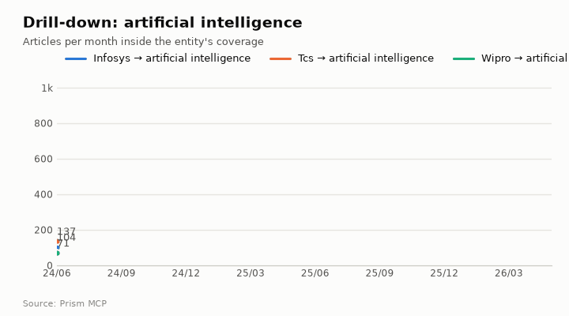

# Infosys vs TCS vs Wipro

[Companies, people & places](README.md) · [All use cases](../README.md) · [How the benchmark works](../../../benchmarks/README.md) · [Prism MCP](../../../README.md)

> **Intelligence requirement.** Three listed IT services rivals on one scale with growth and tone.  
> **Why it is hard.** Results seasons create quarterly spikes; growth must be read across them.  
> **Data.** Captured 2026-10-23 from the live Prism MCP server · 2024-06-01 to 2026-06-01 (exclusive) · all listed tables passed strict index partition reads and historical row floors. Saved responses: [infosys-tcs-wipro.json](../../examples/infosys-tcs-wipro.json).

**The question:**

> How does news attention compare across Infosys, TCS and Wipro, and whose tone is better?

## What Prism returned

| Term | Articles | Share | Critical | Growth (late vs early) | Negative-to-positive | vs all news |
| --- | ---: | ---: | ---: | ---: | ---: | ---: |
| **infosys** | 40,012 | 41.8% | 23,431 | 1.02× (flat) | 0.45 | 0.78× |
| **tcs** | 39,787 | 41.6% | 25,178 | 1.44× (rising) | 0.45 | 0.78× |
| **wipro** | 15,867 | 16.6% | 9,868 | 1.06× (flat) | 0.36 | 0.62× |


> more coverage is attention, not importance, and a term that is also a common word will over-count — check each term's own volume against its sources panel

## Beyond the news trend



This page also shows: **Areas of activity and company events** · **Drill into a section**. Each section below is one Prism call; the call is printed under it so you can run it on any other company, person, place or phrase.

### Areas of activity: infosys


| Area of activity | Articles | Lift over all news |
| --- | ---: | ---: |
| Business & Industrial › Business Services › Outsourcing | 334 | 85.9× |
| Computers & Electronics › Enterprise Technology | 3,988 | 13.4× |
| Business & Industrial › Business Operations › Flexible Work Arrangements | 276 | 38.9× |
| Business & Industrial › Business Services › Consulting | 872 | 19.2× |
| Business & Industrial › Business Operations › Human Resources | 1,457 | 8.3× |
| Computers & Electronics › Software › Business & Productivity Software | 3,022 | 5.0× |
| Science › Computer Science › Machine Learning & Artificial Intelligence | 3,161 | 3.9× |
| Finance › Banking | 1,846 | 4.6× |
| Jobs & Education › Jobs › Job Listings | 984 | 6.0× |
| Business & Industrial › Business Education | 152 | 13.3× |

**Activity topics inside those areas:** stock market index composition, sector rotation strategies, international/emerging markets stocks, market volatility indicators, work visa categories (e.g., h-1b, l-1, tier 2), asian financial market developments, trade wars and geopolitical impacts, stock market performance and trends


| Event type | Events | Latest example |
| --- | ---: | --- |
| earnings | 367 | 2026-04-25: Infosys delivered constant-currency revenue growth of 3.1% for FY2026, the strongest performance of the four. |
| regulatory | 63 | 2026-04-24: Infosys has approved performance-linked stock incentives worth approximately INR 52 crore for its Chief Executive Officer and Managing Director, Salil |
| new product | 58 | 2026-03-20: Infosys (NSE: INFY) (BSE: INFY) (NYSE: INFY), a global leader in next generation digital services and consulting, and Formula E, the world’s first all |
| company announcement | 56 | 2026-04-25: Infosys in Q4 reduced the number of around 8,440 employees. |
| contracts | 55 | 2026-04-29: Truist Financial Corp. of the United States has awarded Infosys Ltd a contract to establish and operate a global capabilities centre (GCC) in Hyderaba |
| ma | 50 | 2026-05-05: Infosys completed the acquisition of Optimum Healthcare IT, a digital transformation and consulting firm focused on healthcare providers. |
| job creation | 31 | 2026-04-29:  |
| lawsuit | 23 | 2025-12-22: The company has reached a settlement agreement for a class action lawsuit against its foreign subsidiary, McCamish LLC, and its certain customer. |

<details><summary><b>How to run this:</b> <code>news.activities</code> (MCP tool <code>news_activities</code>)</summary>

The function is `activities(term, domain, since, until, limit)` in [`prism/deep.py`](../../../prism/deep.py), registered as the `news.activities` feature in [`prism_mcp.py`](../../../prism_mcp.py): the industry taxonomy each article is classified under (generic news classes removed), the curated subcategories inside it, the top tags, and, with a web domain, the company's news events by type.

**MCP** (Claude, ChatGPT, Cursor, any MCP client): call the tool `news_activities` with

```json
{"term": "infosys", "domain": "infosys.com"}
```

**REST**

```bash
curl -s -X POST "$PRISM_URL/v1/news.activities" -H "Authorization: Bearer $FLIAR_API_KEY" \
  -H 'content-type: application/json' -d '{"term": "infosys", "domain": "infosys.com"}' | jq '.data'
```

**Python**

```python
import prism_mcp
r = prism_mcp.REGISTRY["news_activities"]["fn"](term="infosys", domain="infosys.com")
print(r["data"], r["window"])
```

**CLI**

```bash
prism call news.activities term='infosys' domain='infosys.com'
```

</details>

### Drill-down: infosys → artificial intelligence

**5,106** articles about infosys also mention artificial intelligence: **12.76%** of its coverage; last third of the window vs first: **2.26×**. Tone: 0.26 negative per positive in the section vs 0.45 for infosys overall (the section is covered more positively than the entity as a whole).


**Inside the section, the top tags are:** infosys (4,981), artificial intelligence (4,927), ai (4,631), india (2,956), technology (2,933), innovation (2,519), tcs (1,602), us (1,300), wipro (1,129), investment (1,028)

| Day | Outlets that day | What was reported |
| --- | ---: | --- |
| 2026-02-17 | 146 | bengaluru: infosys has unveiled an ai-first value framework, positioning itself to tap what it estimates to be a $300–400 billion global services opportunity as enterprises race to |
| 2026-02-04 | 89 | india&rsquo;s information technology (it) stocks slid sharply on wednesday after losses in wall street software peers, as advances in artificial intelligence (ai) spooked investors |
| 2026-02-18 | 84 | when us-based ai company anthropic unveiled its latest claude model in san francisco, shares of indian it majors, including infosys, tata consultancy services, hcltech, tech mahind |
| 2026-02-19 | 72 | &lt;p&gt;mumbai: the tata group and its it services arm &lt;a href="https://www.deccanherald.com/tags/tcs"&gt;tcs&lt;/a&gt; on thursday announced a multi-dimensional tie-up with op |
| 2026-02-13 | 62 | the tech world never really slows down. just when companies feel settled, something new comes along and changes the mood. right now, artificial intelligence (ai) is that &ldquo;som |
| 2026-02-12 | 54 | indian equities ended sharply lower on thursday, dragged down by a fresh wave of selling in information technology stocks amid growing global unease around artificial intelligence |

<details open><summary><b>How to run this:</b> <code>news.drill</code> (MCP tool <code>news_drill</code>)</summary>

The function is `drill(term, scope, since, until, limit)` in [`prism/deep.py`](../../../prism/deep.py), registered as the `news.drill` feature in [`prism_mcp.py`](../../../prism_mcp.py): an article is in the section when it mentions the entity and every scope phrase; the section's monthly volume is divided by the entity's own, its tone compared with the entity's, and its busiest days listed.

The scoping itself is this function: the entity's own match, narrowed by every scope phrase, so the section is always a subset of the entity's coverage:

```python
def _pred(term: str, scope_terms: list) -> str:
    p = news.term_predicate(term, "mention")
    for s in scope_terms:
        p = f"({p} AND {news.term_predicate(s, 'mention')})"
    return p
```

**MCP** (Claude, ChatGPT, Cursor, any MCP client): call the tool `news_drill` with

```json
{"term": "infosys", "scope": "artificial intelligence"}
```

**REST**

```bash
curl -s -X POST "$PRISM_URL/v1/news.drill" -H "Authorization: Bearer $FLIAR_API_KEY" \
  -H 'content-type: application/json' -d '{"term": "infosys", "scope": "artificial intelligence"}' | jq '.data'
```

**Python**

```python
import prism_mcp
r = prism_mcp.REGISTRY["news_drill"]["fn"](term="infosys", scope="artificial intelligence")
print(r["data"], r["window"])
```

**CLI**

```bash
prism call news.drill term='infosys' scope='artificial intelligence'
```

</details>

### Drill-down: tcs → artificial intelligence

**4,442** articles about tcs also mention artificial intelligence: **11.16%** of its coverage; last third of the window vs first: **2.89×**. Tone: 0.29 negative per positive in the section vs 0.45 for tcs overall (the section is covered more positively than the entity as a whole).


**Inside the section, the top tags are:** tcs (4,412), artificial intelligence (4,252), ai (3,886), india (2,590), technology (2,469), tata consultancy services (2,257), innovation (1,768), infosys (1,592), us (1,120), wipro (927)

| Day | Outlets that day | What was reported |
| --- | ---: | --- |
| 2026-02-19 | 123 | tata, openai to build 100 mw of ai infrastructure new delhi, feb 19 (uni) tata group, tata consultancy services (tcs) and openai on thursday announced a strategic partnership, that |
| 2026-02-12 | 65 | united states artificial intelligence in marketing market to reach usd 77.3 billion by 2030 \| key players: ibm, microsoft, alphabet, adobe, salesforceartificial intelligence in mar |
| 2025-07-28 | 63 | shares of tech major tata consultancy services (tcs) were trading lower on monday, following the company's announcement to lay off around 12,200 employees in fy26. the share had sl |
| 2026-04-09 | 57 | it major tata consultancy services (tcs) will report its march quarter results on thursday, with investor focus likely to stay less on the reported numbers and more on what managem |
| 2026-02-04 | 55 | india&rsquo;s information technology (it) stocks slid sharply on wednesday after losses in wall street software peers, as advances in artificial intelligence (ai) spooked investors |
| 2026-02-25 | 47 | technology stocks worldwide are experiencing sharp volatility amid concerns over rapid advancements in artificial intelligence (ai) and their potential impact on the broader it sec |

<details open><summary><b>How to run this:</b> <code>news.drill</code> (MCP tool <code>news_drill</code>)</summary>

The function is `drill(term, scope, since, until, limit)` in [`prism/deep.py`](../../../prism/deep.py), registered as the `news.drill` feature in [`prism_mcp.py`](../../../prism_mcp.py): an article is in the section when it mentions the entity and every scope phrase; the section's monthly volume is divided by the entity's own, its tone compared with the entity's, and its busiest days listed.

The scoping itself is this function: the entity's own match, narrowed by every scope phrase, so the section is always a subset of the entity's coverage:

```python
def _pred(term: str, scope_terms: list) -> str:
    p = news.term_predicate(term, "mention")
    for s in scope_terms:
        p = f"({p} AND {news.term_predicate(s, 'mention')})"
    return p
```

**MCP** (Claude, ChatGPT, Cursor, any MCP client): call the tool `news_drill` with

```json
{"term": "tcs", "scope": "artificial intelligence"}
```

**REST**

```bash
curl -s -X POST "$PRISM_URL/v1/news.drill" -H "Authorization: Bearer $FLIAR_API_KEY" \
  -H 'content-type: application/json' -d '{"term": "tcs", "scope": "artificial intelligence"}' | jq '.data'
```

**Python**

```python
import prism_mcp
r = prism_mcp.REGISTRY["news_drill"]["fn"](term="tcs", scope="artificial intelligence")
print(r["data"], r["window"])
```

**CLI**

```bash
prism call news.drill term='tcs' scope='artificial intelligence'
```

</details>

### Drill-down: wipro → artificial intelligence

**2,119** articles about wipro also mention artificial intelligence: **13.35%** of its coverage; last third of the window vs first: **2.19×**. Tone: 0.3 negative per positive in the section vs 0.36 for wipro overall (the section is covered more positively than the entity as a whole).


**Inside the section, the top tags are:** wipro (2,052), artificial intelligence (2,047), ai (1,873), india (1,243), technology (1,153), infosys (1,142), tcs (941), innovation (920), us (647), tata consultancy services (527)

| Day | Outlets that day | What was reported |
| --- | ---: | --- |
| 2026-02-04 | 60 | amid panic in the tech world over artificial intelligence firm anthropic bringing new legal tools to its flagship chatbot claude, tech mahindra ceo and managing director mohit josh |
| 2026-02-12 | 35 | indian equities ended sharply lower on thursday, dragged down by a fresh wave of selling in information technology stocks amid growing global unease around artificial intelligence |
| 2026-02-16 | 32 | after a sharp fall in benchmark indices, investors will closely track global and domestic cues next week, including the us federal reserve minutes, rbi policy signals, it sector tr |
| 2026-04-06 | 31 | by haripriya suresh and bharath rajeswaran bengaluru, april 6 (reuters) - top indian information technology firms are set to report another lacklustre quarter, with revenue and pro |
| 2026-02-13 | 25 | infosys, tata consultancy services, wipro, hcl technologies and other it stocks are likely to remain under pressure on friday after witnessing a sharp sell-off in the previous sess |
| 2026-02-18 | 23 | it stocks: after witnessing some rebound in the previous session, indian it stocks including infosys, tcs, wipro, hcl tech and others are back in the red on wednesday, february 18 |

<details open><summary><b>How to run this:</b> <code>news.drill</code> (MCP tool <code>news_drill</code>)</summary>

The function is `drill(term, scope, since, until, limit)` in [`prism/deep.py`](../../../prism/deep.py), registered as the `news.drill` feature in [`prism_mcp.py`](../../../prism_mcp.py): an article is in the section when it mentions the entity and every scope phrase; the section's monthly volume is divided by the entity's own, its tone compared with the entity's, and its busiest days listed.

The scoping itself is this function: the entity's own match, narrowed by every scope phrase, so the section is always a subset of the entity's coverage:

```python
def _pred(term: str, scope_terms: list) -> str:
    p = news.term_predicate(term, "mention")
    for s in scope_terms:
        p = f"({p} AND {news.term_predicate(s, 'mention')})"
    return p
```

**MCP** (Claude, ChatGPT, Cursor, any MCP client): call the tool `news_drill` with

```json
{"term": "wipro", "scope": "artificial intelligence"}
```

**REST**

```bash
curl -s -X POST "$PRISM_URL/v1/news.drill" -H "Authorization: Bearer $FLIAR_API_KEY" \
  -H 'content-type: application/json' -d '{"term": "wipro", "scope": "artificial intelligence"}' | jq '.data'
```

**Python**

```python
import prism_mcp
r = prism_mcp.REGISTRY["news_drill"]["fn"](term="wipro", scope="artificial intelligence")
print(r["data"], r["window"])
```

**CLI**

```bash
prism call news.drill term='wipro' scope='artificial intelligence'
```

</details>

## Run it yourself

**In Claude, ChatGPT, Cursor or any MCP client**, with the Prism server connected:

```text
How does news attention compare across Infosys, TCS and Wipro, and whose tone is better?
```

**Over REST** (same function, same envelope):

```bash
curl -s -X POST "$PRISM_URL/v1/news.compare" \
  -H 'content-type: application/json' \
  -d '{"terms": ["infosys", "tcs", "wipro"], "since": "2024-06-01"}' | jq '.data'
```

**From Python**, in-process:

```python
import prism_mcp
r = prism_mcp.REGISTRY['compare_terms']["fn"](**{'terms': ['infosys', 'tcs', 'wipro'], 'since': '2024-06-01'})
print(r["ok"], r["window"], r["meta"]["coverage"]["note"])
```

Tool calls this page is built from: `compare_terms` (32.8 s) → `news_activities` (14.1 s) → `news_drill` (32.0 s) → `news_drill` (30.9 s) → `news_drill` (32.2 s)

## Take it further

- **Export:** every response is JSON in one envelope (`ok`, `data`, `window`, `meta`), so `jq`, pandas or a spreadsheet import reads it directly. See [Data export](../../DATA_EXPORT.md).
- **Research workflow:** chain this with `research.brief`, `research.citations` and `research.audit` to go from a question to a sourced draft. See [Research analysis](../../RESEARCH_ANALYSIS.md).
