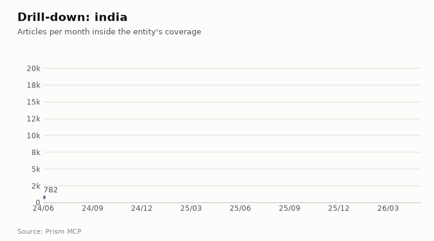

# Narendra Modi vs Donald Trump in the news

[Companies, people & places](README.md) · [All use cases](../README.md) · [How the benchmark works](../../../benchmarks/README.md) · [Prism MCP](../../../README.md)

> **Intelligence requirement.** Two leaders on one scale, month by month, with tone against the all-news baseline.  
> **Why it is hard.** Trump dominates global volume; the useful reading is share, growth and tone, not raw counts.  
> **Data.** Captured 2026-10-23 from the live Prism MCP server · 2024-06-01 to 2026-06-01 (exclusive) · all listed tables passed strict index partition reads and historical row floors. Saved responses: [modi-vs-trump.json](../../examples/modi-vs-trump.json).

**The question:**

> How does world news coverage of Narendra Modi compare with Donald Trump: volume, growth, tone and critical stories?

## What Prism returned

| Term | Articles | Share | Critical | Growth (late vs early) | Negative-to-positive | vs all news |
| --- | ---: | ---: | ---: | ---: | ---: | ---: |
| **narendra modi** | 381,708 | 12.2% | 296,417 | 1.0× (flat) | 0.6 | 1.03× |
| **donald trump** | 2,740,019 | 87.8% | 2,141,104 | 1.5× (rising) | 4.45 | 7.67× |


> more coverage is attention, not importance, and a term that is also a common word will over-count — check each term's own volume against its sources panel

## Beyond the news trend



This page also shows: **Drill into a section** · **Month-by-month ultra research**. Each section below is one Prism call; the call is printed under it so you can run it on any other company, person, place or phrase.

### Drill-down: donald trump → india

**174,153** articles about donald trump also mention india: **6.36%** of its coverage; last third of the window vs first: **2.32×**. Tone: 2.35 negative per positive in the section vs 4.45 for donald trump overall (the section is covered more positively than the entity as a whole).


**Inside the section, the top tags are:** india (172,437), donald trump (171,902), us (124,343), trump (120,169), china (82,418), the united states (64,597), u.s. (54,811), washington (52,397), russia (50,052), tariffs (43,694)

| Day | Outlets that day | What was reported |
| --- | ---: | --- |
| 2025-08-07 | 1628 | donald trump speaks to reporters at the white house, august 6, 2025 (ap)wednesday’s coverage: zelensky’s “productive” discussion with trump on eve of witkoff’s visit to kremlinupda |
| 2025-02-14 | 1554 | prime minister narendra modi welcomed the efforts made by u.s. president donald trump towards resolving the russia-ukraine conflict and reiterated india's position that the conflic |
| 2025-04-03 | 1536 | wake up! the stock market is crashing, layoffs have surged more than 200 percent, and we are being warned a depression is coming% of readers think this story is fact. add your two |
| 2025-08-06 | 1424 | eighty years ago this week, when u.s. president harry truman announced the first use of an atomic bomb, he called it “the greatest achievement of organized science in history.” tru |
| 2026-02-03 | 1306 | opinionthe iranian regime is brutal, fanatical and corrupt. it has just committed the mass murder of its own citizens in the city streets and in their own homes. but the story we a |
| 2025-07-31 | 1204 | in yet another twist in his unpredictable decision making, us president donald trump has dramatically shortened his original 50-day ultimatum to vladimir putin to call a ceasefire |

<details open><summary><b>How to run this:</b> <code>news.drill</code> (MCP tool <code>news_drill</code>)</summary>

The function is `drill(term, scope, since, until, limit)` in [`prism/deep.py`](../../../prism/deep.py), registered as the `news.drill` feature in [`prism_mcp.py`](../../../prism_mcp.py): an article is in the section when it mentions the entity and every scope phrase; the section's monthly volume is divided by the entity's own, its tone compared with the entity's, and its busiest days listed.

The scoping itself is this function: the entity's own match, narrowed by every scope phrase, so the section is always a subset of the entity's coverage:

```python
def _pred(term: str, scope_terms: list) -> str:
    p = news.term_predicate(term, "mention")
    for s in scope_terms:
        p = f"({p} AND {news.term_predicate(s, 'mention')})"
    return p
```

**MCP** (Claude, ChatGPT, Cursor, any MCP client): call the tool `news_drill` with

```json
{"term": "donald trump", "scope": "india"}
```

**REST**

```bash
curl -s -X POST "$PRISM_URL/v1/news.drill" -H "Authorization: Bearer $FLIAR_API_KEY" \
  -H 'content-type: application/json' -d '{"term": "donald trump", "scope": "india"}' | jq '.data'
```

**Python**

```python
import prism_mcp
r = prism_mcp.REGISTRY["news_drill"]["fn"](term="donald trump", scope="india")
print(r["data"], r["window"])
```

**CLI**

```bash
prism call news.drill term='donald trump' scope='india'
```

</details>

### Drill-down: narendra modi → tariff

**10,267** articles about narendra modi also mention tariff: **2.69%** of its coverage; last third of the window vs first: **10.94×**. Tone: 1.46 negative per positive in the section vs 0.6 for narendra modi overall (the section is covered more negatively than the entity as a whole).


**Inside the section, the top tags are:** narendra modi (10,190), india (9,868), donald trump (8,119), us (8,076), trump (7,599), tariffs (6,500), china (4,940), new delhi (4,925), washington (4,292), russia (4,149)

| Day | Outlets that day | What was reported |
| --- | ---: | --- |
| 2026-02-03 | 465 | former assistant us trade representative mark linscott on monday (local time) welcomed the india-us trade deal, in which washington reduced the tariffs on india to 18 per cent, say |
| 2025-08-27 | 332 | us president donald trump has once again claimed credit for his role in the truce between india and pakistan following the four-day military conflict between the two neighbouring c |
| 2026-02-02 | 299 | trump speaks to pm modi amid ongoing trade talks; us ambassador to india says 'stay tuned' the telephonic conversation between the two leaders come at a time when the relationship |
| 2025-08-07 | 295 | us media reported on the additional tariff announcement stating how it would complicate the relations between the two countries, that seemed to be “enjoying the friendship” forged |
| 2025-02-13 | 230 | washington dc [us], february 13 (ani): us president donald trump said on thursday that a news conference on reciprocal tariffs will be made later today.in a post on truth social to |
| 2025-02-14 | 220 | washington – in a news conference thursday, president trump and indian prime minister narendra modi sought to emphasize their strong relationship and areas where the two countries |

<details open><summary><b>How to run this:</b> <code>news.drill</code> (MCP tool <code>news_drill</code>)</summary>

The function is `drill(term, scope, since, until, limit)` in [`prism/deep.py`](../../../prism/deep.py), registered as the `news.drill` feature in [`prism_mcp.py`](../../../prism_mcp.py): an article is in the section when it mentions the entity and every scope phrase; the section's monthly volume is divided by the entity's own, its tone compared with the entity's, and its busiest days listed.

The scoping itself is this function: the entity's own match, narrowed by every scope phrase, so the section is always a subset of the entity's coverage:

```python
def _pred(term: str, scope_terms: list) -> str:
    p = news.term_predicate(term, "mention")
    for s in scope_terms:
        p = f"({p} AND {news.term_predicate(s, 'mention')})"
    return p
```

**MCP** (Claude, ChatGPT, Cursor, any MCP client): call the tool `news_drill` with

```json
{"term": "narendra modi", "scope": "tariff"}
```

**REST**

```bash
curl -s -X POST "$PRISM_URL/v1/news.drill" -H "Authorization: Bearer $FLIAR_API_KEY" \
  -H 'content-type: application/json' -d '{"term": "narendra modi", "scope": "tariff"}' | jq '.data'
```

**Python**

```python
import prism_mcp
r = prism_mcp.REGISTRY["news_drill"]["fn"](term="narendra modi", scope="tariff")
print(r["data"], r["window"])
```

**CLI**

```bash
prism call news.drill term='narendra modi' scope='tariff'
```

</details>

### Month by month: Prism reads donald trump → india

Prism took the days most outlets reported the subject, one month at a time, read the stories' openings, and wrote what happened and why it mattered; every point cites the stories it rests on.

> **The arc.** In mid‑2025 Trump’s foreign‑policy narrative swung from aggressive Iran rhetoric to a hardening stance on Russia, while he cultivated a reputation for brokering peace in South Asia. He repeatedly claimed to have ended the India‑Pakistan clash, using those claims to bolster his diplomatic brand even as regional tensions persisted. By late 2025 his agenda expanded to include bold moves on Ukraine, Israel‑Hamas and nuclear testing, creating a pattern of high‑profile but contested agreements. Entering his second non‑consecutive term in early 2026, Trump leveraged the platform to claim a new India‑Pakistan de‑escalation and to draw India into Middle‑East peace efforts, while his Iran campaign intensified, leading to blockades and maritime incidents. The fragility of his cease‑fire deals and the growing involvement of India and China signal a volatile diplomatic environment that could test Trump’s claimed peace‑making legacy.

- **Turning point, 2025-06:** Trump’s aggressive Iran rhetoric heightened US‑Iran tensions and he was praised for ending a brief India‑Pakistan clash, positioning himself as a peace broker.
- **Turning point, 2025-07:** He cut his Russia ultimatum to ten days and vowed more weapons to Ukraine, marking a hardening U.S. stance on Moscow.
- **Turning point, 2025-09:** At the UN, Trump publicly claimed to have resolved the India‑Pakistan conflict, reinforcing his self‑styled diplomatic record.
- **Turning point, 2025-10:** Trump issued a warning to supply Ukraine with long‑range missiles, suggested restarting nuclear testing, and announced a purported Israel‑Hamas peace deal, showing an aggressive diplomatic posture.

| Month | Articles | Signal | What happened |
| --- | ---: | --- | --- |
| 2025-06 | 6,059 | turning point | **Trump’s aggressive Iran rhetoric sparked regional tension even as he was lauded for ending a brief India‑Pakistan clash** Trump’s “evacuate Tehran” comment and later insult to Iran’s supreme leader (“you got beat to hell”) heightened US‑Iran tensions. While claiming optimism about brokering a cease‑fire in the Israel‑Iran conflict, Trump ordered strikes on Iran, prompting Pakistan to condemn the action. Pakistan praised Trump for helping end a four‑day India‑Pakistan conflict the previous month and nominated him for  |
| 2025-07 | 10,827 | escalating | **Trump ramps up pressure on Russia while his foreign‑policy stance fuels political debate in India over Modi's Pakistan ceasefire** Trump cut his original 50‑day ultimatum to Putin for a Ukraine ceasefire down to ten days, a move framed as frustration with the Russian leader. He vowed to send more weapons to Ukraine and complained that Russia was throwing “a lot of bullshit” at the United States, underscoring a hardening U.S. stance. In the Indian Lok Sabha, TMC MP Kalyan Banerjee mocked Prime Minister Modi over the May 10 cea |
| 2025-08 | 19,327 | steady | **Trump’s August diplomacy focused on Russia‑Ukraine, with no reported India engagement** Trump addressed reporters at the White House, emphasizing his role in global mediation efforts. He highlighted his ongoing mediation work and aspirations for a Nobel peace prize, claiming credit for ending multiple wars. Trump announced a planned meeting with Russian President Vladimir Putin in Alaska to discuss ending the Ukraine war, underscoring his focus on that conflict. |
| 2025-09 | 13,893 | turning point | **Trump says he ended the India‑Pakistan conflict as Pakistan lauds his diplomacy amid lingering regional tensions** A brief but intense India‑Pakistan missile and drone clash in early May 2025, described as a 100‑hour battle with unprecedented use of weapons, highlighted the volatility of the relationship. At the United Nations General Assembly, former US President Donald Trump reiterated his claim that he had resolved the “unendable” India‑Pakistan conflict and six other disputes, asserting his efforts eased t |
| 2025-10 | 7,446 | escalating | **Trump’s October 2025 foreign policy flurry spanned Ukraine, Israel, nuclear testing, and NATO ties** Trump issued a stern warning to supply Ukraine with long‑range Tomahawk missiles, suggested the U.S. would restart nuclear weapons testing, and announced a purported Israel‑Hamas peace agreement, highlighting an aggressive and unconventional diplomatic stance. He met with NATO Secretary‑General Mark Rutte, reaffirming U.S. support for the Ukraine strategy, while the EU moved to end Russian oil and |
| 2025-11 | 4,191 | escalating | **Trump’s disputed claims and the US’s muted diplomatic response sparked controversy amid India‑Pakistan explosions.** Two explosions hit Delhi’s Red Fort area and other capitals, killing nine and prompting a delayed ‘thoughts and prayers’ post from the US embassy that drew sharp criticism in India. President Trump revised his earlier tally of aircraft losses in the India‑Pakistan clash, saying eight fighter jets were shot down, and claimed he forced a truce by threatening to suspend trade deals with the two natio |
| 2025-12 | 3,716 | escalating | **December 2025 saw Donald Trump spearheading a high‑profile diplomatic offensive, from a bold push to end the Ukraine war to fragile peace deals in Asia, while several of his touted agreements began to unravel.** Trump launched his most intense diplomatic push to end the war in Ukraine, but Russian President Vladimir Putin rejected key U.S. proposals, underscoring the difficulty of securing a settlement. He presided over a Thailand‑Cambodia ceasefire agreement in Malaysia, yet fighting quickly resumed, highlighting the fragility of the new arrangement. Trump hosted a Congo‑Rwanda deal in Washington, but at |
| 2026-01 | 6,956 | turning point | **Trump leverages his second non-consecutive term to claim a diplomatic win averting an India‑Pakistan war and to pull India’s Modi onto a Gaza peace board** Trump said he stopped an India‑Pakistan conflict as tensions rose and nuclear escalation loomed, highlighting the claim in the White House’s “365 wins in 365 days” document. Trump reportedly invited Indian Prime Minister Narendra Modi to join a proposed Gaza board of peace, signaling an effort to involve India in Middle‑East peace initiatives. Trump became only the second U.S. president to serve n |
| 2026-02 | 9,801 | escalating | **February 2026 saw heightened India‑US tension over Iran‑related accusations and broader Middle‑East diplomatic calculations** Iran’s ambassador to India publicly blamed the United States and Israel for a large‑scale attack that killed hundreds of Iranian civilians, sparking diplomatic friction for New Delhi with Washington. An opinion piece on February 3 linked current narratives about Iran to the legacy of “the two U.S. presidents George…,” implicitly invoking former presidents—including Donald Trump—as reference points |
| 2026-03 | 8,543 | escalating | **Trump’s hardline Iran campaign spurs India’s first direct outreach, as regional tensions flare** President Trump warned that U.S. military strikes on Iran would continue until Washington’s objectives were met and threatened action over the Strait of Hormuz, signaling an intensifying conflict. Prime Minister Narendra Modi publicly backed a swift restoration of peace in West Asia and keeping the Strait of Hormuz open, and held his first phone call with Trump to discuss the crisis, highlighting  |
| 2026-04 | 8,975 | escalating | **Trump’s shifting Iran strategy in April sparked a blockade, a brief cease‑fire, and renewed regional tension** After a 21‑hour marathon of talks in Islamabad ended without a peace deal, Trump announced that the U.S. navy would impose a blockade on the Strait of Hormuz and Iranian ports. Earlier in the month Trump had offered a conditional two‑week pause in planned attacks, but then indefinitely called off the attacks, leaving a two‑week‑old cease‑fire in limbo. Iran responded by launching missile attacks o |
| 2026-05 | 5,362 | escalating | **May 2026 saw Trump’s Tehran‑focused diplomacy in Beijing amid rising Gulf tensions, while India reinforced its anti‑terrorism stance** President Donald Trump met Chinese President Xi Jinping in Beijing to discuss the Iran war, highlighting US concern over the escalating conflict in the Gulf. Trump warned that the cease‑fire between the US and Iran was on "massive life support," underscating the fragility of the month‑long truce. Maritime incidents – a ship seized off the UAE and a cargo vessel sunk near Oman – illustrated the wid |

**What to watch:** Whether the US‑Iran confrontation escalates further, especially around the Strait of Hormuz; The durability of the India‑Pakistan cease‑fire and any new diplomatic initiatives involving India; India’s role on the proposed Gaza peace board and its impact on U.S. Middle‑East strategy; The stability of Trump‑brokered cease‑fires in Asia as other regional powers react

<details><summary><b>How to run this:</b> <code>analysis.timeline</code> (MCP tool <code>deep_timeline</code>)</summary>

The function is `timeline(term, scope, months, until, per_month)` in [`prism/deep.py`](../../../prism/deep.py), registered as the `analysis.timeline` feature in [`prism_mcp.py`](../../../prism_mcp.py): for each month, the days most outlets reported the subject are read from their openings and summarised with citations; then the arc across the months.

**MCP** (Claude, ChatGPT, Cursor, any MCP client): call the tool `deep_timeline` with

```json
{"term": "donald trump", "scope": "india", "months": 12}
```

**REST**

```bash
curl -s -X POST "$PRISM_URL/v1/analysis.timeline" -H "Authorization: Bearer $FLIAR_API_KEY" \
  -H 'content-type: application/json' -d '{"term": "donald trump", "scope": "india", "months": 12}' | jq '.data'
```

**Python**

```python
import prism_mcp
r = prism_mcp.REGISTRY["deep_timeline"]["fn"](term="donald trump", scope="india", months=12)
print(r["data"], r["window"])
```

**CLI**

```bash
prism call analysis.timeline term='donald trump' scope='india' months='12'
```

</details>

## Run it yourself

**In Claude, ChatGPT, Cursor or any MCP client**, with the Prism server connected:

```text
How does world news coverage of Narendra Modi compare with Donald Trump: volume, growth, tone and critical stories?
```

**Over REST** (same function, same envelope):

```bash
curl -s -X POST "$PRISM_URL/v1/news.compare" \
  -H 'content-type: application/json' \
  -d '{"terms": ["narendra modi", "donald trump"], "since": "2024-06-01"}' | jq '.data'
```

**From Python**, in-process:

```python
import prism_mcp
r = prism_mcp.REGISTRY['compare_terms']["fn"](**{'terms': ['narendra modi', 'donald trump'], 'since': '2024-06-01'})
print(r["ok"], r["window"], r["meta"]["coverage"]["note"])
```

Tool calls this page is built from: `compare_terms` (19.3 s) → `news_drill` (11.6 s) → `news_drill` (12.1 s) → `deep_timeline` (20.3 s)

## Take it further

- **Export:** every response is JSON in one envelope (`ok`, `data`, `window`, `meta`), so `jq`, pandas or a spreadsheet import reads it directly. See [Data export](../../DATA_EXPORT.md).
- **Research workflow:** chain this with `research.brief`, `research.citations` and `research.audit` to go from a question to a sourced draft. See [Research analysis](../../RESEARCH_ANALYSIS.md).
