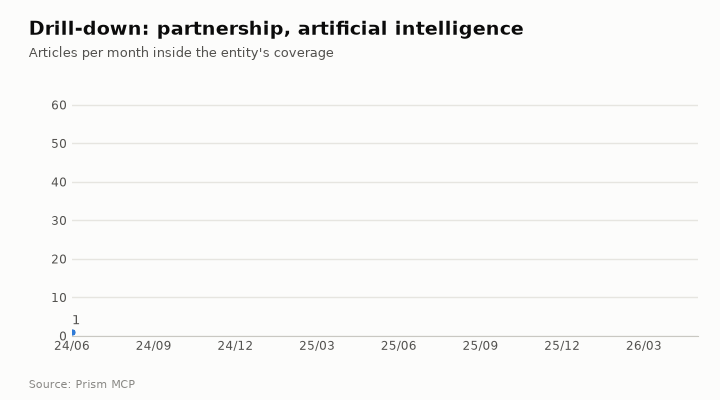
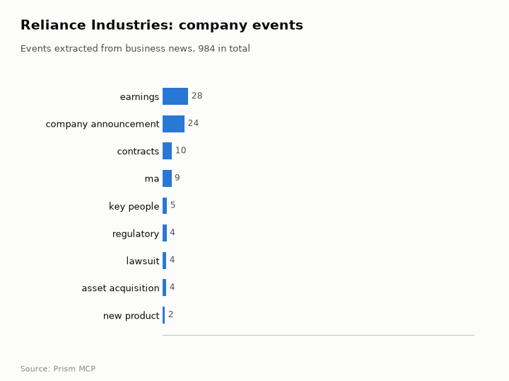

# Reliance Industries: media intelligence

[Companies, people & places](README.md) · [All use cases](../README.md) · [How the benchmark works](../../../benchmarks/README.md) · [Prism MCP](../../../README.md)

> **Intelligence requirement.** A listed conglomerate as an entity: Jio, retail, energy and the Ambanis around it.  
> **Why it is hard.** The company name collides with 'reliance' as a common word; matching must be by entity.  
> **Data.** Captured 2026-10-23 from the live Prism MCP server · research corpus windows below · all listed tables passed strict index partition reads and historical row floors. Saved responses: [reliance-industries-pulse.json](../../examples/reliance-industries-pulse.json).

**The question:**

> What is the world saying about Reliance Industries: volume, tone, themes, people and places?

## What Prism returned

### At a glance

| Measure | Value |
| --- | ---: |
| Articles that mention “reliance industries”, Jun 2024 – May 2026 | 30,862 |
| Critical coverage (priority 7–9) | 18,823 (61%) |
| Peak month | Aug 2025 (2,214 articles) |
| Last third of the window vs first third | 0.86× (flat) |
| Negative · positive | 28.6% · 70.2% |
| Tone vs all news (negative-to-positive ratio) | 0.41 vs 0.58 baseline: *somewhat more positive than ordinary news coverage* |
| What Prism thinks “reliance industries” is | organization |


**Top tags.** Every theme above is built from the articles' own tags; these are the most frequent tags on “reliance industries” coverage (they also name the companies, people and places it is written about with): india (19,203), mumbai (5,572), bse (5,471), sensex (5,454), hdfc bank (5,283), nifty (5,174), infosys (4,528), tcs (3,021), gujarat (2,162), tata motors (1,948), brent (1,822), sbi (1,670)

### Who and what appears alongside it

| Organisations | People | Places |
| --- | --- | --- |
| reliance industries | mukesh ambani | india |
| jio | nita ambani | united states |
| hindustan unilever | anil ambani | china |
| hdfc bank | gautam adani | japan |
| ultratech cement | kapil sibal | united kingdom |
| bajaj finserv | natarajan chandrasekaran | russia |

**Top publishers in a 212-article sample:** financialexpress.com (15.6%), livemint.com (9%), businesstoday.in (5.7%), outlookbusiness.com (3.8%), cnbctv18.com (3.3%), fortuneindia.com (2.8%)

<details><summary>Monthly series (table view of the charts)</summary>

| Month | Articles | Critical | Negative | Positive |
| --- | ---: | ---: | ---: | ---: |
| Jun 2024 | 1,017 | 488 | 164 | 846 |
| Jul 2024 | 1,810 | 660 | 290 | 1,475 |
| Aug 2024 | 1,527 | 982 | 286 | 1,218 |
| Sep 2024 | 1,074 | 649 | 283 | 785 |
| Oct 2024 | 1,831 | 1,215 | 627 | 1,185 |
| Nov 2024 | 1,348 | 834 | 480 | 852 |
| Dec 2024 | 1,222 | 689 | 420 | 790 |
| Jan 2025 | 1,589 | 892 | 425 | 1,153 |
| Feb 2025 | 1,208 | 731 | 299 | 897 |
| Mar 2025 | 1,422 | 864 | 505 | 898 |
| Apr 2025 | 1,122 | 705 | 302 | 808 |
| May 2025 | 804 | 473 | 205 | 583 |
| Jun 2025 | 816 | 446 | 175 | 631 |
| Jul 2025 | 1,138 | 629 | 334 | 787 |
| Aug 2025 | 2,214 | 1,362 | 623 | 1,559 |
| Sep 2025 | 844 | 574 | 161 | 678 |
| Oct 2025 | 1,264 | 773 | 311 | 905 |
| Nov 2025 | 952 | 575 | 245 | 693 |
| Dec 2025 | 886 | 550 | 240 | 633 |
| Jan 2026 | 1,221 | 887 | 537 | 666 |
| Feb 2026 | 1,404 | 919 | 328 | 1,034 |
| Mar 2026 | 1,372 | 1,009 | 645 | 708 |
| Apr 2026 | 1,654 | 1,138 | 534 | 1,094 |
| May 2026 | 1,123 | 779 | 385 | 725 |

</details>

## Beyond the news trend





This page also shows: **Areas of activity and company events** · **Drill into a section** · **Month-by-month ultra research**. Each section below is one Prism call; the call is printed under it so you can run it on any other company, person, place or phrase.

### Areas of activity: reliance industries


| Area of activity | Articles | Lift over all news |
| --- | ---: | ---: |
| Arts & Entertainment › Entertainment Industry | 148 | 34.6× |
| Business & Industrial › Energy & Utilities › Oil & Gas | 3,860 | 6.1× |
| Hobbies & Leisure › Special Occasions › Weddings | 569 | 13.4× |
| Food & Drink › Beverages | 153 | 15.5× |
| Internet & Telecom › Service Providers › Phone Service Providers | 391 | 8.7× |
| Finance › Banking | 1,357 | 4.2× |
| Business & Industrial › Shipping & Logistics › Import & Export | 843 | 4.8× |
| Jobs & Education › Internships | 55 | 12.6× |
| Food & Drink › Beverages › Soft Drinks | 73 | 10.5× |
| Internet & Telecom › Service Providers › Cable & Satellite Providers | 166 | 5.1× |

**Activity topics inside those areas:** sector rotation strategies, stock market index composition, international/emerging markets stocks, market volatility indicators, asian financial market developments, blue-chip stock portfolios, trade wars and geopolitical impacts, stock market performance and trends


| Event type | Events | Latest example |
| --- | ---: | --- |
| earnings | 285 | 2026-04-28: For the year ended March 31, 2026, the company has reported 24.36% rise in its net profit at Rs 43,851 crore as compared to Rs 35,262 crore for the pr |
| company announcement | 244 | 2026-04-26: according to an investor presentation the company made post fourth quarter earnings announcement. |
| contracts | 103 | 2026-05-05: Innovators Facade Systems Limited has announced that it has received a work order from Reliance Industries Limited for the design, supply, and install |
| ma | 97 | 2026-05-07: Reliance Industries has announced that it will no longer proceed with the acquisition of 100% equity stake in Kandla GHA Transmission Limited (KGTL) a |
| key people | 48 | 2026-02-19: Reema H Kundnani has joined Reliance Industries Limited as Chief Marketing Officer – Jio World Centre. |
| regulatory | 43 | 2026-04-14: Reliance Industries Ltd has become the first company to secure inclusion of heterojunction (HJT) solar cells in the Approved List of Models and Manufa |
| lawsuit | 40 | 2026-04-09: In a setback to the Mumbai Metropolitan Region Development Authority (MMRDA), the Bombay High Court set aside the “arbitrary and illegal” penalty dema |
| asset acquisition | 40 | 2026-04-27: Dubai-based port operator DP World has acquired a 49% stake in a soon-to-be-operational multimodal logistics park (MMLP) being developed by a unit of |

<details><summary><b>How to run this:</b> <code>news.activities</code> (MCP tool <code>news_activities</code>)</summary>

The function is `activities(term, domain, since, until, limit)` in [`prism/deep.py`](../../../prism/deep.py), registered as the `news.activities` feature in [`prism_mcp.py`](../../../prism_mcp.py): the industry taxonomy each article is classified under (generic news classes removed), the curated subcategories inside it, the top tags, and, with a web domain, the company's news events by type.

**MCP** (Claude, ChatGPT, Cursor, any MCP client): call the tool `news_activities` with

```json
{"term": "reliance industries", "domain": "ril.com"}
```

**REST**

```bash
curl -s -X POST "$PRISM_URL/v1/news.activities" -H "Authorization: Bearer $FLIAR_API_KEY" \
  -H 'content-type: application/json' -d '{"term": "reliance industries", "domain": "ril.com"}' | jq '.data'
```

**Python**

```python
import prism_mcp
r = prism_mcp.REGISTRY["news_activities"]["fn"](term="reliance industries", domain="ril.com")
print(r["data"], r["window"])
```

**CLI**

```bash
prism call news.activities term='reliance industries' domain='ril.com'
```

</details>

### Drill-down: reliance industries → partnership

**829** articles about reliance industries also mention partnership: **2.69%** of its coverage; last third of the window vs first: **1.43×**. Tone: 0.04 negative per positive in the section vs 0.41 for reliance industries overall (the section is covered more positively than the entity as a whole).


**Inside the section, the top tags are:** india (762), reliance industries (635), partnership (431), reliance (396), ai (339), mukesh ambani (300), technology (273), jio (239), innovation (235), mumbai (223)

| Day | Outlets that day | What was reported |
| --- | ---: | --- |
| 2024-10-24 | 48 | nvidia corp.’s jensen huang is forging partnerships with india’s biggest corporate names from reliance industries ltd . to infosys ltd ., underscoring the importance of the world’s |
| 2025-08-29 | 40 | reliance industries limited (ril) has announced a major step in its artificial intelligence (ai) ambitions, with chairman mukesh ambani revealing partnerships with global tech gian |
| 2025-10-30 | 19 | reliance industries and google on thursday announced a partnership that will provide the tech giant’s google ai pro plan to millions of reliance jio’s wireless subscribers. the mov |
| 2024-10-25 | 17 | with the announcement of the largest-ever collaboration in india's artificial intelligence (ai) industry, nvidia has partnered with reliance industries to build ai infrastructure i |
| 2025-03-12 | 17 | jio platforms from india reliance industries and largest telecommunications operators in the country, rebo announces partnership with spacex broadband internet starlink to offer se |
| 2025-10-31 | 17 | reliance industries limited (ril), through reliance intelligence, has partnered strategically with google to accelerate ai adoption in india under reliance’s “ai for all” vision. t |

<details open><summary><b>How to run this:</b> <code>news.drill</code> (MCP tool <code>news_drill</code>)</summary>

The function is `drill(term, scope, since, until, limit)` in [`prism/deep.py`](../../../prism/deep.py), registered as the `news.drill` feature in [`prism_mcp.py`](../../../prism_mcp.py): an article is in the section when it mentions the entity and every scope phrase; the section's monthly volume is divided by the entity's own, its tone compared with the entity's, and its busiest days listed.

The scoping itself is this function: the entity's own match, narrowed by every scope phrase, so the section is always a subset of the entity's coverage:

```python
def _pred(term: str, scope_terms: list) -> str:
    p = news.term_predicate(term, "mention")
    for s in scope_terms:
        p = f"({p} AND {news.term_predicate(s, 'mention')})"
    return p
```

**MCP** (Claude, ChatGPT, Cursor, any MCP client): call the tool `news_drill` with

```json
{"term": "reliance industries", "scope": "partnership"}
```

**REST**

```bash
curl -s -X POST "$PRISM_URL/v1/news.drill" -H "Authorization: Bearer $FLIAR_API_KEY" \
  -H 'content-type: application/json' -d '{"term": "reliance industries", "scope": "partnership"}' | jq '.data'
```

**Python**

```python
import prism_mcp
r = prism_mcp.REGISTRY["news_drill"]["fn"](term="reliance industries", scope="partnership")
print(r["data"], r["window"])
```

**CLI**

```bash
prism call news.drill term='reliance industries' scope='partnership'
```

</details>

### Drill-down: reliance industries → partnership + artificial intelligence

**220** articles about reliance industries also mention partnership + artificial intelligence: **0.71%** of its coverage; last third of the window vs first: **1.18×**. Tone: 0.01 negative per positive in the section vs 0.41 for reliance industries overall (the section is covered more positively than the entity as a whole).


**Inside the section, the top tags are:** india (212), artificial intelligence (208), ai (198), reliance (164), reliance industries (161), technology (137), mukesh ambani (134), innovation (125), partnership (112), google (98)

| Day | Outlets that day | What was reported |
| --- | ---: | --- |
| 2024-10-24 | 35 | nvidia corp.’s jensen huang is forging partnerships with india’s biggest corporate names from reliance industries ltd . to infosys ltd ., underscoring the importance of the world’s |
| 2025-08-29 | 27 | &quot;new delhi: reliance industries chairman mukesh ambani on friday announced the formation of a new wholly-owned subsidiary, reliance intelligence, that will house large-scale a |
| 2025-10-30 | 16 | new delhi– reliance industries limited (ril) on thursday announced a sweeping strategic partnership with google through its artificial intelligence arm, reliance intelligence limit |
| 2024-10-25 | 14 | with the announcement of the largest-ever collaboration in india's artificial intelligence (ai) industry, nvidia has partnered with reliance industries to build ai infrastructure i |
| 2025-10-31 | 13 | reliance industries limited (ril) on thursday announced an expansive strategic partnership between google and its artificial intelligence (ai) focused subsidiary, reliance intellig |
| 2025-03-23 | 9 | see more of our coverage in your search results. openai and meta platforms have held separate discussions with india’s reliance industries over potential partnerships to expand the |

<details open><summary><b>How to run this:</b> <code>news.drill</code> (MCP tool <code>news_drill</code>)</summary>

The function is `drill(term, scope, since, until, limit)` in [`prism/deep.py`](../../../prism/deep.py), registered as the `news.drill` feature in [`prism_mcp.py`](../../../prism_mcp.py): an article is in the section when it mentions the entity and every scope phrase; the section's monthly volume is divided by the entity's own, its tone compared with the entity's, and its busiest days listed.

The scoping itself is this function: the entity's own match, narrowed by every scope phrase, so the section is always a subset of the entity's coverage:

```python
def _pred(term: str, scope_terms: list) -> str:
    p = news.term_predicate(term, "mention")
    for s in scope_terms:
        p = f"({p} AND {news.term_predicate(s, 'mention')})"
    return p
```

**MCP** (Claude, ChatGPT, Cursor, any MCP client): call the tool `news_drill` with

```json
{"term": "reliance industries", "scope": "partnership, artificial intelligence"}
```

**REST**

```bash
curl -s -X POST "$PRISM_URL/v1/news.drill" -H "Authorization: Bearer $FLIAR_API_KEY" \
  -H 'content-type: application/json' -d '{"term": "reliance industries", "scope": "partnership, artificial intelligence"}' | jq '.data'
```

**Python**

```python
import prism_mcp
r = prism_mcp.REGISTRY["news_drill"]["fn"](term="reliance industries", scope="partnership, artificial intelligence")
print(r["data"], r["window"])
```

**CLI**

```bash
prism call news.drill term='reliance industries' scope='partnership, artificial intelligence'
```

</details>

### Month by month: Prism reads reliance industries

Prism took the days most outlets reported the subject, one month at a time, read the stories' openings, and wrote what happened and why it mattered; every point cites the stories it rests on.

> **The arc.** From June 2025, Reliance rode a wave of stock gains, a leadership reshuffle and early AI partnership talks, positioning itself for a digital‑AI push. The following months saw profit‑taking and a sharp US tariff shock in July, then a surge of AI collaborations with Meta and Google and expansion into renewables in August, while geopolitical tension over its Jamnagar refinery added risk. September cemented the AI strategy with a joint venture with Meta and benefitted from China’s overcapacity crackdown, leading to a strong October as U.S. sanctions on Russian oil lifted energy‑market pressures. Late 2025 focused on capital‑raising, with a blockbuster Jio Platforms IPO preparation, Samsung ties and an $11 billion AI‑native data‑centre commitment, but the start of 2026 brought mixed results, including missed Q4 expectations and a halted battery‑cell plan. The company now balances ambitious digital‑AI expansion, renewable energy projects, and regulatory scrutiny as it moves toward the Jio IPO and new overseas refinery and battery partnerships.

- **Turning point, 2025-06:** Leadership reshuffle with Anant Ambani appointed executive director and initial AI partnership talks with OpenAI signaled a strategic shift.
- **Turning point, 2025-07:** Profit‑taking after record earnings and a US‑imposed 25% tariff on Indian exports introduced major geopolitical risk.
- **Turning point, 2025-08:** Strategic AI partnerships with Meta and Google and expansion into renewable energy, alongside a new geopolitical threat to the Jamnagar refinery.
- **Turning point, 2025-09:** Launch of an AI joint venture with Meta, leveraging China’s anti‑overcapacity drive to boost shareholder wealth.

| Month | Articles | Signal | What happened |
| --- | ---: | --- | --- |
| 2025-06 | 816 | escalating | **Reliance Industries saw stock gains, a leadership reshuffle, and strategic AI partnership talks while its founder hailed the Jio gamble as transformative.** Reliance Industries' shares rallied sharply, helping the Nifty 50 cross the psychologically important 25,200 level and marking a recovery from recent lows driven by improved investor sentiment toward riskier assets. Mukesh Ambani reflected on his 2016 decision to launch Reliance Jio as the biggest risk of his life, emphasizing its role in transforming India despite early analyst doubts. Anant Amba |
| 2025-07 | 1,138 | turning point | **Reliance posted record profit but faced profit‑taking pressure as a US tariff shock rattled Indian markets in July 2025** Despite the record profit, Reliance shares slipped nearly 3% on Monday as investors took profits after the strong earnings announcement. The broader market showed optimism, with Indian equities rallying and the Nifty 50 reclaiming the 25,000‑point level, driven by banking and auto stocks. The month ended with a shock: a US tariff announcement of a 25% duty on all Indian exports triggered a Sensex  |
| 2025-08 | 2,214 | new | **Reliance Industries posted solid financial results, launched AI ties with Meta and Google, expanded renewable projects, while facing a new geopolitical threat to its Jamnagar refinery.** Reliance concluded FY25 with balanced growth across oil, retail and digital services and disclosed equal compensation for Anant, Isha and Akash Ambani, highlighting both diversified performance and family governance. At its AGM, chairman Mukesh Ambani announced strategic AI partnerships with global tech giants Meta and Google, marking a major push into artificial intelligence. Reliance Infra won a |
| 2025-09 | 844 | escalating | **Reliance launches AI joint venture with Meta and leverages China’s anti‑overcapacity drive to boost shareholder wealth** Reliance announced a new joint venture with Meta Platforms to develop and deploy enterprise‑grade AI solutions across India, backed by an initial capital infusion. Morgan Stanley analysts said Reliance stands to benefit the most from China’s push to curb overcapacity, combined with the conglomerate’s own streamlining efforts. In a year of global uncertainty, Reliance was highlighted as one of Indi |
| 2025-10 | 1,264 | turning point | **Reliance Industries' shares jumped over 3% on strong September results as U.S. sanctions on Russian oil tighten pressure on India's energy market** Reliance Industries' stock rose more than 3% to Rs 1,460.60 after September quarter results, adding roughly Rs 56,000 crore to investor wealth. The rally came as the United States imposed sweeping sanctions on Russia’s major oil firms Rosneft and Lukoil, prompting India and China to worry about disruptions to their cheap Russian oil supplies. India’s crude oil imports rose 1.7% to 19.93 million to |
| 2025-11 | 952 | escalating | **Reliance readies a blockbuster Jio Platforms IPO, deepens ties with Samsung, and backs a $11 billion AI‑native data centre push** Mukesh Ambani made a high‑profile visit to South Korea, meeting Samsung Electronics executive chairman Lee Jae‑yong and other top Samsung affiliates, underscoring the strategic importance of the trip for both firms. Reliance, together with Brookfield and Digital Realty, pledged $11 billion through the Digital Connexion JV to build a 1 GW AI‑native data centre, intensifying India’s digital‑infrastr |
| 2025-12 | 886 | escalating | **Reliance Industries faced stock pressure amid market sell‑offs while its founder’s wealth swings underscored the conglomerate’s outsized influence** Reliance Industries' shares fell sharply on Dec 9, contributing to a broader market drop in the Sensex and Nifty as global cues turned negative and foreign funds exited. Mukesh Ambani’s personal wealth was highlighted, with calculations showing his fortune could be exhausted at a daily spend of Rs 5 crore, and the year‑end billionaire wealth rankings showed large gains and losses among India’s ric |
| 2026-01 | 1,221 | steady | **Reliance posted solid Q3 growth but missed Q4 expectations, saw its stock tumble and halted battery cell plans.** Reliance reported a 10% year‑on‑year increase in consolidated revenue to Rs 2.94 lakh crore for Q3 FY26, with EBITDA up 6.1% and Jio platforms driving a 16.4% rise in EBITDA. Reliance paused its plan to make lithium‑ion battery cells in India after failing to secure Chinese technology, highlighting challenges in building an independent clean‑energy supply chain. |
| 2026-02 | 1,404 | escalating | **Reliance Industries rides trade‑pact optimism but faces lingering legal scrutiny** Reliance Industries Ltd shares surged up to 7.1% after India and the United States announced a long‑awaited trade pact, lifting investor sentiment. Chairman Mukesh Ambani said sustained double‑digit growth for India is possible and praised Prime Minister Modi’s stable leadership, signalling a bullish outlook for the conglomerate. The firm remained entangled in legal matters, with related news noti |
| 2026-03 | 1,372 | escalating | **Reliance Industries pushed into a US refinery partnership, faced a Jio listing delay, and saw its stock tumble amid volatile oil markets** President Donald Trump announced that the United States will receive its first new oil refinery in 50 years with investment from Reliance Industries Ltd., marking a major overseas expansion for the conglomerate. Reliance’s digital and telecom arm, Jio Platforms, encountered a setback in its planned stock market listing because a new rule change was approved in principle but not yet finalized. Reli |
| 2026-04 | 1,654 | escalating | **Reliance Industries accelerates its digital and AI ambitions with an upcoming Jio Platforms IPO and a new AI joint‑venture leader** Reliance Industries received a go‑ahead to launch the much‑awaited IPO of its digital arm Jio Platforms and will file draft paperwork in May. Reliance Enterprise Intelligence Limited, the 70%‑Reliance and 30%‑Meta joint venture, appointed Parminder Singh as chief navigator to steer an expansive AI roadmap. |
| 2026-05 | 1,123 | steady | **Reliance Industries trimmed sports contract liabilities, signaled a major Jio Platforms IPO update, and pursued battery supply deals to boost its renewable energy push.** Jiostar, the joint venture with Disney, cut its provision for onerous sports contracts by 31.12% to Rs 17,742 crore in FY26 after using Rs 8,018 crore of the FY25 provision, indicating a significant improvement in its sports‑related liabilities. Mukesh Ambani is expected to provide an update on the highly anticipated Jio Platforms IPO at the June 19 AGM, a key step for Reliance’s next round of cap |

**What to watch:** Progress and pricing of the Jio Platforms IPO; Outcome of battery supply negotiations with CATL and other global partners; Performance of the AI joint venture with Meta and its impact on revenue; Developments in the US refinery partnership and its contribution to overseas growth

<details><summary><b>How to run this:</b> <code>analysis.timeline</code> (MCP tool <code>deep_timeline</code>)</summary>

The function is `timeline(term, scope, months, until, per_month)` in [`prism/deep.py`](../../../prism/deep.py), registered as the `analysis.timeline` feature in [`prism_mcp.py`](../../../prism_mcp.py): for each month, the days most outlets reported the subject are read from their openings and summarised with citations; then the arc across the months.

**MCP** (Claude, ChatGPT, Cursor, any MCP client): call the tool `deep_timeline` with

```json
{"term": "reliance industries", "months": 12}
```

**REST**

```bash
curl -s -X POST "$PRISM_URL/v1/analysis.timeline" -H "Authorization: Bearer $FLIAR_API_KEY" \
  -H 'content-type: application/json' -d '{"term": "reliance industries", "months": 12}' | jq '.data'
```

**Python**

```python
import prism_mcp
r = prism_mcp.REGISTRY["deep_timeline"]["fn"](term="reliance industries", months=12)
print(r["data"], r["window"])
```

**CLI**

```bash
prism call analysis.timeline term='reliance industries' months='12'
```

</details>

## Run it yourself

**In Claude, ChatGPT, Cursor or any MCP client**, with the Prism server connected:

```text
What is the world saying about Reliance Industries: volume, tone, themes, people and places?
```

**Over REST** (same function, same envelope):

```bash
curl -s -X POST "$PRISM_URL/v1/news.overview" \
  -H 'content-type: application/json' \
  -d '{"term": "reliance industries", "since": "2024-06-01"}' | jq '.data'
```

**From Python**, in-process:

```python
import prism_mcp
r = prism_mcp.REGISTRY['prism_overview']["fn"](**{'term': 'reliance industries', 'since': '2024-06-01'})
print(r["ok"], r["window"], r["meta"]["coverage"]["note"])
```

Tool calls this page is built from: `prism_overview` (138.4 s) → `news_activities` (23.5 s) → `news_drill` (28.2 s) → `news_drill` (25.6 s) → `deep_timeline` (36.9 s)

## Take it further

- **Export:** every response is JSON in one envelope (`ok`, `data`, `window`, `meta`), so `jq`, pandas or a spreadsheet import reads it directly. See [Data export](../../DATA_EXPORT.md).
- **Research workflow:** chain this with `research.brief`, `research.citations` and `research.audit` to go from a question to a sourced draft. See [Research analysis](../../RESEARCH_ANALYSIS.md).
