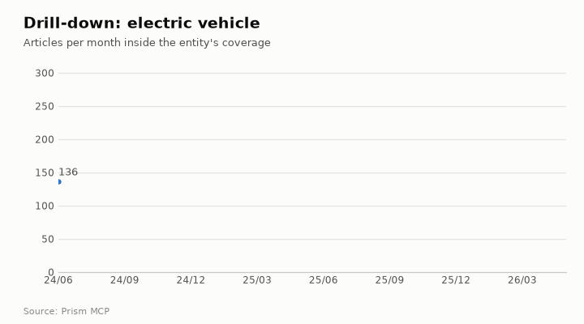
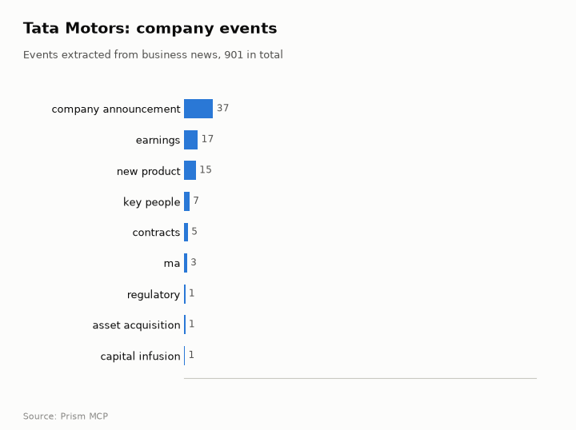

# Tata Motors: media intelligence

[Companies, people & places](README.md) · [All use cases](../README.md) · [How the benchmark works](../../../benchmarks/README.md) · [Prism MCP](../../../README.md)

> **Intelligence requirement.** A listed automaker as an entity: EVs, Jaguar Land Rover, demerger.  
> **Why it is hard.** Tata group coverage spills into Tata Motors; themes show which stories are about the company.  
> **Data.** Captured 2026-10-23 from the live Prism MCP server · research corpus windows below · all listed tables passed strict index partition reads and historical row floors. Saved responses: [tata-motors-pulse.json](../../examples/tata-motors-pulse.json).

**The question:**

> What is the world saying about Tata Motors: volume, tone, themes, people and places?

## What Prism returned

### At a glance

| Measure | Value |
| --- | ---: |
| Articles that mention “tata motors”, Jun 2024 – May 2026 | 41,964 |
| Critical coverage (priority 7–9) | 13,017 (31%) |
| Peak month | Dec 2025 (4,292 articles) |
| Last third of the window vs first third | 1.39× (rising) |
| Negative · positive | 19.6% · 79.7% |
| Tone vs all news (negative-to-positive ratio) | 0.25 vs 0.58 baseline: *markedly more positive than ordinary news coverage* |
| What Prism thinks “tata motors” is | organization |


**Top tags.** Every theme above is built from the articles' own tags; these are the most frequent tags on “tata motors” coverage (they also name the companies, people and places it is written about with): tata motors (40,875), tata (11,807), automotive industry (11,546), maruti suzuki (5,202), sensex (5,176), nifty (4,963), mahindra (4,059), eqs (2,824), infosys (2,763), safari (2,750), volvo (2,601), hdfc bank (2,383)

### Who and what appears alongside it

| Organisations | People | Places |
| --- | --- | --- |
| tata motors | natarajan chandrasekaran | india |
| tata group | noel tata | united states |
| jaguar land rover | motilal oswal financial services | japan |
| maybach | benny blanco | china |
| tata steel | gordon ramsay | united kingdom |
| bajaj finserv | shilpa shetty | south korea |

**Top publishers in a 216-article sample:** financialexpress.com (9.7%), thedetroitbureau.com (6%), storyboard18.com (5.1%), livehindustan.com (4.2%), outlookbusiness.com (2.8%), businesstoday.in (2.8%)

### Critical headlines

| Date | Headline | Publisher | Priority | Tone |
| --- | --- | --- | ---: | --- |
| 2026-04-15 | [Tata Motors Hits 10 Lakh Vehicles in UP, CM Yogi Lauds Milestone](https://www.newkerala.com/news/a/tata-motors-10-lakhth-vehicle-rollout-lucknow-marks-786.htm) | newkerala.com | 8 | very_pos |
| 2026-04-15 | [Chief Minister Yogi Adityanath flagged off the 10th lakh vehicle at the Tata Motors Lucknow plant](https://www.forpressrelease.com/forpressrelease/669664/2/chief-minister-yogi-adityanath-flagged-off-the-10th-lakh-vehicle-at-the-tata-motors-lucknow-plant) | forpressrelease.com | 8 | very_pos |
| 2026-03-02 | [Tata Steel to invest Rs 11,000 cr in Jharkhand for developing advanced grade steel in Jamsehdpur: TATA Group Chairman N ](https://www.devdiscourse.com/article/Newsalert/3823240-tata-steel-to-invest-rs-11000-cr-in-jharkhand-for-developing-advanced-grade-steel-in-jamsehdpur-tata-group-chairman-n-chan) | devdiscourse.com | 8 | slight_neg |

<details><summary>Monthly series (table view of the charts)</summary>

| Month | Articles | Critical | Negative | Positive |
| --- | ---: | ---: | ---: | ---: |
| Jun 2024 | 1,304 | 433 | 126 | 1,169 |
| Jul 2024 | 1,502 | 426 | 266 | 1,220 |
| Aug 2024 | 1,778 | 637 | 410 | 1,350 |
| Sep 2024 | 1,654 | 540 | 321 | 1,320 |
| Oct 2024 | 1,779 | 751 | 467 | 1,294 |
| Nov 2024 | 1,140 | 383 | 342 | 781 |
| Dec 2024 | 1,341 | 374 | 387 | 931 |
| Jan 2025 | 1,583 | 497 | 312 | 1,262 |
| Feb 2025 | 1,440 | 619 | 378 | 1,051 |
| Mar 2025 | 1,548 | 604 | 511 | 1,029 |
| Apr 2025 | 1,386 | 662 | 548 | 826 |
| May 2025 | 1,343 | 457 | 297 | 1,034 |
| Jun 2025 | 1,202 | 381 | 256 | 942 |
| Jul 2025 | 1,675 | 531 | 356 | 1,309 |
| Aug 2025 | 2,144 | 808 | 531 | 1,601 |
| Sep 2025 | 2,387 | 1,140 | 794 | 1,574 |
| Oct 2025 | 1,373 | 527 | 290 | 1,065 |
| Nov 2025 | 1,545 | 469 | 270 | 1,260 |
| Dec 2025 | 4,292 | 319 | 157 | 4,116 |
| Jan 2026 | 1,471 | 323 | 145 | 1,307 |
| Feb 2026 | 2,155 | 415 | 153 | 1,986 |
| Mar 2026 | 2,150 | 308 | 250 | 1,894 |
| Apr 2026 | 2,209 | 720 | 256 | 1,934 |
| May 2026 | 1,563 | 693 | 376 | 1,179 |

</details>

## Beyond the news trend





This page also shows: **Areas of activity and company events** · **Drill into a section** · **Month-by-month ultra research**. Each section below is one Prism call; the call is printed under it so you can run it on any other company, person, place or phrase.

### Areas of activity: tata motors


| Area of activity | Articles | Lift over all news |
| --- | ---: | ---: |
| Autos & Vehicles › Motor Vehicles (By Brand) | 5,561 | 678.0× |
| Autos & Vehicles › Motor Vehicles (By Brand) › Jaguar | 1,318 | 274.8× |
| Autos & Vehicles › Vehicle Shopping › Vehicle Specs, Reviews & Comparisons | 16,952 | 40.8× |
| Business & Industrial › Automotive Industry | 12,871 | 44.4× |
| Autos & Vehicles › Motor Vehicles (By Type) › Trucks, Vans & SUVs | 9,361 | 45.5× |
| Autos & Vehicles › Motor Vehicles (By Brand) › Land Rover | 759 | 125.8× |
| Autos & Vehicles › Motor Vehicles (By Brand) › Mercedes-Benz | 2,833 | 62.2× |
| Autos & Vehicles › Motor Vehicles (By Brand) › Jeep | 664 | 116.3× |
| Autos & Vehicles › Motor Vehicles (By Type) › Sedans | 2,170 | 56.1× |
| Autos & Vehicles › Motor Vehicles (By Type) › Hybrid & Alternative Vehicles | 7,744 | 24.1× |

**Activity topics inside those areas:** cargo and passenger space measurements, interior comfort and ergonomics reviews, automotive industry market trends, sedan vs suv vs truck comparisons, vehicle infotainment system reviews, hybrid vs electric vehicle reviews, electric vehicle range and charging speed tests, new model year updates and changes


| Event type | Events | Latest example |
| --- | ---: | --- |
| company announcement | 378 | 2026-04-17: Tata Motors Ltd., India’s largest commercial vehicle manufacturer, today marked a defining milestone with the rollout of the 10th lakh commercial vehi |
| earnings | 177 | 2026-04-27: Tata Motors has concluded the fiscal year 2025-26 on a high note, asserting its dominance in the Indian automotive landscape. According to the latest |
| new product | 152 | 2026-04-15: The company also launched improved versions of its popular Intra V50 and Ace Diesel vehicles, reengineered to lower fuel consumption with reduced cost |
| key people | 68 | 2026-05-18: Tata Motors has appointed DP Nambiar as Chief Human Resources Officer. |
| contracts | 47 | 2026-04-16: Air India SATS Airport Services Private Limited (AISATS) has ordered 21 electric airport passenger coaches from Tata Motors |
| ma | 35 | 2026-05-18: In a strategic move to expand its technology-driven logistics capabilities, Tata Motors has acquired logistics technology platform Freight Tiger for ₹ |
| regulatory | 12 | 2026-04-05: The maximum penalty of Rs 1,346.46 crore has been slapped on Tata Motors, followed by Maruti (Rs 471.14 crore), Mahindra & Mahindra (Rs 292.25 crore) |
| asset acquisition | 12 | 2026-04-15: The sale of the Ford facility at Sanand to Tata Motors (yes, sceptics will argue that it is still at the MoU stage but the deal is done for all practi |

<details><summary><b>How to run this:</b> <code>news.activities</code> (MCP tool <code>news_activities</code>)</summary>

The function is `activities(term, domain, since, until, limit)` in [`prism/deep.py`](../../../prism/deep.py), registered as the `news.activities` feature in [`prism_mcp.py`](../../../prism_mcp.py): the industry taxonomy each article is classified under (generic news classes removed), the curated subcategories inside it, the top tags, and, with a web domain, the company's news events by type.

**MCP** (Claude, ChatGPT, Cursor, any MCP client): call the tool `news_activities` with

```json
{"term": "tata motors", "domain": "tatamotors.com"}
```

**REST**

```bash
curl -s -X POST "$PRISM_URL/v1/news.activities" -H "Authorization: Bearer $FLIAR_API_KEY" \
  -H 'content-type: application/json' -d '{"term": "tata motors", "domain": "tatamotors.com"}' | jq '.data'
```

**Python**

```python
import prism_mcp
r = prism_mcp.REGISTRY["news_activities"]["fn"](term="tata motors", domain="tatamotors.com")
print(r["data"], r["window"])
```

**CLI**

```bash
prism call news.activities term='tata motors' domain='tatamotors.com'
```

</details>

### Drill-down: tata motors → electric vehicle

**3,900** articles about tata motors also mention electric vehicle: **9.29%** of its coverage; last third of the window vs first: **0.8×**. Tone: 0.09 negative per positive in the section vs 0.25 for tata motors overall (the section is covered more positively than the entity as a whole).


**Inside the section, the top tags are:** tata motors (3,836), ev (2,915), india (2,639), electric vehicle (2,010), electric vehicles (1,792), tata (1,714), automotive industry (1,591), hyundai (841), automotive (830), mahindra (779)

| Day | Outlets that day | What was reported |
| --- | ---: | --- |
| 2026-04-15 | 55 | hyundai will launch its first india-designed and built electric suv by 2027, marking a major localisation push as it gears up to make over half its 2030 lineup eco-friendly. hyunda |
| 2024-08-07 | 51 | according to the company, the tata curve ev features a 1.2c charging rate, allowing it to achieve a range of 150 km with just 15 minutes of charging. the vehicle is also equipped w |
| 2026-02-20 | 36 | tata.ev, india’s leading electric mobility brand, has launched the new avatar of the punch.ev, marking a major step toward accelerating mainstream electric vehicle (ev) adoption in |
| 2025-01-17 | 34 | with several mass-market carmakers unveiling their electric vehicles (evs) at the bharat mobility global expo on friday, tata motors, the leading player in the ev segment, believes |
| 2025-12-23 | 32 | tata safari/harrier petrol review: hits & misses explained \| toi auto 08:57 five new electric cars by fy2030 tata passenger electric mobility (tpem), the electric mobility arm of t |
| 2025-06-03 | 31 | india’s electric vehicle (ev) market is in the middle of a fast-paced reshuffle. tata motors, once seen as the unchallenged leader in the electric passenger vehicle segment, still |

<details open><summary><b>How to run this:</b> <code>news.drill</code> (MCP tool <code>news_drill</code>)</summary>

The function is `drill(term, scope, since, until, limit)` in [`prism/deep.py`](../../../prism/deep.py), registered as the `news.drill` feature in [`prism_mcp.py`](../../../prism_mcp.py): an article is in the section when it mentions the entity and every scope phrase; the section's monthly volume is divided by the entity's own, its tone compared with the entity's, and its busiest days listed.

The scoping itself is this function: the entity's own match, narrowed by every scope phrase, so the section is always a subset of the entity's coverage:

```python
def _pred(term: str, scope_terms: list) -> str:
    p = news.term_predicate(term, "mention")
    for s in scope_terms:
        p = f"({p} AND {news.term_predicate(s, 'mention')})"
    return p
```

**MCP** (Claude, ChatGPT, Cursor, any MCP client): call the tool `news_drill` with

```json
{"term": "tata motors", "scope": "electric vehicle"}
```

**REST**

```bash
curl -s -X POST "$PRISM_URL/v1/news.drill" -H "Authorization: Bearer $FLIAR_API_KEY" \
  -H 'content-type: application/json' -d '{"term": "tata motors", "scope": "electric vehicle"}' | jq '.data'
```

**Python**

```python
import prism_mcp
r = prism_mcp.REGISTRY["news_drill"]["fn"](term="tata motors", scope="electric vehicle")
print(r["data"], r["window"])
```

**CLI**

```bash
prism call news.drill term='tata motors' scope='electric vehicle'
```

</details>

### Drill-down: tata motors → jaguar land rover + tariff

**287** articles about tata motors also mention jaguar land rover + tariff: **0.68%** of its coverage; last third of the window vs first: **25.0×**. Tone: 3.33 negative per positive in the section vs 0.25 for tata motors overall (the section is covered more negatively than the entity as a whole).


**Inside the section, the top tags are:** jaguar land rover (280), tata motors (278), us (234), donald trump (186), jlr (178), uk (167), india (159), trump (151), tariffs (121), automotive industry (108)

| Day | Outlets that day | What was reported |
| --- | ---: | --- |
| 2025-03-27 | 39 | while india’s direct automobile export to the us is meagre compared to countries like japan, mexico and canada, the secondary effects of trump’s tariffs are expected to impact the |
| 2025-04-07 | 23 | estimated reading time: 4 minutesglobal markets are continuing their descent today as the impact of the tariffs announced on thursday becomes clearer.with more details being releas |
| 2025-04-03 | 18 | mumbai: us president donald trump’s sweeping reciprocal tariffs, announced on april 2 under what he termed ‘liberation day’, have sent ripples through global markets, with india am |
| 2025-03-28 | 11 | donald trump on wednesday declared that the us would levy a 25 per cent tariff on imported cars and critical auto parts starting april 3. but which companies will be worst hit by t |
| 2025-08-08 | 10 | tata motors reported a 63 per cent decline in q1 consolidated profit, hit by a fall in volumes across all segments, tariffs, and a drop in jaguar land rover’s profitability.it repo |
| 2025-04-08 | 10 | india news business tata denies halting car shipments to us tata destroys us that said, the company making the tariff’s impact reduction strategy, trump had imposed 25% tariffs. mu |

<details open><summary><b>How to run this:</b> <code>news.drill</code> (MCP tool <code>news_drill</code>)</summary>

The function is `drill(term, scope, since, until, limit)` in [`prism/deep.py`](../../../prism/deep.py), registered as the `news.drill` feature in [`prism_mcp.py`](../../../prism_mcp.py): an article is in the section when it mentions the entity and every scope phrase; the section's monthly volume is divided by the entity's own, its tone compared with the entity's, and its busiest days listed.

The scoping itself is this function: the entity's own match, narrowed by every scope phrase, so the section is always a subset of the entity's coverage:

```python
def _pred(term: str, scope_terms: list) -> str:
    p = news.term_predicate(term, "mention")
    for s in scope_terms:
        p = f"({p} AND {news.term_predicate(s, 'mention')})"
    return p
```

**MCP** (Claude, ChatGPT, Cursor, any MCP client): call the tool `news_drill` with

```json
{"term": "tata motors", "scope": "jaguar land rover, tariff"}
```

**REST**

```bash
curl -s -X POST "$PRISM_URL/v1/news.drill" -H "Authorization: Bearer $FLIAR_API_KEY" \
  -H 'content-type: application/json' -d '{"term": "tata motors", "scope": "jaguar land rover, tariff"}' | jq '.data'
```

**Python**

```python
import prism_mcp
r = prism_mcp.REGISTRY["news_drill"]["fn"](term="tata motors", scope="jaguar land rover, tariff")
print(r["data"], r["window"])
```

**CLI**

```bash
prism call news.drill term='tata motors' scope='jaguar land rover, tariff'
```

</details>

### Month by month: Prism reads tata motors → electric vehicle

Prism took the days most outlets reported the subject, one month at a time, read the stories' openings, and wrote what happened and why it mattered; every point cites the stories it rests on.

> **The arc.** From June 2025 Tata Motors faced tightening competition and supply‑chain shocks that threatened its EV lead. A $1 billion fundraise in August 2025 funded new models and reinforced its market push, while a leadership reshuffle in September signaled a strategic reset amid intensifying rival activity. The company then leveraged policy support to win a 9,500‑EV public contract and celebrated the Nexon EV crossing 1 lakh sales, cementing its first‑mover advantage. In early 2026 Tata expanded its portfolio with a low‑priced Punch EV and an affordable AWD Harrier, hit the 2 lakh cumulative EV sales milestone, and announced a rapid production ramp‑up to about 15,000 units per month, positioning itself for the market’s inflection point.

- **Turning point, 2025-06:** Competition from MG Motor and Mahindra & Mahindra accelerated, and supply‑chain shocks such as China’s rare‑earth magnet export ban narrowed margins.
- **Turning point, 2025-08:** Tata Motors announced a $1 billion capital raise for its passenger EV business, boosting shares and funding new model development.
- **Turning point, 2025-09:** A top‑level leadership reshuffle appointed Shailesh Chandra as MD and CEO, reflecting the need to accelerate EV rollout amid rival launches.
- **Turning point, 2026-02:** The company launched a lower‑priced Punch EV at ₹9.69 lakh, targeting mainstream adoption and leveraging financing trends.

| Month | Articles | Signal | What happened |
| --- | ---: | --- | --- |
| 2025-06 | 263 | escalating | **Tata Motors stays on top of India's EV market but faces tightening competition and supply‑chain headwinds in June 2025** Tata Motors remained the leader in electric passenger cars, yet its margin narrowed as MG Motor and Mahindra & Mahindra accelerated their EV rollouts, challenging Tata’s dominance. The competitive pressure arrived alongside India’s flagship EV promotion scheme and external supply shocks, especially China’s rare‑earth magnet export ban, which threaten component availability for Tata’s vehicles. Glo |
| 2025-07 | 204 | escalating | **Tata Motors' new EV models drove a surge in Indian electric car sales amid policy pushes and a booming global market** Tata Motors introduced fresh electric models that helped lift the share of EVs in new car sales in India during the first five months of 2025. Transport minister Nitin Gadkari announced that EVs will be as affordable as petrol cars within six months, a promise that could accelerate demand for Tata Motors' competitively priced EV lineup. |
| 2025-08 | 143 | escalating | **Tata Motors ramps up EV push with a $1 billion fundraise as India’s EV market heats up** Tata Motors announced a $1 billion capital raise for its passenger electric‑vehicle business, sending its shares up nearly 10% to hit the upper circuit in Mumbai. The fundraise coincided with a wave of new EV investments in India, including Vinfast’s $500 million plant in Tamil Nadu and Macquarie’s $405 million financing for the Vertelo fleet‑electrification platform. India’s ambitious 2030 EV ado |
| 2025-09 | 117 | turning point | **Tata Motors reshuffles top leadership as India’s EV race heats up** Tata Motors announced a series of top‑level leadership changes, appointing Shailesh Chandra as managing director and CEO effective Oct 1 for a three‑year term. The appointment comes as India’s EV market intensifies, with Maruti Suzuki launching its first BEV exports (e‑Vitara) and Tesla’s entry showing modest demand, underscoring the competitive pressure on Tata to accelerate its own EV rollout. S |
| 2025-10 | 86 | escalating | **Tata Motors rides festive demand to record EV sales while securing charging infrastructure amid rising competition** India’s overall EV registrations slipped in September to 181,907 from 188,355 in August, highlighting a volatile market even as Tata pushes ahead. Tata Motors signed an MOU with charging‑solution provider Nikol EV to roll out new charging stations across Maharashtra, Madhya Pradesh, Goa and Karnataka, strengthening its EV ecosystem. Analysts note that while Tata enjoys a first‑mover advantage and  |
| 2025-11 | 136 | escalating | **Tata Motors clinches a 9,500‑EV public contract and stays ahead as India’s EV market hits record growth** Tata Motors won the auction to supply 9,500 electric vehicles to the state‑owned Energy Efficiency Services Limited (EESL), with the first deliveries scheduled for the end of November. India’s EV sector surged to a record 234,019 units sold in October, driven by supportive government policies and rising consumer demand for clean transport. |
| 2025-12 | 135 | escalating | **Tata Motors' Nexon EV hits 1‑lakh sales as the company pushes affordable EVs and expands state partnerships, amid a booming Indian market** The Nexon EV became India’s first electric vehicle to cross the 1 lakh cumulative sales/production mark, contributing to more than 2.5 lakh Tata EVs now on Indian roads. Tata Motors’ passenger‑vehicle CEO said electric cars could soon cost the same as petrol and diesel models, signalling a push for price‑competitive EVs. Tata Group chairman N. Chandrasekaran met Uttar Pradesh chief minister Yogi A |
| 2026-01 | 90 | escalating | **Tata Motors reported strong sales, launched a new electric truck line, and pushed for policy incentives as India’s EV market accelerates.** Tata Motors posted a robust Q3 FY26 performance, selling over 1.71 lakh passenger vehicles driven by higher SUV demand and rising electric vehicle adoption. The company introduced the Azura series, India’s widest electric truck range built on the i‑MOEV modular architecture, targeting the ILMCV segment with world‑class safety standards. Tata Motors sought targeted incentives for entry‑level EVs an |
| 2026-02 | 181 | turning point | **Tata Motors launches a lower‑priced Punch EV as India’s electric vehicle market reaches a growth inflection point** Tata EV introduced the new avatar of the Punch EV on Feb 20, priced from ₹9.69 lakh, targeting mainstream adoption of electric mobility. Financing companies drove the majority of EV purchases in FY 2025, highlighting the crucial role of credit in scaling sales and supporting Tata’s launch. |
| 2026-03 | 79 | escalating | **Tata Motors ramps up its EV lineup in March, unveiling a cheaper AWD Harrier, previewing a premium Avinya line, and capitalizing on market and policy shifts.** Tata Motors introduced an affordable all‑wheel‑drive version of its Harrier EV, the Fearless+ QWD 75, priced at Rs 26.49 lakh, expanding its EV portfolio. The company is gearing up for a premium push with the Avinya line, slated to be its most upscale EV offering next year, signaling a strategic product assault in the high‑end segment. Reviews highlighted the Tata Punch.ev as India’s most value‑fo |
| 2026-04 | 216 | escalating | **Tata Motors cemented its EV leadership in April 2026, celebrating 2 lakh sales while facing internal pressure to speed up new models amid a booming market.** Tata Motors announced up to Rs 1.8 lakh in benefits to mark the cumulative sale of 2 lakh electric vehicles in India, launching a 45‑day exclusive offer for new and existing customers. In March 2026 Tata sold 8,224 EVs, outpacing Mahindra's 5,217 units and confirming its position as the country’s top EV manufacturer. Chairman N Chandrasekaran challenged Tata Motors to develop an EV within a year,  |
| 2026-05 | 195 | escalating | **May 2026 saw a rapid surge in India's EV market, prompting Tata Motors to ramp up production amid strong policy and global momentum** India’s EV market crossed 2.5 million annual sales in FY2026, driven by two‑wheelers, strong state demand and rising competition across segments. Tata Motors announced plans to increase EV output by about 50 % to roughly 15,000 units per month within the next three‑to‑four months, reflecting rising demand. Government policy momentum boosted the sector: Prime Minister Narendra Modi reiterated focus |

**What to watch:** launch and market reception of the premium Avinya line; execution of the gigafactory and battery strategy amid Chinese export controls; expansion of charging infrastructure through state partnerships; impact of PM‑E‑Drive incentives on entry‑level EV pricing and sales

<details><summary><b>How to run this:</b> <code>analysis.timeline</code> (MCP tool <code>deep_timeline</code>)</summary>

The function is `timeline(term, scope, months, until, per_month)` in [`prism/deep.py`](../../../prism/deep.py), registered as the `analysis.timeline` feature in [`prism_mcp.py`](../../../prism_mcp.py): for each month, the days most outlets reported the subject are read from their openings and summarised with citations; then the arc across the months.

**MCP** (Claude, ChatGPT, Cursor, any MCP client): call the tool `deep_timeline` with

```json
{"term": "tata motors", "scope": "electric vehicle", "months": 12}
```

**REST**

```bash
curl -s -X POST "$PRISM_URL/v1/analysis.timeline" -H "Authorization: Bearer $FLIAR_API_KEY" \
  -H 'content-type: application/json' -d '{"term": "tata motors", "scope": "electric vehicle", "months": 12}' | jq '.data'
```

**Python**

```python
import prism_mcp
r = prism_mcp.REGISTRY["deep_timeline"]["fn"](term="tata motors", scope="electric vehicle", months=12)
print(r["data"], r["window"])
```

**CLI**

```bash
prism call analysis.timeline term='tata motors' scope='electric vehicle' months='12'
```

</details>

## Run it yourself

**In Claude, ChatGPT, Cursor or any MCP client**, with the Prism server connected:

```text
What is the world saying about Tata Motors: volume, tone, themes, people and places?
```

**Over REST** (same function, same envelope):

```bash
curl -s -X POST "$PRISM_URL/v1/news.overview" \
  -H 'content-type: application/json' \
  -d '{"term": "tata motors", "since": "2024-06-01"}' | jq '.data'
```

**From Python**, in-process:

```python
import prism_mcp
r = prism_mcp.REGISTRY['prism_overview']["fn"](**{'term': 'tata motors', 'since': '2024-06-01'})
print(r["ok"], r["window"], r["meta"]["coverage"]["note"])
```

Tool calls this page is built from: `prism_overview` (148.6 s) → `news_activities` (25.0 s) → `news_drill` (27.3 s) → `news_drill` (28.6 s) → `deep_timeline` (33.5 s)

## Take it further

- **Export:** every response is JSON in one envelope (`ok`, `data`, `window`, `meta`), so `jq`, pandas or a spreadsheet import reads it directly. See [Data export](../../DATA_EXPORT.md).
- **Research workflow:** chain this with `research.brief`, `research.citations` and `research.audit` to go from a question to a sourced draft. See [Research analysis](../../RESEARCH_ANALYSIS.md).
