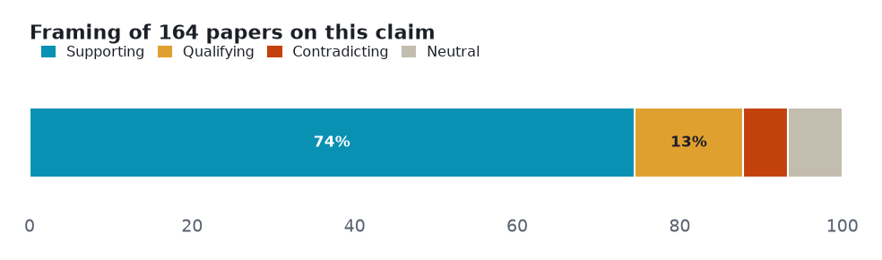
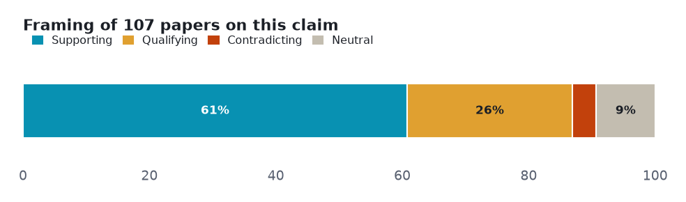
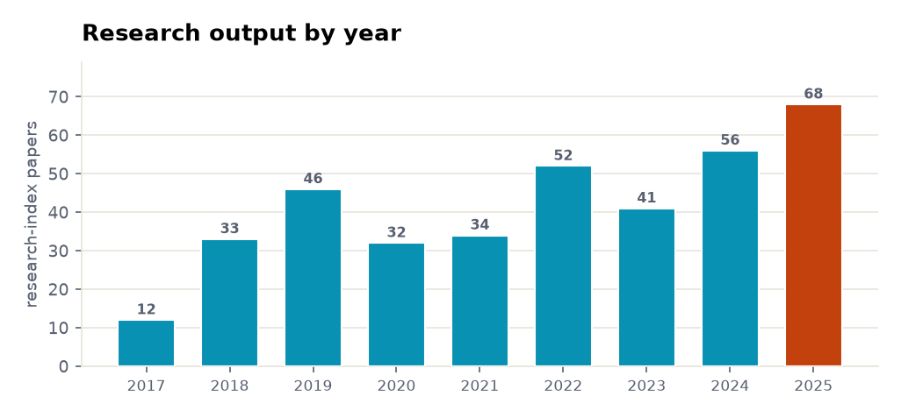

# CRISPR gene editing: a five-angle meta-analysis

> Five claims about CRISPR gene editing tested against both sides of the published literature — 1 that the evidence settles, 2 it leaves genuinely contested, 2 with too thin a lane to call.

**▶ Interactive version** (same sections, light/dark): **<https://fliarbi.com/demo/prism-examples/crispr-gene-editing/>** — also committed here as [`index.html`](index.html).

Every number below is **retrieved, not generated**. Each angle is a claim run against the research layer on **both sides** — the papers that affirm it and the papers that push back — so the verdict reflects how much evidence exists and which way it leans, not a single cherry-picked study. Effect sizes are quoted verbatim and verified; thin lanes are reported as inconclusive rather than charted as fact.

| | |
|---|---|
| **Subject** | CRISPR gene editing |
| **Retrieved** | 2026-11-06 |
| **Coverage** | research typed 107% · research 104.2% · biomedical 100% |
| **Source** | Prism public API — research.evidence (one call per angle) |

## How to read this

Each section is one **claim**. The bar shows how the papers *framed* it — **supporting**, **qualifying** (yes, but…), **contradicting**, or **neutral** — and the verdict weighs that spread against how deep the evidence runs. A claim can be loudly discussed yet thinly evidenced; the brief says which.

## Overview — evidence depth and framing

Two cross-cutting views before the angle-by-angle read: how much both-sides evidence each claim has, and how the literature splits on framing.

<picture><source media="(prefers-color-scheme: dark)" srcset="assets/evidence-depth-dark.png"></picture>

<picture><source media="(prefers-color-scheme: dark)" srcset="assets/stance-composition-dark.png"></picture>

## Angle 1 · Well supported — CRISPR gene editing can treat cancer

Overwhelmingly positive framing, which on a citation-weighted corpus can mean consensus or can mean publication bias. Deepest lane, but concentrated in CAR-T immunotherapy and preclinical work; corpus_topics led by CAR-T cell therapy (46) and virus-based gene therapy (46).

<picture><source media="(prefers-color-scheme: dark)" srcset="assets/angle-0-dark.png"></picture>

**Common findings**

- Of **164 papers** on both sides: 122 support · 22 qualify · 9 contradict · 11 neutral.
- CRISPR/Cas9-UCA1 knockdown significantly inhibited bladder-cancer cell proliferation, migration and invasion in vitro and in vivo (Oncotarget 2017, meta-analysis tier)

**Verdict:** Well supported · **both-sides papers:** 164 · **mean stance:** +0.49 · **contested:** 18.9%

## Angle 2 · Supported contested — CRISPR gene editing has significant off-target effects

Mostly positive framing, with a substantial cautionary minority. The most contested CRISPR angle (29.9%) and the only one where the read document pushed back — newer methods report 'little or no' off-target editing.

<picture><source media="(prefers-color-scheme: dark)" srcset="assets/angle-1-dark.png"></picture>

**Common findings**

- Of **107 papers** on both sides: 65 support · 28 qualify · 4 contradict · 10 neutral.
- 'resulting in little or no undesirable on- or off-target effects' — dual-conditional CRISPR-Cas9 in human stem cells (Mol Ther Nucleic Acids 2022)
- large deletions up to several thousand bases at Cas9 cut sites: HBB 11.7-35.4%, HBG 14.3%, BCL11A 13.2% (Sci Adv 2022)

**Verdict:** Supported contested · **both-sides papers:** 107 · **mean stance:** +0.41 · **contested:** 29.9%

## Angle 3 · Landmark trial claim outpaces design — CRISPR gene editing cures sickle cell disease

The outcome pole matched biomedical subject headings only (Anemia, Sickle Cell), so no both-sides intersection formed and Prism fell back to the subject lane; the extracted health-claim layer carried the real evidence instead.

> **Lane not cleanly resolved — read from the documents.** Not charted as established; the finding is reported from the individual studies.

**Common findings**

- 'both patients had ... transfusion independence, and (in the patient with SCD) elimination of vaso-occlusive episodes' — NEJM 2020, CRISPR-Cas9 for Sickle Cell Disease and β-Thalassemia (cited 1,856); single-arm, so the word 'cure' rests on uncontrolled data

**Verdict:** Landmark trial claim outpaces design · **both-sides papers:** None

## Angle 4 · Not established — CRISPR gene editing improves crop yield

Overwhelmingly positive framing, which on a citation-weighted corpus can mean consensus or can mean publication bias. Only 20 papers cover both sides of the claim; most CRISPR-crop work targets traits (disease resistance, quality), not yield itself, so the yield claim is thin at the claim level.

> **Thin lane — 20 papers cover both sides.** Not charted as established; reported as the boundary of the evidence.

**Common findings**

**Verdict:** Not established · **both-sides papers:** 20

## Angle 5 · Not established — Base editing is more precise than CRISPR-Cas9

Only 3 papers cover both sides of this comparison; the field describes base editing avoiding double-strand breaks and reporting 'no off-target mutations', but head-to-head precision benchmarks against CRISPR-Cas9 are almost absent — assumed, rarely demonstrated.

> **Thin lane — 3 papers cover both sides.** Not charted as established; reported as the boundary of the evidence.

**Common findings**

**Verdict:** Not established · **both-sides papers:** 3

## Research output by year

The field's own tempo: research-index papers on this subject per year, from 12 in 2017 to 68 in 2025.

<picture><source media="(prefers-color-scheme: dark)" srcset="assets/research-trend-dark.png"></picture>

## Direction of travel

Across 4,422 papers, the framing is shifting — how much each orientation grew in the late window versus the early one. Above 1× is rising; below 1× is fading.

<picture><source media="(prefers-color-scheme: dark)" srcset="assets/framing-growth-dark.png"></picture>

**Common findings**

- Rising: **breakthrough** ×1.72, **problem identifying** ×1.68, **promising** ×1.5, **cautionary** ×1.43.
- Fading: **critical** ×0.7.
- Contested share stays low and steady — 3.7% in 2017 to 3.8% in 2025.
- {'early_contested_pct': 4.4, 'late_contested_pct': 3.9, 'delta_pct_points': -0.5, 'reading': 'the balance of framing is broadly unchanged'}.

## Is the claim scaffolded?

The safety claim is fully scaffolded — a real literature behind every sub-claim, not a gap

**Common findings**

- Decomposed into 4 sub-claims — **4 evidenced, 0 unevidenced.**
- Off-target mutations occur
- Off-target effects are significant
- Off-target activity varies with guide-RNA design
- Significant off-target effects raise safety concerns

## In the news

News on CRISPR is a thin, high-priority, almost-uniformly-positive stream; the qualifying/cautionary nuance lives in the research layer, not the news layer

**Common findings**

- 294 articles in the window (2024-2026 (news ingest censored at 2026-06-01)).
- 2025: 161 articles — 153 positive / 8 negative, 92.5% high-priority.
- Geography of coverage: United States 35.2%, United Kingdom 11%, China 4.8%, India 4.8% (the place an article is ABOUT, not where published; only 43.3% of articles place cleanly, and acronym collisions inflate some low-count rows — directional, not precise).

## Method & limits

Counts and shares measured from the data. Quoted findings verbatim and verified. Two angles fell to the subject lane (no clean both-sides intersection) and are reported that way, not charted by a both-sides count.

Each angle is one call against the research-evidence layer: the claim is posed, both sides of the literature are retrieved, and the framing tally is computed from the returned papers. Thin lanes are named, not inflated — the point of the exercise is to show where the evidence is deep, where it is contested, and where it barely exists.

---

*A Prism worked example. Charts are generated from the retrieved data; every quoted finding is verbatim and verified. [`data.json`](data.json) holds the underlying numbers.*
