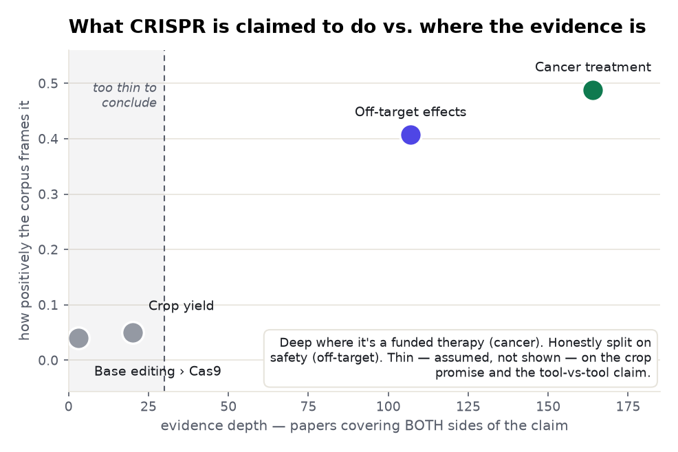
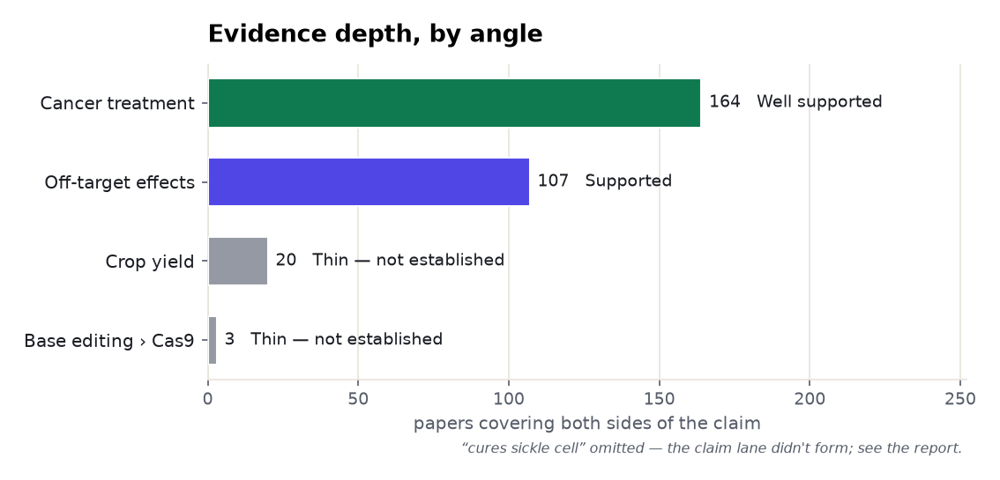
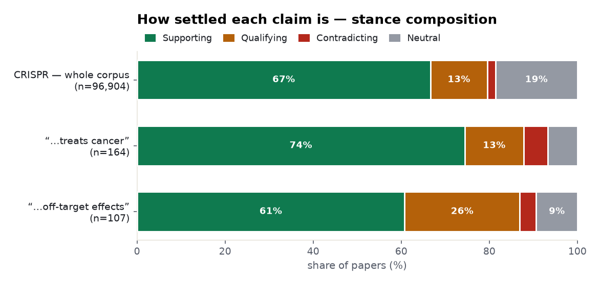
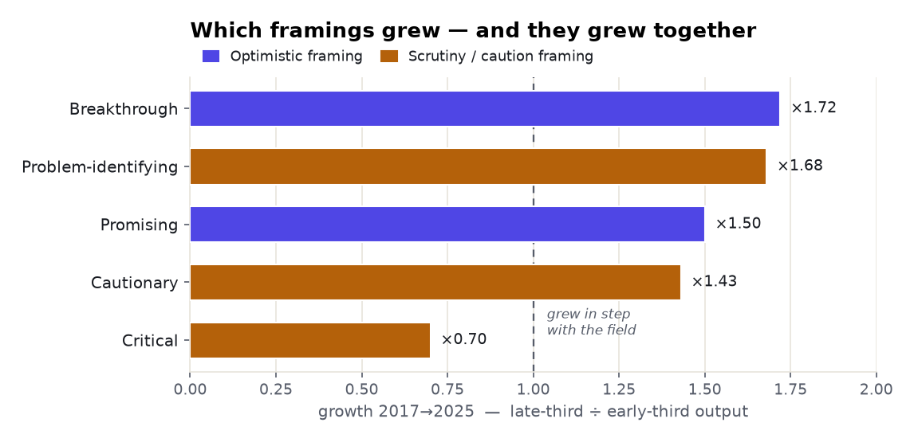
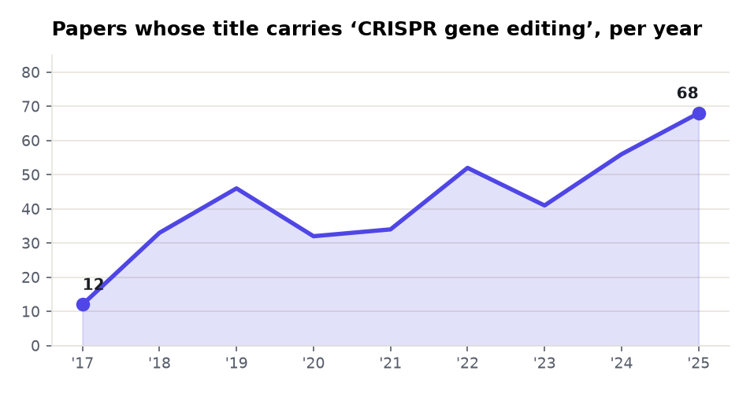

# CRISPR gene editing: a five-angle meta-analysis

> The same method as the [intermittent-fasting](../intermittent-fasting-glycemic-control/) and
> [semaglutide](../semaglutide/) examples, on a field everyone agrees is a breakthrough — which is
> exactly why it's a good test. Five claims measured from the corpus, then four deeper passes
> (framing-over-time, journals-vs-headlines, geography, gap analysis) that a single evidence lookup
> can't give you. Every count is measured over Prism's corpora; every quoted finding is
> verbatim from the source and verified against it.

**Subject:** CRISPR gene editing · **Retrieved:** 2026-11-06 · **Tools:** `find_evidence` ×5,
`stance_trends`, `news_trends`, `news_geography`, `research_gaps`

---

## The finding in one chart

The CRISPR literature's framing is **overwhelmingly positive** — 67% of the ~96,900-paper corpus is
coded "supporting," and "breakthrough" is the single most common orientation. But that positivity is
**not uniform across claims.** Ask a precise, clinically-funded question and the evidence is deep.
Ask a broad promise or a tool-vs-tool comparison and the both-sides evidence thins to a handful of
papers — *assumed*, not *shown*.

<picture>
  <source media="(prefers-color-scheme: dark)" srcset="./assets/belief-vs-evidence-dark.png">
  
</picture>

---

## Ranked by how much evidence stands behind it

<picture>
  <source media="(prefers-color-scheme: dark)" srcset="./assets/evidence-depth-dark.png">
  
</picture>

| Angle | Both-sides papers | Verdict | Prism's reading | Evidence (verbatim) |
|---|--:|---|---|---|
| **Treats cancer** | 164 | Well supported | *"overwhelmingly positive framing"* | CRISPR/Cas9 knockdown inhibited bladder-cancer proliferation, migration & invasion *in vitro* and *in vivo* |
| **Off-target effects** | 107 | Supported · most contested | *"mostly positive, substantial cautionary minority"* | large deletions at Cas9 cut sites: HBB **11.7–35.4%**, HBG 14.3%, BCL11A 13.2% — yet newer designs report *"little or no"* off-target editing |
| **Cures sickle cell** | — † | Landmark trial; "cure" outpaces design | — (subject lane) | *"transfusion independence … elimination of vaso-occlusive episodes"* (NEJM 2020) — **single-arm** |
| **Improves crop yield** | 20 \* | Not established | *"positive framing"* (thin) | CRISPR-crop work targets *traits*, not yield — the yield claim itself is thin |
| **Base editing > Cas9 precision** | 3 \* | Not established | — | field *assumes* it (base editing avoids double-strand breaks) but almost never benchmarks head-to-head |

<sub>\* thin claim lanes — the connection is not established at the stated count. † the claim lane didn't form at all; see "The one the lane couldn't measure" below.</sub>

---

## Where the field is actually split

The honest signal isn't the average — it's the *spread*. Normalising each claim's stance to 100%
shows the one place CRISPR's consensus genuinely cracks: **safety.** The off-target claim carries by
far the largest "qualifying" slice (26% vs. 13%) — the field hedges most exactly where you'd want it
to argue. "Contradicting" stays tiny everywhere, which is itself a tell: a citation-weighted corpus
rarely publishes the null.

<picture>
  <source media="(prefers-color-scheme: dark)" srcset="./assets/stance-composition-dark.png">
  
</picture>

And the 26% isn't hand-waving. `research_gaps` decomposes "off-target effects are significant" into
four sub-claims — *off-target mutations occur* · *they are significant* · *they vary with guide-RNA
design* · *they raise safety concerns* — and finds a real literature behind **every one** (0
unevidenced). The safety doubt is the most *scaffolded* part of the whole CRISPR corpus, not its
weakest.

---

## Does the caution keep up? — framing across nine years

Here's where a one-shot lookup would mislead you. The "cautionary" literature is growing fast
(CAGR 10.7%); so is "problem-identifying" (1.68× from the early years to the late ones). Read those
rates alone and you'd report *a field turning anxious.* But run `stance_trends` and the optimistic
framings are climbing at the **same** rate — "breakthrough" 1.72×, "promising" 1.50× — so the two
move in lockstep. Only outright **"critical"** framing actually falls (0.70×).

<picture>
  <source media="(prefers-color-scheme: dark)" srcset="./assets/framing-growth-dark.png">
  
</picture>

The consequence is in the numbers Prism puts beside the counts: across a near-**doubling** of annual
output (725 papers in 2017 → 1,282 in 2025), the **contested share held flat** — 4.4% in the early
years, 3.9% in the late ones, a −0.5pt move Prism reads as *"broadly unchanged."* The field isn't
getting more worried or less. It's getting **bigger**, and taking its proportion of caution with it.
That is the entire reason every Prism payload ships the share next to the count.

---

## The one the lane couldn't measure — sickle cell

"CRISPR cures sickle cell disease" is CRISPR's most famous real-world win (the first approved
CRISPR therapy). But when you ask for it as a *claim*, Prism is honest about a mechanical limit: the
outcome pole matched only biomedical subject headings (`Anemia, Sickle Cell`), which didn't produce a clean
both-sides intersection against the typed research index — so the tool **fell back to the subject
lane and said so**, rather than inventing a count. Then it surfaced the evidence a different way:

- **The extracted health-claim layer** carried **223 claims** for this pairing — but weighted toward
  the bottom of the evidence pyramid: **106 preclinical, 28 review/meta, 8 clinical, 4 RCT**
  (high-tier share **17.9%**).
- **The landmark trial** is real and strong: *"both patients had … transfusion independence, and (in
  the patient with SCD) elimination of vaso-occlusive episodes"* (NEJM 2020, cited 1,856). But it is
  **single-arm** — which is why Prism's document check flagged *"single-arm study shows improvement,
  not cure; lacks comparator."*

So the honest verdict is neither "proven cure" nor "no evidence": a dramatic, landmark single-arm
result, where the word **cure** is ahead of the trial **design**. A search box would have said
"yes." The lane model says *where* the yes comes from.

---

## The headlines and the journals disagree about the nuance

Run `news_trends` on the same subject and you get a completely different-shaped object. Across
2024–2026 the news corpus holds just **294 articles** on CRISPR gene editing — and in a full year
(2025: 161 articles) **95% carry positive sentiment** (153 positive vs. 8 negative) and **92% are
flagged high editorial priority.** The public-facing layer is a thin, almost-uniformly-triumphant
stream — approvals, firsts, breakthroughs.

Set that beside the research layer — **1,282 papers in 2025 alone**, with its 13–26% qualifying
minority and its growing cautionary literature — and the division of labour is clear: **the headlines
carry the wins; the journals carry the caveats.** Someone reading only the news would never meet the
26% of the off-target literature that hedges. This is why a research tool reads the journals and the
news as *two different corpora with two different jobs*, and never blends them into one "sentiment."

---

## Where the work happens — and the one place the lane undercounts

Look at *who authored* the evidence in each lane, straight from the verbatim document institutions,
and a pattern falls out that explains the depth map itself:

- **The deep, "well-supported" therapy angles are US / UK / EU work in high-visibility venues** —
  University of Pennsylvania and the Broad Institute (cancer / CAR-T), Boston Children's and
  Brigham & Women's, the *New England Journal of Medicine* (sickle cell). `news_geography` agrees:
  the United States is the subject of **35%** of CRISPR news, the UK 11%.
- **The thin "crop yield" angle is largely Chinese plant-science work** — the Chinese Academy of
  Sciences and the Institute of Genetics and Developmental Biology (base editing in rice and wheat),
  Shanxi Agricultural University (foxtail millet) — published in plant journals under titles like
  *"glufosinate resistance"* and *"grain traits,"* not *"yield."*

So part of why "crop yield" reads thin is **where the corpus is strongest**: an English-title,
high-citation vocabulary indexes therapeutic CRISPR deeply and agricultural CRISPR more sparsely —
and agricultural work more often measures a *trait* than *yield* outright. The thinness is real at
the claim level, but the honest footnote is that it reflects a **coverage-and-vocabulary boundary**,
not an absence of CRISPR-crop research in the world. Naming that boundary is the difference between a
research instrument and a search box. *(The `news_geography` caveat applies too: only 43% of
articles place cleanly, and acronym collisions inflate a few low-count rows — so the country shares
are directional, not precise.)*

---

## Direction of travel

Title-phrase matches for "CRISPR gene editing," per year — a bumpy climb, not the exponential curve
the drug literatures show. (The broad topic "CRISPR and Genetic Engineering" holds ~96,900 papers;
this is the narrow title-phrase slice.)

<picture>
  <source media="(prefers-color-scheme: dark)" srcset="./assets/trend-dark.png">
  
</picture>

---

## The cross-angle insights

1. **Positive ≠ proven — and the corpus lets you separate them.** CRISPR reads as "breakthrough"
   almost everywhere (mean stance ~0.48), but depth ranges over **two orders of magnitude** — 164
   both-sides papers for cancer down to 3 for the base-editing comparison. The framing is flat; the
   evidence is not.
2. **Depth follows funding, again.** As with semaglutide, the deep angles are the ones with clinical
   programmes behind them (cancer / CAR-T). The thin ones are a broad agricultural *promise* and an
   engineering *comparison* — things people assert in introductions, not things trials are run on.
3. **The split is where it should be.** Of all five angles, the corpus is most contested on
   **off-target safety** (29.9% contested; 26% qualifying) — and `research_gaps` shows that doubt is
   fully scaffolded (4/4 sub-claims evidenced). The field argues about risk, not about promise.
4. **Caution scales *with* hype, not against it.** Optimistic and cautionary framings grew in
   lockstep over nine years (×1.72 and ×1.68), so the contested share held flat at ~4% through a
   doubling of output. The rising count of cautionary papers is a volume effect, not a mood shift —
   visible only because Prism reports the share beside the count.
5. **Two corpora, two jobs.** The news layer is thin and ~95% positive; the journals hold the
   qualifying minority. Blending them into one "sentiment" would erase exactly the nuance that
   matters.
6. **Honesty beats a number.** On sickle cell the tool **declined to fabricate a both-sides count**,
   named the lane it fell back to, and routed to the extracted-claim layer instead; on crop yield it
   flagged that the thinness is partly a coverage boundary. The most useful outputs in the whole
   report are the two places it said *"here's what I could not cleanly measure, and why."*

---

## Reproduce it

**The five claim lanes — one call each:**

```bash
for claim in \
  "CRISPR gene editing can treat cancer" \
  "CRISPR gene editing has significant off-target effects" \
  "CRISPR gene editing cures sickle cell disease" \
  "CRISPR gene editing improves crop yield" \
  "base editing is more precise than CRISPR-Cas9" ; do
  curl -s https://radar-api.fliarbi.com/prism/v1/research.evidence \
    -H "Authorization: Bearer $PRISM_KEY" -H "Content-Type: application/json" \
    -d "{\"claim\":\"$claim\"}" \
  | jq '{claim: .subject.claim,
         lane: .data.lane_counts.lane // .data.query.lane,
         both_sides: .data.lane_counts.intersection,
         lean: .data.corpus_stance.sides, reading: .data.corpus_stance.reading,
         verdict: .data.tally.counts, lane_note: .data.lane_note}'
done
```

**The four deeper passes — focus on a single angle:**

```bash
# how the framing mix moved over nine years (the caution-vs-hype finding)
curl -s .../prism/v1/research.stance_trends -H "$AUTH" -d '{"term":"CRISPR gene editing"}' \
  | jq '{per_orientation_trend, framing_shift}'

# the public layer, for the headlines-vs-journals split
curl -s .../prism/v1/news.trends      -H "$AUTH" -d '{"term":"CRISPR gene editing","granularity":"yearly"}'
curl -s .../prism/v1/news.geography   -H "$AUTH" -d '{"term":"CRISPR gene editing","level":"country"}'

# is a claim a real gap or a scaffolded literature?
curl -s .../prism/v1/research.gaps    -H "$AUTH" -d '{"claim":"CRISPR gene editing has significant off-target effects"}'
```

Over MCP these are `find_evidence`, `stance_trends`, `news_trends`, `news_geography`, and
`research_gaps`. Watch the `lane` field on `find_evidence`: when `intersection` is `null` or the lane
reads `subject`, the numbers describe the subject alone and **do not** establish the claim — that's
the sickle-cell and base-editing case above, and the report treats them that way. Charts generated
from these responses; see [`data.json`](./data.json) for the full retrieved payload. The honesty
model (lane, window, coverage, evidence-vs-interpretation, like-with-like units) is the same across
all three examples.
