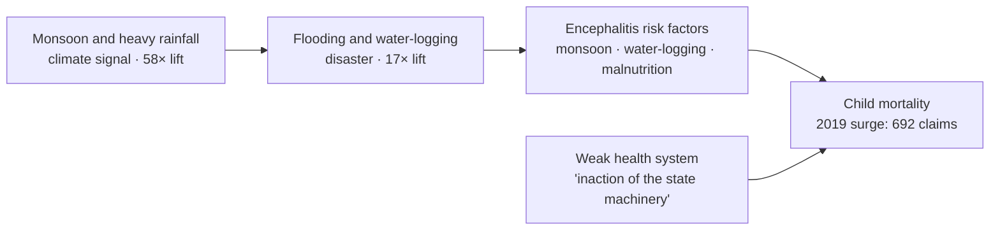
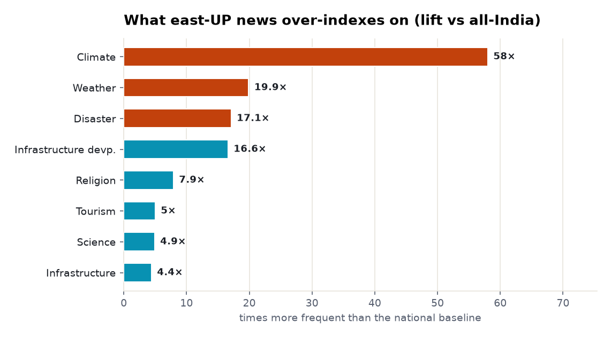
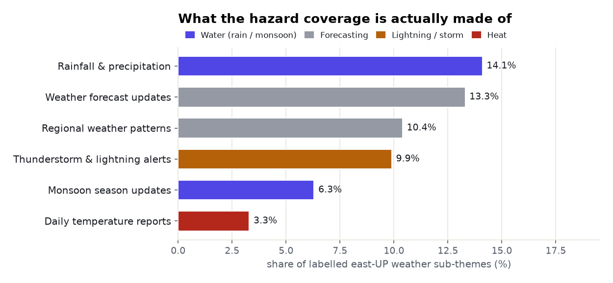
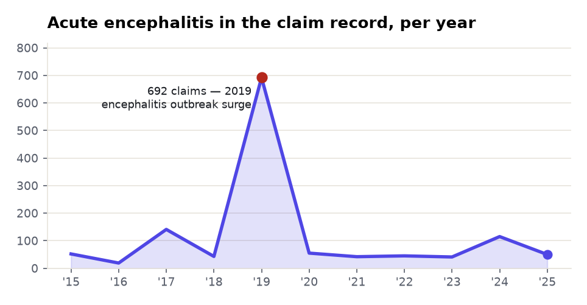
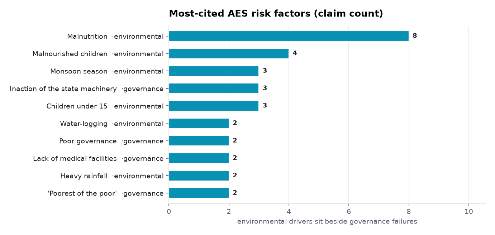

# Eastern Uttar Pradesh: a climate-first regional brief

> A region, read as a *chain* rather than a list. This brief leads with the single signal that
> dominates eastern UP (Purvanchal) — **climate** — then follows it downstream: what the hazard is
> made of, how it's lived day to day as weather, when it becomes disaster, and where it finally lands
> as a human-mortality crisis. The corpus itself draws the causal line: the same water (monsoon,
> rainfall, water-logging) that defines the climate signal reappears as the risk factors behind the
> region's signature disease. Every count is measured from the data; every quoted factor is extracted
> and verified.

**Subject:** eastern Uttar Pradesh (Purvanchal) · **Retrieved:** 2026-11-06 · **Tools:**
`news_themes`, `news_trends`, `disease_profile` · **Read as:** one flow, top to bottom.

---

## The flow, in one picture

Everything below is this chain. The climate signal is not background weather — it is the upstream
cause of the region's worst health outcome, and the corpus connects the two by name.



---

## 1 · Climate — the defining signal

Ask the news corpus what makes eastern UP *distinctive* — not what it mentions, but what it covers far
more than the rest of India — and three categories tower over everything else, all of them hazard:
**climate 58×** the national baseline, **weather 20×**, **disaster 17×**. No other theme (religion
8×, tourism 5×) is close. For this region, the climate is not a section of the news — it *is* the
news.

<picture>
  <source media="(prefers-color-scheme: dark)" srcset="./assets/news-distinctiveness-dark.png">
  
</picture>

**What that signal is made of — and the measurement.** Break the hazard coverage into its
sub-themes and it resolves into a *water* story first and a *forecasting* story second: rainfall &
precipitation **14.1%** of labelled sub-themes, monsoon updates **6.3%** — a fifth of all weather
coverage is rain and monsoon — with forecasting (forecast updates 13.3%, regional patterns 10.4%)
and lightning alerts (9.9%) filling the rest. Heat is a distant last (3.3%).

<picture>
  <source media="(prefers-color-scheme: dark)" srcset="./assets/hazard-composition-dark.png">
  
</picture>

> **Common issues, measured:** monsoon-driven **rainfall and flooding** (20% of weather coverage),
> **thunderstorm & lightning** (~10%), and **heat** (~3%). The anchor place-tag is **Gorakhpur**
> (497× lift) — the city at the centre of both the flood plain and the health crisis below.

---

## 2 · Weather — the hazard, lived day to day

The same signal, one level down, is an **operational** one: the region runs on forecasts and warnings.
Weather-forecast updates (13.3%) and regional-pattern coverage (10.4%) are the daily bulletin; the IMD
tag carries a **98× lift**. And the sharp edge of it is **thunderstorm & lightning alerts (9.9%)** —
pre-monsoon lightning is a signature Gangetic-plain killer, which is why "alerts" are a standing
category here rather than an occasional story.

> **The read:** east UP doesn't just *get* extreme weather — it *lives on the warnings*. One in ten
> labelled weather items is a lightning or storm alert.

---

## 3 · Disaster — when the weather wins

When rainfall and monsoon tip over, they register as **disaster** — 121 articles, **17× the national
baseline**. This is the flood layer: the Ghaghra, Rapti and Ganga systems spilling into the plain,
and the **water-logging** that follows and lingers. Disaster coverage spills across the porous border,
too: the co-occurring place-tags are **Bihar** (110× lift) and **Jharkhand** (151×) — the flood belt
is a region, not a state line.

> **The hinge:** water-logging is where this report turns from a *weather* story into a *health* one —
> because it is, verbatim, one of the risk factors the corpus names for the disease in Section 4.

---

## 4 · The crisis downstream — encephalitis

Here the climate signal lands as mortality. The one health emergency the corpus binds tightly to this
belt is **acute encephalitis syndrome** — the disease behind the Gorakhpur and Muzaffarpur child
deaths. `disease_profile` returns **1,523 extracted claims**, and their time-path carries the region's
worst year on its face: a surge to **692 claims in 2019**, the north-India outbreak.

<picture>
  <source media="(prefers-color-scheme: dark)" srcset="./assets/encephalitis-trend-dark.png">
  
</picture>

**The payoff of the flow is in the causes.** The factors the corpus names split into two families —
and the first family *is Section 1*. The environmental risk factors are **monsoon season, water-logging,
heavy rainfall, malnutrition** — the exact water signal that opened this brief. The climate hazard and
the child-mortality crisis are not two stories; they are one chain, and the corpus wired it for us.

<picture>
  <source media="(prefers-color-scheme: dark)" srcset="./assets/encephalitis-factors-dark.png">
  
</picture>

The **second** family is the amplifier: *"inaction of the state machinery,"* *"poor governance,"*
*"lack of medical facilities in government hospitals,"* the *"poorest of the poor section."* The top
associations are *Bihar*, *Muzaffarpur* and a *"rising number of deaths."* So in this corpus
encephalitis is a **monsoon disease multiplied by poverty and a weak health system** — climate
upstream, governance at the point of care. *(Honest caveat: only **3%** of these 1,523 claims come
from high-tier studies; most are news-derived, so read them as what is **said** about the crisis, not
as trial evidence.)*

---

## 5 · The human cost — out-migration and governance

Downstream of a hazard-prone, under-industrialised belt is the region's other defining fact:
**labour out-migration.** The research signal is thin (see Section 6), but it is the human answer to
Sections 1–4 — people leaving a flood plain that offers few jobs and a frayed safety net. The
governance layer that failed at the hospital in Section 4 is the same one tagged across the regional
news: *Yogi Adityanath* (129× lift), *government* coverage at 7.3%. The brief ends where it has to —
at the state's capacity to absorb the shocks the earlier sections measured.

---

## 6 · The honest boundary — what the research corpus can't tell us

Everything above is built from the **news problem-space** and the **extracted disease-claim layer.**
It had to be — because when the same region is put to the *academic research* tool as a claim, the
lanes collapse:

| Claim put to `find_evidence` | Both-sides papers | What Prism did |
|---|--:|---|
| encephalitis causes high child mortality **in eastern UP** | **0** | returned `no_data` (`ok:false`) |
| river flooding damages agriculture **in eastern UP** | **0** | fell to the subject lane; the 5 papers are Sikkim / Sundarbans / J&K |
| lack of employment drives out-migration **from eastern UP** | **4** | thin subject lane; *"employment in eastern uttar pradesh"* = 0 titles |

**The academic title index does not resolve sub-national Indian regions.** A search-box model would
have written a confident paragraph about Purvanchal's flood-hit farms anyway. Prism said *"no data,"*
named the fallback lane, and the region's real intelligence surfaced where it lives — in the news and
disease-claim corpora. *(A live example of the same discipline: at the time of this run part of the
data cluster was temporarily unavailable, so the deeper event-level stats — `find_statistics`,
`critical_news`, `news_factors` — were **deferred**, not estimated, because degraded coverage returns
floors, not totals. The figures above are from full-coverage pulls.)*

---

## Why this is "intelligence," not a dashboard

A flat dashboard would have shown you six unrelated panels. This brief shows you **one causal chain** —
monsoon → flooding → water-logging → encephalitis → child death, amplified by poverty and governance —
and the corpus supplied every link, including the join between the climate signal and the health
factors. Leading with the dominant signal and following it downstream is what turns a pile of counts
into a story you can act on.

---

## Reproduce it

```bash
# 1. what the region is distinctively about, and the composition of the signal
curl -s .../prism/v1/news.themes  -H "$AUTH" -d '{"term":"eastern Uttar Pradesh"}' \
  | jq '{categories: .data.categories.rows, subthemes: .data.subcategories.rows}'

# 4. the crisis downstream — causes, risk factors, the 2019 time-series
curl -s .../prism/v1/research.disease -H "$AUTH" -d '{"disease":"acute encephalitis syndrome"}' \
  | jq '{claims, risk_factors: .data.risk_factors, series: .data.series}'

# 6. the honest boundary — a region-specific claim the research corpus can't carry
curl -s .../prism/v1/research.evidence -H "$AUTH" \
  -d '{"claim":"acute encephalitis syndrome causes high child mortality in eastern Uttar Pradesh"}' \
  | jq '{ok, both_sides: .data.lane_counts.intersection, reason: .error.reason}'
```

Over MCP these are `news_themes`, `disease_profile`, and `find_evidence`. The `no_data` on the last is
the intended behaviour, not an error to route around. Full payload in [`data.json`](./data.json).
