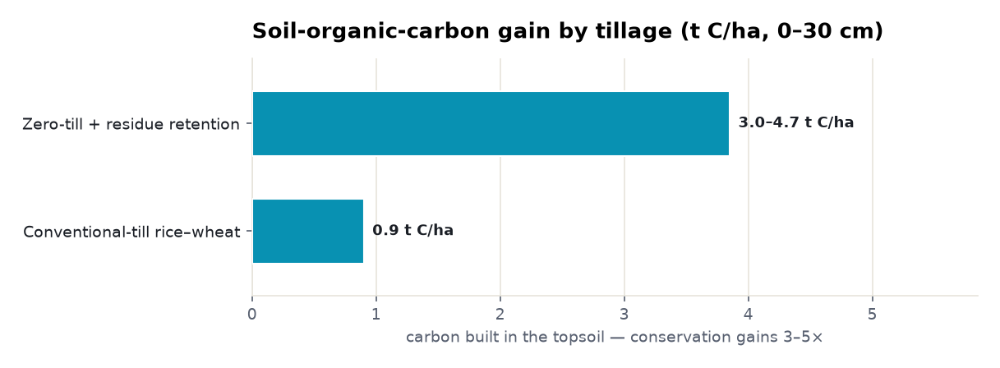
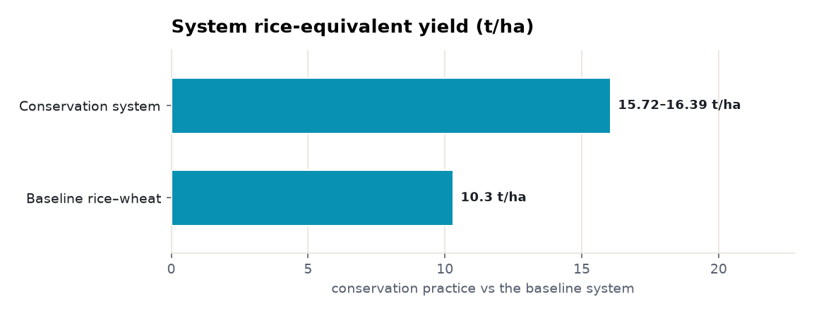
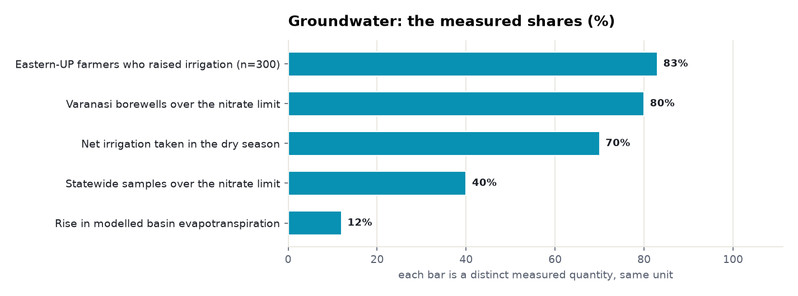
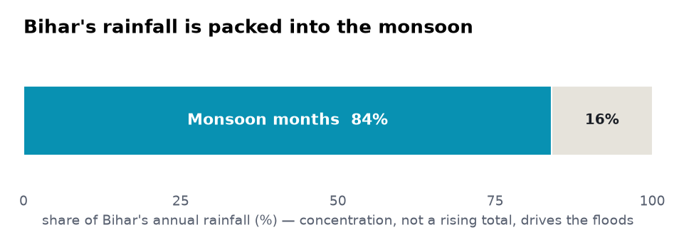
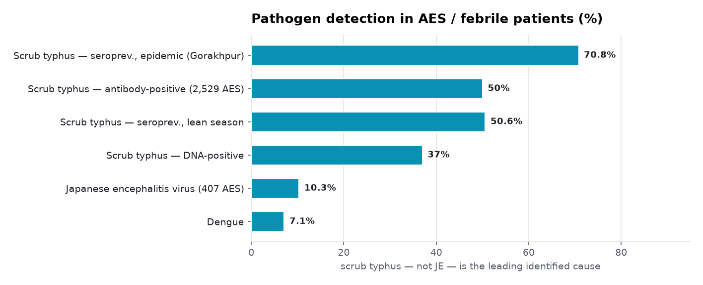
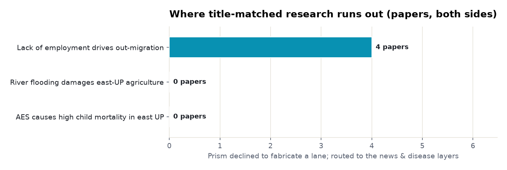
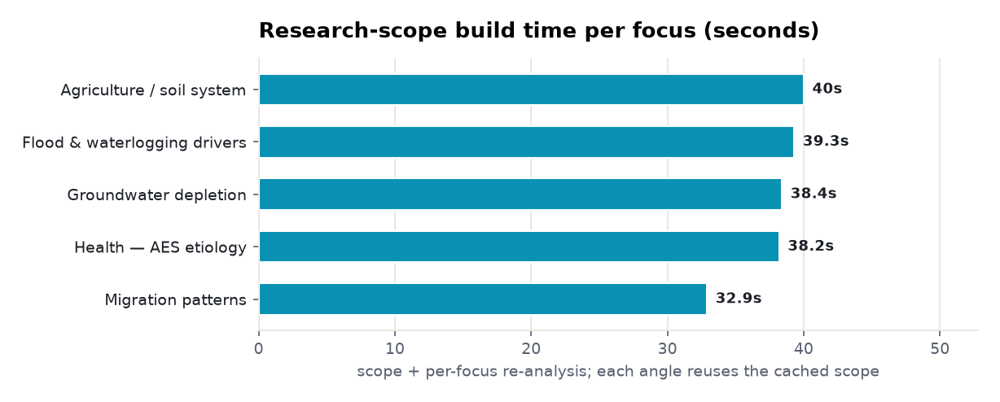

# Eastern Uttar Pradesh — a regional brief

> Purvanchal read as **one causal chain**: the climate signal drives flooding and
> water-logging, which feed the region's signature health crisis, which poverty and a
> weak health system then amplify. A *place*, not a single claim.

**▶ Interactive version** (all 13 charts, light/dark, hover values):
**<https://fliarbi.com/demo/prism-examples/east-uttar-pradesh/>** — also committed here as
[`index.html`](index.html).

Every number below is **retrieved, not generated**: counts and shares are computed over
the stated windows, and every quoted line is copied verbatim and verified against its
source. Because the academic title index does not resolve sub-national Indian regions,
the research-scope engine was run on the **systems the belt belongs to** — the eastern
Indo-Gangetic rice–wheat plain and the north-India encephalitis epidemiology. Where a
data lane could not form, the tools report it rather than fill the gap.

| | |
|---|---|
| **Subject** | eastern Uttar Pradesh (Purvanchal) — regional problem-space |
| **Retrieved** | 2026-11-06 |
| **Engines** | news corpus · extracted disease-claim layer · research-scope (findings + re-analysis) |
| **Coverage** | news 107% · disease-factor claims 100% |

Each section below carries a **chart**, a short **summary**, and a bulleted list of the
**common findings** with study DOIs. Publisher, company and individual names are withheld
per deliverable policy; IMD = India Meteorological Department (a public body).

---

## 1 · The signal — what this place is made of

Eastern UP does not resolve as one claim — it is a place, and its character shows up most
clearly in **what the news over-indexes on**. Against the national baseline, climate (58×),
weather (19.9×) and disaster (17.1×) dominate, anchored on Gorakhpur and spilling into
Bihar and Jharkhand. Read top-to-bottom, this brief follows a single causal chain.

<picture><source media="(prefers-color-scheme: dark)" srcset="assets/news-distinctiveness-dark.png"></picture>

**Common findings**
- The distinctive signature is **extreme weather** — monsoon, flooding, thunderstorm and lightning — not politics or crime.
- Geography by tag-lift: **Gorakhpur 496.7×**, Varanasi 188.5×, Jharkhand 151.3×, Bihar 109.6×, IMD 97.6× — the belt reads as one hydro-climatic unit with Bihar.
- Volume is a balanced, mixed-sentiment stream: **1,101 articles** (2024–26), 507 in 2025 with 46% high-priority — not a single triumph or scandal.
- The same water factors — monsoon, water-logging, heavy rainfall — appear in *both* the climate signal and the encephalitis risk-factor list; the corpus itself supplies the link between hazard and health.

---

## 2 · Climate & weather — a water story with a storm season

The climate signal is overwhelmingly about **water and timing**. A fifth of weather
coverage is rainfall and monsoon; forecasting and lightning alerts fill most of the rest;
heat, though deadly, is a minor share of coverage. The hazard year runs on a fixed
calendar, and the region's news mood swings negative exactly when those hazards land.

<picture><source media="(prefers-color-scheme: dark)" srcset="assets/hazard-composition-dark.png"></picture>

<picture><source media="(prefers-color-scheme: dark)" srcset="assets/sentiment-season-dark.png"></picture>

**Common findings**
- **December** — dense fog, “zero visibility or below 50 metres across 13 districts of the Terai belt and eastern UP.”
- **April–June** — IMD orange alert: “47 °C heatwave with thunderstorms, lightning,” with a recorded heatwave death toll across eastern UP and Bihar.
- **July–September** — “many major rivers across the state flow above the danger mark; Ganga above danger mark, Allahabad, Varanasi flooded.”
- Flood has **two sources**: “late monsoon rain, along with water released from Nepal into our rivers” — the Ghaghra and Rapti rise in Nepal — flooding fields and leaving water-logging into the encephalitis season.
- Discipline check: the extractor *discarded two further flood factors “because no source named”* — it keeps only factors tied to a verified report.

---

## 3 · Agriculture & the rural economy — at news level it is water; in the science it is soil

At the news level, farm fortune is **water**: the Saryu Canal expansion promises irrigation
to 14.04 lakh hectare “great relief to the farmers,” while the same rivers flood the same
fields. The research-scope engine, run on the eastern Indo-Gangetic rice–wheat plain
(93 findings, 38 papers), adds the depth the news cannot: soil carbon, salinity and yield
respond sharply to how the land is tilled.

<picture><source media="(prefers-color-scheme: dark)" srcset="assets/agriculture-soil-carbon-dark.png"></picture>

<picture><source media="(prefers-color-scheme: dark)" srcset="assets/agriculture-yield-dark.png"></picture>

**Common findings**
- Conventional puddling keeps soil carbon low; **zero-till + residue gained 3.0–4.7 t C/ha (3–5× conventional)**, and non-puddled rice + residue lifted SOC +79% and nitrogen +62%. — [10.1016/j.eja.2017.08.006](https://doi.org/10.1016/j.eja.2017.08.006)
- Intensified cropping **depleted total organic carbon 17.56%** at 0–30 cm; tillage had no effect below 0.15 m. — [10.1111/sum.12331](https://doi.org/10.1111/sum.12331)
- On sodic soils, gypsum + pressmud raised organic carbon 32–64% with **~25% higher yield**; yield rose with soil carbon and fell with pH, exchangeable-sodium-% and bulk density. — [10.1002/ldr.4047](https://doi.org/10.1002/ldr.4047)
- Water & inputs: **40% of groundwater samples exceed the 50 mg/l nitrate limit**; shifting wheat sowing dates could unlock +69% untapped wheat potential; nutrient-expert fertiliser cut wheat global-warming potential 12–20% and raised yield/income for &gt;80% of farmers. — [10.3390/agronomy10060888](https://doi.org/10.3390/agronomy10060888)
- Resource-poor households are most exposed to simulated drought, cushioned mainly by **off-farm income** — tying the farm economy back to migration. — [10.4067/s0718-95162018005003201](https://doi.org/10.4067/s0718-95162018005003201)

---

## 4 · Groundwater — irrigation-driven depletion with basin-scale costs

The region's water problem is not only floods — it is a quiet, **irrigation-driven drawdown**
with costs that travel far downstream, plus confirmed nitrate contamination in shallow
wells. Pumping for a rice–wheat system raises evapotranspiration across the whole Ganges
basin and pulls freshwater away from the Bay of Bengal.

<picture><source media="(prefers-color-scheme: dark)" srcset="assets/groundwater-shares-dark.png"></picture>

**Common findings**
- Irrigation raised modelled **evapotranspiration 12%** across the Ganges basin; net irrigation ~101 mm/yr (67 km³), 70% in the dry season. — [10.1029/2018wr023038](https://doi.org/10.1029/2018wr023038)
- **83% of 300 eastern-UP farmers increased irrigation**; depletion cut Bay-of-Bengal freshwater flow by up to 1,200 m³/s per year. — [10.1016/j.jafr.2021.100132](https://doi.org/10.1016/j.jafr.2021.100132)
- Reduced irrigation maps to **wheat-yield loss of −4% to −36%** — the water table and the harvest are the same ledger. — [10.5194/hess-27-2463-2023](https://doi.org/10.5194/hess-27-2463-2023)
- Contamination is real and local: **80% of Varanasi borewells exceed the 50 mg/l nitrate limit.** — [10.1016/j.ecolind.2023.110637](https://doi.org/10.1016/j.ecolind.2023.110637)

---

## 5 · Floods & rivers — concentration and saturation, not more rain

The counter-intuitive finding is that the floods are getting worse while **mean rainfall is
falling**. The driver is *concentration* — 84% of the year's rain arrives in the monsoon
months — landing on already-saturated ground and rivers topped up by a ~2 m seasonal
groundwater swing and water released from Nepal.

<picture><source media="(prefers-color-scheme: dark)" srcset="assets/flood-monsoon-split-dark.png"></picture>

**Key measured values**

| value | what it measures |
|---|---|
| **176%** | above-average rain, late-Sep 2019, central/east Bihar |
| **+19%** | soil-moisture anomaly in the same window |
| **7,019 km²** | of Bihar submerged in one monsoon |
| **≈2 m** | monsoon groundwater head swing topping up rivers |
| **−2.17 mm/yr** | long-run annual rainfall trend, 1901–2002 |

**Common findings**
- **Annual and monsoon rainfall declined** across Bihar 1901–2002 (−2.17 / −2.13 mm/yr) — floods are not a rising-total story. — [10.4236/ajcc.2017.61007](https://doi.org/10.4236/ajcc.2017.61007)
- **84% of rainfall** falls in the monsoon months; late-Sep 2019 ran 176% above average with soil moisture +19%. — [10.2478/jwld-2018-0018](https://doi.org/10.2478/jwld-2018-0018)
- A **~2 m monsoon groundwater head swing** tops up the rivers, and saturated soils add to water-logging. — [10.1007/s40899-019-00340-3](https://doi.org/10.1007/s40899-019-00340-3)
- One monsoon put **7,019 km² of Bihar under water**; forecasts for the Bihar monsoon can be skilful enough to support flood planning. — [10.3390/w13121695](https://doi.org/10.3390/w13121695)
- Two-source mechanism (news): “late monsoon rain, along with water released from Nepal into our rivers, have been causing flooding of fields.”

---

## 6 · Health — encephalitis, re-read by the evidence

Eastern UP's defining health story is acute encephalitis syndrome (AES), and the extracted
evidence overturns the folk diagnosis. Across 38 papers and 120 kept findings,
**scrub typhus — not Japanese encephalitis — is the leading identified cause**, and it is
treatable with doxycycline. The disease-claim layer frames the crisis as both
socio-environmental and a **governance failure**. This is where the climate chain lands —
the same water factors from the weather signal reappear as health risk factors.

<picture><source media="(prefers-color-scheme: dark)" srcset="assets/health-etiology-dark.png"></picture>

<picture><source media="(prefers-color-scheme: dark)" srcset="assets/encephalitis-trend-dark.png"></picture>

<picture><source media="(prefers-color-scheme: dark)" srcset="assets/encephalitis-factors-dark.png"></picture>

**Common findings**
- **50% of 2,529 hospitalised AES cases** were antibody-positive and 37% DNA-positive for *O. tsutsugamushi*; Gorakhpur seroprevalence 70.8% epidemic vs 50.6% lean season. — [10.3201/eid2308.170025](https://doi.org/10.3201/eid2308.170025)
- **JE virus in only 10.3%** of 407 Gorakhpur AES patients, dengue 7.1% — scrub typhus is treatable, unlike JE, which changes the clinical response. — [10.4103/ijmr.ijmr_625_21](https://doi.org/10.4103/ijmr.ijmr_625_21)
- The disease layer holds **1,523 claims**; the 2019 surge (692 claims) tracks the Muzaffarpur / north-India outbreak coverage. High-tier (clinical / trial / review) share is only 3%.
- Risk factors mix **environment and governance**: malnutrition (8), monsoon season (3), “inaction of the state machinery” (3), water-logging (2), “lack of medical facilities” (2).
- Top associations — Bihar (24), Muzaffarpur (22), “rising number of deaths” (15), malnutrition (11); one Gorakhpur hospital is the referral point for eastern UP, Bihar and Nepal.

---

## 7 · Migration & livelihoods — the defining fact the corpus cannot measure

Labour out-migration is Purvanchal's defining economic fact — and it is where the research
layer is **honestly thin**. The academic title index does not resolve sub-national Indian
regions: there is no flow or destination data for eastern UP, only Bihar-proxy observational
work. Rather than invent a lane, the engine says so. What the news layer shows is a state
trying to *manufacture reasons to stay*.

<picture><source media="(prefers-color-scheme: dark)" srcset="assets/migration-limits-dark.png"></picture>

**Common findings**
- **Circular labour migration tracks scarce local opportunity** (single observational finding); Gulf migration and remittances improved livelihoods for 60 Bihar migrants, but left pandemic debt. — [10.1177/00027642211000392](https://doi.org/10.1177/00027642211000392)
- No data exists on migration flows, destinations within India, or Purvanchal specifically — **“labour out-migration” returns 5 titles, “employment in eastern UP” returns 0.**
- Policy counter-move: land-ownership certificates to resettled families; a Gorakhpur “Centre of Excellence” with a major IT-services firm to teach emerging technology to the belt's youth.
- The through-line: resource-poor farm households survive simulated drought mainly on off-farm income — **migration is the farm economy's shock-absorber.**

---

## 8 · Crime & law-and-order — a trafficking-and-muscle story, under-counted

Crime is a **weak categorical signal but a sharp event signal**. The literal term “crime in
Uttar Pradesh” returns only ~17 articles, because crime news is tagged by specifics, not by
the word “crime.” Read at the event level, the distinctive pattern is not a property-crime
beat but a **Bihar-border illegal-arms pipeline** and threats against public figures.

<picture><source media="(prefers-color-scheme: dark)" srcset="assets/vertical-landscape-dark.png"></picture>

**Common findings**
- Category signal is weak — **~17 articles** for the literal term; crime registers as just 2 of the region's top-20 priority stories.
- Event signal is sharp: a man arrested in Chandauli carrying **“five pistols … five magazines of 32 bore,” running them from Munger (Bihar) toward Bhadohi**.
- A sitting Lok Sabha MP reported a “threat to life … criminals in Eastern Uttar Pradesh are planning to harm him.”
- Reading: a **trafficking-and-muscle** story tied to the porous Bihar border — the same corridor that defines the belt's water and health geography.

---

## Method & limits — how this was built, and where the data runs out

A topic query returns a **scope** of extracted findings plus a **scope-id** held in a
short-lived cache; each angle is a fast **re-analysis** of that cached scope against a new
focus. Build times per focus:

<picture><source media="(prefers-color-scheme: dark)" srcset="assets/method-buildtime-dark.png"></picture>

The honest boundary of title-matched research for a sub-national place:

- **AES → child mortality in east UP**: 0 papers both-sides — “acute encephalitis syndrome” has 197 titles, but the region+child-mortality intersection is 0.
- **River flooding damages east-UP agriculture**: 0 both-sides; the 5 subject papers are about Sikkim, Sundarban and J&K — not east UP.
- **Employment drives out-migration**: only 4 both-sides, and thin — a boundary the brief states rather than papers over.

The intelligence lives in the **news corpus** and the **extracted disease-claim layer**, with
the **research-scope engine** supplying agro-ecological and epidemiological depth — three
engines, one place. The design rule throughout: *distinguish retrieved evidence from model
interpretation*, and say so wherever the corpus has nothing.

---

*A Prism worked example. Charts are generated from the retrieved data; every quoted finding
is verbatim and verified. [`data.json`](data.json) holds the underlying numbers and source
tooling.*
