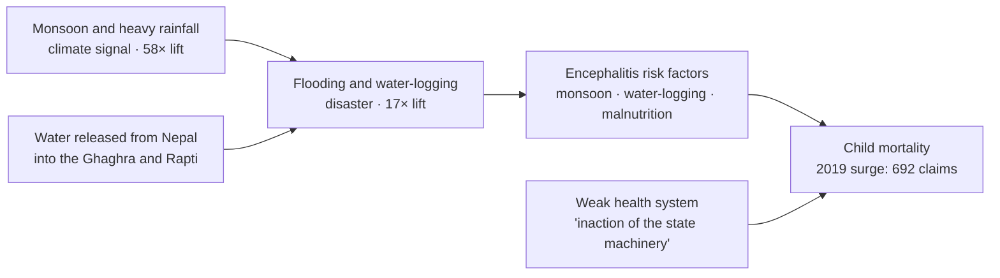
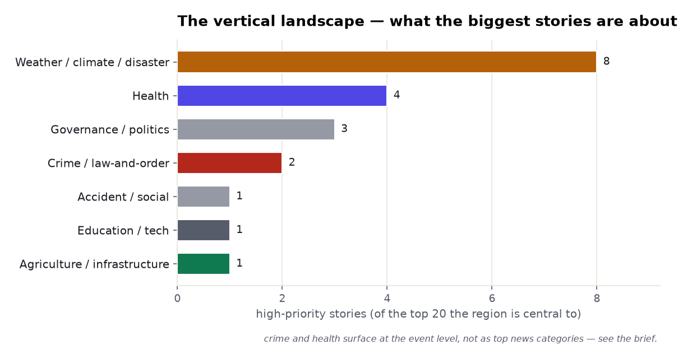
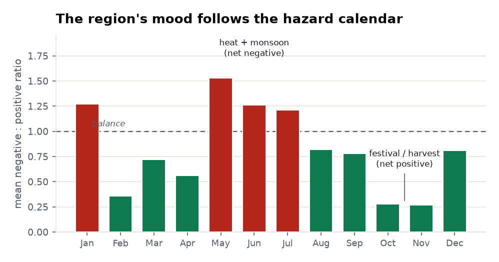

# Eastern Uttar Pradesh: a multi-vertical regional brief

> A region read two ways. First as a **chain** — leading with the signal that dominates eastern UP
> (Purvanchal), **climate**, and following it downstream through weather, disaster and the health
> crisis it causes. Then **widened** across the other verticals the same corpus surfaces: crime,
> agriculture, migration and economy, religion and tourism — each looked into with its own data, and
> the whole thing closed on a mood that tracks the hazard calendar. Every count is measured from the
> data; every quoted factor is extracted and verified; publisher and company names are withheld, and
> *IMD* = India Meteorological Department (the public body in the weather alerts).

**Subject:** eastern Uttar Pradesh (Purvanchal) · **Retrieved:** 2026-11-06 · **Tools:**
`news_themes`, `news_trends`, `news_sentiment`, `critical_news`, `disease_profile`, `find_evidence`

---

## The flow, in one picture

The spine of the brief is this causal chain — the climate signal is the upstream cause of the
region's worst health outcome, and the corpus connects the two by name.



## The vertical landscape

Before following the chain, the lay of the land. Rank the region's **highest-priority** stories by
subject and the verticals fall out: weather dominates, but **health, governance, crime and
agriculture** are all live beats. Two of them — crime and health — barely register as *news
categories* yet surface sharply at the *event* level; that gap is itself a finding, and the sections
below treat each on its own terms.

<picture>
  <source media="(prefers-color-scheme: dark)" srcset="./assets/vertical-landscape-dark.png">
  
</picture>

---

## 1 · Climate — the defining signal

Ask the corpus what makes eastern UP *distinctive* and three hazard categories tower over everything:
**climate 58×** the national baseline, **weather 20×**, **disaster 17×**. No other theme is close. For
this region the climate is not a section of the news — it *is* the news.

<picture>
  <source media="(prefers-color-scheme: dark)" srcset="./assets/news-distinctiveness-dark.png">
  
</picture>

Break that signal into sub-themes and it resolves into a **water** story first: rainfall &
precipitation **14.1%** of labelled weather items, monsoon updates **6.3%** — a fifth of weather
coverage — with forecasting and lightning alerts filling the rest, heat a distant last.

<picture>
  <source media="(prefers-color-scheme: dark)" srcset="./assets/hazard-composition-dark.png">
  
</picture>

> **Common issues, measured:** monsoon rainfall and flooding (20% of weather coverage), thunderstorm
> & lightning (~10%), heat (~3%). Anchor place-tag: **Gorakhpur** (497× lift).

---

## 2 · Weather — the hazard calendar

One level down the signal is **operational** — the region runs on forecasts and warnings (IMD tag
98× lift) — and the warnings **rotate**, so there is no off-season. The dated, verified high-priority
alerts assemble into a calendar:

| When | Hazard | Verbatim from the corpus |
|---|---|---|
| **December** | Dense fog | *"dense fog"*, *"zero visibility or below 50 metres"* across **13 districts** of the Terai belt and eastern UP |
| **Apr–Jun** | Heat + lightning | an IMD orange alert pairing a **47°C** heatwave with *"thunderstorms, lightning"*; an earlier report records a *"death toll from the heatwave in eastern Uttar Pradesh, Bihar"* |
| **Jul–Sep** | Monsoon flood | *"many major rivers across the state … flow above the danger mark"* — the **Ganga** *"above danger mark … Allahabad, Varanasi flooded"* |
| **Oct** | Cyclone tail | a late cyclone *"broke a 20-year record"*, dropping the max temperature to **22.7°C** with 24 mm rain |

The extraction tool discarded two further flood factors *"because no source named"* — the discipline
that lets the rest be quoted at all.

---

## 3 · Disaster — the flood mechanism

When rain and monsoon tip over they register as **disaster** (17× baseline), and the corpus names the
*mechanism*: east-UP flooding is a **two-source** problem — the monsoon from above and water from
across the border — *"late monsoon rain, along with water released from Nepal into our rivers, have
been causing flooding of fields."* The rivers that drown Purvanchal (the **Ghaghra** and **Rapti**)
rise in Nepal, so an upstream release lands as a flooded paddy downstream. The recorded impact is
exactly that — *"flooding of fields"* (crop loss) and **water-logging** that lingers into the
encephalitis season of Section 4. The flood belt is a region, not a state line: co-occurring tags are
**Bihar** (110×) and **Jharkhand** (151×).

---

## 4 · Health — bigger than encephalitis

The dominant health emergency is **acute encephalitis syndrome** — **1,523 extracted claims**,
spiking to **692 in 2019**.

<picture>
  <source media="(prefers-color-scheme: dark)" srcset="./assets/encephalitis-trend-dark.png">
  
</picture>

Its causes split into two families — and the first *is Section 1*: **monsoon, water-logging, heavy
rainfall, malnutrition**. The second is the amplifier: *"inaction of the state machinery,"* *"poor
governance,"* *"lack of medical facilities."* So encephalitis here is a **monsoon disease multiplied
by poverty and a weak health system.**

<picture>
  <source media="(prefers-color-scheme: dark)" srcset="./assets/encephalitis-factors-dark.png">
  
</picture>

But the high-priority feed shows health is **wider** than encephalitis, and the measurements are
grim-to-hopeful: a verbatim *"399 deaths this year"* from brain fever reported by the Gorakhpur
government medical college; a *"rare incidence"* of cerebral **malaria** (mixed *Plasmodium*); drug-
resistant **tuberculosis** work at a Gorakhpur tertiary hospital; and, on the other side, a new
**32-bed ICU** *"ready… to relieve severe patients from Eastern Uttar Pradesh, Bihar and Nepal."* One
Gorakhpur hospital is the referral point for three jurisdictions — the health geography mirrors the
flood geography.

---

## 5 · Crime and law-and-order

Here the honesty model earns its keep. As a **news category** crime barely registers — the literal
term runs to a handful of articles, because crime news is tagged by its specifics, not by the word
"crime." But at the **event** level the structural signal is sharp, and it is the one Purvanchal is
infamous for: the **Bihar-border illegal-arms pipeline.** A single seizure in the corpus: a man
arrested in **Chandauli** carrying *"five pistols… five magazines of 32 bore,"* running them from
**Munger** (Bihar's gun-making hub) toward **Bhadohi.** And the politics is violent — a sitting Lok
Sabha MP from the region reporting a *"threat to life… criminals in Eastern Uttar Pradesh are
planning to harm him."*

> **The read:** crime in east UP is a *trafficking-and-muscle* story, not a property-crime beat — and
> it under-registers in categorical coverage precisely because it lives in one-off seizures and
> threats. The vertical-landscape chart (2 of the top 20 stories) is the honest floor, not the ceiling.

---

## 6 · Agriculture and the rural economy

The region is an agrarian floodplain, so water is the economy as much as the hazard. The upside
appears as irrigation: an expansion of the **Saryu Canal** project to cover *"14.04 lakh hectare"* of
irrigation, *"great relief to the farmers of Eastern Uttar Pradesh."* The downside is Section 3's
flood landing on the same fields — *"flooding of fields"*, and a monsoon flood that *"faded the
happiness of Rakshabandhan"* as people reached relatives *"by boat."* Agriculture here is one unbroken
line from the canal headworks to the danger mark on the river gauge.

---

## 7 · Migration and the economy

Downstream of a hazard-exposed, under-industrialised belt is Purvanchal's other defining fact:
**labour out-migration.** The research corpus can't even measure it (Section 10), but the policy
response is all over the feed — the state trying to *manufacture* reasons to stay: **land-ownership
certificates** distributed to tribal and resettled families, and a Gorakhpur **"Centre of Excellence"**
built with a major IT-services firm to teach *"emerging technology to the youth of Eastern Uttar
Pradesh."* Even the grid is contested terrain — power-department staff *"mobilised against
privatisation."* The economic question underneath every vertical is whether the belt can hold its
own people.

---

## 8 · Religion, culture and tourism

The region's other identity is **sacred geography** — and it is a real slice of the coverage:
religion, culture and tourism together run ~**250 articles** (religion alone at **8× lift**). This is
the land of **Varanasi** (Kashi) and the **Gorakhnath** temple; the place-tags carry the *Ram temple*
and pilgrimage towns like **Shravasti**. It is the one vertical where the region's dominant news tone
is *positive* rather than hazard-negative — and, as Section 9 shows, it is what pulls the autumn mood
back above the line.

---

## 9 · The mood follows the hazard calendar

Put 24 months of sentiment together and the region's mood is **seasonal**, in lockstep with the
hazards above it. The net negative:positive ratio peaks in **May–July** (heat, then monsoon flood) and
in the January cold snap; it falls well below the line in **October–November**, the festival and
harvest season. The overall tone is *"somewhat more negative than ordinary news coverage"* (1.16× the
corpus baseline) — a region whose news is driven by what the weather does to it.

<picture>
  <source media="(prefers-color-scheme: dark)" srcset="./assets/sentiment-season-dark.png">
  
</picture>

---

## 10 · The honest boundary — what the research corpus can't tell us

Everything above is built from the **news problem-space** and the **extracted disease-claim layer** —
because when the region is put to the *academic research* tool as a claim, the lanes collapse:

| Claim put to `find_evidence` | Both-sides papers | What Prism did |
|---|--:|---|
| encephalitis causes high child mortality **in eastern UP** | **0** | returned `no_data` (`ok:false`) |
| river flooding damages agriculture **in eastern UP** | **0** | fell to the subject lane; papers are Sikkim / Sundarbans / J&K |
| lack of employment drives out-migration **from eastern UP** | **4** | thin subject lane; *"employment in eastern uttar pradesh"* = 0 titles |

**The academic title index does not resolve sub-national Indian regions.** A search-box model would
have written a confident paragraph anyway. Prism said *"no data,"* named the fallback, and the
region's real intelligence surfaced where it lives. *(Reliability in real time: during this run the
data backend dropped in and out — `news_factors` failed outright at one point while coverage was
degraded. Degraded coverage returns floors, not totals, so any figure pulled during an outage is a
silent undercount. Every number in this brief is from a **full-coverage** read; the pulls that came
back degraded were deferred, not estimated.)*

---

## Why this is "intelligence," not a dashboard

A dashboard shows ten unrelated panels. This brief shows **one causal chain** — monsoon → flooding →
water-logging → encephalitis → child death, amplified by poverty and governance — and then widens to
the **verticals the same data surfaces**: a crime economy that lives in border arms-seizures, an
agriculture that rides the same rivers that flood it, a migration the research can't measure, a sacred
geography that lifts the autumn mood. Leading with the dominant signal, following it downstream, and
being explicit about which verticals the corpus quantifies (weather, health, sentiment) versus which
it only *witnesses* (crime, migration) is what turns a pile of counts into a brief you can act on.

---

## Reproduce it

```bash
# the vertical landscape + the mood, from the same regional query
curl -s .../prism/v1/news.critical  -H "$AUTH" -d '{"term":"eastern Uttar Pradesh","days":540,"limit":25}'
curl -s .../prism/v1/news.sentiment -H "$AUTH" -d '{"term":"eastern Uttar Pradesh"}'

# 1-2. what the region is distinctively about, and the composition of the signal
curl -s .../prism/v1/news.themes  -H "$AUTH" -d '{"term":"eastern Uttar Pradesh"}'

# 3. the flood mechanism (verbatim, verified)
curl -s .../prism/v1/news.factors -H "$AUTH" -d '{"topic":"flooding in eastern Uttar Pradesh"}'

# 4. the crisis downstream — causes, risk factors, the 2019 time-series
curl -s .../prism/v1/research.disease -H "$AUTH" -d '{"disease":"acute encephalitis syndrome"}'

# 10. the honest boundary — a region-specific claim the research corpus can't carry
curl -s .../prism/v1/research.evidence -H "$AUTH" \
  -d '{"claim":"acute encephalitis syndrome causes high child mortality in eastern Uttar Pradesh"}' \
  | jq '{ok, both_sides: .data.lane_counts.intersection, reason: .error.reason}'
```

Over MCP these are `news_themes`, `news_trends`, `news_sentiment`, `critical_news`, `news_factors`,
`disease_profile`, and `find_evidence`. Crime and migration are read at the event level (via
`critical_news`) because the corpus under-categorises them — stated plainly rather than overclaimed.
Full payload in [`data.json`](./data.json).
