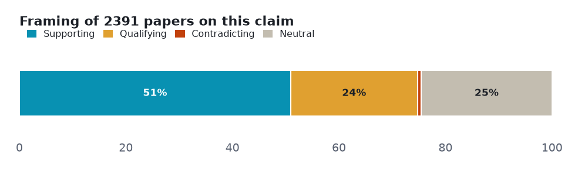
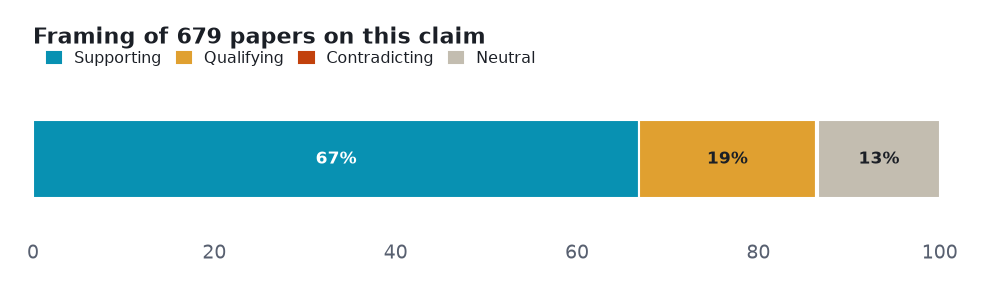
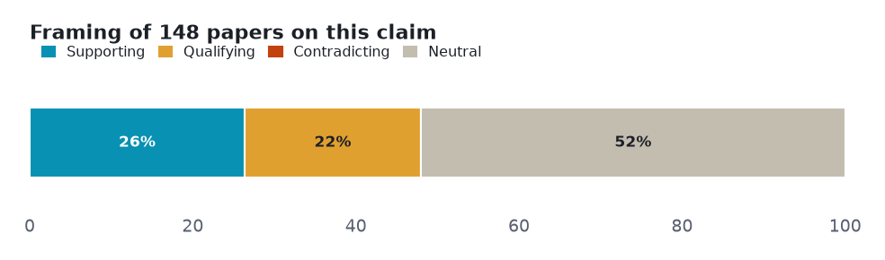
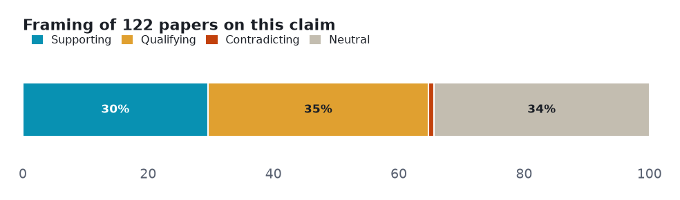

# Electric vehicles (climate / energy): a five-angle meta-analysis

> Five claims about electric vehicles tested against both sides of the published literature — 1 that the evidence settles, 4 it leaves genuinely contested.

**▶ Interactive version** (same sections, light/dark): **<https://fliarbi.com/demo/prism-examples/electric-vehicles/>** — also committed here as [`index.html`](index.html).

Every number below is **retrieved, not generated**. Each angle is a claim run against the research layer on **both sides** — the papers that affirm it and the papers that push back — so the verdict reflects how much evidence exists and which way it leans, not a single cherry-picked study. Effect sizes are quoted verbatim and verified; thin lanes are reported as inconclusive rather than charted as fact.

| | |
|---|---|
| **Subject** | electric vehicles (climate / energy) |
| **Retrieved** | 2026-11-06 |
| **Coverage** | research typed 107% · research 104.2% |
| **Source** | Prism public API — research.evidence (one call per angle) |

## How to read this

Each section is one **claim**. The bar shows how the papers *framed* it — **supporting**, **qualifying** (yes, but…), **contradicting**, or **neutral** — and the verdict weighs that spread against how deep the evidence runs. A claim can be loudly discussed yet thinly evidenced; the brief says which.

## Overview — evidence depth and framing

Two cross-cutting views before the angle-by-angle read: how much both-sides evidence each claim has, and how the literature splits on framing.

<picture><source media="(prefers-color-scheme: dark)" srcset="assets/evidence-depth-dark.png"></picture>

<picture><source media="(prefers-color-scheme: dark)" srcset="assets/stance-composition-dark.png"></picture>

## Angle 1 · Well supported — Electric vehicles reduce greenhouse gas emissions

Mixed framing with no dominant lean. The solid core — supporting outnumbers contradicting 48:1; lifecycle studies confirm the reduction across vehicle types.

<picture><source media="(prefers-color-scheme: dark)" srcset="assets/angle-0-dark.png"></picture>

**Common findings**

- Of **2,156 papers** on both sides: 1046 support · 329 qualify · 22 contradict · 759 neutral.
- "the transition from internal combustion engine vehicles ... to electric vehicles would reduce the greenhouse gas emission for passenger cars, two-wheelers, and buses" (LCA, Malaysia, Sustainability 2022)
- "BEVs have lower CO2 emissions" vs conventional vehicles (Clean Technologies 2023)

**Verdict:** Well supported · **both-sides papers:** 2,156 · **mean stance:** +0.31 · **contested:** 16.3%

## Angle 2 · Supported caveat — Electric vehicle battery production has a high environmental cost

Mostly positive framing, with a substantial cautionary minority. A real, well-studied cost — but a partial offset, not a reversal; the landmark LCA puts the battery at ~15% of total e-mobility impact.

<picture><source media="(prefers-color-scheme: dark)" srcset="assets/angle-1-dark.png"></picture>

**Common findings**

- Of **2,391 papers** on both sides: 1218 support · 569 qualify · 17 contradict · 587 neutral.
- "The share of the total environmental impact of E-mobility caused by the battery ... is 15%" (Notter, Environ. Sci. Technol. 2010)
- cradle-to-gate Global Warming Potential 67.1 kg CO2e/kWh for an Indian LFP pack (2025)

**Verdict:** Supported caveat · **both-sides papers:** 2,391 · **mean stance:** +0.28 · **contested:** 24.5%

## Angle 3 · Conditional — Electric vehicle adoption strains the electricity grid

Overwhelmingly positive framing, which on a citation-weighted corpus can mean consensus or can mean publication bias. The one place framing and read-evidence diverge: 454 papers frame EVs as a grid strain, but the high-tier documents read lean CONTRADICT (6 vs 3) — smart charging keeps voltage within limits even at 90% penetration.

<picture><source media="(prefers-color-scheme: dark)" srcset="assets/angle-2-dark.png"></picture>

**Common findings**

- Of **679 papers** on both sides: 454 support · 132 qualify · 2 contradict · 91 neutral.
- "voltage profiles maintained within safe operational limits, even under 90% EV penetration level" (Glasgow, 2025)
- "minimal impact on voltage profiles" (Rwanda MV networks, 2020)
- counter: "higher line loading, voltage fluctuations, and increased power losses" (37-bus study, 2025)

**Verdict:** Conditional · **both-sides papers:** 679 · **mean stance:** +0.42 · **contested:** 19.7%

## Angle 4 · Conditional — Electric vehicles are cheaper to own than gasoline cars

Mostly positive framing, with a substantial cautionary minority. Conditional — no contradicting papers, but the reads say 'it depends': on segment, mileage, battery replacement and policy.

<picture><source media="(prefers-color-scheme: dark)" srcset="assets/angle-3-dark.png"></picture>

**Common findings**

- Of **148 papers** on both sides: 39 support · 32 qualify · 0 contradict · 77 neutral.
- "the optimal vehicle drive technology depends strongly on the vehicle segment considered" (Applied Energy 2025)
- "EVs have a lower TCO ... if the battery replacement cost for EVs is not considered" (Romania study, 2024)

**Verdict:** Conditional · **both-sides papers:** 148 · **mean stance:** +0.19 · **contested:** 21.6%

## Angle 5 · Conditional — Electric vehicles reduce urban air pollution

Mostly positive framing, with a substantial cautionary minority. The only angle where qualifying (43) outnumbers supporting (36) — benefits depend on the grid mix and can even be regressive.

<picture><source media="(prefers-color-scheme: dark)" srcset="assets/angle-4-dark.png"></picture>

**Common findings**

- Of **122 papers** on both sides: 36 support · 43 qualify · 1 contradict · 42 neutral.
- "people in census block groups with median income greater than about $65,000 receive positive environmental benefits while those below this threshold receive negative environmental benefits" (Holland, JAERE 2018)
- support: heavy-duty electrification "consistently improves air quality in terms of NO2 and fine particulate matter" (China, 2020)

**Verdict:** Conditional · **both-sides papers:** 122 · **mean stance:** +0.12 · **contested:** 36.1%

## Method & limits

Counts and shares measured from the data. Quoted findings verbatim and verified. Every angle formed a real both-sides lane (122-2,391 papers) — no thin lanes here; the story is the verdict, not the depth. Note the mixed valence: 'battery cost' and 'grid strain' are caveat-claims, so a large supporting share there means the caveat is well-evidenced.

Each angle is one call against the research-evidence layer: the claim is posed, both sides of the literature are retrieved, and the framing tally is computed from the returned papers. Thin lanes are named, not inflated — the point of the exercise is to show where the evidence is deep, where it is contested, and where it barely exists.

---

*A Prism worked example. Charts are generated from the retrieved data; every quoted finding is verbatim and verified. [`data.json`](data.json) holds the underlying numbers.*
