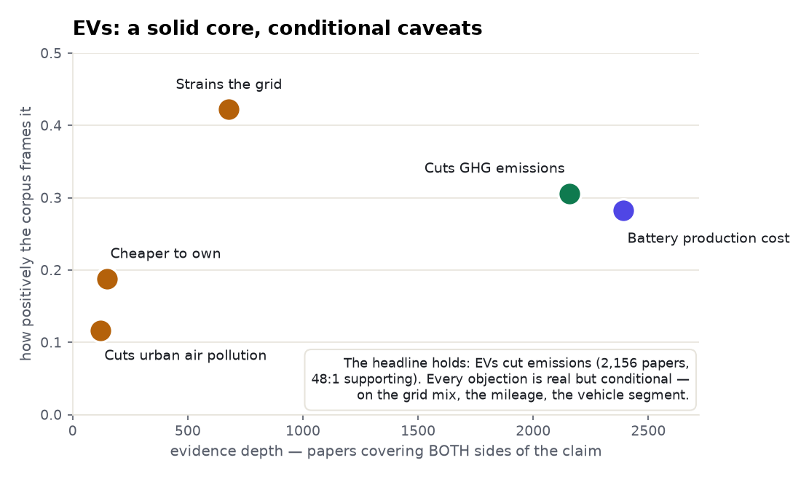
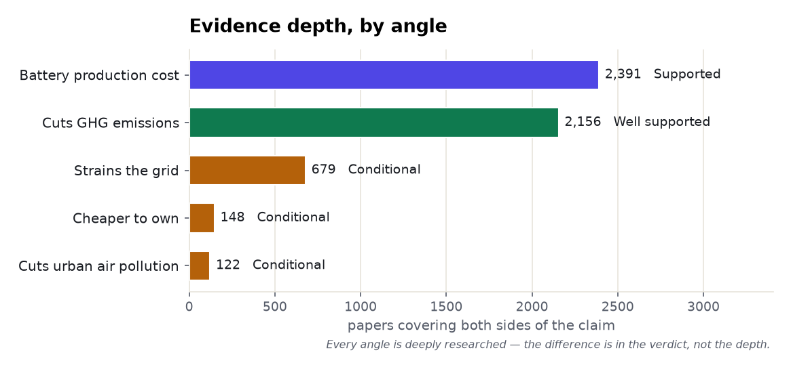
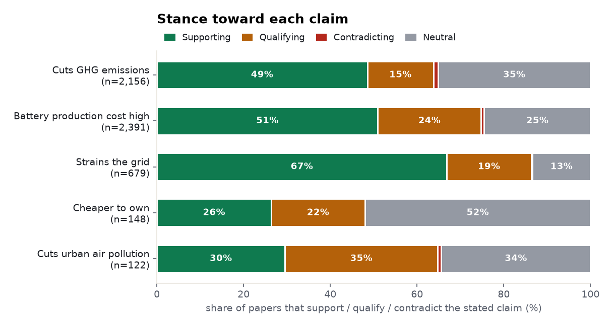

# Electric vehicles: a five-angle meta-analysis

> The method from the health and economics examples, on a **climate / energy** subject — one where,
> unlike the others, *every* angle is deeply researched. That makes it the cleanest demonstration of
> a different point: when the evidence is thick on all sides, the honesty model earns its keep by
> separating the **solid core** from the **conditional caveats**. Every count is computed in
> ClickHouse; every quoted finding is verbatim and verified.

**Subject:** electric vehicles · **Retrieved:** 2026-11-06 · **Tool:** `find_evidence` ×5

---

## The finding in one chart

The headline survives contact with the corpus: **EVs cut greenhouse-gas emissions** — 2,156
both-sides papers, supporting beating contradicting **48 : 1**. What's interesting is that none of the
familiar objections *refute* that; each is real but **conditional**. Battery production is costly
(but ~15% of lifecycle impact, an offset not a reversal); the grid strain is manageable with smart
charging; ownership cost depends on the segment; local air benefits depend on the electricity mix.

<picture>
  <source media="(prefers-color-scheme: dark)" srcset="./assets/belief-vs-evidence-dark.png">
  
</picture>

---

## Ranked by how much evidence stands behind it

Note what's *missing* here versus the other examples: there are **no thin lanes.** Every EV claim has
hundreds to thousands of both-sides papers. The differentiator isn't depth — it's the verdict.

<picture>
  <source media="(prefers-color-scheme: dark)" srcset="./assets/evidence-depth-dark.png">
  
</picture>

| Angle | Both-sides papers | Verdict | Prism's reading | Evidence (verbatim) |
|---|--:|---|---|---|
| **Cuts GHG emissions** | 2,156 | Well supported | *"mixed, no dominant lean"* | *"transition ... to electric vehicles would reduce the greenhouse gas emission for passenger cars, two-wheelers, and buses"* |
| **Battery production cost** | 2,391 | Supported (a real caveat) | *"mostly positive, cautionary minority"* | battery = *"15%"* of total e-mobility impact (Notter 2010) — offset, not reversal |
| **Strains the grid** | 679 | Conditional | framing says strain; **reads say manageable** | *"voltage profiles maintained within safe operational limits, even under 90% EV penetration"* |
| **Cheaper to own** | 148 | Conditional | *"mostly positive, cautionary minority"* | *"depends strongly on the vehicle segment"*; cheaper *"if the battery replacement cost is not considered"* |
| **Cuts urban air pollution** | 122 | Conditional | qualifying **>** supporting | benefits positive above ~$65k median income, *"negative ... below this threshold"* (Holland 2018) |

---

## Stance toward each claim

Each bar is the share of papers that support / qualify / contradict *that statement* (two of the five
are caveat-claims, so a long green bar on "battery cost high" means the caveat is well-evidenced, not
that EVs are bad). The tell is the bottom two rows: **air pollution** is the only claim where
qualifying outweighs supporting, and **cheaper-to-own** is half neutral — the two most *conditional*
verdicts, exactly where the reads said "it depends."

<picture>
  <source media="(prefers-color-scheme: dark)" srcset="./assets/stance-composition-dark.png">
  
</picture>

---

## The condition hiding in each caveat

- **Grid strain — the framing/evidence split.** 454 of 679 papers frame EV adoption as a grid strain
  — yet when Prism reads the high-tier studies, they lean the *other* way (contradict 6, support 3,
  tier-weighted): *"voltage profiles maintained within safe operational limits, even under 90% EV
  penetration"* (Glasgow 2025); *"minimal impact on voltage profiles"* (Rwanda 2020). The strain is
  real in the abstract and solved in the method. Prism shows both.
- **Battery cost — a share, not a verdict.** The quantified landmark says the battery is **15%** of
  total e-mobility impact (Notter 2010). A newer Indian LFP study puts cradle-to-gate warming at 67.1
  kg CO2e/kWh. Both are "high cost" findings — and both are *offsets* that the use-phase emissions
  savings outrun. The caveat is true; it doesn't cancel the core.
- **Air pollution — the regressive condition.** The one angle where qualifying outnumbers supporting.
  The landmark finds EV benefits flip sign by income: positive above ~$65k median income, *negative
  below* — because the benefit depends on where the electricity (and its pollution) is generated.
  "EVs clean the air" is true on average and false in the wrong grid.

---

## The cross-angle insights

1. **A solid core the objections don't dislodge.** Every common anti-EV claim is *real* in the
   corpus — and every one is *conditional*. None of them contradicts "EVs cut emissions"; they
   qualify the conditions under which the benefits land.
2. **Depth everywhere, so verdict is the story.** Unlike the minimum-wage or CRISPR examples, no EV
   angle is thin. When the literature is thick on all sides, the value isn't "is there evidence?" but
   "which way do the *read* documents lean, and under what conditions?"
3. **Framing can invert on reading.** Grid strain is the sharpest case in any of these examples where
   the dominant framing (strain) and the high-tier read evidence (manageable) point opposite ways.
   Counting abstracts would have gotten it backwards; reading them gets it right.
4. **"Conditional" is a real answer.** Three of five verdicts are *conditional* — on the grid mix, the
   mileage, the segment. A search box rounds those to "yes" or "no." The honest output names the
   condition.

---

## Reproduce it — one call per angle

```bash
for claim in \
  "electric vehicles reduce greenhouse gas emissions" \
  "electric vehicle battery production has a high environmental cost" \
  "electric vehicles are cheaper to own than gasoline cars" \
  "electric vehicle adoption strains the electricity grid" \
  "electric vehicles reduce urban air pollution" ; do
  curl -s https://radar-api.fliarbi.com/prism/v1/research.evidence \
    -H "Authorization: Bearer $PRISM_KEY" -H "Content-Type: application/json" \
    -d "{\"claim\":\"$claim\"}" \
  | jq '{claim: .subject.claim, both_sides: .data.lane_counts.intersection,
         framing: .data.corpus_stance.sides,
         read_tally: .data.tally.tier_weighted, reading: .data.corpus_stance.reading}'
done
```

The `framing` (how all papers frame the claim) and `read_tally` (how the high-tier documents actually
read) are separate fields on purpose — the grid-strain angle is where they disagree. Over MCP it's
`find_evidence { "claim": "…" }`. Full payload in [`data.json`](./data.json).
