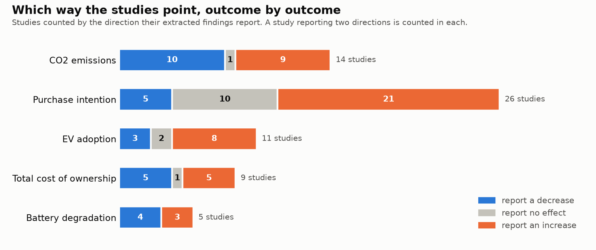
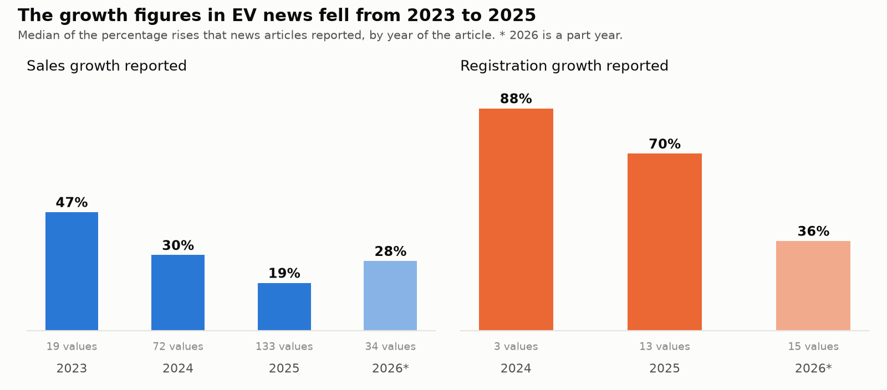

# Electric vehicles: what studies found and what the news reported

> Two extraction layers, read side by side. Prism stores the individual **findings** extracted from research papers and the
> individual **figures** extracted from news articles. This page groups them by angle and quotes them as stored.
> Every count is computed from stored findings; every quoted line is copied, not written.

**Subject:** electric vehicles · **Retrieved:** 2026-11-14 · **Tools:** `research_insights`, `research_scope` + `research_scope_cluster`, `news_insights`

**Web version** (same content, light/dark): [`index.html`](index.html).

**What was read:** 5,121 extracted findings from the papers of six research scopes, one per angle (2,726 paper slots; a paper can sit in more than one angle), and 4,545 extracted figures from 949 of the 4,703 news articles on electric vehicles between 2021-06-01 and 2026-06-01.

---

## The short version

1. **Emissions depend on the electricity.** The largest group of findings says EVs cut emissions; the second largest names the cases where they do not: coal-heavy grids, isolated island systems, and the extra emissions of building the battery.
2. **Fast charging costs battery life; managed charging helps.** Studies report that high charging rates speed up degradation, and that scheduled or smart charging lowers charging cost and emissions.
3. **Price-led charging can backfire on the grid.** Three studies warn that charging which simply follows the cheapest electricity bunches cars into new peaks.
4. **Cheaper to own is a local answer.** Total cost of ownership came out lower in some places and higher in others, and one US study found it varies by nearly 40% between cities.
5. **People buy on control and usefulness, not on subsidies alone.** Twenty-one studies found a factor that raised purchase intention; ten found factors with no effect, subsidies among them.
6. **In the news, the growth numbers shrank.** The typical sales rise reported fell from 47% in 2023 to 19% in 2025, while reports of falling sales became more common.

<picture>
  <source media="(prefers-color-scheme: dark)" srcset="./assets/research-directions-dark.png">
  
</picture>

Read the bars with care: a study is counted for the direction its finding reports, whatever the cause it studied. On CO2 emissions, some of the "increase" findings are about economic growth or energy use, not about the vehicle. The quoted findings below say which is which.

---

## 1. Emissions

**Counted from the findings**

> On CO2 emissions, 14 studies report a direction: 10 a decrease, 1 no effect, 9 an increase.

**EVs cut emissions, and more so on clean power** (187 findings from 139 papers; a related group, 37 findings from 24 papers)

- "The results show the possibilities to reduce the electric vehicles emissions, during the life cycle, with 20 to 140% using the renewable energy sources." — [Possibilies for Improvement the Ecological Effect of Battery Electric Vehicles Using Renewable Energy](https://doi.org/10.1109/eeae49144.2020.9279077), 2020
- "Electric vehicles reduce carbon emissions and air pollution, and their evolution highlights benefits such as reducing carbon emissions and air pollution." — [Electric Vehicles: Benefits, Challenges, and Potential Solutions for Widespread Adaptation](https://doi.org/10.3390/app13106016), 2023
- "The findings of this paper suggest that EVs have the potential to significantly reduce greenhouse gas emissions and improve air quality, but their overall environmental impact depends on factors such as the source of electricity used to power them, and the materials used in their production." — [Impact of Electronic Vehicles on Environment](https://doi.org/10.55529/jeimp.33.36.40), 2023
- "BEVs in southern Chinese provinces have substantial (∼50%) well-to-wheel GHG benefits compared with baseline gasoline vehicles." — [China Electricity Generation Greenhouse Gas Emission Intensity in 2030: Implications for Electric Vehicles](https://doi.org/10.1021/acs.est.8b05264), 2019
- "Replacing gasoline vehicles with BEVs can cut GHG emissions by up to 43.61–55.81% and fossil energy consumption by up to 46.33–55.45%, according to the simulated scenario." — [Energy and Environmental Impact of the Promotion of Battery Electric Vehicles in the Context of Banning Gasoline Vehicle Sales](https://doi.org/10.3390/en15228388), 2022
- "Light-duty plug-in electric trucks had an average GHG emission 69% lower than light-duty diesel trucks, while medium-duty trucks had an average GHG emission 9.8% higher." — [Life Cycle Assessment of Commercial Delivery Trucks: Diesel, Plug-In Electric, and Battery-Swap Electric](https://doi.org/10.3390/su10124547), 2018
- "The average US electric vehicle produces global warming emissions equal to a gasoline vehicle that gets 91 miles per gallon, based on power plant emissions and EV sales data." — [Driving Cleaner: Electric Cars and Pickups Beat Gasoline on Lifetime Global Warming Emissions](https://doi.org/10.47923/2022.14657), 2022
- "In GREET models, EVs in Los Angeles had lower GHG emissions than those in Detroit for the same car model, modeled in 2017." — [Life Cycle Assessment to Study the Impact of the Regional Grid Mix and Temperature Differences on the GHG Emissions of Battery Electric and Conventional Vehicles](https://doi.org/10.1109/southeastcon42311.2019.9020666), 2019

**Where EVs come out level or worse** (98 findings from 70 papers)

- "CO2 emissions from electric vehicle production in China range from 14.6 to 14.7 t, 59% to 60% higher than the 9.2 t level of an ICEV." — [Comparative Study on Life Cycle CO2 Emissions from the Production of Electric and Conventional Vehicles in China](https://doi.org/10.1016/j.egypro.2017.03.827), 2017
- "BEV vehicle production CO2 emissions are 14.6 ton (60.8 gCO2/km), 132% and 123% of those for petrol and diesel ICEVs." — [Environmental and energy impacts of battery electric and conventional vehicles: A study in Sweden under recycling scenarios](https://doi.org/10.1016/j.jfueco.2022.100083), 2022
- "In most Indian states, four-wheeler battery-electric vehicles have higher GHG and SO2 emissions than other conventional or alternative vehicles." — [Should India Move toward Vehicle Electrification? Assessing Life-Cycle Greenhouse Gas and Criteria Air Pollutant Emissions of Alternative and Conventional Fuel Vehicles in India](https://doi.org/10.1021/acs.est.1c07718), 2022
- "Charging a reference BEV in isolated Canary Islands power systems entails higher CO2 emissions than charging an internal combustion vehicle." — [A comparative evaluation of CO2 emissions between internal combustion and electric vehicles in small isolated electrical power systems - Case study of the Canary Islands](https://doi.org/10.1016/j.jclepro.2022.133252), 2022
- "The WTW cycle phase GHG emissions for an EV were estimated to be ~24.478 t CO 2 eq which is 23.6% higher than the diesel-fuelled ICEV and 8.325% higher than petrol-fuelled ICEV." — [Life Cycle Assessment of Greenhouse Gas Emissions of Electric and Internal Combustion Engine Vehicles in India](https://doi.org/10.4271/2022-01-0749), 2022
- "A small decrease in CO2 emissions was observed only in isolated Canary Islands systems with energy storage systems and high renewable penetration." — [A comparative evaluation of CO2 emissions between internal combustion and electric vehicles in small isolated electrical power systems - Case study of the Canary Islands](https://doi.org/10.1016/j.jclepro.2022.133252), 2022
- "Greenhouse gas emissions from electric vehicle production were 1.5 times higher than those from internal combustion engine vehicles." — [Comparative Life Cycle Assessment of Electric and Internal Combustion Engine Vehicles](https://doi.org/10.3390/en17112747), 2024

**Not only the tailpipe: particles from brakes** (20 findings from 7 papers)

- "With low-metallic brake pads, the EV's total PM10 emission factor was 49.2-57.7 mg/V·km lower than the gasoline ICEV (56.3 mg/V·km) and diesel ICEV (57.2 mg/V·km)." — [Comparison of total PM emissions emitted from electric and internal combustion engine vehicles: An experimental analysis](https://doi.org/10.1016/j.scitotenv.2022.156961), 2022
- "With non-asbestos organic brake pads, the EV's total PM10 emission factor was 47.7-49.3 mg/V·km higher than the gasoline ICEV (42.3 mg/V·km) and diesel ICEV (43.2 mg/V·km)." — [Comparison of total PM emissions emitted from electric and internal combustion engine vehicles: An experimental analysis](https://doi.org/10.1016/j.scitotenv.2022.156961), 2022

---

## 2. Batteries

**Counted from the findings**

> On battery degradation, 5 studies report a direction: 4 a decrease, 3 an increase.

**Faster charging, shorter life** (19 findings from 18 papers)

- "High charging rates strongly influence battery degradation, and a trade-off exists between faster charging and longer battery lifetime." — [Charging strategies and battery ageing for electric vehicles: A review](https://doi.org/10.1016/j.esr.2025.101641), 2025
- "Rapid and ultra-rapid charging cause more degradation of the most common electric vehicle batteries than fast charging, though battery management systems limit this degradation to an extent." — [Impact of Charging Rates on Electric Vehicle Battery Life](https://doi.org/10.32866/001c.21459), 2021
- "Results indicated that naturally decreasing battery lifetime can be reduced and scheduled charging can extend lifetime." — [Electric Vehicle Battery Cell Cycle Aging in Vehicle to Grid Operations: A Review](https://doi.org/10.1109/jestpe.2019.2959276), 2019
- "Aggressive driving and recharging behavior significantly reduced the battery life of an EV model in simulations of 50 driving cycles." — [Electric Vehicle Battery Cycle Aging Evaluation in Real-World Daily Driving and Vehicle-to-Grid Services](https://doi.org/10.1109/tte.2017.2764320), 2017
- "The analysis shows that delayed charging and V2G slow down the rate of battery degradation." — [The effect of cycling on the state of health of the electric vehicle battery](https://doi.org/10.1109/upec.2013.6715031), 2013
- "The analysis presented shows that including rest periods during battery charging reduces battery degradation in two ways." — [A method of electric vehicle charging to improve battery life](https://doi.org/10.1109/upec.2015.7339846), 2015

**What raises energy use** (22 findings from 18 papers)

- "When both motor size and efficiency map were combined, the overall difference in electric vehicle consumption could be around 10–21%." — [Sensitivity Analysis of Electric Energy Consumption in Battery Electric Vehicles with Different Electric Motors](https://doi.org/10.3390/wevj14020036), 2023
- "At 35 °C, electric vehicle energy consumption rose by 24% in city driving and 12% in highway driving, mainly due to the air conditioning system." — [Comprehensive Analysis of Battery Thermal Management and Energy Consumption in an Electric Vehicle: Impact of Driving Modes and Ambient Temperatures](https://doi.org/10.1007/s12239-024-00202-8), 2024
- "A 10 kWh battery capacity increase increases electric car energy consumption by 0.7–1.0 kWh/100 km." — [Energy efficiency trade-offs in small to large electric vehicles](https://doi.org/10.1186/s12302-020-00307-8), 2020
- "Air conditioning on motion and idle increased energy consumption by 17.12% and 47.48% compared with air conditioning off." — [Study on the influence of high and low temperature environment on the energy consumption of battery electric vehicles](https://doi.org/10.1016/j.egyr.2023.05.120), 2023
- "Increasing vehicle mass by 100 kg increased energy consumption by 0.34 kWh/100 km." — [Simulation analysis of electric vehicles energy consumption in driving tests](https://doi.org/10.17531/ein.2020.1.15), 2019

**A second life for used packs** (21 findings from 18 papers)

- "Reusing retired electric vehicle batteries can further reduce the environmental impacts of using electric vehicle batteries as storage." — [Effects on environmental impacts of introducing electric vehicle batteries as storage - A case study of the United Kingdom](https://doi.org/10.1016/j.esr.2022.100819), 2022

---

## 3. Charging

**Coordinated charging is the most repeated result** (316 findings from 269 papers)

- "Proposed approach significantly reduces the charging costs for the EV owners and increase the profits for the charging station owners, while improving the overall efficiency of the electricity grid." — [Optimal Scheduling of Electric Vehicles: Leveraging Grid-to-Vehicle (G2V) and Vehicle-to-Grid (V2G) Prices: A Game-Theoretic Approach](https://doi.org/10.1109/sefet57834.2023.10245871), 2023

**Managed charging cuts emissions and cost** (10 findings from 8 papers)

- "Utility-controlled charging decreased emissions by 7% compared with uncontrolled charging in decarbonized power systems." — [Flexible electric vehicle charging and its role in variable renewable energy integration](https://doi.org/10.1186/s40068-023-00293-9), 2023
- "Smart charging reduced average CO2 emissions by 10 % compared with the typically charged vehicle in the UK." — [Emissions from charging electric vehicles in the UK](https://doi.org/10.1016/j.trd.2022.103430), 2022
- "In this case study, controlled charging can reduce the charging costs to approximately 42% compared to uncontrolled charging." — [Electric Vehicle Charging Considering Grid Limitation in Residential Areas](https://doi.org/10.1109/itec60657.2024.10598892), 2024

**Charger hardware is already efficient** (19 findings from 18 papers; wireless, 8 findings from 6 papers)

- "The prototype converts from 800 V to 150 V with 98.2% peak efficiency and >97% efficiency across the entire output voltage range at 120 W/in3 (7.3 kW/L)." — [A High Power Density Wide Range DC–DC Converter for Universal Electric Vehicle Charging](https://doi.org/10.1109/tpel.2022.3217092), 2022
- "The charging mode reached peak efficiency of 99.4% and 98.4% at 11 kW, with 22 mA leakage current meeting transformerless standards." — [Bidirectional Nonisolated Fast Charger Integrated in the Electric Vehicle Traction Drivetrain](https://doi.org/10.1109/tte.2021.3124936), 2021
- "The 13.56-MHz prototype capacitive wireless power transfer system transferred 884 W at 91.3% efficiency, with 29.5 kW/m2 power density." — [High-Performance 13.56-MHz Large Air-Gap Capacitive Wireless Power Transfer System for Electric Vehicle Charging](https://doi.org/10.1109/compel.2018.8460153), 2018

---

## 4. The grid

**Vehicle-to-grid helps the grid and the bill** (273 findings from 239 papers; 19 findings from 17 papers)

- "Optimised EV charging with vehicle-to-grid reduced peak power capacity investment in all four regions, reduced storage needs, and stimulated renewable share compared with direct charging in some regions." — [Impact of electric vehicles on the cost-competitiveness of generation and storage technologies in the electricity system](https://doi.org/10.1088/1748-9326/ab5e6b), 2019
- "Simulations show the V2G system provides frequency and voltage support while reducing EV charging costs, especially during on-peak periods when active and reactive power need is high." — [Vehicle-to-Grid Aggregator to Support Power Grid and Reduce Electric Vehicle Charging Cost](https://doi.org/10.1109/access.2019.2958664), 2019
- "Vehicle-to-grid integration appears to offer cost-wise and environment-wise benefits while assisting the grid by tapping idle energy of parked EVs during peak hours." — [Utilization of Electric Vehicles for Vehicle-to-Grid Services: Progress and Perspectives](https://doi.org/10.3390/en15020589), 2022

**Charging by price alone creates new peaks** (3 findings from 3 papers)

- "The electricity price optimization strategy increased aggregated charging peaks that peak shaving could only slightly reduce." — [Impact of Dynamic Electricity Tariff and Home PV System Incentives on Electric Vehicle Charging Behavior: Study on Potential Grid Implications and Economic Effects for Households](https://doi.org/10.3390/en15031079), 2022
- "An electricity price optimized charging strategy primarily increased the risk of low-voltage power system violations in some city areas." — [A large-scale high-resolution geographic analysis of impacts of electric vehicle charging on low-voltage grids](https://doi.org/10.1016/j.energy.2022.125180), 2022
- "Purely market-oriented charging strategies can lead to high load peaks and transformer and line overloading." — [Challenges in Grid Integration of Electric Vehicles in Urban and Rural Areas](https://doi.org/10.3390/wevj12040206), 2021

**The limits of vehicle-to-grid** (3 findings from 3 papers)

- "Vehicle-to-grid benefits reach their full potential well before EVs penetrate the mobility sector, and EVs contribute only marginally to long-term energy storage." — [The Potential of Vehicle-to-Grid to Support the Energy Transition: A Case Study on Switzerland](https://doi.org/10.3390/en14164812), 2021
- "For large batteries, intensive Vehicle to Grid does not cause early battery retirement and reduces underuse, but only in a few cases appears more profitable than simply driving." — [Circular Economy-Based Alternatives beyond Second-Life Applications: Maximizing the Electric Vehicle Battery First Life](https://doi.org/10.3390/wevj14030066), 2023
- "The results show that more destination charging will reduce the load in many residential areas, while the demand increases in zones that contain large workplaces, malls, universities and hospitals." — [Impact of home- and destination charging on the geographical and temporal distribution of electric vehicle charging load](https://doi.org/10.1109/eem54602.2022.9921062), 2022

---

## 5. Costs

**Counted from the findings**

> On total cost of ownership, 9 studies report a direction: 5 a decrease, 1 no effect, 5 an increase.

> 13 studies measured total cost of ownership.

**Lower in some markets**

- "Existing battery EV options in the most popular Irish car segments averaged 26% and 42% lower total cost of ownership than equivalent petrol and diesel ICEV options over a 4-year term." — [Variability in total cost of vehicle ownership across vehicle and user profiles](https://doi.org/10.1016/j.commtr.2022.100071), 2022
- "The results show that EVs have a lower TCO compared with internal combustion vehicles if the battery replacement cost for EVs is not considered in the analysis." — [Study of the Total Ownership Cost of Electric Vehicles in Romania](https://doi.org/10.3390/wevj15120569), 2024
- "In specific cases, financial incentives may no longer be needed, since electric vehicle ownership costs would have been lower without them." — [The impact of financial incentives on the total cost of ownership of electric light commercial vehicles in EU countries](https://doi.org/10.1016/j.tra.2023.103936), 2023

**Higher in others**

- "BEVs and FCEVs have total cost of ownership 11%–33% and 37%–78% higher than ICEVs, respectively." — [A total cost of ownership analysis of zero emission powertrain solutions for the heavy goods vehicle sector](https://doi.org/10.1016/j.jclepro.2023.139910), 2023
- "Electric motorcycles in Indonesia had a higher total cost of ownership than conventional motorcycles, at 12% (IDR 3 million) on low mobility, 16% (IDR 4 million) on medium mobility and 18% (IDR 5.5 million) on high mobility." — [Comparing Total Cost of Ownership of Electric and Conventional Motorcycles in Indonesia](https://doi.org/10.22219/jtiumm.vol22.no2.196-210), 2021
- "The results, which are based on vehicle technology characteristics and driver behavior, showed that the TCO for United States, showed that the TCO for EV and PHEV is higher by 24% and 36%, respectively, compared to the HEV." — [Impact of Battery Performance on Total Cost of Ownership for Electric Drive Vehicle](https://doi.org/10.1109/itsc.2018.8569439), 2018
- "The TCO assessment underscores a stark geographic divergence: in Italy, eLCVs (0.359 EUR/km) are currently 19.7% more expensive than their diesel counterparts (0.300 EUR/km)." — [Cross-Country Assessment of Total Cost of Ownership for Light Commercial Vehicles: Insights from Italy and Pakistan](https://doi.org/10.3390/futuretransp5030126), 2025

**And it varies inside one country**

- "Total cost of ownership for a 300-mile midsize electric SUV varies by $52,000, or nearly 40%, across 14 US cities." — [Electric and gasoline vehicle total cost of ownership across US cities](https://doi.org/10.1111/jiec.13463), 2024
- "For both BEVs and ICEVs, vehicle value loss has the greatest impact on total cost of ownership." — [Total cost of ownership for battery electric vehicles: The role of energy prices](https://doi.org/10.1016/j.apenergy.2025.125764), 2025

---

## 6. Adoption

**Counted from the findings**

> On electric vehicle purchase intention, 26 studies report a direction: 5 a decrease, 10 no effect, 21 an increase.

> On electric vehicle adoption, 11 studies report a direction: 3 a decrease, 2 no effect, 8 an increase.

**What raised the intention to buy**

- "Control over the resources required to purchase electric vehicles had the highest influence on consumers' behavioral intention to purchase them." — [Key Factors Influencing Consumers’ Purchase of Electric Vehicles](https://doi.org/10.3390/su11143863), 2019
- "Among 170 Portuguese consumers, higher fuel cost, closer charging places and better battery lifetime perception were positively related to their intention to buy an electric car." — [Determinants of Electric Car Purchase Intention in Portugal](https://doi.org/10.1108/s2043-052320200000015009), 2020
- "Environmental concern and government policies have a positive and significant effect on the intention to buy an electric car." — [The Effect of Environmental Concerns and Government Policies on The Intention to Buy Electric Car](https://doi.org/10.17358/brcs.4.1.52), 2023
- "Respondents' stated willingness to adopt an EV increases considerably with improvements in driving range, with effects on both new and used car buyers similar." — [Effects of Charging Infrastructure Characteristics on Electric Vehicle Preferences of New and Used Car Buyers in the United States](https://doi.org/10.1177/0361198120952792), 2020

**What made no difference, or lowered it**

- "Governmental subsidies and insufficient charging infrastructure had no significant relationship with young adults' willingness to buy electric vehicles." — [Purchase Intention for Electric Vehicles Among Young Adults in Thailand](https://doi.org/10.1177/09722629211001981), 2021
- "Infrastructure barriers significantly and negatively affected electric vehicle purchase intention among 385 people in Indonesia." — [Analysis of Electric Vehicle Purchase Intentions in Indonesia Using the Extension C-TAM-TPB Model](https://doi.org/10.47191/ijcsrr/v6-i12-61), 2023
- "Uncertainty had a significant negative indirect effect on intention to buy a BEV (b = -0.03) via perceived behavioral control." — [Consumer Intention to Buy Electric Cars: Integrating Uncertainty in the Theory of Planned Behavior](https://doi.org/10.3390/su15118548), 2023
- "Financial incentives provided to install home charging stations may have been ineffective in promoting the adoption of plug-in electric vehicles." — [A First Look at Ontario’s Electric Vehicle Incentive Program: Who Are Ontario’s Green Drivers?](https://doi.org/10.3138/cpp.2019-014), 2020
- "The high upfront cost of EVs poses a significant barrier to adoption, as it may exceed the purchasing power of consumers in developing countries." — [Barriers and Drivers for Electric Vehicle Adoption in Developing Countries](https://doi.org/10.17613/7eat-fd72), 2023

**Incentives that moved sales**

- "A €1000 per year recurring incentive for company cars increased sales shares of plug-in hybrid electric vehicles by 50–90 % in 31 European countries from 10 % without incentive to 15–19 %." — [Electrifying company cars? The effects of incentives and tax benefits on electric vehicle sales in 31 European countries](https://doi.org/10.1016/j.erss.2024.103914), 2025
- "Demonstration policies can enhance adoption by improving consumers' perception of the number of EVs." — [Exploring incentives to promote electric vehicles diffusion under subsidy abolition: An evolutionary analysis on multiplex consumer social networks](https://doi.org/10.1016/j.energy.2023.127587), 2023

**The barriers named most often** (40 findings from 26 papers)

- "Lack of charging stations and limited driving range, reduced air pollution, and availability of policy incentives were the most cited factors affecting EV adoption." — [Adoption of electric vehicles: A state-of-art review](https://doi.org/10.1016/j.trpro.2023.11.923), 2023

---

## What the news reported

From 4,703 articles on electric vehicles in the five years to 2026-06-01; 949 of them have extracted figures so far.

<picture>
  <source media="(prefers-color-scheme: dark)" srcset="./assets/news-growth-dark.png">
  
</picture>

**Sales: still rising, by less**

> 106 articles report sales rising: median 25%, middle half 9.54% to 50% (258 values). The yearly median moved from 47% in 2023 to 27.7% in 2026 (19 and 34 values).

> 55 articles report sales falling: median 12%, middle half 6% to 27% (99 values). The yearly median moved from 11% in 2024 to 25% in 2026 (13 and 15 values).

- "Electric passenger vehicle (PV) retail sales in India grew 75.14 per cent year-on-year (y-o-y) at 23,506 units in April 2026 as compared to 13,421 units in the same month last year, Federation of Automobile Dealers Associations (FADA) said on Wednesday." — news article of 2026-05-06
- "While new data highlights a 25% year-on-year surge in sales for financial year 2026, reaching 24.5 lakh units, the industry still grapples with a market penetration of just 7.6%." — news article of 2026-04-21
- "EVs claim market share Market data released today shows 15,839 battery electric vehicles were sold in March, a 42 per cent increase to the previous month." — news article of 2026-04-07
- "Between January and April this year, Tesla's retail sales in China fell 15.05% year-on-year." — news article of 2026-05-22
- "A new report on electric vehicle sales for the first week of December showed a 17% annual decline in EV and hybrid sales in China, amid a broader—and deeper—decline in overall car sales." — news article of 2025-12-12
- "In Europe, sales of electric-only cars fell 5.8% in January-September from a year earlier, while their market share fell to 13% from 14%." — news article of 2025-07-27

**Share of new cars, market by market**

The share figures in the news measure different things (a country, a brand, a target), so they are quoted here one by one and not averaged.

- "Norway saw a new monthly record in April with electric vehicles accounting for 98.6 per cent of all new passenger car registrations." — news article of 2026-05-05
- "Data from the European Automobile Manufacturers’ Association (ACEA) shows battery-electric vehicles accounted for 19.4% of EU market share in the first quarter of 2026, up from 15.2% in the same period a year earlier, with 546,937 new registrations recorded." — news article of 2026-05-13
- "The rollout comes against a backdrop of accelerating EV adoption, with electric cars accounting for 23.4 per cent of new UK registrations in 2025, according to Zapmap data." — news article of 2026-04-25
- "The auto industry body said that the electric PVs now contributed 5.8 per cent to the overall PV market in India, as compared to 3.7 per cent April 2025." — news article of 2026-05-06
- "China is the exception. Driven by government subsidies and mandates, vehicles with electric motors, including plug-in hybrids that combine electric and fossil fuel motors, topped 50% of sales in the month of July." — news article of 2025-07-27
- "EVs accounted for about 8 per cent of new vehicles sales in the U.S. last year, but factors such as cost and charging infrastructure remain concerns for mainstream buyers." — news article of 2025-12-15
- "Electric car sales are rising fast and battery-powered vehicles now account for more than 13.4 per cent of new car sales across Europe, according to figures from the first quarter of this year." — news article of 2023-04-24

**Registrations**

> 15 articles report registrations rising: median 43.5%, middle half 28.9% to 111% (31 values). The yearly median moved from 88% in 2024 to 35.6% in 2026 (3 and 15 values).

- "Germany specifically saw battery-electric registrations grow 41.3% during the quarter." — news article of 2026-05-13
- "New electric van (EV) registrations continued their strong upward trajectory, rising 41.1% year-on-year to 4,262 units – the most ever recorded in a single month, achieving a market share of 8.9%." — news article of 2025-10-07
- "In January, 2025, Tesla recorded a 60 % decline in registrations in Germany, which was once its European fief." — news article of 2025-02-17

**Prices**

> 102 articles report vehicle price: median $45,000, middle half $34,010 to $58,124 (247 values); 20 far larger or smaller values left out as another quantity.

> 29 articles report vehicle price: median €35,560, middle half €23,000 to €44,990 (48 values); 1 far larger or smaller value left out as another quantity.

> 26 articles report vehicle price: median £38,995, middle half £28,754 to £53,000 (61 values); 1 far larger or smaller value left out as another quantity. The yearly median moved from £40,000 in 2023 to £36,275 in 2026 (3 and 18 values).

Dollar prices include US, Australian and other dollars as printed. Yearly dollar medians barely moved: $43,990 in 2023, $45,295 in 2024, $43,600 in 2025, $45,100 in 2026 (2026 is a part year).

- "Prices are estimated to start at just over 23,000 euros, making it affordable for a mass-market electric car." — news article of 2026-04-10
- "Under the skin, the still unnamed electric city car will be related to the recently revealed Renault Twingo, but it will be around €2,000 cheaper, with an expected starting price of around €18,000." — news article of 2026-01-15
- "With the grant taken into account the new Micra will be priced below £21,500, to compete against the likes of the new Renault 5, as manufacturers introduce a wider range of cheaper EVs to entice people into going electric." — news article of 2025-08-06

> 20 articles report vehicle price falling: median $7,500, middle half $3,100 to $9,980 (49 values); 3 far larger or smaller values left out as another quantity. The yearly median moved from $3,245 in 2023 to $5,500 in 2026 (12 and 4 values).

- "In the past week BMW has taken $8000 off the price of its iX1 and iX2 electric SUVs, and Volvo has also stripped out big dollars from its EX30 and EX40 compact electric SUVs." — news article of 2026-04-10
- "The 2026 Ioniq 5 SUV with Tesla NACS port that doesn't need a Lectron adapter to top up at Superchargers, for instance, gets a massive price cut of up to $9,800, for a starting tag of just $35,000 for the base RWD model." — news article of 2025-10-02
- "Hyundai counters EV price cuts with new discounts A day after Kia reduced prices on several electric vehicles by up to 3 million won ($2,000) in South Korea last month, Hyundai followed suit." — news article of 2026-02-18

---

## What each layer covers

- **Research carries the engineering and the evidence on effects.** Charging alone has 1,004 grouped findings from 637 papers; only 67 of the extracted news figures mention charging and 24 mention emissions.
- **News carries the market.** Sales, registrations, market share and prices make up most of the extracted news figures (1,219 mention sales, 1,382 a price), which the research findings barely touch.
- **They meet on adoption.** Studies name charging access, range and upfront cost as the barriers; the news figures show where share stands (98.6% of new cars in Norway, about 8% in the US) and makers cutting entry prices.

---

## How to read this page

- **Findings are extractions.** Each quoted line is a finding stored from a paper's abstract, or a sentence stored from a news article. Nothing was read from full texts.
- **Counts are floors.** Research statements count papers cited ten or more times that the topic search matched (up to 600 per topic); the grouped findings come from scopes of papers cited three or more times.
- **Grouping is by meaning.** Findings are grouped by similarity of wording; a group label is its most typical finding, and a group can hold findings that point different ways. The quotes are the evidence, the group sizes are context.
- **News extraction is still running.** About a fifth of the articles on this topic have extracted figures so far, and news figures mix units and scopes.
- **One partition of the research index was offline** on the day of retrieval, so research counts are lower bounds.

---

## Reproduce it

```bash
H=(-H "Authorization: Bearer $PRISM_KEY" -H "Content-Type: application/json")
U=https://radar-api.fliarbi.com/prism/v1

# counted statements from the research extraction layer (one narrow topic per call)
curl -s $U/research.insights "${H[@]}" -d '{"topic":"electric vehicle purchase intention","order":"all"}' | jq '.data.statements[].text'

# every finding behind one statement
curl -s $U/research.insights "${H[@]}" -d '{"topic":"electric vehicle purchase intention","behind":"r0-split"}' | jq '.data.statements[0].examples'

# common findings of one angle: open a scope, then group it by meaning
SID=$(curl -s $U/research.scope "${H[@]}" -d '{"topic":"electric vehicle charging","min_cited":3}' | jq -r .data.scope_id)
curl -s $U/research.scope_cluster "${H[@]}" -d "{\"scope_id\":\"$SID\",\"min_sim\":0.72,\"max_groups\":14}" | jq '.data.common_findings[] | {findings, papers, common_finding}'

# counted statements from the news extraction layer, with or without a focus
curl -s $U/news.insights "${H[@]}" -d '{"term":"electric vehicles","focus":"sales","order":"all"}' | jq '.data.statements[].text'
```

Over MCP the same calls are `research_insights`, `research_scope`, `research_scope_cluster` and `news_insights`. The statements, groups and quoted findings used on this page are in [`data.json`](./data.json).
