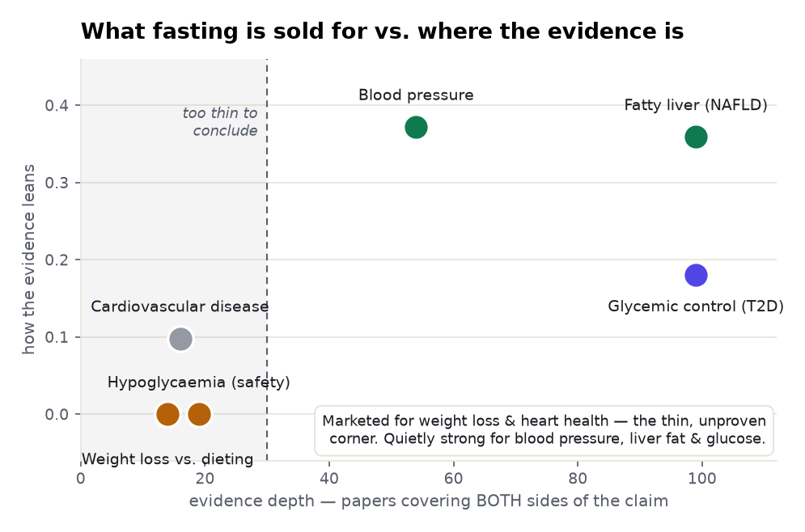
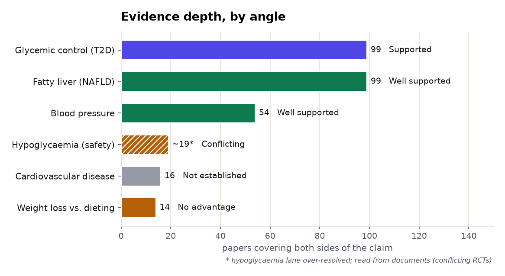
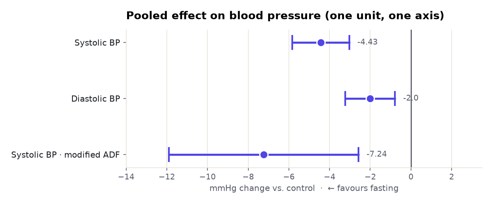
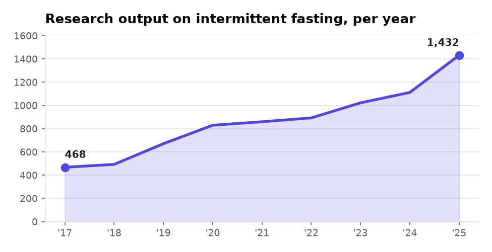

# Intermittent fasting: a six-angle meta-analysis

> What a research literature actually says when you stop asking one question and map the whole
> topic — six claims, each measured from the corpus, ranked by how the evidence leans, with the
> thin lanes called out instead of guessed. Every number is measured over Prism's
> corpora; every quoted finding is copied verbatim from the source and verified against it.

**Topic:** intermittent fasting · **Retrieved:** 2026-11-06 · **Interactive version:** <https://fliarbi.com/demo/prism-examples/intermittent-fasting/>

---

## The finding in one chart

The single most useful thing a cross-angle view surfaces is the **gap between what fasting is
promoted for and where the evidence actually is.** The two angles fasting is most *marketed*
for — rapid weight loss and heart-disease prevention — are exactly the two with the **thinnest,
least conclusive** evidence. The angles where the evidence is **deep and positive** are the
quieter metabolic ones: blood pressure, liver fat, and blood glucose.

<picture>
  <source media="(prefers-color-scheme: dark)" srcset="./assets/belief-vs-evidence-dark.png">
  
</picture>

A claim with too few papers covering **both** sides can't be read as evidence either way — Prism
says so in its `lane_note` rather than reporting a confident number. That's why cardiovascular
disease and the head-to-head vs. dieting sit in the "too thin to conclude" region, not as a verdict.

---

## Ranked by how much evidence stands behind it

<picture>
  <source media="(prefers-color-scheme: dark)" srcset="./assets/evidence-depth-dark.png">
  
</picture>

| Angle | Both-sides papers | Verdict | Prism's reading of the slice | Pooled effect (verbatim) |
|---|--:|---|---|---|
| **Blood pressure** | 54 | Well supported | *"overwhelmingly positive framing — consensus or publication bias"* | SBP −4.43, DBP −2.00 mmHg |
| **Fatty liver (NAFLD)** | 99 | Well supported | *"mostly positive, with a cautionary minority"* | steatosis −33.2 CAP dB/m, ALT −9.1 U/L |
| **Glycemic control (T2D)** | 99 | Supported | *"mostly positive, with a cautionary minority"* | HbA1c −0.08 %, fasting glucose −3.34 mg/dL |
| **Hypoglycaemia (safety)** | ~19\* | Conflicting | — | one RCT RR 2.05; another "no severe hypoglycemia" |
| **Cardiovascular disease** | 16 | Not established | *"positive framing, cautionary minority"* | surrogate markers & animal studies only |
| **Weight loss vs. dieting** | 14 | No advantage | *"mixed framing, no dominant lean"* | RCTs: "no significant difference" |

<sub>\* the hypoglycaemia claim lane over-resolved to the broad diabetes field, so it is read from the specific documents rather than charted by count.</sub>

---

## Pooled effect on blood pressure

The one place three estimates share a unit (mmHg), so they share one axis — a real forest plot.
All three favour fasting, and the confidence intervals clear zero.

<picture>
  <source media="(prefers-color-scheme: dark)" srcset="./assets/bp-forest-dark.png">
  
</picture>

Other angles are measured in different units (HbA1c %, CAP dB/m, U/L) and are **never** put on a
shared axis — each is read on its own scale in the table above.

---

## What the documents said — the spread is the point

- **Supports (fatty liver, meta-analysis):** *"IF regimens reduced steatosis scores (WMD −33.22 CAP dB/m, 95% CI −50.72 to −15.72) … as well as ALT (−9.10 U/L) … versus controls."* — Saleh et al. 2024
- **Supports (blood pressure, meta-analysis):** *"IF significantly reduced systolic blood pressure (−4.43 mmHg) and diastolic blood pressure (−2.00 mmHg)."* — Guo et al. 2025
- **Contradicts superiority (vs. dieting, RCT):** *"No significant difference between ICR and CCR regarding weight change at wk102 was observed (p = 0.63)."* — Pannen et al. 2021
- **Conflicting (safety, two RCTs):** *"Fasting increased the rate of hypoglycaemia (RR 2.05, 95% CI 1.17 to 3.52)."* — Corley 2018, **versus** *"No severe hypoglycemia occurred."* — INTERFAST-2, Obermayer 2023

---

## Direction of travel

<picture>
  <source media="(prefers-color-scheme: dark)" srcset="./assets/trend-dark.png">
  
</picture>

---

## The cross-angle insights

1. **Belief ≠ evidence.** Fasting's two most-marketed benefits — beating ordinary dieting for weight
   loss, and preventing heart disease — are the two the corpus *least* supports. Its best-evidenced
   effects are the unglamorous metabolic ones.
2. **It moves intermediates, not (yet) outcomes.** Every well-supported angle is a metabolic
   *marker* — blood pressure, liver enzymes, HbA1c, fasting glucose. The hard clinical *outcomes*
   (cardiovascular events, superiority over calorie restriction) are exactly where the lane goes
   thin. Fasting reliably shifts the dials; proof that the dials translate into events isn't in yet.
3. **Depth sets confidence.** The three supported angles each rest on ≥54 both-sides papers and
   very-high-strength meta-analyses; the three weak ones rest on ≤16, or on surrogate and animal
   studies. Prism refuses to read a verdict from a thin lane — the honest "we can't tell yet."
4. **Consistency varies.** Blood pressure is the least divided literature (≈15% contested) and the
   cleanest consensus; cardiovascular disease is the most divided (≈30%) — which, with its thin
   lane, is why it lands as *not established* rather than *null*.
5. **The one safety flag is real but unsettled.** For people on glucose-lowering medication, one RCT
   found twice the hypoglycaemia rate; others found none. The signal doesn't disappear — it depends
   on medication management, and the report says so rather than averaging it away.

---

## Reproduce it — one call per angle

Each row is one `research.evidence` call. The subject stays fixed; the *claim* is the angle.
Needs one Fliar API key.

```bash
for claim in \
  "intermittent fasting lowers blood pressure" \
  "intermittent fasting improves non-alcoholic fatty liver disease" \
  "intermittent fasting improves glycemic control in type 2 diabetes" \
  "intermittent fasting outperforms continuous calorie restriction for weight loss" \
  "intermittent fasting increases the risk of hypoglycaemia in type 2 diabetes" \
  "intermittent fasting reduces cardiovascular disease risk" ; do
  curl -s https://radar-api.fliarbi.com/prism/v1/research.evidence \
    -H "Authorization: Bearer $PRISM_KEY" -H "Content-Type: application/json" \
    -d "{\"claim\":\"$claim\"}" \
  | jq '{claim: .subject.claim,
         both_sides: .data.lane_counts.intersection,     # is the evidence even there?
         lean:       .data.corpus_stance.sides,           # supporting / qualifying / contradicting / neutral
         reading:    .data.corpus_stance.reading,         # Prism's one-line read of the slice
         verdict:    .data.tally.counts}'                 # how the read documents actually fall
done
```

Over MCP (Claude Desktop, ChatGPT connector, Cursor, n8n) the same call is a tool:
`find_evidence { "claim": "…" }`. To add an angle, add a claim; to compare two head to head in one
call, use `compare_claims { "claim_a": "…", "claim_b": "…" }`.

The charts above were generated from these responses — see [`data.json`](./data.json) for the full
retrieved payload and [`index.html`](./index.html) for the interactive version.

---

## How to read the numbers (the honesty model)

- **Lane** — a topic count and a claim count differ by orders of magnitude; a verdict is read from
  the claim lane, never from one pole. Thin lanes are reported inconclusive, not charted.
- **Window** — each corpus is counted over its own window (typed research 2017–2025, biomedical index
  1990–2025); counts across corpora are never added.
- **Coverage** — every number is computed under the coverage check; if part of the data is unavailable the answer
  says so, never a silent undercount.
- **Evidence vs. interpretation** — effect sizes are verbatim and verified; stance and "reading"
  label the corpus, not the truth of a claim.
- **Units** — only like-with-like (the blood-pressure numbers) ever share an axis.
