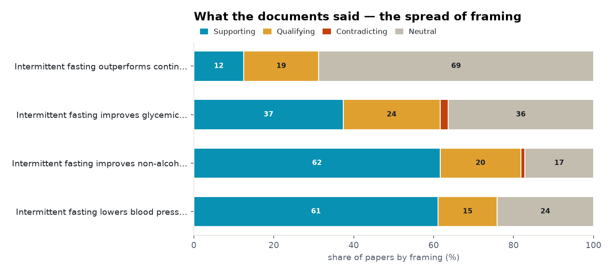
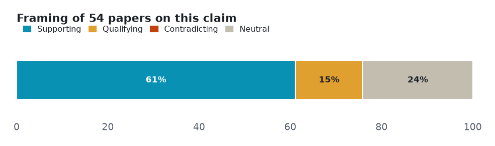
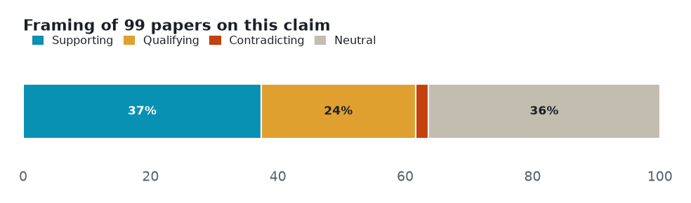
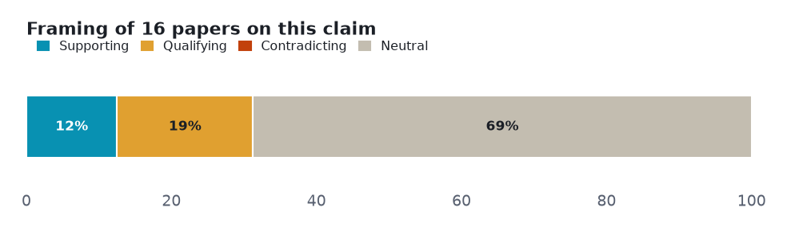
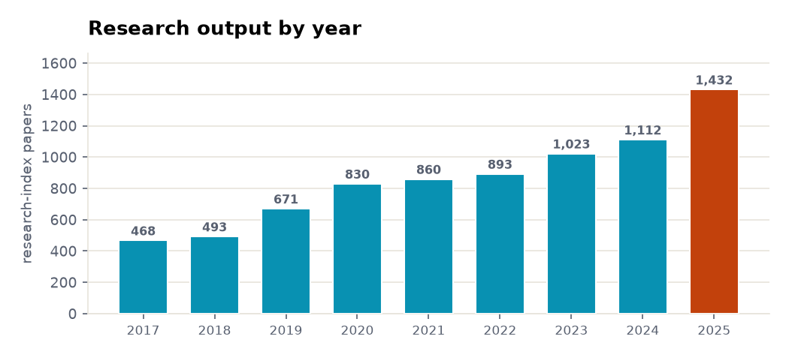
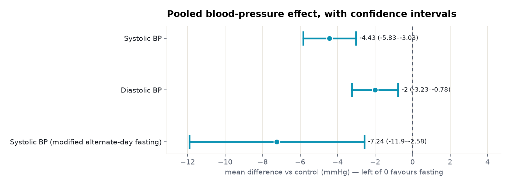
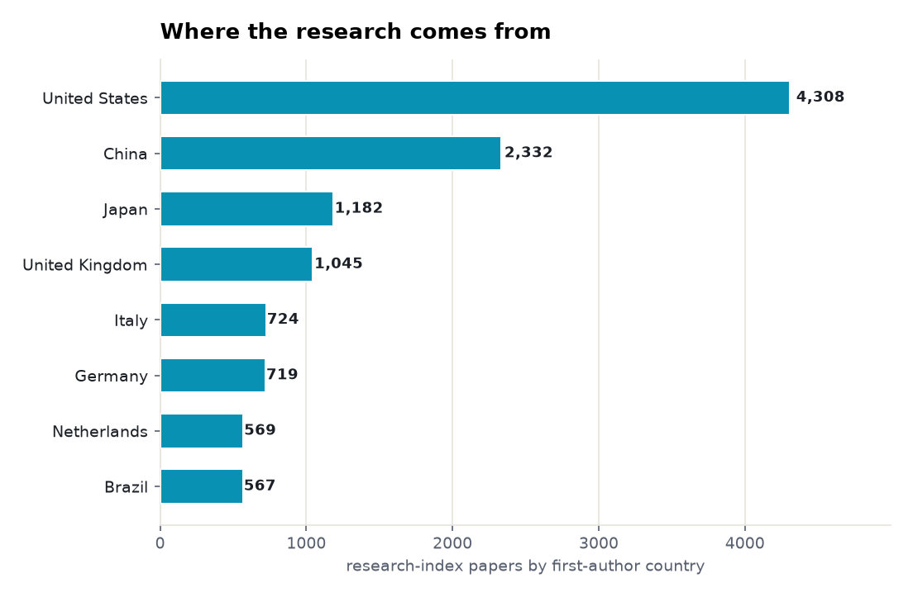

# Intermittent fasting: a six-angle meta-analysis

> Six claims about intermittent fasting tested against both sides of the published literature — 3 that the evidence settles, 2 it leaves genuinely contested, 1 with too thin a lane to call.

**▶ Interactive version** (same sections, light/dark): **<https://fliarbi.com/demo/prism-examples/intermittent-fasting-glycemic-control/>** — also committed here as [`index.html`](index.html).

Every number below is **retrieved, not generated**. Each angle is a claim run against the research layer on **both sides** — the papers that affirm it and the papers that push back — so the verdict reflects how much evidence exists and which way it leans, not a single cherry-picked study. Effect sizes are quoted verbatim and verified; thin lanes are reported as inconclusive rather than charted as fact.

| | |
|---|---|
| **Subject** | intermittent fasting |
| **Retrieved** | 2026-11-06 |
| **Coverage** | research typed 107% · research 104.2% · biomedical 100% |
| **Source** | Prism public API — research.evidence (one call per angle) + research.brief |

## How to read this

Each section is one **claim**. The bar shows how the papers *framed* it — **supporting**, **qualifying** (yes, but…), **contradicting**, or **neutral** — and the verdict weighs that spread against how deep the evidence runs. A claim can be loudly discussed yet thinly evidenced; the brief says which.

## Overview — evidence depth and framing

Two cross-cutting views before the angle-by-angle read: how much both-sides evidence each claim has, and how the literature splits on framing.

<picture><source media="(prefers-color-scheme: dark)" srcset="assets/evidence-depth-dark.png"></picture>

<picture><source media="(prefers-color-scheme: dark)" srcset="assets/stance-composition-dark.png"></picture>

## Angle 1 · Well supported — Intermittent fasting lowers blood pressure

Overwhelmingly positive framing, which on a citation-weighted corpus can mean consensus or can mean publication bias.

<picture><source media="(prefers-color-scheme: dark)" srcset="assets/angle-0-dark.png"></picture>

**Common findings**

- Of **54 papers** on both sides: 33 support · 8 qualify · 0 contradict · 13 neutral.

**Verdict:** Well supported · **both-sides papers:** 54 · **mean stance:** +0.37

## Angle 2 · Well supported — Intermittent fasting improves non-alcoholic fatty liver disease

Mostly positive framing, with a substantial cautionary minority.

<picture><source media="(prefers-color-scheme: dark)" srcset="assets/angle-1-dark.png"></picture>

**Common findings**

- Of **99 papers** on both sides: 61 support · 20 qualify · 1 contradict · 17 neutral.

**Verdict:** Well supported · **both-sides papers:** 99 · **mean stance:** +0.36

## Angle 3 · Supported — Intermittent fasting improves glycemic control in type 2 diabetes

Mostly positive framing, with a substantial cautionary minority.

<picture><source media="(prefers-color-scheme: dark)" srcset="assets/angle-2-dark.png"></picture>

**Common findings**

- Of **99 papers** on both sides: 37 support · 24 qualify · 2 contradict · 36 neutral.

**Verdict:** Supported · **both-sides papers:** 99 · **mean stance:** +0.18

## Angle 4 · No advantage — Intermittent fasting outperforms continuous calorie restriction for weight loss

Mixed framing with no dominant lean. Only 14 papers cover both sides; evidence is about the subject alone and does not establish superiority.

<picture><source media="(prefers-color-scheme: dark)" srcset="assets/angle-3-dark.png"></picture>

**Common findings**

- Of **14 papers** on both sides: 2 support · 3 qualify · 0 contradict · 11 neutral.

**Verdict:** No advantage · **both-sides papers:** 14 · **mean stance:** +0.17

## Angle 5 · Conflicting — Intermittent fasting increases the risk of hypoglycaemia in type 2 diabetes

Automated lane over-resolved to the diabetes field; read from documents. Corley 2018 RCT: RR 2.05 (1.17-3.52); INTERFAST-2 (Obermayer 2023): no severe hypoglycemia; Ramadan review: conflicting results.

> **Lane not cleanly resolved — read from the documents.** Not charted as established; the finding is reported from the individual studies.

**Common findings**

**Verdict:** Conflicting · **both-sides papers:** mixed

## Angle 6 · Not established — Intermittent fasting reduces cardiovascular disease risk

Mostly positive framing, with a substantial cautionary minority. Only 16 papers cover both sides; most matched papers are surrogate markers or animal studies.

> **Thin lane — 16 papers cover both sides.** Not charted as established; reported as the boundary of the evidence.

**Common findings**

**Verdict:** Not established · **both-sides papers:** 16 · **mean stance:** +0.10

## Research output by year

The field's own tempo: research-index papers on this subject per year, from 468 in 2017 to 1,432 in 2025.

<picture><source media="(prefers-color-scheme: dark)" srcset="assets/research-trend-dark.png"></picture>

## Pooled effects, with confidence intervals

Where the settled angles carry pooled effect sizes, here they are verbatim — point estimate and 95% confidence interval, each verified against its source.

<picture><source media="(prefers-color-scheme: dark)" srcset="assets/pooled-bp-dark.png"></picture>

**Common findings**

- **Systolic BP: -4.43 mmHg** (95% CI -5.83–-3.03) (Guo 2025, meta-analysis) — [10.1038/s41366-025-01823-4](https://doi.org/10.1038/s41366-025-01823-4)
- **Diastolic BP: -2 mmHg** (95% CI -3.23–-0.78) (Guo 2025, meta-analysis) — [10.1038/s41366-025-01823-4](https://doi.org/10.1038/s41366-025-01823-4)
- **Systolic BP (modified alternate-day fasting): -7.24 mmHg** (95% CI -11.9–-2.58) (Kibret 2025, network meta-analysis) — [10.1007/s13668-025-00684-7](https://doi.org/10.1007/s13668-025-00684-7)
- **hepatic steatosis (NAFLD): -33.22 CAP dB/m** (95% CI -50.72–-15.72) (Saleh 2024, meta-analysis) — [10.1016/j.clnesp.2023.11.009](https://doi.org/10.1016/j.clnesp.2023.11.009)
- **ALT (NAFLD): -9.1 U/L** (95% CI -12.45–-5.75) (Saleh 2024, meta-analysis) — [10.1016/j.clnesp.2023.11.009](https://doi.org/10.1016/j.clnesp.2023.11.009)
- **HbA1c (T2D): -0.08 %** (95% CI -0.13–-0.02) (Lu 2025, meta-analysis) — [10.1186/s41043-025-01039-2](https://doi.org/10.1186/s41043-025-01039-2)
- **fasting blood glucose: -3.34 mg/dL** (95% CI -6.24–-0.45) (Lu 2025, meta-analysis) — [10.1186/s41043-025-01039-2](https://doi.org/10.1186/s41043-025-01039-2)

## Where the research comes from

First-author affiliation of the research-index papers — a read on who is producing the evidence.

<picture><source media="(prefers-color-scheme: dark)" srcset="assets/geography-dark.png"></picture>

**Common findings**

- Led by **United States** (4,308), **China** (2,332), **Japan** (1,182).

## Method & limits

Counts and shares measured from the data. Effect sizes copied verbatim and verified against source. 'reading' is Prism's interpretation of the slice, not a verdict on truth. Thin claim lanes are reported inconclusive, not charted.

Each angle is one call against the research-evidence layer: the claim is posed, both sides of the literature are retrieved, and the framing tally is computed from the returned papers. Thin lanes are named, not inflated — the point of the exercise is to show where the evidence is deep, where it is contested, and where it barely exists.

---

*A Prism worked example. Charts are generated from the retrieved data; every quoted finding is verbatim and verified. [`data.json`](data.json) holds the underlying numbers.*
