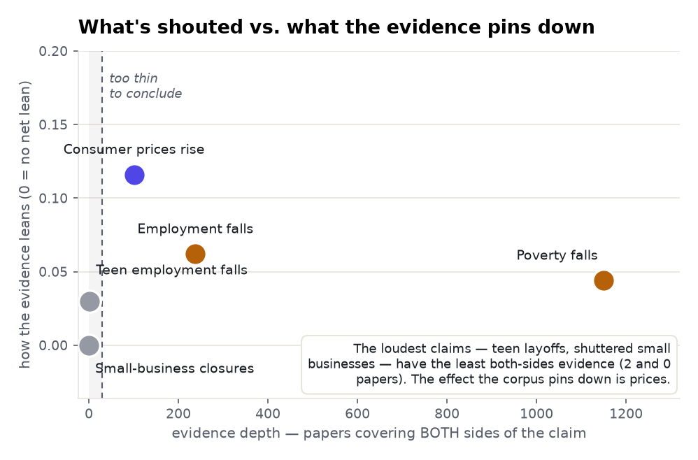

# The minimum wage: a five-angle meta-analysis

> The same method as the health examples ([fasting](../intermittent-fasting-glycemic-control/),
> [semaglutide](../semaglutide/), [CRISPR](../crispr-gene-editing/)), now on **economics** — to show
> the honesty model isn't a health trick. Five claims from the minimum-wage debate, measured from the
> corpus and ranked by how much both-sides evidence stands behind each. Every count is computed in
> ClickHouse; every quoted finding is verbatim from the source and verified against it.

**Subject:** minimum wage · **Retrieved:** 2026-11-06 · **Tool:** `find_evidence` ×5

---

## The finding in one chart

The minimum-wage debate is loud about **jobs** — teenagers priced out, small businesses shuttered.
But those are exactly the claims the research corpus can *least* substantiate: "small-business
closures" has **0** both-sides papers and "teen employment falls" has **2**, even though each draws
roughly **3,000** news mentions. The effect the corpus actually pins down is the one nobody argues
about: **prices rise.**

<picture>
  <source media="(prefers-color-scheme: dark)" srcset="./assets/belief-vs-evidence-dark.png">
  
</picture>

---

## Ranked by how much evidence stands behind it

<picture>
  <source media="(prefers-color-scheme: dark)" srcset="./assets/evidence-depth-dark.png">
  
</picture>

| Angle | Both-sides papers | Verdict | Prism's reading | Evidence (verbatim) |
|---|--:|---|---|---|
| **Consumer prices rise** | 101 | Supported | *"actively contested"* framing — but reads converge | *"near-full price pass-through of minimum wages"* (McDonald's study); supports 5/0 |
| **Employment falls** | 238 | Conflicting | *"mostly positive, cautionary minority"* | *"no evidence ... of an adverse effect on hours worked or the job destruction rate"* (Bishop 2018) |
| **Poverty falls** | 1,149 | Conflicting | *"mostly positive, cautionary minority"* | deepest lane, but qualifying (351) **>** supporting (250) — heavily hedged |
| **Teen employment falls** | 2 \* | Not established | — | NYS study: −20% teen employment; another: well-off teens *gain* — but the lane is 2 papers |
| **Small-business closures** | 0 \* | Not established | — | **zero** both-sides papers; ~2,959 news mentions |

<sub>\* thin / empty claim lanes — the connection is not established at the stated count.</sub>

---

## Where the field is actually split

Normalising each lane's stance to 100% shows why "prices" is the resolved one and "jobs" isn't. The
price claim has the **largest supporting slice** (36%) *and* the largest contradicting slice (17%) —
polarised, but with a clear plurality and, crucially, convergent high-tier reads behind it.
Employment and poverty are dominated by **neutral + qualifying** papers — the signature of a question
the field has studied exhaustively without settling.

<picture>
  <source media="(prefers-color-scheme: dark)" srcset="./assets/stance-composition-dark.png">
  
</picture>

---

## What the documents said

- **Prices — the resolved effect.** Three independent studies, one mechanism: *"restaurant prices
  rise in response to minimum wage increases"* (Aaronson 2008); *"near-full price pass-through"*
  (Ashenfelter & Jurajda, McDonald's, 2022); *"nearly all of the minimum wage increase is passed
  through to consumers"* (Allegretto & Reich 2025). When Prism read the actual documents, **5 of 5
  supported** the claim — even though the corpus-wide *framing* reads "contested."
- **Employment — the unsettled core.** The flagship read document finds *"no evidence ... of an
  adverse effect on hours worked or the job destruction rate"* (Bishop 2018) — the modern empirical
  result that broke the textbook consensus. 238 papers, lean ≈ 0: a genuine standoff.
- **Teen employment — loud, but a 2-paper lane.** The classic New York State study reports a *"20.2%
  to 21.8% reduction in the employment of less-skilled, less-educated workers, with the largest
  effects on those aged 16 to 24"* — while another finds well-off teens *gain* employment at the
  expense of poorer ones. Real findings, but the both-sides *title* lane is 2 papers: the corpus
  can't carry the weight the debate puts on this claim.
- **Small-business closures — the empty lane.** Zero papers title both "minimum wage" and
  "closures." The research that exists studies profits and adjustment margins (*"the minimum wage
  hike reduced profits ... adjusting their workforces more aggressively"*, Drucker 2019) — real
  effects, but not the mass-closure claim the slogan asserts.

---

## The cross-angle insights

1. **Volume of debate ≠ depth of evidence.** The two claims shouted loudest — teen layoffs, shuttered
   small businesses — have the **least** both-sides research (2 and 0 papers), against ~3,000 news
   mentions each. Prism puts the research lane and the news lane side by side so the gap is visible
   instead of assumed.
2. **The settled effect is the boring one.** Prices pass through — convergent, high-tier, 5/5 on the
   read. It's also the effect no campaign is built around. The corpus resolves the quiet question and
   leaves the loud ones open.
3. **"Contested framing" is not "no answer."** The price claim reads 41.6% contested at the framing
   level, yet the documents actually read converge. Prism separates how papers *frame* a claim from
   what they *find* — and here they disagree, which is the whole point of reading the documents.
4. **The mirror of the fasting example.** [Intermittent fasting](../intermittent-fasting-glycemic-control/)
   is *marketed* for the things it least supports; the minimum wage is *debated* over the things the
   corpus least covers. Same failure mode — belief outrunning evidence — in a different arena.

---

## Reproduce it — one call per angle

```bash
for claim in \
  "raising the minimum wage increases consumer prices" \
  "raising the minimum wage reduces employment" \
  "raising the minimum wage reduces poverty" \
  "raising the minimum wage reduces teenage employment" \
  "raising the minimum wage causes small business closures" ; do
  curl -s https://radar-api.fliarbi.com/prism/v1/research.evidence \
    -H "Authorization: Bearer $PRISM_KEY" -H "Content-Type: application/json" \
    -d "{\"claim\":\"$claim\"}" \
  | jq '{claim: .subject.claim,
         lane: .data.lane_counts.lane // .data.query.lane,
         both_sides: .data.lane_counts.intersection,
         lean: .data.corpus_stance.sides, reading: .data.corpus_stance.reading,
         verdict: .data.tally.counts, news: .data.volumes.news.n}'
done
```

Over MCP it's `find_evidence { "claim": "…" }`. Watch the `lane` field: when `intersection` is `null`
or small and the lane reads `subject`, the numbers describe the subject alone and **do not** establish
the claim — that's the teen-employment and small-business-closures case above. See
[`data.json`](./data.json) for the full payload. The honesty model is identical to the health
examples; only the subject changed.
