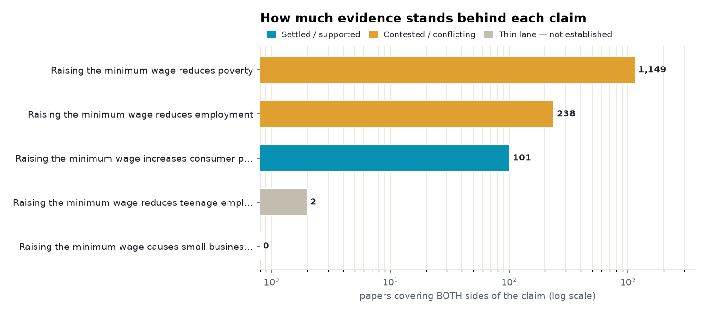
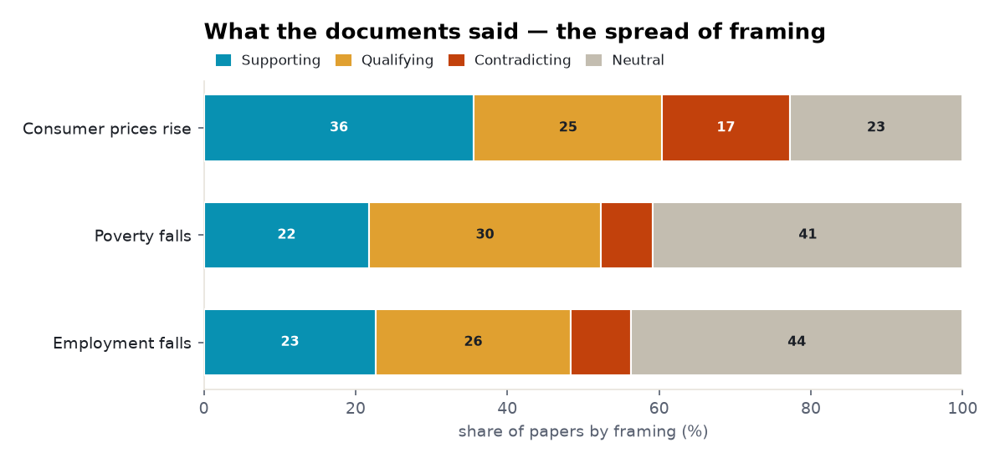
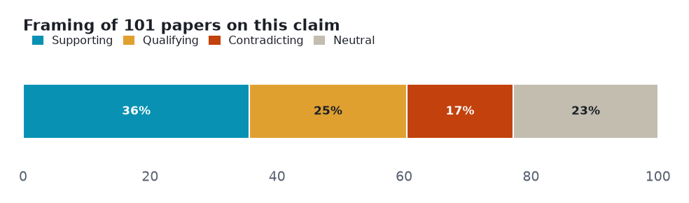
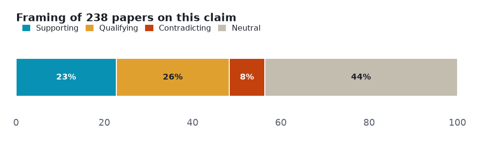
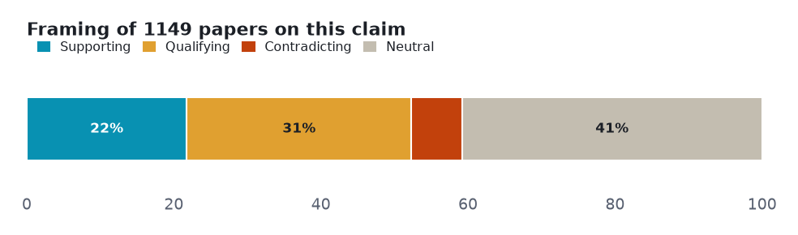

# Minimum wage (economics / labour policy): a five-angle meta-analysis

> Five claims about minimum wage tested against both sides of the published literature — 1 that the evidence settles, 2 it leaves genuinely contested, 2 with too thin a lane to call.

**▶ Interactive version** (same sections, light/dark): **<https://fliarbi.com/demo/prism-examples/minimum-wage/>** — also committed here as [`index.html`](index.html).

Every number below is **retrieved, not generated**. Each angle is a claim run against the research layer on **both sides** — the papers that affirm it and the papers that push back — so the verdict reflects how much evidence exists and which way it leans, not a single cherry-picked study. Effect sizes are quoted verbatim and verified; thin lanes are reported as inconclusive rather than charted as fact.

| | |
|---|---|
| **Subject** | minimum wage (economics / labour policy) |
| **Retrieved** | 2026-11-06 |
| **Coverage** | research typed 107% · research 104.2% |
| **Source** | Prism public API — research.evidence (one call per angle) |

## How to read this

Each section is one **claim**. The bar shows how the papers *framed* it — **supporting**, **qualifying** (yes, but…), **contradicting**, or **neutral** — and the verdict weighs that spread against how deep the evidence runs. A claim can be loudly discussed yet thinly evidenced; the brief says which.

## Overview — evidence depth and framing

Two cross-cutting views before the angle-by-angle read: how much both-sides evidence each claim has, and how the literature splits on framing.

<picture><source media="(prefers-color-scheme: dark)" srcset="assets/evidence-depth-dark.png"></picture>

<picture><source media="(prefers-color-scheme: dark)" srcset="assets/stance-composition-dark.png"></picture>

## Angle 1 · Supported — Raising the minimum wage increases consumer prices

The literature on this is actively contested — a large share of papers frame it as a problem, a caution or a criticism. Framing is contested, but the high-tier documents actually read converge on yes — near-full price pass-through.

<picture><source media="(prefers-color-scheme: dark)" srcset="assets/angle-0-dark.png"></picture>

**Common findings**

- Of **101 papers** on both sides: 36 support · 25 qualify · 17 contradict · 23 neutral.
- "we show that restaurant prices rise in response to minimum wage increases" (Aaronson, J. Human Resources 2008)
- "near-full price pass-through of minimum wages" (Ashenfelter & Jurajda, McDonald's, J. Labor Econ 2022)
- "nearly all of the minimum wage increase is passed through to consumers" (Allegretto & Reich 2025)

**Verdict:** Supported · **both-sides papers:** 101 · **mean stance:** +0.12 · **contested:** 41.6%

## Angle 2 · Conflicting — Raising the minimum wage reduces employment

Mostly positive framing, with a substantial cautionary minority. The textbook claim — well studied, genuinely unsettled, lean near zero; the read document found no adverse effect.

<picture><source media="(prefers-color-scheme: dark)" srcset="assets/angle-1-dark.png"></picture>

**Common findings**

- Of **238 papers** on both sides: 54 support · 61 qualify · 19 contradict · 104 neutral.
- "I find no evidence that these small, incremental increases ... have an adverse effect on hours worked or the job destruction rate" (Bishop 2018)

**Verdict:** Conflicting · **both-sides papers:** 238 · **mean stance:** +0.06 · **contested:** 33.6%

## Angle 3 · Conflicting — Raising the minimum wage reduces poverty

Mostly positive framing, with a substantial cautionary minority. The deepest lane, but qualifying papers (351) outnumber supporting (250) — heavily hedged, no net lean.

<picture><source media="(prefers-color-scheme: dark)" srcset="assets/angle-2-dark.png"></picture>

**Common findings**

- Of **1,149 papers** on both sides: 250 support · 351 qualify · 79 contradict · 469 neutral.

**Verdict:** Conflicting · **both-sides papers:** 1,149 · **mean stance:** +0.04 · **contested:** 37.4%

## Angle 4 · Not established — Raising the minimum wage reduces teenage employment

Only 2 papers cover both sides; the famous NYS study finds a −20% teen-employment effect, another finds well-off teens gain at the expense of poorer ones — but the both-sides title lane is almost empty.

> **Thin lane — 2 papers cover both sides.** Not charted as established; reported as the boundary of the evidence.

**Common findings**

- Discussed far more than it is studied — ~**3,009 news mentions** against this thin research lane.

**Verdict:** Not established · **both-sides papers:** 2

## Angle 5 · Not established — Raising the minimum wage causes small business closures

Zero papers cover both sides of this claim (the phrase 'small business closures' appears in one title) — the alarm has essentially no direct research lane, against ~2,959 news mentions.

> **Thin lane — 0 papers cover both sides.** Not charted as established; reported as the boundary of the evidence.

**Common findings**

- Discussed far more than it is studied — ~**2,959 news mentions** against this thin research lane.

**Verdict:** Not established · **both-sides papers:** 0

## Method & limits

Counts and shares measured from the data. Quoted findings verbatim and verified. Two angles fell to the subject lane (0 and 2 both-sides papers) and are reported that way, not charted as established.

Each angle is one call against the research-evidence layer: the claim is posed, both sides of the literature are retrieved, and the framing tally is computed from the returned papers. Thin lanes are named, not inflated — the point of the exercise is to show where the evidence is deep, where it is contested, and where it barely exists.

---

*A Prism worked example. Charts are generated from the retrieved data; every quoted finding is verbatim and verified. [`data.json`](data.json) holds the underlying numbers.*
