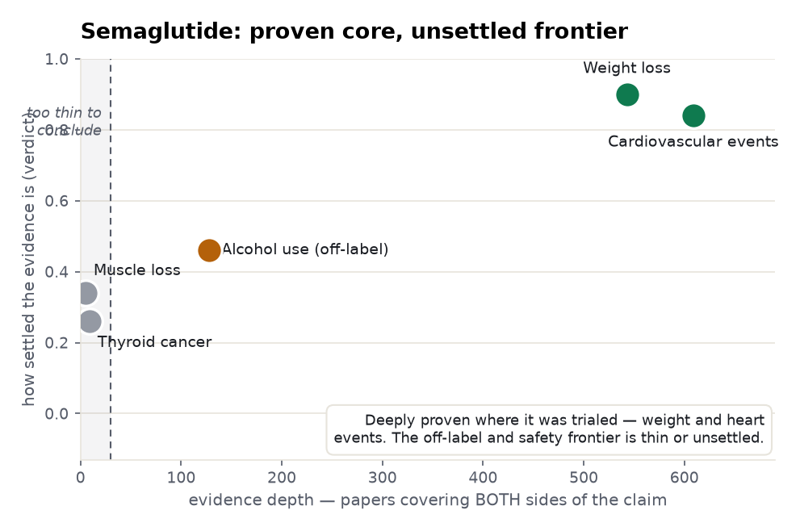
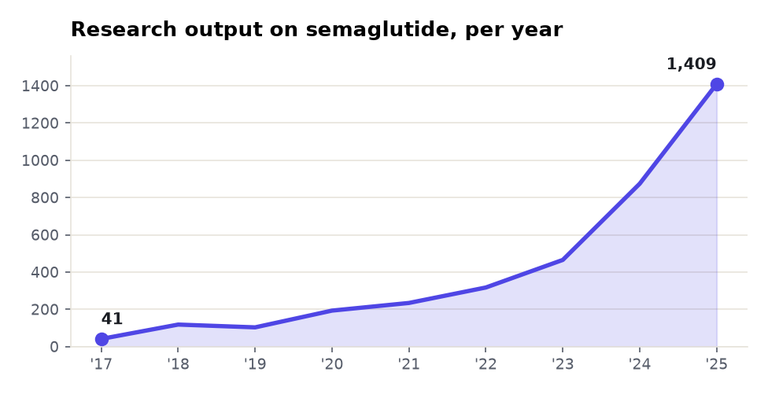

# Semaglutide: a five-angle meta-analysis

> The same method as the [intermittent-fasting example](../intermittent-fasting-glycemic-control/),
> on a very different subject — a blockbuster drug. Five claims measured from the corpus, ranked by
> how the evidence leans and how much stands behind it. Every number is computed in ClickHouse over
> Prism's corpora; every quoted finding is verbatim from the source and verified against it.

**Subject:** semaglutide (Ozempic / Wegovy) · **Retrieved:** 2026-11-06

---

## The finding in one chart

Semaglutide is the mirror image of the fasting story. Where fasting is *marketed beyond its
evidence*, semaglutide's **core is rigorously proven** — the two uses with billion-dollar RCT
programmes (weight loss, cardiovascular events) are deep and robustly positive. The gap is on the
**frontier**: the buzzy off-label use (alcohol) and the two safety questions (muscle, thyroid) are
thin or unsettled.

<picture>
  <source media="(prefers-color-scheme: dark)" srcset="./assets/belief-vs-evidence-dark.png">
  
</picture>

---

## Ranked by how much evidence stands behind it

<picture>
  <source media="(prefers-color-scheme: dark)" srcset="./assets/evidence-depth-dark.png">
  
</picture>

| Angle | Both-sides papers | Verdict | Prism's reading | Evidence (verbatim) |
|---|--:|---|---|---|
| **Weight loss** | 543 | Well supported | *"mostly positive, cautionary minority"* | −13.2% vs −3.9% (STEP UP T2D); −14.3% vs −1.3% (OASIS 2) |
| **Cardiovascular events (MACE)** | 609 | Well supported | *"mixed framing, no dominant lean"* | MACE **RR 0.81** (0.74–0.88); SELECT trial, 17,604 patients |
| **Alcohol use (off-label)** | 128 | Conflicting | *"mostly positive, cautionary minority"* | one RCT β −0.48; but pooled RCTs **non-significant** (SMD −0.24, CI −0.70 to 0.23) |
| **Thyroid cancer** | 9\* | Not established | — | semaglutide incidence <1% ("no significant risk"); a **class** signal (OR 1.55) |
| **Muscle loss** | 5\* | Not established | — | early sarcopenia signal in two small studies; under-studied |

<sub>\* thin claim lanes — read from the specific documents / the subject lane, not charted by count.</sub>

---

## The cardiovascular benefit — a real forest plot

Four independent risk-ratio estimates (RRs and HRs), all on one ratio scale, all favouring
semaglutide, all clearing 1.0. This is the kind of convergent, high-tier evidence that marks a
*proven* claim — and why the MACE angle sits top-right in the map.

<picture>
  <source media="(prefers-color-scheme: dark)" srcset="./assets/forest-dark.png">
  
</picture>

---

## What the documents said — the spread

- **Weight loss (phase-3 RCT):** *"semaglutide 7·2 mg led to greater reductions in mean bodyweight (−13·2% vs −3·9% … p<0·0001)."* — STEP UP T2D, Lingvay 2025
- **Cardiovascular (landmark RCT):** *"Semaglutide significantly reduced MACE incidence compared with placebo among 17,604 patients enrolled in SELECT."* — Deanfield 2025
- **Alcohol — the hype/proof gap:** *"Low-dose semaglutide reduced the amount of alcohol consumed … (β −0.48)."* (Hendershot 2025, phase-2 RCT) **versus** *"RCTs showed non-significant reductions in alcohol consumption (SMD −0.24, 95% CI −0.70 to 0.23)."* (Sinha & Ghosal 2025, meta-analysis)
- **Thyroid safety — reassuring but class-flagged:** *"The incidence of thyroid cancer in semaglutide-treated patients was less than 1%, suggesting no significant risk."* (Feier 2024) — while a class-wide meta-analysis found *"an increase in the risk for thyroid cancer (MH-OR 1.55)."*

---

## Direction of travel

Among the fastest-growing drug literatures in the corpus: **34× in eight years.**

<picture>
  <source media="(prefers-color-scheme: dark)" srcset="./assets/trend-dark.png">
  
</picture>

---

## The cross-angle insights

1. **Evidence follows investment.** The two uses with large, funded RCT programmes — weight (STEP)
   and cardiovascular events (SELECT) — are exactly the deep, well-supported angles. Proof concentrates
   where trials were run.
2. **Off-label hype outruns proof.** Alcohol use has real research interest (128 both-sides papers) and
   a promising phase-2 signal, but the *pooled* RCT result is non-significant. Enthusiasm is ahead of
   the evidence — the opposite failure mode from a thin lane.
3. **Safety questions are under-studied, not disproven.** Muscle loss (5 papers) and thyroid cancer (9)
   land as "not established" — but partly because few studies target them head-on. The thyroid warning
   rests on rodent and whole-class data; semaglutide-specific human evidence is thin and mostly
   reassuring. Absence of evidence is not evidence of absence, and the report says which it is.
4. **Mirror image of fasting.** In the [fasting example](../intermittent-fasting-glycemic-control/),
   the gap was in the *foundation* — it's marketed for things the corpus least supports. Here the
   foundation is solid; the gap is at the *frontier*.

---

## Reproduce it — one call per angle

```bash
for claim in \
  "semaglutide produces significant weight loss in adults with obesity" \
  "semaglutide reduces major adverse cardiovascular events" \
  "semaglutide reduces alcohol consumption" \
  "semaglutide causes loss of lean muscle mass" \
  "semaglutide increases the risk of thyroid cancer" ; do
  curl -s https://radar-api.fliarbi.com/prism/v1/research.evidence \
    -H "Authorization: Bearer $PRISM_KEY" -H "Content-Type: application/json" \
    -d "{\"claim\":\"$claim\"}" \
  | jq '{claim: .subject.claim, both_sides: .data.lane_counts.intersection,
         lean: .data.corpus_stance.sides, reading: .data.corpus_stance.reading,
         verdict: .data.tally.counts}'
done
```

Over MCP it's `find_evidence { "claim": "…" }`. Charts generated from these responses; see
[`data.json`](./data.json) for the full retrieved payload. The honesty model (lane, window,
coverage, evidence-vs-interpretation, units) is the same as the fasting example.
