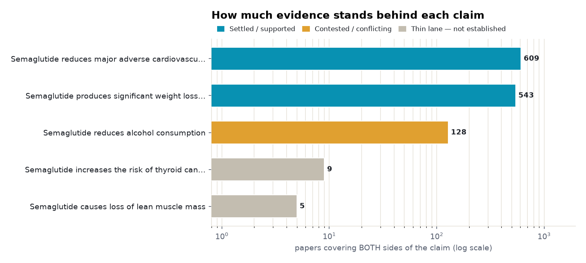
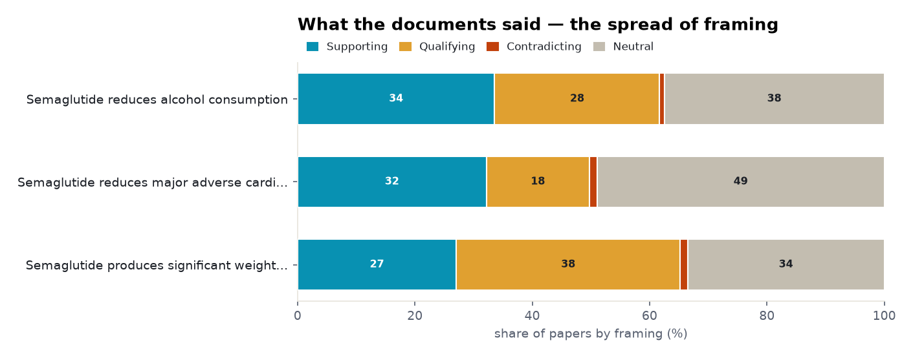
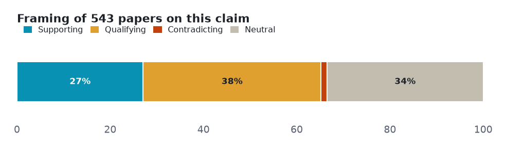
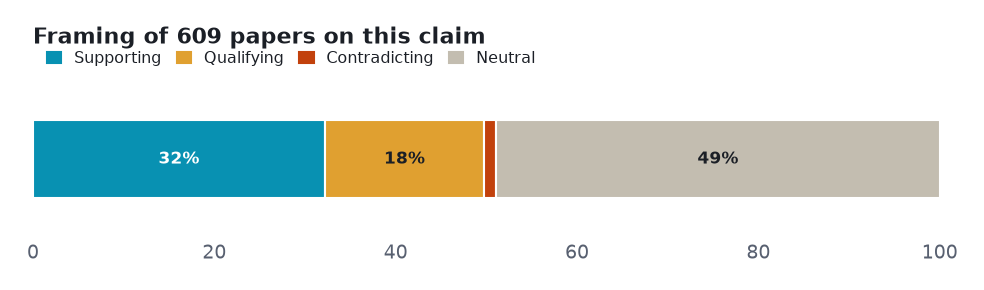
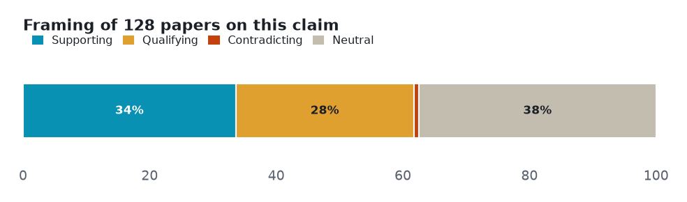
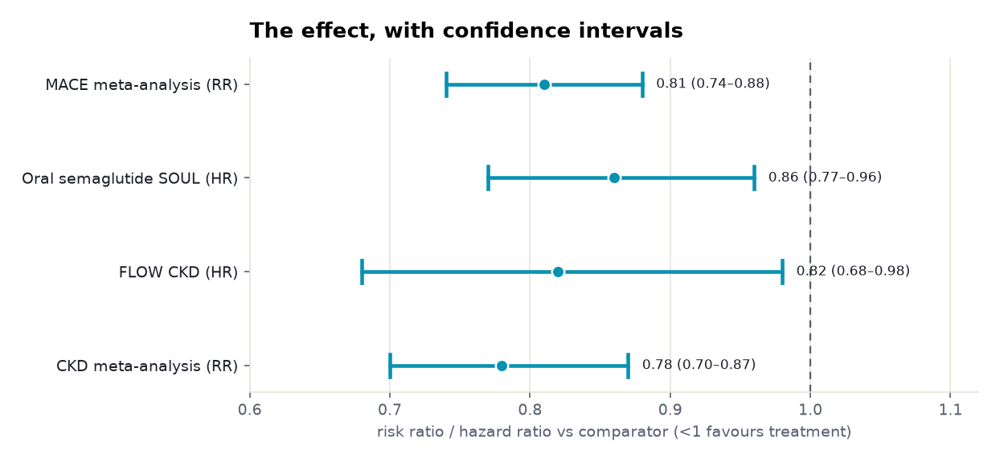
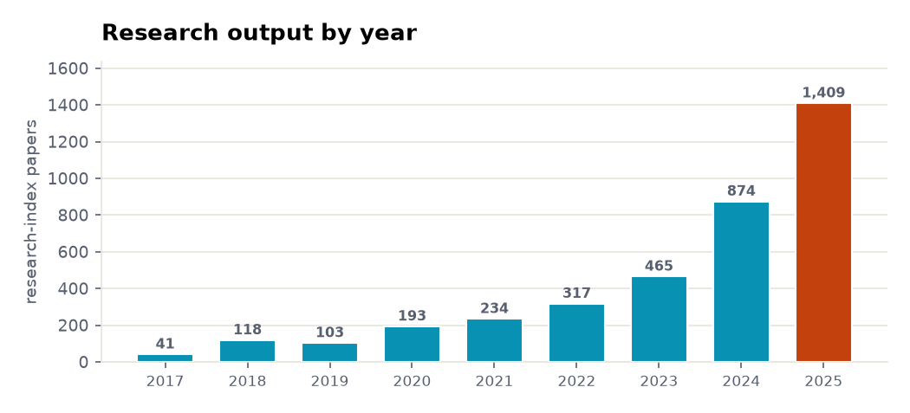

# Semaglutide (Ozempic / Wegovy): a five-angle meta-analysis

> Five claims about semaglutide tested against both sides of the published literature — 2 that the evidence settles, 1 it leaves genuinely contested, 2 with too thin a lane to call.

**▶ Interactive version** (same sections, light/dark): **<https://fliarbi.com/demo/prism-examples/semaglutide/>** — also committed here as [`index.html`](index.html).

Every number below is **retrieved, not generated**. Each angle is a claim run against the research layer on **both sides** — the papers that affirm it and the papers that push back — so the verdict reflects how much evidence exists and which way it leans, not a single cherry-picked study. Effect sizes are quoted verbatim and verified; thin lanes are reported as inconclusive rather than charted as fact.

| | |
|---|---|
| **Subject** | semaglutide (Ozempic / Wegovy) |
| **Retrieved** | 2026-11-06 |
| **Coverage** | research typed 107% · research 104.2% · biomedical 100% |
| **Source** | Prism public API — research.evidence (one call per angle) |

## How to read this

Each section is one **claim**. The bar shows how the papers *framed* it — **supporting**, **qualifying** (yes, but…), **contradicting**, or **neutral** — and the verdict weighs that spread against how deep the evidence runs. A claim can be loudly discussed yet thinly evidenced; the brief says which.

## Overview — evidence depth and framing

Two cross-cutting views before the angle-by-angle read: how much both-sides evidence each claim has, and how the literature splits on framing.

<picture><source media="(prefers-color-scheme: dark)" srcset="assets/evidence-depth-dark.png"></picture>

<picture><source media="(prefers-color-scheme: dark)" srcset="assets/stance-composition-dark.png"></picture>

## Angle 1 · Well supported — Semaglutide produces significant weight loss in adults with obesity

Mostly positive framing, with a substantial cautionary minority.

<picture><source media="(prefers-color-scheme: dark)" srcset="assets/angle-0-dark.png"></picture>

**Common findings**

- Of **543 papers** on both sides: 147 support · 207 qualify · 7 contradict · 182 neutral.
- **-13.2% vs -3.9% body weight (STEP UP T2D)**
- **-14.3% vs -1.3% (OASIS 2)**
- **-11.71 kg (umbrella review)**

**Verdict:** Well supported · **both-sides papers:** 543 · **mean stance:** +0.07

## Angle 2 · Well supported — Semaglutide reduces major adverse cardiovascular events

Mixed framing with no dominant lean.

<picture><source media="(prefers-color-scheme: dark)" srcset="assets/angle-1-dark.png"></picture>

**Common findings**

- Of **609 papers** on both sides: 196 support · 107 qualify · 8 contradict · 298 neutral.
- **MACE RR 0.81 (0.74-0.88)**
- **SELECT trial 17,604 pts**
- **SOUL HR 0.86**
- **FLOW HR 0.82**

**Verdict:** Well supported · **both-sides papers:** 609 · **mean stance:** +0.19

## Angle 3 · Conflicting / emerging — Semaglutide reduces alcohol consumption

Mostly positive framing, with a substantial cautionary minority. Phase-2 RCT positive (beta -0.48) but pooled RCTs non-significant (SMD -0.24, CI -0.70, 0.23).

<picture><source media="(prefers-color-scheme: dark)" srcset="assets/angle-2-dark.png"></picture>

**Common findings**

- Of **128 papers** on both sides: 43 support · 36 qualify · 1 contradict · 48 neutral.

**Verdict:** Conflicting / emerging · **both-sides papers:** 128 · **mean stance:** +0.15

## Angle 4 · Not established — Semaglutide increases the risk of thyroid cancer

Only 9 papers cover both sides; semaglutide-specific data reassuring (<1% incidence); a class-level signal exists (OR 1.55, HR 1.58 for GLP-1 RAs).

> **Thin lane — 9 papers cover both sides.** Not charted as established; reported as the boundary of the evidence.

**Common findings**

**Verdict:** Not established · **both-sides papers:** 9

## Angle 5 · Not established — Semaglutide causes loss of lean muscle mass

Only 5 papers cover both sides; early sarcopenia signal in a pilot and a retrospective cohort; under-studied at the claim level.

> **Thin lane — 5 papers cover both sides.** Not charted as established; reported as the boundary of the evidence.

**Common findings**

**Verdict:** Not established · **both-sides papers:** 5

## The effect, with confidence intervals

Where the settled angles carry pooled effect sizes, here they are as a real forest plot — point estimate and 95% confidence interval, each verified against its source.

<picture><source media="(prefers-color-scheme: dark)" srcset="assets/forest-dark.png"></picture>

**Common findings**

- **MACE meta-analysis (RR): 0.81** (95% CI 0.74–0.88) (Sadraei 2025) — [10.1186/s12872-025-05278-3](https://doi.org/10.1186/s12872-025-05278-3)
- **Oral semaglutide SOUL (HR): 0.86** (95% CI 0.77–0.96) (Marx 2025) — [10.1161/CIRCULATIONAHA.125.074545](https://doi.org/10.1161/CIRCULATIONAHA.125.074545)
- **FLOW CKD (HR): 0.82** (95% CI 0.68–0.98) (Mahaffey 2025) — [10.1093/eurheartj/ehae613](https://doi.org/10.1093/eurheartj/ehae613)
- **CKD meta-analysis (RR): 0.78** (95% CI 0.70–0.87) (Abdullah 2025) — [10.1002/edm2.70136](https://doi.org/10.1002/edm2.70136)

## Research output by year

The field's own tempo: research-index papers on this subject per year, from 41 in 2017 to 1,409 in 2025.

<picture><source media="(prefers-color-scheme: dark)" srcset="assets/research-trend-dark.png"></picture>

## Method & limits

Counts and shares measured from the data. Effect sizes verbatim and verified. Thin lanes reported inconclusive, not charted.

Each angle is one call against the research-evidence layer: the claim is posed, both sides of the literature are retrieved, and the framing tally is computed from the returned papers. Thin lanes are named, not inflated — the point of the exercise is to show where the evidence is deep, where it is contested, and where it barely exists.

---

*A Prism worked example. Charts are generated from the retrieved data; every quoted finding is verbatim and verified. [`data.json`](data.json) holds the underlying numbers.*
