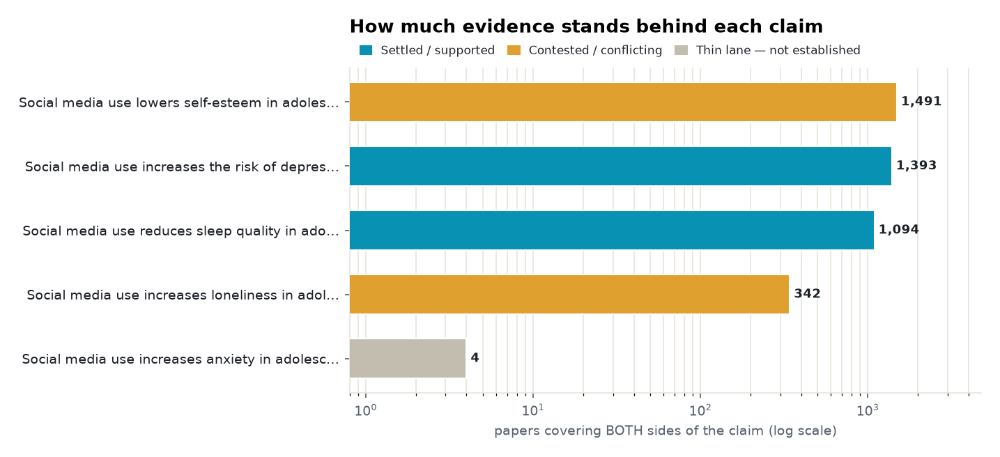
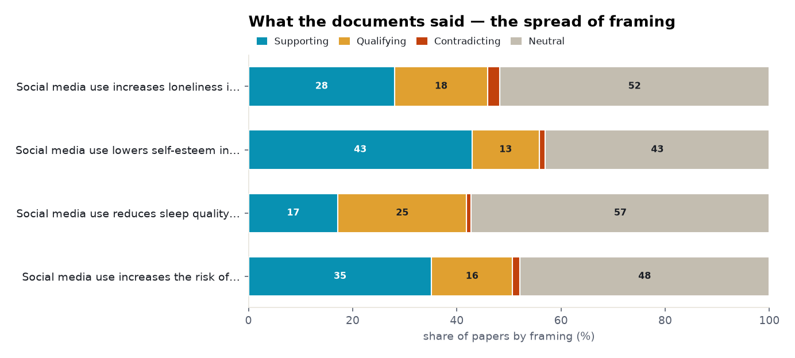
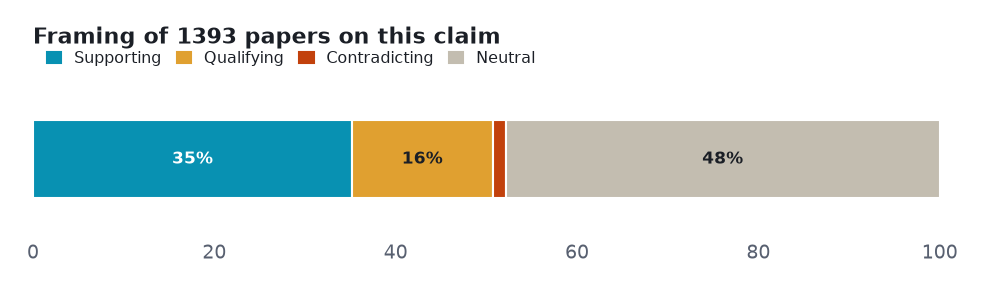
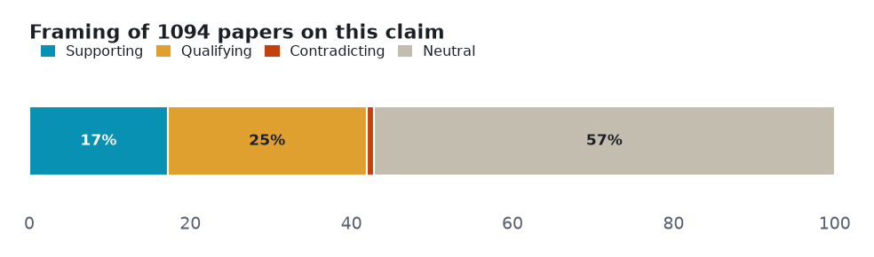
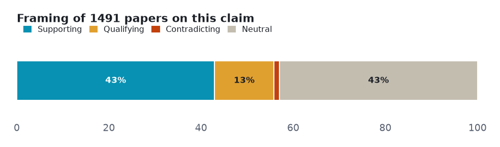
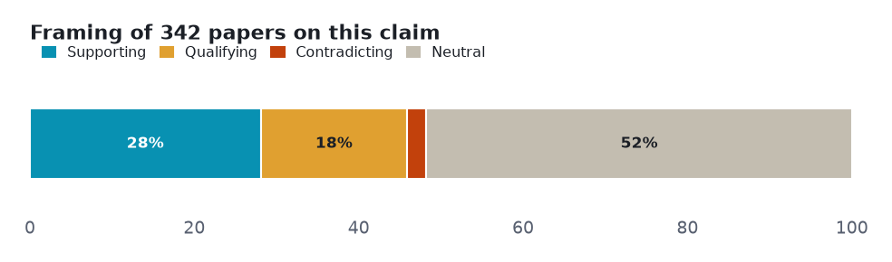

# Social media and adolescent mental health: a five-angle meta-analysis

> Five mental-health claims about adolescents and social media, each tested against both sides of the literature: the clearest signals are small (depression) or specific (night-time sleep), two outcomes are genuinely inconsistent, and the anxiety claim barely has a both-sides research lane at all — the headline outruns the evidence.

**▶ Interactive version** (same sections, light/dark): **<https://fliarbi.com/demo/prism-examples/social-media-adolescent-mental-health/>** — also committed here as [`index.html`](index.html).

Every number below is **retrieved, not generated**. Each angle is a claim run against the research layer on **both sides** — the papers that affirm it and the papers that push back — so the verdict reflects how much evidence exists and which way it leans, not a single cherry-picked study. Effect sizes are quoted verbatim and verified; thin lanes are reported as inconclusive rather than charted as fact.

| | |
|---|---|
| **Subject** | social media and adolescent mental health |
| **Retrieved** | 2026-11-07 |
| **Coverage** | research typed 107% · research 104.2% |
| **Source** | Prism public API — research.evidence (one call per angle) |

## How to read this

Each section is one **claim**. The bar shows how the papers *framed* it — **supporting**, **qualifying** (yes, but…), **contradicting**, or **neutral** — and the verdict weighs that spread against how deep the evidence runs. A claim can be loudly discussed yet thinly evidenced; the brief says which.

## Overview — evidence depth and framing

Two cross-cutting views before the angle-by-angle read: how much both-sides evidence each claim has, and how the literature splits on framing.

<picture><source media="(prefers-color-scheme: dark)" srcset="assets/evidence-depth-dark.png"></picture>

<picture><source media="(prefers-color-scheme: dark)" srcset="assets/stance-composition-dark.png"></picture>

## Angle 1 · Supported — Social media use increases the risk of depression in adolescents

Mixed framing with no dominant lean, but the pooled evidence points one way. The signal is real but small — the headline meta-analysis finds a correlation of r = 0.11; a longitudinal study adds the nuance that it is appearance-focused use, not raw time on social media, that tracks depressive symptoms.

<picture><source media="(prefers-color-scheme: dark)" srcset="assets/angle-0-dark.png"></picture>

**Common findings**

- Of **1,393 papers** on both sides: 490 support · 216 qualify · 20 contradict · 667 neutral.
- "we found a small but significant positive correlation (k = 12 studies, r = .11, p < .01) between adolescent social media use and depressive symptoms" (Ivie 2020, meta-analysis)
- "appearance-related social-media consciousness was associated longitudinally with increased depressive symptoms, though it did not mediate or moderate the link between time on social media and depressive symptoms in the full sample" (Maheux 2020, longitudinal)

**Verdict:** Supported · **both-sides papers:** 1,393 · **mean stance:** +0.17 · **contested:** 16.9%

## Angle 2 · Supported — Social media use reduces sleep quality in adolescents

Mostly positive framing, with a substantial cautionary minority — and qualifying papers outnumber plain supporting ones. The most consistent of the five, but specific: the landmark study ties poorer sleep to night-time and emotionally-invested use rather than total screen time; qualifying papers (270) outnumber supporting ones (188).

<picture><source media="(prefers-color-scheme: dark)" srcset="assets/angle-1-dark.png"></picture>

**Common findings**

- Of **1,094 papers** on both sides: 188 support · 270 qualify · 10 contradict · 626 neutral.
- "adolescents who used social media more — both overall and at night — and those who were more emotionally invested in social media experienced poorer sleep quality" (Woods & Scott 2016, #Sleepyteens, cited 1,235)
- "digital media use was associated to shorter sleep duration and poorer sleep quality" (Brautsch 2022, systematic review, cited 171)

**Verdict:** Supported · **both-sides papers:** 1,094 · **mean stance:** +0.04 · **contested:** 25.6%

## Angle 3 · Conflicting — Social media use lowers self-esteem in adolescents

The framing leans negative, but the read documents could not confirm a specific self-esteem effect. The deepest lane (1,491 papers) and the one that most openly admits uncertainty — a scoping review calls the wellbeing findings 'inconsistent, inconclusive and contradictory', so the brief files it as conflicting despite a negative framing lean.

<picture><source media="(prefers-color-scheme: dark)" srcset="assets/angle-2-dark.png"></picture>

**Common findings**

- Of **1,491 papers** on both sides: 640 support · 192 qualify · 18 contradict · 641 neutral.
- "research examining adolescent social media use and wellbeing is confusing as findings are inconsistent, inconclusive and contradictory" (West 2024, systematic scoping review, cited 43)

**Verdict:** Conflicting · **both-sides papers:** 1,491 · **mean stance:** +0.23 · **contested:** 14.1%

## Angle 4 · Conflicting — Social media use increases loneliness in adolescents

Genuinely bidirectional — the same tool can deepen or relieve loneliness. The evidence points both ways: cross-sectional work suggests social media can exacerbate appearance anxiety and loneliness, while a lockdown study found it used as a constructive coping strategy against isolation.

<picture><source media="(prefers-color-scheme: dark)" srcset="assets/angle-3-dark.png"></picture>

**Common findings**

- Of **342 papers** on both sides: 96 support · 61 qualify · 8 contradict · 177 neutral.
- "[cross-sectional] social media use may exacerbate appearance anxiety and, hence, loneliness" (Papapanou 2023, cited 62)
- "social media can be used as a constructive coping strategy for adolescents to deal with anxious feelings" (Cauberghe 2020, COVID-19 lockdown, cited 554)

**Verdict:** Conflicting · **both-sides papers:** 342 · **mean stance:** +0.12 · **contested:** 20.2%

## Angle 5 · Not established — Social media use increases anxiety in adolescents

Only 4 papers cover both sides of this claim at the title level — the 104,148-paper 'both sides' figure is really the subject lane (social-media research in general), which does not establish the connection the claim asserts. The nearest pooled estimate comes from short-form-video research and includes adults.

> **Thin lane — 4 papers cover both sides.** Not charted as established; reported as the boundary of the evidence.

**Common findings**

- for context (not the claim lane): "increased short-form-video use was associated with poorer mental health (r = -.21), with stress (r = -.34) and anxiety (r = -.33) showing the strongest associations" (Nguyen 2025, meta-analysis — includes adults, correlational)
- Discussed far more than it is studied — ~**138 news mentions** against this thin research lane.

**Verdict:** Not established · **both-sides papers:** 4

## Method & limits

Counts and shares measured from the data. Quoted findings verbatim and verified. Effect sizes here are correlations and associations, not pooled risk ratios, and are reported as-is. Where a claim's both-sides title lane is thin — anxiety resolves to just 4 papers — it is reported as not established, rather than inferred from the much larger subject lane of social-media research in general.

Each angle is one call against the research-evidence layer: the claim is posed, both sides of the literature are retrieved, and the framing tally is computed from the returned papers. Thin lanes are named, not inflated — the point of the exercise is to show where the evidence is deep, where it is contested, and where it barely exists.

---

*A Prism worked example. Charts are generated from the retrieved data; every quoted finding is verbatim and verified. [`data.json`](data.json) holds the underlying numbers.*
