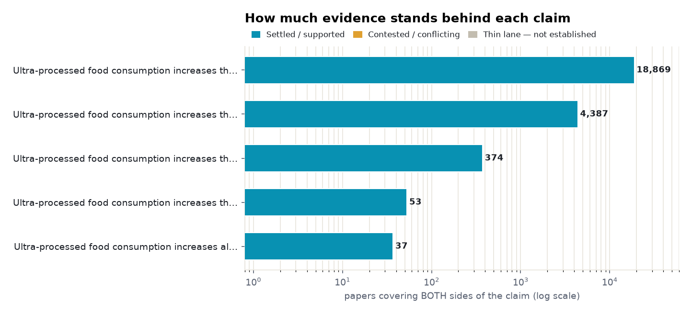
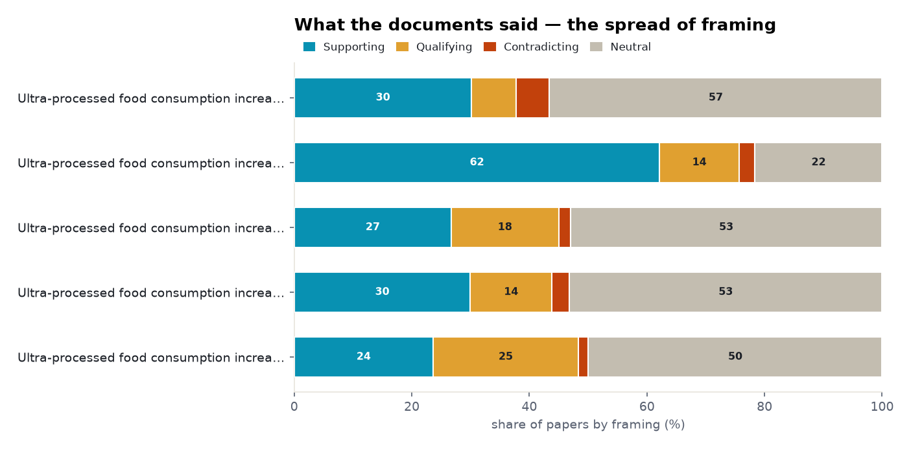
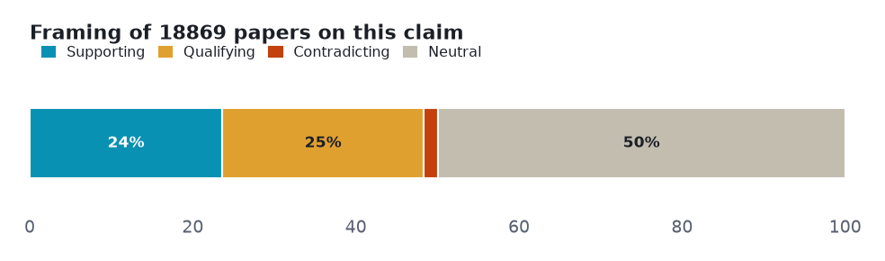
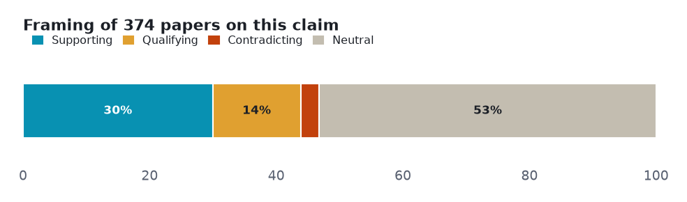
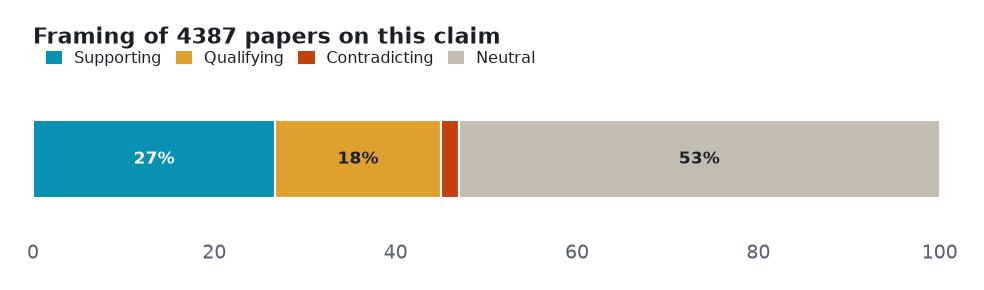
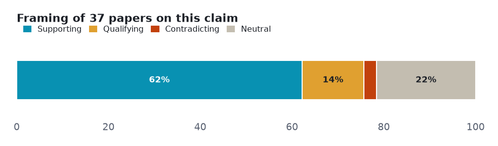
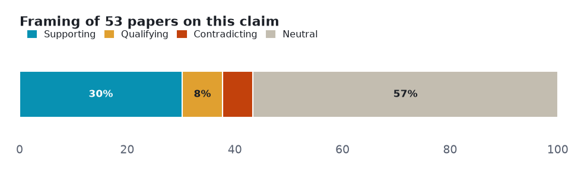
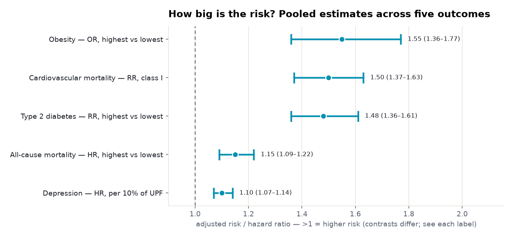
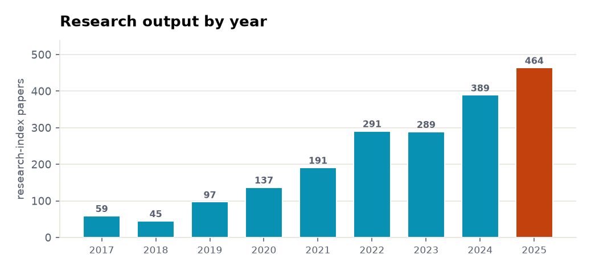
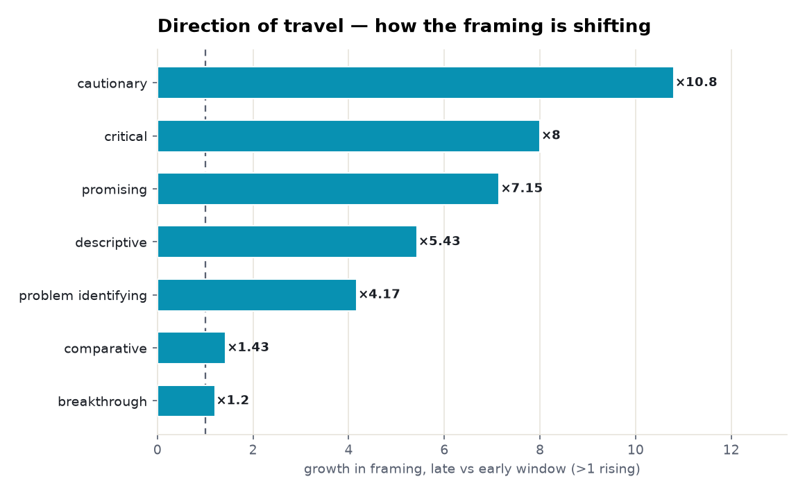

# Ultra-processed foods and health: a five-angle meta-analysis

> Five health outcomes, one direction of travel: ultra-processed food shows a consistent association with harm — strongest for obesity, diabetes and heart disease — but every lane is observational, and causation is the open question.

**▶ Interactive version** (same sections, light/dark): **<https://fliarbi.com/demo/prism-examples/ultra-processed-foods/>** — also committed here as [`index.html`](index.html).

Every number below is **retrieved, not generated**. Each angle is a claim run against the research layer on **both sides** — the papers that affirm it and the papers that push back — so the verdict reflects how much evidence exists and which way it leans, not a single cherry-picked study. Effect sizes are quoted verbatim and verified; thin lanes are reported as inconclusive rather than charted as fact.

| | |
|---|---|
| **Subject** | ultra-processed foods and health |
| **Retrieved** | 2026-11-07 |
| **Coverage** | research typed 107% · research 104.2% · biomedical 100% |
| **Source** | Prism public API — research.evidence (one call per angle) |

## How to read this

Each section is one **claim**. The bar shows how the papers *framed* it — **supporting**, **qualifying** (yes, but…), **contradicting**, or **neutral** — and the verdict weighs that spread against how deep the evidence runs. A claim can be loudly discussed yet thinly evidenced; the brief says which.

## Overview — evidence depth and framing

Two cross-cutting views before the angle-by-angle read: how much both-sides evidence each claim has, and how the literature splits on framing.

<picture><source media="(prefers-color-scheme: dark)" srcset="assets/evidence-depth-dark.png"></picture>

<picture><source media="(prefers-color-scheme: dark)" srcset="assets/stance-composition-dark.png"></picture>

## Angle 1 · Well supported — Ultra-processed food consumption increases the risk of obesity

Mostly positive framing, with a substantial cautionary minority. The deepest lane by far — 18,869 papers on both sides, with a convincing pooled association, but also the clearest confounding debate: an E-value analysis asks whether the link is causal or confounded, and paediatric evidence is genuinely mixed.

<picture><source media="(prefers-color-scheme: dark)" srcset="assets/angle-0-dark.png"></picture>

**Common findings**

- Of **18,869 papers** on both sides: 4456 support · 4664 qualify · 321 contradict · 9428 neutral.
- "UPF consumption was associated with an increased risk of obesity (OR = 1.55; 95% CI: 1.36, 1.77; I² = 55%)" (Moradi 2021, dose-response meta-analysis)
- "the literature strongly supports ... that dietary patterns high in UPF promote overeating and increase the risk of overweight and obesity" (Juul 2025, Nature Reviews Endocrinology)
- a cautionary minority: "a 5% increase in risk of developing obesity (RR 1.05, 95% CI 0.99–1.13, p = 0.1321)" — non-significant (Gutierrez-Ortiz 2025)
- and in children: "inconclusive and heterogeneous evidence ... most cross-sectional studies reported null associations" (Robles 2024, systematic review)

**Verdict:** Well supported · **both-sides papers:** 18,869 · **mean stance:** +0.09 · **contested:** 26.4%

## Angle 2 · Well supported — Ultra-processed food consumption increases the risk of type 2 diabetes

A consistent dose-response signal, with no contradicting papers in the read set. Multiple 2025 meta-analyses converge around a risk ratio of 1.4–1.5 for the highest versus lowest intake, backed by a 13% increase per 10% of UPF in the diet.

<picture><source media="(prefers-color-scheme: dark)" srcset="assets/angle-1-dark.png"></picture>

**Common findings**

- Of **374 papers** on both sides: 112 support · 52 qualify · 11 contradict · 199 neutral.
- "summary RR for T2DM risk was 1.48 (95% CI, 1.36 to 1.61)" (Kim 2025, dose-response meta-analysis)
- "for every 10% increase in UPFs intake, there was a 13% increase in risk of developing type 2 diabetes (RR 1.13, 95% CI 1.12–1.15, p < 0.001)" (Gutierrez-Ortiz 2025)
- "the hazard ratio for T2D comparing extreme quintiles of total UPF intake was 1.46" (Chen 2023, three large U.S. cohorts, Diabetes Care)

**Verdict:** Well supported · **both-sides papers:** 374 · **mean stance:** +0.15 · **contested:** 16.8%

## Angle 3 · Well supported — Ultra-processed food consumption increases the risk of cardiovascular disease

Mostly positive framing, with a substantial cautionary minority. Graded 'convincing' (class I) in a BMJ umbrella review — yet the certainty on that same estimate is rated very low; a strong, consistent association resting on observational cohorts.

<picture><source media="(prefers-color-scheme: dark)" srcset="assets/angle-2-dark.png"></picture>

**Common findings**

- Of **4,387 papers** on both sides: 1172 support · 801 qualify · 87 contradict · 2327 neutral.
- "convincing evidence (class I) supported direct associations between greater ultra-processed food exposure and higher risks of incident cardiovascular disease related mortality (risk ratio 1.50, 95% CI 1.37 to 1.63; GRADE = very low)" (Lane 2024, BMJ umbrella review)
- "intake of ultra-processed food was associated with a higher risk of overall cardiovascular disease (hazard ratio for an absolute increment of 10% in UPF 1.12, 95% CI 1.05 to 1.20)" (Srour 2019, NutriNet-Santé, BMJ)
- "participants with the highest intake of UPF had a 68% greater incidence of CVD (HR = 1.68, 95% CI 1.14–2.48)" (Jalali 2024, Tehran Lipid and Glucose Study)

**Verdict:** Well supported · **both-sides papers:** 4,387 · **mean stance:** +0.12 · **contested:** 20.2%

## Angle 4 · Supported — Ultra-processed food consumption increases all-cause mortality

Overwhelmingly positive framing, which on a citation-weighted corpus can mean consensus or can mean publication bias. A real pooled signal, but a thinner lane (37 papers on both sides) with high heterogeneity (I² = 83%); the brief flags the framing itself as a caution, not just the estimate.

<picture><source media="(prefers-color-scheme: dark)" srcset="assets/angle-3-dark.png"></picture>

**Common findings**

- Of **37 papers** on both sides: 23 support · 5 qualify · 1 contradict · 8 neutral.
- "compared to the lowest, participants with the highest UPF consumption had a 15% increased risk of all-cause mortality (HR = 1.15, 95% CI 1.09–1.22; I² = 83.0%)" (Liang 2025, dose-response meta-analysis)

**Verdict:** Supported · **both-sides papers:** 37 · **mean stance:** +0.38 · **contested:** 16.2%

## Angle 5 · Supported — Ultra-processed food consumption increases the risk of depression

Mixed framing with no dominant lean, but the read documents point one way. The newest and smallest lane — a reproducible hazard ratio near 1.10 across a cohort meta-analysis and a target-trial emulation, pointing the same direction as the metabolic outcomes.

<picture><source media="(prefers-color-scheme: dark)" srcset="assets/angle-4-dark.png"></picture>

**Common findings**

- Of **53 papers** on both sides: 16 support · 4 qualify · 3 contradict · 30 neutral.
- "each 10% increase in the dietary share of ultra-processed foods was associated with a 10% increase in the hazard of incident depressive symptoms (HR 1.10; 95% CI 1.07–1.14)" (Werneck 2024, NutriNet Brasil + updated meta-analysis)
- "high UPF consumption at time zero was associated with an increased risk of depressive symptoms (RR 1.10; 95% CI 1.04–1.18)" (Mengist 2025, target trial emulation)
- "4 cohort studies and 17 cross-sectional studies found that consumption of UPF were positively associated with depression or depressive symptoms" (Tian 2023, systematic review)

**Verdict:** Supported · **both-sides papers:** 53 · **mean stance:** +0.14 · **contested:** 13.2%

## How big is the risk? Pooled estimates across five outcomes

Pooled effect sizes as a real forest plot — point estimate and 95% confidence interval, each verified against its source.

<picture><source media="(prefers-color-scheme: dark)" srcset="assets/forest-dark.png"></picture>

**Common findings**

- **Obesity — OR, highest vs lowest: 1.55** (95% CI 1.36–1.77) (Moradi 2021) — [10.1080/10408398.2021.1946005](https://doi.org/10.1080/10408398.2021.1946005)
- **Cardiovascular mortality — RR, class I: 1.50** (95% CI 1.37–1.63) (Lane 2024 (BMJ)) — [10.1136/bmj-2023-077310](https://doi.org/10.1136/bmj-2023-077310)
- **Type 2 diabetes — RR, highest vs lowest: 1.48** (95% CI 1.36–1.61) (Kim 2025) — [10.4093/dmj.2024.0706](https://doi.org/10.4093/dmj.2024.0706)
- **All-cause mortality — HR, highest vs lowest: 1.15** (95% CI 1.09–1.22) (Liang 2025) — [10.1186/s13643-025-02800-8](https://doi.org/10.1186/s13643-025-02800-8)
- **Depression — HR, per 10% of UPF: 1.10** (95% CI 1.07–1.14) (Werneck 2024) — [10.1016/j.clnu.2024.03.028](https://doi.org/10.1016/j.clnu.2024.03.028)

## Research output by year

The field's own tempo: research-index papers on this subject per year, from 59 in 2017 to 464 in 2025.

<picture><source media="(prefers-color-scheme: dark)" srcset="assets/research-trend-dark.png"></picture>

## Direction of travel

Across 939 papers, the framing is shifting — how much each orientation grew in the late window versus the early one. Above 1× is rising; below 1× is fading.

<picture><source media="(prefers-color-scheme: dark)" srcset="assets/framing-growth-dark.png"></picture>

**Common findings**

- Rising: **cautionary** ×10.8, **critical** ×8, **promising** ×7.15, **descriptive** ×5.43, **problem identifying** ×4.17, **comparative** ×1.43, **breakthrough** ×1.2.
- Contested share stays low and steady — 20.3% in 2017 to 18.3% in 2025.
- The balance of framing is broadly unchanged — but cautionary and critical framings rose fastest as the field expanded.

## Method & limits

Counts and shares measured from the data. Effect sizes quoted verbatim and verified against their source. Every lane here is observational; the brief reports the association and flags where certainty is graded low or the lane is thin, rather than asserting causation.

Each angle is one call against the research-evidence layer: the claim is posed, both sides of the literature are retrieved, and the framing tally is computed from the returned papers. Thin lanes are named, not inflated — the point of the exercise is to show where the evidence is deep, where it is contested, and where it barely exists.

---

*A Prism worked example. Charts are generated from the retrieved data; every quoted finding is verbatim and verified. [`data.json`](data.json) holds the underlying numbers.*
